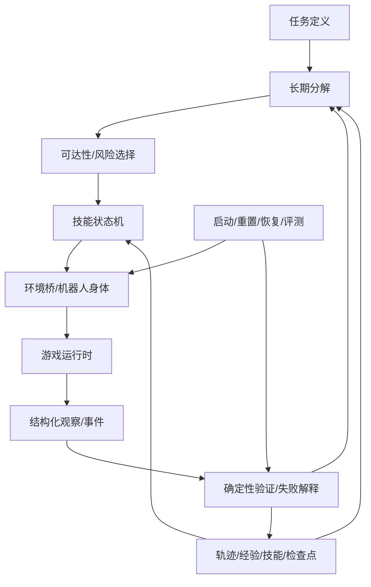
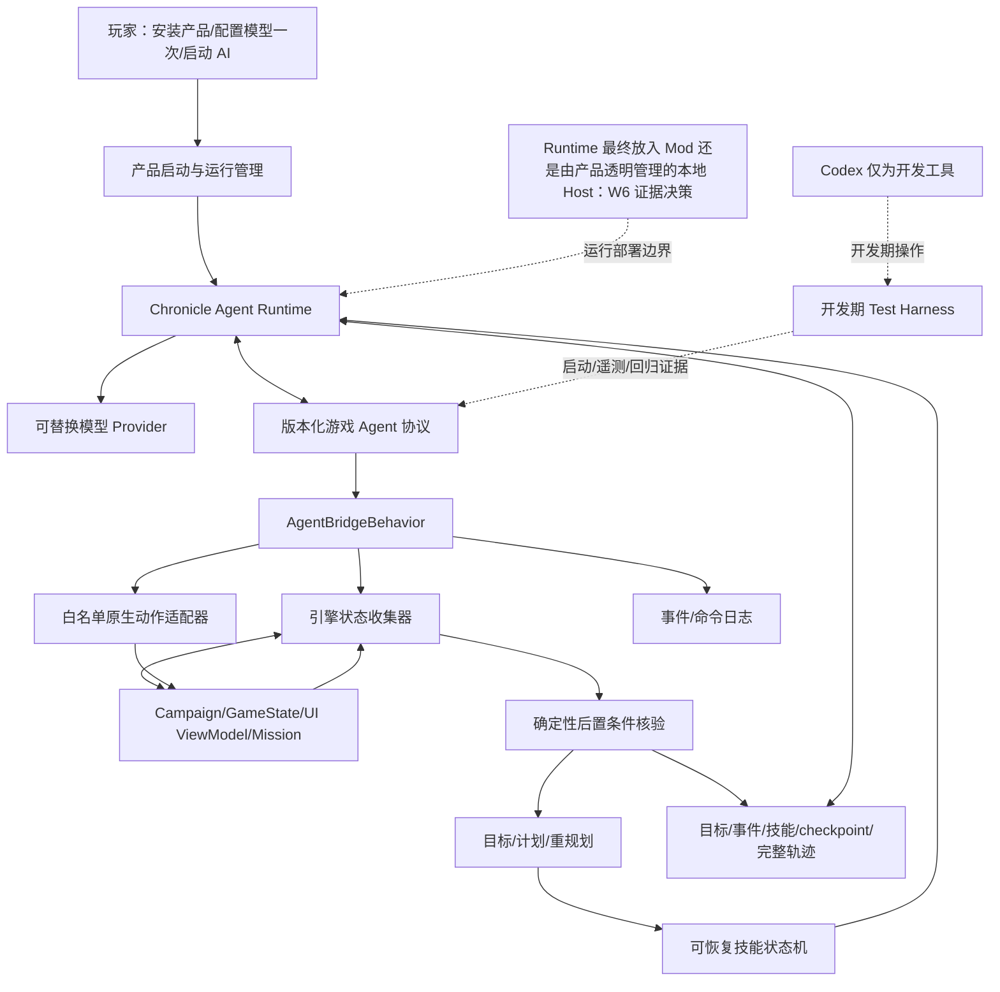
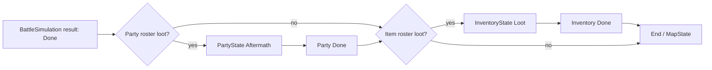

# 当前主线：Autonomous Campaign Agent Mod

绝对目标：AI 不能只是观察者、建议器、辅助工具或需要玩家确认的 Copilot。AI 必须能够独立感知战役状态、制定目标、执行行动、处理失败并持续推进战役。

只有两种正式部署形态：

1. **单机自主客户端**：AI 控制当前 Bannerlord 单机客户端中的玩家角色/玩家战役，拥有完整自主权；不需要第二 Steam 账号。
2. **多人独立客户端**：AI 以独立 Hero/Party/Clan 身份加入共享多人战役，拥有独立客户端身份；这通常需要第二个游戏客户端、第二个 Steam 账号和第二份游戏授权。

同一进程中的同伴/队伍代理可以作为单机架构实验，但只有当它拥有独立目标、独立行动循环和独立战役身份时，才算自主代理，不是辅助功能。

### 术语边界：单机多代理不等于离线联机

- **单机自主玩家**：AI 控制当前单机客户端中的玩家角色；没有第二玩家实体。
- **单机 NPC 代理**：AI 在同一个单机进程中控制独立 Hero、MobileParty、Clan 或其他游戏实体；它拥有自主目标，但仍由同一个战役进程统一模拟，不是网络客户端。
- **多人独立玩家**：AI 作为第二客户端加入共享战役；需要网络同步、独立客户端身份和多人战役服务器/Mod。

“离线联机”不作为工程术语。单机 NPC 代理可以实现玩家与 AI 共同生活在同一战役，但不能据此声称实现了联机。

### 单机多代理的底层限制

单机 NPC 代理在数据层面可行，但存在不能由普通 Agent 逻辑消除的引擎边界：

- 玩家进入单机战斗、聚落或其他 Mission 时，战役时间通常停止；小时/日事件、Party 移动、工资、食物、围城和其他时间系统不会像多人服务器那样继续推进；
- AI NPC 即使在玩家视野外，也不会获得一个独立的并行世界。它通常只是 Campaign 层的 Hero/MobileParty，接受全局抽象模拟；只有进入相应 Mission/Scene 时才有 3D 实体；
- 战略层 AI 可以在 Campaign Tick 上运行；要求真实 3D 场景、实时移动或独立交战的行为，必须等待场景实例化；
- 因此单机 NPC 代理适合验证 AI 作为世界实体的数据模型，不等价于玩家与 AI 同时推进的共同游玩。

真正的并发共玩需要多人服务器拥有全局时钟，并定义玩家进入战斗、暂停、遭遇、战斗结果和断线时的仲裁。现有 Bannerlord 联机项目正是通过服务器权威和时间控制补丁处理这些问题，而不是复用单机暂停语义。

Mineflayer/MineDojo 等 Agent 以独立玩家为动作和观察主体；这不排除 Bannerlord 单机 NPC 代理，它是利用原生 Hero/Party AI 的另一条研究路线，验收不可与多人客户端路线混称。

### Research readiness and current technical focus

Research Gate: **BLOCKED**
Implementation Gate: **BLOCKED**
行为总分母：**UNKNOWN**　游戏版本：**1.4.8.119303**

当前技术焦点是完整盘点玩家与战役世界的观察和行动接口。逐系统核实玩家入口/输入修饰、被动与按需信息、原版后果和Campaign时间、UI handler/API差异、当前适配、证据及未知，然后跨域去重建立真实行为分母。`SYSTEM_INVENTORY.md`的127项是研究入口，不是玩家动作数。盘点验收、域间依赖和工作次序由GitHub Project维护；本文不保存活动卡片、完成数量或当前工作状态。Research Gate通过前不新增游戏能力；Tier 1仅作为未来成熟度夹具。Minecraft Agent研究作为后续架构参考，不构成绕过全景研究的理由。

Minecraft Agent 的环境、规划、技能、记忆和评测研究已沉淀到本文后续架构段落；本文不再把项目目标定义为“测试工具”。

## 玩家交付原则与待定运行边界

玩家必须只感知一个产品：安装 Chronicle Agent、完成一次模型配置、在游戏中启动自主 AI。玩家不安装 Codex/Claude Code，不配置 MCP/CLI/IPC，也不手工启动 Python 或 Node。

内部实现目前不预设为“全部内嵌 Mod”或“必须外置 Agent Host”。两种方案都保留，最终边界由原型证据决定：

| 候选 | 优势 | 主要风险 |
| --- | --- | --- |
| Mod 内编排 | 单包安装、配置直接、状态访问简单 | 游戏线程污染、请求超时、崩溃耦合、重型记忆与多代理扩展困难 |
| Mod + 隐藏 Host | 故障隔离、模型/记忆独立升级、批量测试和多代理更自然 | 安装与生命周期复杂、IPC 和进程管理成本 |
| 混合式 | Mod 保留身体与轻量循环，Host 承担可选重型能力 | 边界设计和兼容测试要求更高 |

冻结部署边界前必须完成同一 Agent 循环的对照原型，至少测量：游戏线程占用、模型超时行为、断网恢复、游戏/模型进程崩溃隔离、存档大小、长期记忆规模、多代理并发、版本升级和安装步骤。玩家体验要求始终是单入口；即使内部存在 Host，也必须由安装器和启动器透明管理。

## 现实参考：AI 效应 + Player2

现有《AI 效应》的安装说明要求玩家先安装 Mod，再单独下载安装 Player2；进入 Mod 设置后选择 `Player2` 作为 AI Backend，使用预设 URL。[AI 效应安装说明](https://www.mountblade.com.cn/news/Bannerlord/2026-01-17/3059.html)

这说明它采用的是：

```text
Bannerlord Mod（游戏内适配器）
        ↓ HTTP/本地或平台接口
Player2（外部 AI Host/平台）
        ↓
模型、账号、额度和 AI 服务
```

Player2 官方定位也是面向游戏和 Mod 的 AI 接口平台，并同时提供模型和玩家入口。[Player2](https://player2.game/)

它不是完整 Agent 架构的必要组成，而是为游戏 Mod 提供统一模型服务的外部后端。这个案例只能证明“可替换后端 + Mod 内提示词/世界逻辑”可行，不能直接证明 Chronicle 的长期自主 Agent 应全部内嵌或全部外置。

Steam 创意工坊或 CurseForge 可以分发 Mod 文件、依赖和配置，但不能可靠地替玩家执行任意外部程序安装。如果最终需要 Host，应由明确的统一安装器或启动器透明管理，不能由 Mod 隐式下载并执行未知程序。

### AI 效应案例带来的架构修正

AI 效应的现有资料显示，Player2 不是它的唯一 Agent Host，而是可选 AI Backend：公开配置同时列出 Player2、OpenRouter、DeepSeek、Ollama、KoboldCpp 等后端；Mod 自己负责生成结构化提示词、读取游戏上下文、保存世界/提示词数据，并通过后端 URL 请求模型。[AI Influence 后端说明](https://www.nexusmods.com/mountandblade2bannerlord/mods/9711) [AI Influence Prompt Control](https://github.com/PiTatva/AI_Influence_Prompt_Control)

当前只冻结两个技术结论：后端必须可替换，游戏动作与结果验证必须留在 Mod 的安全边界内。规划、提示词、长期记忆和技能库运行在 Mod 内还是 Host 内，须通过同一 Agent 循环的可重复对照原型决定，不能由现有代码库存或安装偏好反推。

## Minecraft Agent 全景结论

已核对论文、官方仓库和 Voyager/Mindcraft 关键代码，覆盖与本项目有关的主要架构家族：

| 层 | 代表项目 | 已解决问题 |
| --- | --- | --- |
| 实验环境 | Malmo、MineRL、MineDojo、MineStudio | reset/step、观察/动作、任务、终止、轨迹、批量评测和崩溃恢复 |
| 原生机器人身体 | Mineflayer | 游戏协议、实体、寻路、背包、合成、容器和战斗高层 API |
| 代码技能与课程 | Voyager、Odyssey | 自动课程、成功技能沉淀、检索、Critic、checkpoint |
| 交互式规划 | DEPS、GITM | 描述、解释、重规划、可达性选择和分层动作 |
| 多模态控制 | VPT、STEVE-1、JARVIS-1 | raw pixels 到键鼠、短时控制器和多模态经验记忆 |
| 工程化 LLM Bot | Mindcraft | 命令白名单、中断、超时、循环检测、记忆压缩、技能检索和代码沙箱 |
| 任务评测 | MCU、MineStudio Benchmark | 原子/组合任务、Simple/Hard 条件和批量证据 |

成熟 Agent 不是一个大模型直接“玩游戏”，而是以下闭环：



缺少环境契约、动作原语、执行后验证、中断、checkpoint 或 benchmark，都会把额外成本转嫁给 LLM 推理。

## 代码级认识

Voyager 实际由 Python 协调器、HTTP 环境桥和 Node/Mineflayer 组成。每轮向环境发送程序与已检索技能，环境执行后返回事件和最终观察；Critic 判断成功，失败状态与 critique 回流，只有成功程序进入向量检索技能库。课程进度、失败任务、技能代码和数据库可 checkpoint 恢复。

Mindcraft 将命令路由、ActionManager、SelfPrompter、History、SkillLibrary 和 Coder 分离。ActionManager 会中断旧动作、设置超时、检测快速/无限循环；History 同时保存短上下文、压缩记忆和完整轨迹；技能按相关性选择；生成代码先检查引用和 lint，再进入受限 compartment。

这些工程保护比“让模型多思考”更重要。

## 迁移与拒绝

采用：

- Malmo/MineRL 的环境动作契约；
- Mineflayer 的原生身体分层；
- Voyager 的动作后观察、Critic 反馈和成功技能沉淀；
- DEPS 的失败解释、重规划与可达性选择；
- JARVIS-1 的规划器/控制器分离；
- Mindcraft 的白名单、中断、超时、循环检测、上下文压缩和完整轨迹；
- MCU 的 Standard/Hard 任务评测；
- MineStudio 的批量运行和崩溃恢复。

暂不采用：

- VPT/STEVE-1 的逐帧视觉控制；战役层低频决策不值得承担其成本；
- 在游戏进程执行 LLM 任意生成代码；
- 第一阶段开放式自动课程；
- LLM Critic 作为成功真值；
- 为测试直接写入资源、位置或战斗结果；
- 把全世界状态和全部技能塞入上下文。

## Bannerlord 目标架构



- 游戏内 Mod 是深入 Bannerlord 引擎的身体：从当前 Campaign、GameState、原生菜单/ViewModel、Mission 与事件生命周期收集信息，并把 Agent 意图映射到有前置/后置条件的原生动作；不能用外部脚本伪造游戏结果。
- Agent Runtime 是交付给玩家的自主决策系统，包含模型 Provider、目标规划、技能状态机、记忆、验证和重规划。部署到游戏进程内还是由产品透明管理的本地 Host，仍由 W6 的原型证据决定；无论边界如何，玩家都只安装/启动一个产品并配置模型一次。
- Codex、MCP、开发用 CLI、Computer Use 与 Test Harness 只属于开发工具，不是交付依赖、产品界面或 Agent Runtime。若 Agent Runtime 位于进程外，它必须随产品被透明部署/启动/更新/停止，玩家不能被要求自行准备 Python/Node 等开发运行环境。
- 游戏进程只执行协议允许的结构化读取与白名单动作；不得执行模型任意生成代码。模型调用不能阻塞 Campaign/UI 主线程。

## 状态、记忆与动作

状态分层：

1. 即时状态：界面、时间、玩家队伍、资源、位置、附近实体和当前遭遇；
2. 增量事件：资源变化、移动、战斗、任务、错误和存档；
3. 工作记忆：目标、子目标、当前技能步骤、预算和风险；
4. 情节记忆：状态—动作—结果—失败原因；
5. 语义记忆：已验证技能、版本、前置和失败模式；
6. 完整轨迹：不可压缩命令、状态、日志和 checkpoint。

每个动作必须声明协议版本、稳定实体 ID、参数、前置条件、成功条件、可恢复/不可恢复失败、超时、中断、清理、重试和幂等边界。自然语言摘要不能替代结构化状态与完整轨迹。

## 当前本机接口风险

历史探针确认过 `MBSubModuleBase.OnGameStart`、`CampaignGameStarter.AddBehavior`、`CampaignBehaviorBase.RegisterEvents/SyncData` 和多个 `CampaignEvents`，但这些证据来自先前本体状态。当前客户端为 `v1.4.8.119303`，进入实现前必须针对当前 DLL 重探针。

当前代码中已有只读 `ChronicleCampaignBehavior` 与 `DailyTickEvent` 计数实验；旧模块加载、行为注册和旧存档日志不能作为当前版本证据。

## Observation knowledge and open contract

原版实体分别暴露 `IsVisible` 与 `IsInspected` 两种地图状态；属性本身不足以证明它们如何对应地图图标、悬浮提示、ALT 部队详情或百科信息。任何 Agent 情报策略都应先核对玩家实际入口与运行时可见结果，不从字段命名推导遮蔽规则。静态面板按需读取，不应默认将玩家物品、队伍、家族、王国和日志全部塞入每次决策上下文。

## Action contracts and coverage definitions

#### 覆盖口径与验收证据 / Coverage and Evidence Contract

本表定义长期有效的分母和判定方式，不维护当前完成数。任务完成状态由GitHub Project Issue表示；单次通过/失败、运行号和原始文件由 `TestResults/<run-id>` 表示。

| 范围 | 分母或判定规则 | 证据规则 |
| --- | --- | --- |
| 玩家行为与观察面 | 先审完SYSTEM_INVENTORY A-L全部12个研究域，再跨域去重；真实行为总分母在此之前保持未知 | 每个域Issue满足其验收并链接对应研究/测试依据；Epic子项提供覆盖总览 |
| GameState接口 | 反编译枚举的状态类型只是接口分母，不等于玩家行为或 Agent 覆盖率 | 按当前安装DLL重新盘点；API Probe和运行时结果分别标记 |
| 自主 Agent 闭环 | 必须有非测试模型/规划器选择目标、调用白名单动作、验证结果，并在世界变化或失败后重规划 | 确定性Provider、单动作成功或累计动作数量均不能算自主闭环 |
| 长程成长夹具 | Tier 1用于评测长期规划、资源、风险和恢复，不是产品目标，也不要求通过刷固定奖励达成 | 结果必须来自 disposable campaign、保留状态/动作证据并清理夹具；失败如实保留 |
| 视觉证据 | 仅用于结构化遥测不能判明的真实界面迁移；采集窗口、帧覆盖、索引和源视频清理均需验证 | 关键帧与事件时间线可追溯至同一run；不将截图替代游戏状态真值 |

新增动作族先更新完整行为分母和验收定义；命令数、Issue数量和测试运行次数都不代表 Agent 能力进度。

#### 原版机制契约 / Mechanic Contract

| 动作 | 玩家入口 | 原版自然副作用 | Campaign 时间行为 | UI/API 差异及当前实现 | 证据 / 未知 |
| --- | --- | --- | --- | --- | --- |
| move | 地图点聚落 | `GetInteractionDataForMainParty`+`SetMoveGoToSettlement` | 单击按配置切速；运行模式自然推进 | CLI 复现 setter/点击时钟；Harness 独立步进抵达 | 运行断言检查目标、菜单迁移、自然时钟；版本重测时重新确认 |
| pursue | 普通点击移动队伍（非 Follow Modifier） | `EngageParty`；失明时原版 Hold | 单击按配置切速；自然接敌 | CLI 复现 Engage 与点击时钟，立即回执 | 可见目标已测自然接敌；目标失明后的停留/时间语义仍未知 |
| hold | 点击玩家队伍 | `SetMoveModeHold` 清目标 | 地图单击时间策略 | CLI Hold+点击时钟 | 运行断言目标清除并检查原版点击时钟 |
| rest | `town_wait` 菜单 | `StartWait` 快进；`EndWait` Stop | `rest(days)` 只观察时长 | 保留原生 Wait menu 时钟，离开后 Stop | 运行断言 Wait menu、持续时间及离开效果；`IsMainPartyWaiting` 生命周期语义需单独理解 |
| advance | Harness 专用，不是地图输入 | 按请求推进 Campaign | 固定步长；遭遇可提前结束 | CLI/Harness 显式工具；决策 provider 拒绝调用 | 独立时钟测试；不得塞进普通地图动作 |
| autoresolve (research) | 遭遇“坐镇指挥”→Done | Init→StartSimulation→Skip→OnFinished→PartyState | 追近自然推进；模拟Stop | 原生Pause/Skip/Done；测试夹具注入敌方 | 奖励与双方状态可结构化核验；自然随机战斗结果需另验 |
| dialogueSelect (research) | Party click→Map conversation | `DoMeeting`→native conversation; `CurOptions`→`DoOption(id)` | clock unverified | 仅选择当前原生条件开放的选项 | 选项条件、结果回执；选项变化或失效时须拒绝 |
| incidentSelect | Town leave→modal→choose/Done | VM Confirm→effects/close | Modal pauses/locks time; close restores | Direct API skips cleanup; unsupported | 目前源码链；模态窗口生命周期与时钟仍待运行核实 |
| talkToIssueOwner (research) | 蓝标→聚落场景→交互 notable | Issue→give→precheck→brief或拒绝 | probe Stop→Stop；运行未知 | 现有本地探针跳过3D接近，仅研究性 | 不同Issue种子/前置会产生不同对话；不可泛化成通用接委托能力 |
| dialogueContinue (research) | 地图对话无选项时 Continue/继续 | Gauntlet `ExecuteContinue`→`ConversationManager.ContinueConversation` | 对话/遭遇时间待核实 | 仅 `CurOptions` 为空时调用 | 运行后要确认对话阶段和遭遇迁移；时钟语义未知 |
| retreat (research) | Mission TAB→Quit；模拟结果→Quit确认 | `TryExit`→RetreatMission；Simulation→XP/encounter | Mission暂停；Simulation未知 | Adapter绕过HUD确认 | 分开验证UI确认副作用与API结果结算，不相互替代 |
| partyLoot (research) | Battle Done→Party/Inventory Loot→Map | 原生Loot screens/Done | 战后Stop | 测试夹具注入战利品；直接离开会跳过Loot | 通过Roster/Inventory前后差异核验；自然掉落和视觉交互分别标明 |



### 当前原版界面核对记录

| 界面 | 已核实入口/行为 | 本地验证层级 | 尚未声称 |
| --- | --- | --- | --- |
| 城镇中心 `town` | 抵达后打开；菜单包含招募、交易、主楼、竞技场、酒馆区、等待、离开等动态选项；离开后回到地图 | 原版代码 + 战役状态/命令回执 | 未做人工逐项截图核对所有选项状态 |
| 招募 | 原版入口是 `town` 菜单的 `recruit_volunteers`；该 VM 按 notable 列出可招募兵种、费用、工资与队伍容量 | 招募 VM 实际执行、roster/金币结果验证 | 当前 Harness 直接调用本体 `RecruitmentVM`，未导航并展示可视招募弹窗；不能称为 UI 路径已验证 |
| 城镇交易 | 原版入口是 `town` 菜单的 `trade`；本体用 `InventoryLogic` 处理市场交易 | 食品报价、交易结算、玩家库存/市场/金币状态验证 | 当前测试不打开可视交易屏幕；不能称为视觉交互已验证 |

证据等级统一标为：源码/资源核实、运行时状态核实、自动动作/结果核实、人工视觉核实。高等级不自动替代低等级；尤其“VM 调用成功”不等于“已验证玩家从界面入口走通”。

## Tier 1 long-horizon evaluation fixture

本阶段定位：Tier 1 是衡量新档 Agent 成长/资源/风险闭环的验证场景，不是产品目标或必须“过关”的交付承诺。不得为凑足 50 Renown 临时堆一次性功能；若通用能力不足，记录证据与缺口，按产品主线判断是否值得补齐。

1.4.8新档与成长证据

- 角色创建反编译显示：成年背景选择在新档起始给予 Clan Renown +20；Tier 1 门槛为50，因此示例背景下缺30。StoryMode 的+25奖励要在Tier 1 后才可能取得，不能作为前置成长路径。
- 在确定性、非模型Provider下，测试招募入口通过VM产生过以下原生副作用：招入一名瓦兰迪亚新兵花费20第纳尔、工资2/日、队伍人数+1；此类单动作结果不代表Agent具备自主成长能力。
- 新档的本地Issue种子和条件有变化：有的没有Issue，有的仅有金币报酬，也有到不了Brief的情况；单个fixture不能推成通用可用的任务路线。

声望来源静态研究记录

对 1.4.8 CampaignSystem、SandBox、StoryMode 的反编译源码检索 `GainRenownAction.Apply` 和 `Clan.AddRenown`，可定位大量声望赋值调用点。它们不等于玩家行为全集：同一Issue可有多种奖励分支，一个行为也可能共用奖励helper。必须逐项还原入口、条件、成本、失败与奖励，才能判断玩家是否真的有该路径。

- 战斗：`MapEventSide` 先根据敌我强度与双方强度比计算战斗声望值；`MapEvent` 再按胜方各队贡献份额和敌方战力被消灭的比例分配，`DefaultBattleRewardModel` 还可能叠加 perk/文化修正。它不是每胜一场给定常数。
- 受控战斗夹具证明原版结算会依据双方强度、胜方贡献和敌方消灭比例计算声望；单个受控样本不代表野外自然遭遇的典型收益，不能线性外推成达标战斗场数。
- 锦标赛：`DefaultTournamentModel` 默认胜者给3点，但赛事生成受城镇状态、时间及当地参赛者等条件影响；玩家须进入赛事 Mission。Chronicle 当前没有锦标赛/3D比赛控制能力，因此奖励数值并不等于可用路线。
- Issue：源码中存在多个+1至+10左右的奖励分支，但每种 Issue 的触发对象、前置资源、交付方式和成败结果不同；聚合调用点不足以判断哪一种适合作为通用的 Tier 1 前置循环。

当前判断：地图战斗与已有 battle bridge 的复用度最高，只能列为一个可检验候选；不能把P5偷换为“反复打劫匪直到50”。在确定验证场景前，还需从玩家实际可用路径、出现率、损失/收益及尚未适配的入口完成比较，并继续保持 Tier 1 是Agent成熟度夹具而非产品目标。

## 维护规则

- 本文维护技术目标、机制契约、领域架构、长期验收定义和未解事实；不保存项目工作项状态、域完成计数或测试通过快照。
- GitHub Project 是唯一工作项/依赖/状态入口；本地 `TestResults/latest.json` 只代表最近一次本机Harness运行，不代表任务完成或当前项目状态。
- 主线改变时更新本文并运行 `Set-ContextFocus.ps1 -Review` 刷新hash/复核期；ContextState只作为本文件和按需研究的路由器。
- 缺少前置时按GitHub原生依赖表示阻塞；领域事实和验收约束留在本文/Research，不复制进任务状态字段。

## 主要来源

- Voyager: https://github.com/MineDojo/Voyager
- Mineflayer: https://github.com/PrismarineJS/mineflayer
- Malmo: https://github.com/microsoft/malmo
- MineRL: https://github.com/minerllabs/minerl
- MineDojo: https://github.com/MineDojo/MineDojo
- MineStudio: https://github.com/CraftJarvis/MineStudio
- DEPS: https://github.com/CraftJarvis/MC-Planner
- GITM: https://github.com/OpenGVLab/GITM
- VPT: https://github.com/openai/Video-Pre-Training
- STEVE-1: https://github.com/Shalev-Lifshitz/STEVE-1
- JARVIS-1: https://github.com/CraftJarvis/JARVIS-1
- Mindcraft: https://github.com/mindcraft-bots/mindcraft
- MCU: https://github.com/CraftJarvis/MCU
