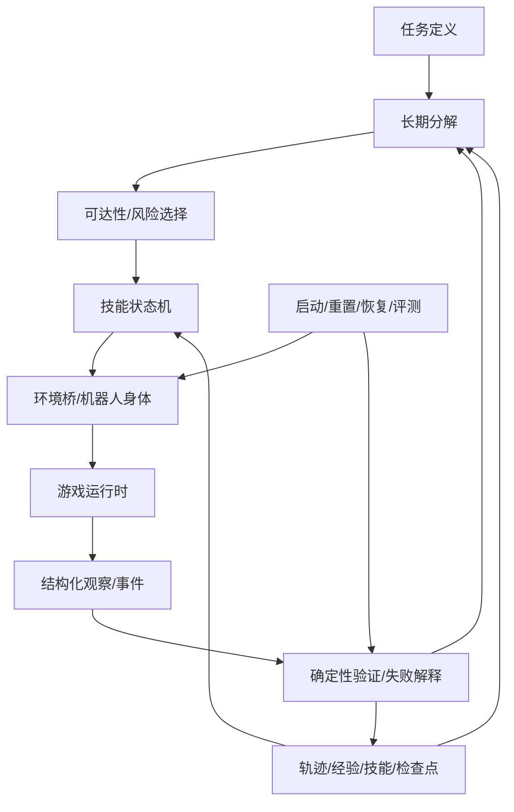
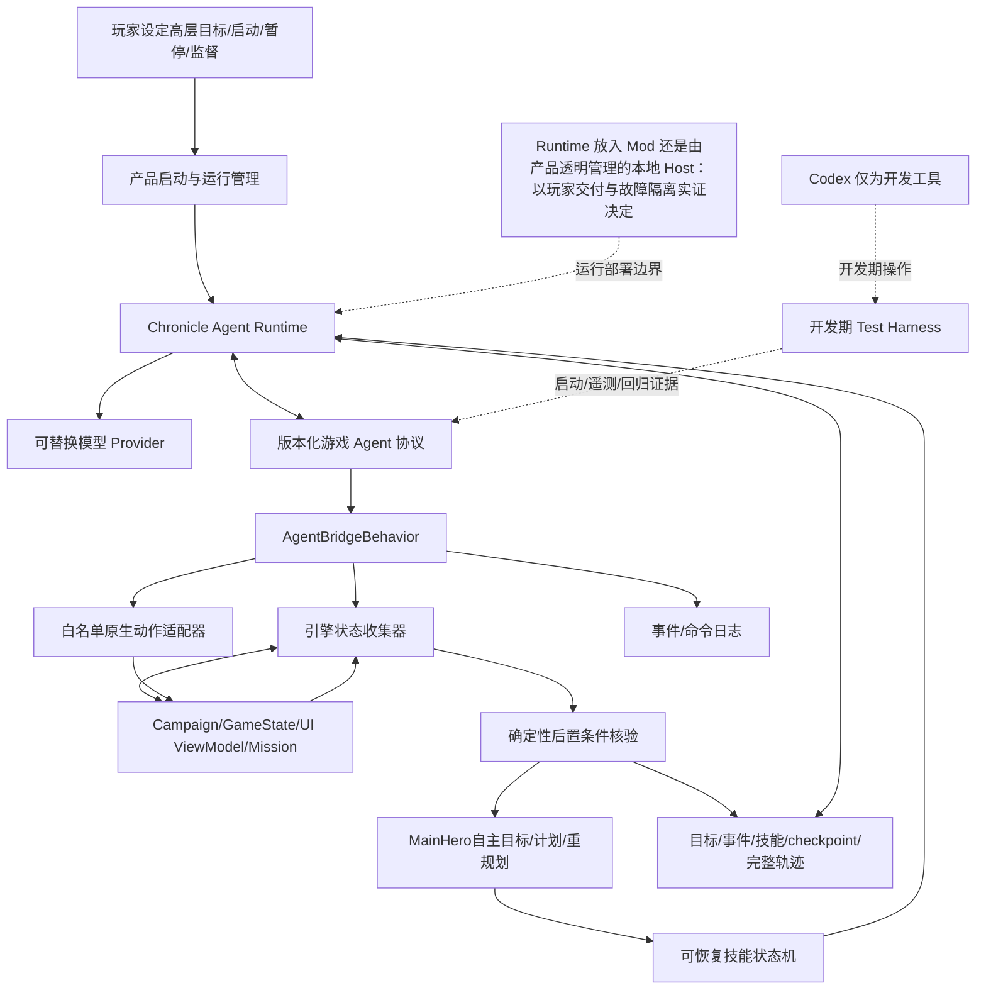
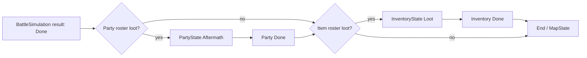

# 当前主线：AI自主游玩 Bannerlord 单机 Campaign

## 当前产品方向（2026-10-19）

Chronicle的核心产品是AI作为单机战役玩家，直接控制原版`Hero.MainHero`与`MobileParty.MainParty`，通过原生菜单、对话、交易、队伍管理、任务、地图移动与战斗结果持续游玩。产品需要同一个Agent支持两种切换方式：自主模式下持续追踪并推进战役目标；指令模式下玩家可临时要求它完成一件原版事务，完成或受阻后回到目标循环。两者共用同一套观察、计划、Native动作和后验核验，不要求玩家替Agent逐步点选，也不把长期自治缩成聊天助手或离散动作演示。

MainHero是首个Agent的原生行动身体和基础设施，不等于首个产品门禁就是最终玩法。当前“建立你的家族”只是一项有边界的第一段长程验收；完成它只能证明该段连续自主闭环，之后仍须逐步扩展到更广泛的战役自治。陪伴者/同伴代理可能提供长期共处的玩家体验，但不是天然更简单的技术起点：同伴留在`MainParty`时没有独立的Campaign Party Think身体，赋予它独立目标与行动还需新增身份、行动权限、原版AI冲突仲裁及玩家影响规则。因此本阶段先打通MainHero自治底座；不把同伴路线删除，保留为后续玩法设计候选，并在主角闭环形成后按玩家体验和引擎成本重新评估。

产品纵向门禁从一个全新、自然创建且无预处理进度的StoryMode战役开始；玩家可走原版角色创建和开局流程。当前首测约定：若新战役自动进入Training Field教程，玩家可在AI接管前使用原版兄长对话的“跳过教程”选项及确认；它不是角色创建菜单选项，必须在首个Campaign MapState前于原版训练场Mission完成。此操作会自然完成Tutorial阶段并触发原版第一阶段/`Establish Your Clan`，不允许用预制存档、注入Quest/资源或预先达成目标替代。AI随后从MainHero第一个稳定Campaign MapState接管，并由真实模型自主完成“建立你的家族”(Establish Your Clan)四项目标：Gold 2000、达到当前藏身处战斗人数门槛、Renown 50、招募至少一名同伴。若AI接管时Tutorial仍未结束，本首测不宣称AI能完成教程；全教程自治是独立后续扩展。每项都以Quest Journal/Native状态和最终原版Quest完成后验核验。这是首个长程闭环，不声称覆盖骑砍所有玩法。

Research Gate: **READY**
Research gate scope: compose the four source-verified StoryMode objective routes after the user-approved Native Tutorial-skip setup; W1/W2's 182 ACT / 73 OBS player-interface baseline alone does not prove this longitudinal loop.
Implementation Gate: **READY**
Implementation gate scope: AgentHost orchestration using already-contracted Native actions; any new player interaction surface or change to a vanilla mechanic remains individually blocked until its exact Native player contract is verified.

## 当前MainHero纵向门禁

Research work: **READY for Host composition; further research remains required for any newly discovered route**. W1/W2's 182 core ACT and 73 OBS remain the human-player interface baseline, not proof of this long-term loop. The first natural Campaign MapState is reached after the user performs the allowed Native Tutorial skip; the Quest still must activate naturally.
Implementation Gate: **READY**
Implementation gate scope: Host composition only—the four goal values, existing Native actions, source time/failure behavior and major unsupported surfaces are mapped. New Bridge/Native actions remain individually gated by their player-visible entry, Native side effects and test contract.

该门禁不阻止对既有Host/Agent循环做真实模型评估或只读Harness诊断；门禁只阻止在目标动作范围未被事实/契约支撑前凭推测新增游戏能力。NPC/同伴独立行动的W8候选不进入本轮Research readiness判断。

### 2026-10-18 NPC Campaign Actor 研究快照（历史候选，不是当前产品路线）

当时的源码研究显示NPC Campaign AI的分层骨架：`AiPartyThinkBehavior`在`TickPartialHourlyAiEvent`收集Native AIBehavior目标评分，选择后经`SetPartyAiAction`落成Party行为；`MobilePartyAi`再负责短期路径、接敌/规避、逃离与地形导航（详见`Research/F/MilitaryPartiesAndCaptivity.md` F02/F03/F04）。v1.4.8公开`AIBehaviorData`目标结构与`PartyThinkParams.AddBehaviorScore/SetBehaviorScore`。只读Harness捕获过真实非MainHero Lord Think样本：110个目标候选、含GoToSettlement、PatrolAroundPoint、BesiegeSettlement、RaidSettlement及目标ID/评分；完整证据见`TestResults/20261019-022445`。这证明该缓存可提供真实Native决策上下文，但不证明候选被最终选中、后续持续性、Agent可控制它或不同存档/状态均一致。该Actor接入提议只属于未来候选研究：Host异步决定高层目标/偏好后，游戏主线程需在有效Think边界重新核验身份、当前候选、权限和期限，不能假定与Vanilla行为评分、Army/Encounter状态兼容；它与MainHero玩家输入API是不同技术接口。

这段研究当时讨论的边界是单机 Campaign 中的人类玩家 + AI 世界角色，而非AI接管玩家；这是已被后续MainHero主线取代的历史候选。其关于Campaign暂停、Actor生命周期、多人共享战役和3D战斗的机制调查仍可复用，但不构成当前产品的首发承诺。

该候选方向曾尝试与《AI效应》/《重铸者》等AI角色模组比较；这不是当前产品定位依据。可复用的行业结论是：不能把“加记忆/对话/行动按钮”本身当作差异，必须验证Agent能否持续追踪目标、组合Native行动、根据后果调整，并产生可观察的战役结果。竞品公开功能不等于运行证据。

本轮外部研究发现两个重要边界：其一，BUTR的Bannerlord.GABS公开声明已提供MCP/GABP工具桥、90+游戏工具、地图威胁检测/逃离、贸易、对话及坐镇战斗等，故“第一个把AI接到骑砍工具”不成立；其仓库/README只证明项目自述和工具覆盖，不能证明多小时目标自主或StoryMode完整成功。[Bannerlord.GABS](https://github.com/BUTR/Bannerlord.GABS)。其二，《AI效应》与《重铸者/AnimusForge》的公开功能已远超纯聊天；具体能力需按它们实际运行/原版状态验证，不能从功能宣传推断或贬低。[AI效应](https://www.nexusmods.com/mountandblade2bannerlord/mods/9711) [重铸者](https://www.mountblade.com.cn/news/Bannerlord/2026-08-14/3294.html)。

“AI-native”可操作化为AI是否构成玩法核心：若移除AI后核心玩法几乎不变，它更像AI增强/聊天层。2026综述分析53个公开游戏/原型，指出目前偏语言叙事，主要设计难点是把语义开放性放进稳定的目标、规则、状态、反馈、节奏和玩家能动性；这是一种学术分类与现状分析，不是商业成功证明。[AI Native Games: A Survey and Roadmap](https://arxiv.org/abs/2607.00527)。OpenGameAgent目前自称alpha/早期接入；另有商业合作方宣布将AI反射层与深思层分开、计划于2027年推出的合作模式。这说明业态在演进，但尚非可据以宣称的爆品案例。[OpenGameAgent](https://opengameagent.com/) [Dimensional Double Shift announcement](https://www.globenewswire.com/news-release/2026/09/14/3361481/0/en/artificial-agency-integrates-agentic-behavior-into-first-commercial-video-game-in-dimensional-double-shift-s-new-single-player-mode.html)。

历史决策（2026-10-18）：先证明一个自主Campaign Actor能产生真实、可重复且玩家可感知的因果链，再决定扩展到多个Actor。该决定已由2026-10-19 MainHero自主游玩主线取代；StoryMode `Establish Your Clan`现在是首个产品北极星门禁，而NPC/同伴Actor仅保留为后续候选。

### NPC/同伴 Agent 术语（后续候选研究，不属于当前主线）

- **人类玩家角色**：当前存档中的 MainHero/MainParty，由玩家控制。
- **Campaign Actor**：首个角色以被绑定的非MainHero `HeroId`为持久身份；当前MobileParty与Clan是需每次从Native关系重新验证的行动身体/政治上下文。Actor具有独立目标，行动通过验证过的原生Campaign AI接口发生。Partyless/Prisoner/Dead/Leader变更等生命周期状态会门控其可用动作。
- **产品运行时**：模型、计划/checkpoint、事件触发、Native Actor 绑定/执行与结果核验的组合。一个MCP工具服务器或大量可调用方法不等于自主Agent产品。
- 单机 Campaign Actor仍与玩家共享一个Campaign时钟；不称为第二个网络玩家或“离线联机”。多人独立客户端是未来独立问题。

**Agent/游戏线程分层约束（候选）：** `AiHourlyTick`内的`PartyThinkParams`是一次同步Think的瞬时对象，不能带到Host线程等待模型后原样写回。Native回调只应收集可序列化候选并继续执行原版Think；Host异步决定后，游戏线程在后续有效Think中重新解析HeroId/LeaderParty/target并复核候选、权限和期限，失效则丢弃而回退Native AI。绝不在该Campaign事件上同步等待LLM，也不暂停原版AI模拟；这一排队/新鲜度设计尚未有运行收据。

### 术语边界：单机多代理不等于离线联机

- **单机自主玩家**：AI 控制当前单机客户端中的玩家角色；没有第二玩家实体。
- **单机 NPC 代理**：AI 在同一个单机进程中控制独立 Hero、MobileParty、Clan 或其他游戏实体；它拥有自主目标，但仍由同一个战役进程统一模拟，不是网络客户端。
- **多人独立玩家**：AI 作为第二客户端加入共享战役；需要网络同步、独立客户端身份和多人战役服务器/Mod。

“离线联机”不作为工程术语。单机 NPC 代理可以实现玩家与 AI 共同生活在同一战役，但不能据此声称实现了联机。

### 单机多代理的底层限制

单机 NPC 代理在数据层面可行，但存在不能由普通 Agent 逻辑消除的引擎边界：

- 玩家进入单机战斗、聚落或其他 Mission 时，战役时间通常停止；小时/日事件、Party 移动、工资、食物、围城和其他时间系统不会像多人服务器那样继续推进；
- AI NPC 即使在玩家视野外，也不会获得一个独立的并行世界。它通常只是 Campaign 层的 Hero/MobileParty，接受全局抽象模拟；只有进入相应 Mission/Scene 时才有 3D 实体；
- 战略层 AI 可以在 Campaign Tick 上运行；要求真实 3D 场景、实时移动或独立交战的行为，必须等待场景实例化；
- 因此单机 NPC 代理适合验证 AI 作为世界实体的数据模型，不等价于玩家与 AI 同时推进的共同游玩。

真正的并发共玩需要多人服务器拥有全局时钟，并定义玩家进入战斗、暂停、遭遇、战斗结果和断线时的仲裁。现有 Bannerlord 联机项目正是通过服务器权威和时间控制补丁处理这些问题，而不是复用单机暂停语义。

Mineflayer/MineDojo 等 Agent 以独立玩家为动作和观察主体；这不排除 Bannerlord 单机 NPC 代理，它是利用原生 Hero/Party AI 的另一条研究路线，验收不可与多人客户端路线混称。

### 历史NPC Actor Research Gate（已暂停实施）

本段Research/Implementation Gate状态属于2026-10-18的NPC Actor研究快照，不控制当前MainHero StoryMode主线。MainHero可见玩家行为的W1-A–L基线已完成；StoryMode完整目标所需的前置/行动组合仍由当前W7产品Issue核对。任何新增Native动作仍须先在MAINLINE机制契约中记录玩家入口、原生副作用、时间行为、UI与直接API差异、证据/未知。
行为总分母：**182**（仅人类玩家核心ACT；OBS分母：**73**，23个N/A不计入）　游戏版本：**1.4.8.119303**

当前目录含183条ACT（其中1条特权入口）；标准行动族分母为182，观察面分母为73。该分母记录人类玩家原版入口，不能单独证明Agent已覆盖全部动作或通过StoryMode长程门禁。

上述182 ACT/73 OBS表示本机1.4.8.119303 Native/SandBox/SandBoxCore/StoryMode中玩家可见入口的基线，不是Agent能力覆盖或全StoryMode通关证明。`SYSTEM_INVENTORY.md`的126项仍是系统研究入口，不是动作数量。当前人类玩家目录含183条ACT、73条OBS和23条N/A，其中`ACT-A06-06`仅为打开Cheat菜单的特权入口，另有控制台/作弊命令；它们留在条件特权扩展，不计入标准Campaign行动分母或普通Agent白名单。W1/W2为当前MainHero接口研究、Native读写桥和测试提供基础。

Campaign Actor的下一道研究门禁须先定义身份绑定（Hero/Party/Clan与原版AI ownership）、受限观察/情报来源、可控制的原生决策面、与原版Party/Campaign AI的冲突仲裁、事件触发与节奏、单机Mission暂停语义、存档/checkpoint身份、玩家影响入口及可验证的持续目标。Actor的“分母”应是可组合的决策/行动族和必要观察，不按每个Campaign Tick或所有NPC机械扩容；需经源码和一个真实运行切片后才能冻结。新能力不得在该契约完成前加入产品白名单。

《AI效应》和《重铸者》等模组的公开功能范围已包括记忆、主动互动、动态事件、外交/关系变化、同伴任务、AI委托或Native资产变化；因此只增加记忆、对话选项或关系后果不是差异化依据。当前可核实的产品假设是“AI在无人逐步命令时持续追踪目标、通过Native action执行多步计划、失败/世界变化后重规划”。公开宣传未能证明或否定这些模组是否已有同等闭环，需在W7运行对照中诚实核验，不做无证据的竞品优劣结论。

旧StoryMode `Establish Your Clan`四项目标与MainHero代理测试保留为历史长程压力测试和Native能力样本；它们不再是新AI Actor产品的唯一或必要成功门禁。单独完成该Quest也不能证明Actor自主模拟。新的产品门禁由GitHub Project W7-P建立：一个单机Campaign Actor独立目标、至少两步相依Native行动、一次环境变化/失败后的重规划、玩家可感知的真实状态后果，以及Human MainHero未被Agent接管。AI Actor在玩家Mission内的并行推进不作承诺。全世界AI化、多人共享战役和实时3D战斗控制均是待评估范围，不作为当前Actor原型的隐含验收。

Implementation Gate **not ready**不表示W1人类玩家适配失效；它表示尚无Actor身份、可见性、行动所有权和后验契约，故不应把MainHero/ MainParty硬编码循环直接称为NPC Agent。既有能力仅按实测范围复用；新Actor能力须在唯一GitHub In Progress Issue下实现，并用真实Native事件、存档隔离及模型运行验证。没有证据的NPC意图、状态变化和异步时间行为都保持未知。

Minecraft Agent 的环境、规划、技能、记忆和评测研究已沉淀到本文后续架构段落；本文不再把项目目标定义为“测试工具”。

## 玩家交付原则与待定运行边界

玩家必须只感知一个产品：安装 Chronicle Agent、完成一次模型配置、在游戏中启动自主 AI。玩家不安装 Codex/Claude Code，不配置 MCP/CLI/IPC，也不手工启动 Python 或 Node。

内部实现目前不预设为“全部内嵌 Mod”或“必须外置 Agent Host”。两种方案都保留，最终边界由原型证据决定：

| 候选 | 优势 | 主要风险 |
| --- | --- | --- |
| Mod 内编排 | 单包安装、配置直接、状态访问简单 | 游戏线程污染、请求超时、崩溃耦合、重型记忆与多代理扩展困难 |
| Mod + 隐藏 Host | 故障隔离、模型/记忆独立升级、批量测试和多代理更自然 | 安装与生命周期复杂、IPC 和进程管理成本 |
| 混合式 | Mod 保留身体与轻量循环，Host 承担可选重型能力 | 边界设计和兼容测试要求更高 |

### MainHero AI Player 技术基线：已证实的运行边界

下表总结现有MainHero/MainParty Native Bridge、Host、Provider与运行验证，**它们是当前主线可复用的基础，不等于AI已经能自主完成整个StoryMode**。真实模型曾完成萨哥特市场购买与三日原版等待切片，也完成过若干任务/遭遇/恢复样本；这些证明主角原生操作链中的部分能力已能运行。仍须以完整StoryMode四目标自然达成作为当前验收；对非MainHero Hero/Party/Clan的控制则仍是未启用的未来候选。

| 边界 | 已核实的当前形态 | 证据与边界 |
| --- | --- | --- |
| 游戏内身体与动作执行 | `SubModule.OnGameStart` 注册 `ChronicleCampaignBehavior`；`OnApplicationTick` 找到当前 Campaign Behavior 并轮询协议。`AgentProtocol.cs` 的玩家动作直接读取/操作 Native `Hero.MainHero`、`MobileParty.MainParty`；响应里的进程号取自游戏进程。 | 源码：`SubModule.cs`、`AgentProtocol.cs`、`AgentObserver.cs`。这是游戏内 Mod 适配层，不是外部脚本模拟一个第二玩家。 |
| 游戏与外部进程的连接 | Mod 从用户文档目录下的 Chronicle AgentRuns 文件夹领取 `command.json`，将响应写入 `responses` 并追加事件记录。命令轮询发生在游戏的 Application Tick；Mod 保留 Native 调用及上下文校验。每个新建的Campaign Behavior生成不入存档的`nativeSessionId`；产品Host对每条命令携带`expectedNativeSessionId`，引擎在动作handler前拒绝错会话，Host逐条核对回执中的游戏PID和会话ID。 | 源码：`AgentProtocol.cs`。这是本机文件邮箱协议；`TestResults/20261012-135946`实测过期会话请求被拒且Gold/当前位置不变；包回归验证匹配命令ID但不同PID/Session的回执仍被拒。它尚不是公开稳定的多人网络协议。 |
| 真实模型循环 | 现有两条已实测路径：早期W5路径由 `Agent-DecisionLoop.ps1` 执行模型循环；W7 Host路径由.NET 8 `ChronicleAgentHost` 在游戏进程外执行同一观察—模型决策—Native动作—后果验证循环。独立Host启动的Provider从MCM v5 `AttributeGlobalSettings` 的全局JSON配置读取loopback URL与模型名，配置目录/文件按 `Documents\Mount and Blade II Bannerlord\Configs\ModSettings\Global\ChronicleFramework\ChronicleAgentSettings.json` 约定；C# `NativeMailboxClient`读写同一Documents文件邮箱，不调用PowerShell决策循环。游戏内Start使用当前MCM地址/模型的stdin配置快照并由Host再校验，独立Host启动仍读取全局配置；仅Harness视觉测试模式允许从其临时证据目录覆盖。 | W7-D三次原始重复收据：`TestResults/20261011-134812/AgentHostSupplyEvaluation.log`。W7-E配置读取后的一次闭环：`TestResults/20261011-144028/AgentHostSupplyEvaluation.log`，commit `174e769`；Host明确回报 `harness-mcm-profile-fixture` 与 `qwen3.5:4b-q4_K_M`，9次模型决策/7个Native动作，184.41秒，完成同一3日补给契约，视频覆盖100%、测试档未变、进程清理通过。该收据证明Host能读取Harness生成的MCM格式临时JSON，不证明MCM实际页面已打开、保存/重启回读或默认真实全局文件路径已在游戏内验收。W7-H范围门新实测：`TestResults/20261013-004218`支持目标从分类、查询、移动到Native抵达，`TestResults/20261013-004434`一级家族目标零动作拒绝；仅证明这两个目标样本。较早PowerShell路径证据保留为不同阶段历史。 |
| 当前身份与效果 | Host循环操作当前 `Hero.MainHero`/`MobileParty.MainParty`：模型经萨哥特原版TradeVM买入并提交一单位橄榄，再选择Town Wait和Native `rest(Days=3)`。rest返回accepted后，Host每500毫秒只读Native状态；当dailyTick达到起点+3且当前 `wait_leave` 选项仍可用时，Host通过原版`menuSelect`提交一次该选项，将新Town/Stop状态交给模型。没有调用`advance/pause/resume/fastForward`。 | 正式三轮终态均为tick 2→5、CampaignDay自然增加约3.006–3.007日、Gold 861、Food 1.35；模型随后在Native完成契约成立时返回done。Food 1.35是本轮观察到的值，不外推为所有起档固定值；验收使用W5冻结的Food≥1.0、Gold≥861门槛。每轮收据含只读轮询的tick样本与Host `wait_leave`回执。 |
| 保存与恢复 | Campaign Behavior 的 `SyncData` 保存 Campaign 实例身份和受限 checkpoint；Harness 的 DecisionLoop 有显式写入/恢复路径，恢复时先取新 Native 状态。 | 源码存在不等于玩家体验已打通：当前证据证明的是可调用的 Harness 恢复能力，不证明游戏崩溃后会自动重启 Host、自动重连或无人工恢复。 |
| 游戏内场景与时间边界 | 同一个 Mod 协议含 Map 与 Mission 相关动作；玩家当前单机Campaign的原版时间/场景生命周期仍由Bannerlord控制。W7-D Host切片覆盖Campaign Map/Town Wait；Native rest期间由原版UnstoppableFastForward自然推进，Host仅只读观察并在目标tick选择当前原生wait_leave。 | W7-D不覆盖模型在战斗、Town/Village 3D Mission中持续运行Campaign，也不证明Mission内外同时推进Campaign。保持这些分支为待验证，不从动作代码存在推断闭环。 |
| 玩家安装与启动 | MCM全局设置提供本地模型地址/名称、配置检查、战役目标及Start/Stop/Status按钮。Mod按模块相对路径启动Host，经stdin传目标、当前MCM模型配置快照、固定动作白名单和游戏PID/启动时刻；Host校验父进程身份、核对Native返回PID并持续监护父进程退出。Mod/Host共用轻量Ready协议，核对版本、运行编号和Native PID后才显示Running；输出异步读取，游戏线程仅在任务完成后取结果。Stop发送显式协议请求，有界超时仅终止本Mod创建且身份匹配的Host；模型格式规则仍复用共享校验器。 | `TestResults/20261012-141629`完整阶段通过：Smoke注册七个设置属性、四个Button；自包含包41项无模型/无Native命令回归及不存在父进程的启动拒绝通过；生命周期在一次性Campaign中调用注册的MCM Action委托，游戏PID36556/Host12548握手版本与protocol 1，Starting→Running→Stopping→Stopped、Host退出码0，随后Native状态仍可查询，位置/源存档hash不变且会话/进程清理通过；过期Native会话请求明确被拒；独立临时设置的空目标、超长目标、外部地址、空模型和缺失Host五例均在建进程前被拒；再次调用已注册Start委托仍仅一个Host。后续独立证据：`20261012-182631`验证五种启动拒绝/重复Start/正常Stop，`185348`与`185544`验证缺失模型和服务不可达，`192012`验证父进程退出监护，`192640`验证Stop超时清理，`193445`验证非Map拒绝，`211525`验证同PID同进程Native Campaign退出/重载并拒绝旧Session写入。`20261013-004218`验证游戏内真实4B支持目标完成，`004434`验证一级家族目标被拒且零Native动作。真实游戏内MCM按钮视觉点击、用户设置保存重载及发行安装/升级仍留Epic #18验收。 |
| 本地首装发行包 | 标准 `ChronicleFramework/` 模块目录内含版本化`SubModule.xml`、游戏DLL、`AgentHost/`自包含win-x64 Host、manifest及私测许可说明；XML必需依赖明确列出Harmony、ButterLib、UIExtenderEx、MCM、Native、SandBoxCore、SandBox和本机已验证最低版本。 | `New-ChronicleReleasePackage.ps1`从独立stage构建；manifest记录每个文件长度/SHA256、模块/程序集版本、游戏基线和依赖最低版本；zip固定Entry排序/时间。`TestResults/20261013-013038`重复构建SHA相同，归档清单逐项验hash；安装到隔离D盘游戏根（官方目录以junction复用、Chronicle目录单独复制）后Main Menu Smoke、程序集生命周期和七个MCM属性/四个按钮注册通过，已安装Mod整目录hash、用户MCM配置、正式存档hash不变，测试包/隔离根/进程清理通过。此验证覆盖隔离模块副本，不代表第三方管理器真实鼠标安装；公发渠道与玩家最终安装体验留Epic验收。 |

FreeLLMAPI 模型服务边界（2026-10-13实现约束）：当前真实模型测试改走本机`http://127.0.0.1:31415/v1` OpenAI兼容接口，默认路由`auto`，请求经FreeLLMAPI当前启用的免费上游服务商；MCM保留历史JSON字段`OllamaBaseUrl`以避免设置迁移，但新默认指向网关，实时Start在非Harness运行下拒绝其它端点、本地推理和缺少统一API key的情况。key只从启动游戏前继承的`FREELLMAPI_API_KEY`或`CHRONICLE_LLM_API_KEY`进程环境读取，不写MCM配置、命令行或日志；Host通过只读`/v1/models?available=true`校验路由，再记录每次回复的`X-Routed-Via`、响应模型和token数及格式模式；HTTP失败仅将`X-Routed-Via`、`X-Fallback-Attempts`、`X-Fallback-Trail`和安全错误码保存在诊断轨迹，不保留响应正文。FreeLLMAPI在HTTP 400/422或带`provider_bad_request`回退链的502时，Host仅对该次决策退回JSON对象模式一次；若轨迹表明回退到OVH Mistral Small，则同时切换为其已验证的`max_tokens`并按OVH请求节奏等待。仍在Native操作前验证结构与当前动作/参数目录，其它HTTP失败不重试。当前Mistral Small 3.2→OVH路由直接使用JSON对象模式、`max_tokens`，不发送已测会触发该上游拒绝的额外字段。FreeLLMAPI服务商目录为OVH匿名Mistral注明每模型每分钟2请求，但本轮真实游戏闭环在31秒请求间隔下仍观察到网关`rpm/rpd-limit`拒绝；因此Host对直连Mistral以及最近成功路由为`ovh/`的请求保守地按开始时间间隔45秒，后续若仍被限流再按响应头/路由证据细化。其它FreeLLMAPI路由不延迟。无游戏的真实Provider冒烟测试用唯一合成Native动作和参数检验模型是否服从当前动作目录，且断言没有发送游戏命令；实时回归另记录真实路由。Quest提示须使用协议目录中的精确动作ID（当前联系人动作是`talkToSettlementHero`），不能把界面术语当调用名。FreeLLMAPI官方CLI用于客户端配置/Provider key管理，逐轮推理直接调用官方OpenAI兼容HTTP API，不通过CLI子进程。过去Qwen/Ollama收据仍是历史原型证据，不代表当前W7-K模型路径；实时游戏闭环必须经FreeLLMAPI实际外部路由验收。

Harness FreeLLMAPI服务启动（2026-10-15）：真实模型预检先用本机`/api/ping`探测桌面网关；没有监听时若默认安装路径含FreeLLMAPI.exe，就用隐藏窗口启动一次并最多等待30秒，仍不就绪则在游戏启动/推理前明确失败。启动FreeLLMAPI子进程时，Harness仅把用户级代理变量临时投影到该子进程；若没有任何显式代理变量且本机`127.0.0.1:7890`通过TCP监听检查，则仅为该FreeLLMAPI子进程临时提供`HTTPS_PROXY=http://127.0.0.1:7890`，之后恢复Harness父进程的环境变量。已运行的FreeLLMAPI不会被悄悄重启或改写其运行时代理。该Harness动作不通过computer-use操作UI、不读UI中的密钥，也不把API key写入任何额外文件；服务保持运行供后续测试复用。此变更针对2026-10-15真实模型请求中FreeLLMAPI上游TLS/socket失败、而显式7890代理探测可达所暴露的启动环境缺口；是否解决需由下一次真实路由回包验证，不宣称配置即代表已修复。

FreeLLMAPI模型请求恢复边界（2026-10-15更新）：若网关以HTTP 502及回退链`keyN=error`/`keyN=upstream_error`标识临时上游故障，Host仅在当前决定尚未转成Native动作前，对同一模型决定最多重试两次，分别延迟5秒、15秒；第三次失败则安全终止本轮，不重放已执行游戏操作。对HTTP 429，只有FreeLLMAPI明确提供有效`Retry-After`且单次等待不超过360秒时，Host才等待并最多重试两次；无提示、非正值或超过上限则安全失败。真实`TestResults/20261015-105000`的315秒冷却原先被120秒上界挡掉；当前FreeLLMAPI/OpenAI-compatible Provider与VillageTools测试Deadline均为360秒，NativeMailbox等待保持独立180/240秒，不因模型冷却延长。若累计等待超过当前Provider总Deadline，仍安全终止且不会发超时后的Native动作。确定性Host Package测试验证315秒可解析、361秒/无提示/非FreeLLMAPI端点被拒及两个429 Retry-After重试有界；`TestResults/20261015-180954`等包回归验证短等待和同一Deadline。新的实机315秒等待路径仍须验证；免费上游网络仍可能不可用。JSON Schema的`provider_bad_request`回退是不同的单次JSON对象兼容规则。

FreeLLMAPI `format_ignored`兼容回退（2026-10-14）：最近一次真实Campaign run `TestResults/20261014-171433`在20次决策/11条Native动作后已接取“卡利奥克需要工具”，`questDetails`能读到活动委托；退出村庄并读取附近目标后，下一模型请求收到HTTP 502，轨迹为`custom/nvidia/llama-3.2-11b-vision key1=format_ignored`。官方`fallback-loop.ts`将模型返回忽略`response_format`或截断JSON分类为`format_ignored`，并非普通传输失败。Host现允许仅针对FreeLLMAPI HTTP 502且轨迹明确含`keyN=format_ignored`的当前决策，一次性改用`json_object`重试；不放宽本地JSON解析、动作ID/参数目录、当前Native状态检查，也不重新执行之前的Native命令。Provider自测覆盖精确轨迹只发第二次JSON对象请求，并将合法`tradeConfirm`动作和省略的审计理由交给原有严格归一化；不执行Native动作。真实模型复验待FreeLLMAPI用户密钥与模型配置恢复。此次运行证明任务已被接受但未完成工具购买/交付，不能标作Quest通关。用户确认头人3D对话中的金色“点击继续”由点击/按键推进对话直到出现可选回答；该输入事实已进入`dialogueContinue`机制契约，时钟语义仍未知。

W7-K Quest交谈策略修正（2026-10-14）：真实模型回归显示，Quest接取后对话会在玩家离开前继续出现多个交谈节点；若任务仍欠工具，Host现在只允许当前Native对话中的离开选项，聚落菜单不再开放重复`talkToSettlementHero`，引导Agent转向Town市场；只有Journal显示数量满足且已采集交付前Inventory基线后，才重新开放Quest给予者对话。此为Chronicle动作目录策略，不改原版对话/任务机制；动作目录/拒绝非法选项由策略自测覆盖，真实模型运行仍待复验。

W7-K真实模型运行与接口故障（`TestResults/20261014-033349`）：模型实际接取“卡利奥克需要工具”，从玩家可见城镇市场购入1单位工具（扣款866第纳尔，持有金从912降至46），Journal随后确认任务要求1/1。任务尚未交付，Host在读取Native `heroEquipmentOptions` 响应后因`mainHeroId`重复字段触发`ArgumentException`并终止；5fps原生窗口录像完整覆盖1400秒，失败片段及末帧保留用于诊断。已从`AgentInventoryStateAdapter.BuildHeroEquipmentOptionsJson`删除重复写入；`AgentHostPackage`和`Docs`阶段通过（`20261014-040706`、`20261014-040742`）。这是已修复的接口根因，不是任务成功证据；尚需下一轮真实模型从持有工具继续返回村庄、完成交付，并核实奖励与最终库存变化。

W7-K后续模型路由实测（`TestResults/20261014-041201`、`042359`、`042545`）：直连Mistral完整运行在7次Host决策/6条Native动作前遇HTTP 429；`auto:noema-free`无游戏Provider冒烟通过，实际回退路由为`custom/nvidia/llama-3.2-11b-vision`，703输入/39输出tokens，精确返回单一可见`talkToSettlementHero`动作且NativeCommands=0。该自动路由完整运行仅完成7次Host决策/4条Native动作，随后FreeLLMAPI回退后仍HTTP 502并终止；源档未变、游戏进程清理成功。两轮都未证明任务完成。根据该网关对临时上游断连的真实响应，Host已将有明确`keyN=error/upstream_error`标记的502恢复从一次扩为最多两次（5秒、15秒），429仍不重试；自托管包/provider合同测试及Docs随后通过（`20261014-043559`、`043751`），完整真实模型闭环仍须在这套恢复逻辑下复验。

W7-K当前对话模型纠错实测（`TestResults/20261014-043939`）：`auto:noema-free`经Native `talkToSettlementHero`进入真实对话后，NVIDIA Llama 11B返回未列入目录的动作名`leave_settlement`；当时唯一允许动作是`dialogueSelect`。Host两次在Native前拒绝该无效响应后，模型又返回过期的`talkToSettlementHero`，回归上限触发；没有把无效响应发送给游戏，也未造成世界动作，源档未变且进程清理成功。已为“当前确处于Native对话”的拒绝增加精确`dialogueSelect`/可点击OptionId反馈，并把此类无副作用恢复上限从2次提高到3次；确定性Host测试让模型先连续3次返回无效动作，再返回正确的当前选项，验证仅执行`talkToSettlementHero → dialogueSelect → questDetails`，测试通过（`20261014-044619`，Docs `20261014-044711`）。该修复尚未经过真实模型复验。

W7-K FreeLLMAPI限流响应核验：真实自动路由在6次Host决策、2条Native动作后，经三次Native前拒绝终于生成合法`dialogueSelect`，下一模型调用遇HTTP 429（`TestResults/20261014-044829`）；真实Provider冒烟后续在OVH Qwen3Guard及Poolside候选连续上游错误后返回HTTP 502（`TestResults/20261014-050415`）。FreeLLMAPI目录用`execution_status=ready|needsKey|exhausted`描述模型当前执行可用性；`available=true`只表示已配置，不等于有可用上游。[FreeLLMAPI REST API](https://github.com/tashfeenahmed/freellmapi/blob/main/docs/en/api/01-rest-api.md)

Host对带`keyN=error/upstream_error`的502按5秒/15秒最多重试两次；HTTP 429仅在明确`Retry-After`为正且不超过360秒时等待，最多两次，等待总量受360秒Provider Deadline限制；缺失/超界Retry-After或总期限耗尽都fail-closed，不发送Native动作。315秒边界与两次等待由`TestResults/20261015-205325`的97个Provider合同场景覆盖；真实585秒上游提示在`TestResults/20261016-004408`中按界限拒绝，模型尚未返回决策，0 Native动作。`/v1/models?execution_status=ready`只反映该请求时刻模型级状态，不保证`auto:noema-free`内部每个候选上游都可用，因此实际响应路由仍是最终证据。

W7-K代理故障当时诊断（2026-10-14）：`AgentHostProvider`运行`TestResults/20261014-050655`的Build与Preflight通过，真实请求经FreeLLMAPI自动链候选`custom/cohere/north-mini-code`后收到HTTP 502 `key1=error`。随后以只读请求验证用户指定的`127.0.0.1:7890`：`curl --proxy http://127.0.0.1:7890`访问`blockrun.ai`和`api.github.com`均在TLS握手失败；普通HTTP `example.com`通过同端口返回502；该监听端口属于`XingchenCore`。当时这使远程推理与GitHub同步都失败；此为当时代理状态的证据，不代表后续连接状态。

W7-K代理恢复后的重新验证（2026-10-14）：用户表示已恢复7890后，GitHub API经代理返回HTTP 200，FreeLLMAPI真实模型探针通过，实际由`custom/nvidia/llama-3.2-11b-vision`返回唯一允许的`talkToSettlementHero`（`TestResults/20261014-115127`）；本地commit `23e3327`已由`git ls-remote`确认存在于远端。BlockRun探针虽返回HTTP 200，但curl仍报告TLS close-notify，FreeLLMAPI上游连接在不同请求间仍有间歇重置。

最新只读Provider探针（`TestResults/20261014-121616`、`122233`）对目录中明确存在的`nvidianemotron-3-nano-omni-30b-a3b-reasoning`先通过Preflight和Build，再在FreeLLMAPI调用层因`ECONNRESET blockrun.ai via proxy`返回HTTP 502并耗尽该直连候选。两次之间curl曾短暂返回BlockRun HTTP 200，但FreeLLMAPI健康检查和随后模型请求又记录Google、OVH与BlockRun多条代理传输重置，证明出口处于间歇状态而非稳定恢复。此后应先以无游戏Provider探针确认调用持续稳定，避免重新启动完整Campaign Fixture。

W7-K直接免费模型对话推进（`TestResults/20261014-134529`，源commit `3bfbf27`）：NVIDIA Llama 11B的模型门禁通过，完整Native界面切片也实际启动；真实模型5轮决策，提交3个Native动作（`talkToSettlementHero`、`dialogueSelect`选择`lord_meet_player_response1`、`dialogueContinue`）。它曾提出当前目录不允许的`leaveSettlement`，Host明确指出当前唯一动作和三个精确对话选项ID后，模型随后按新目录恢复并完成可用的交谈步骤；截图直接显示下一层有“我听说你有个问题需要帮助”等选项，说明模型已到达委托入口前一层。下一模型请求收到HTTP429后停止；该运行约53秒结束，未记录85秒`Retry-After`等待，故不能声称本轮触发了新的429等待重试。任务尚未接取，QuestId仍空；没有把对话开始误报为Quest完成。决策使用10281输入/667输出token，CampaignDay未前进，源fixture未变，游戏进程已停止；视频覆盖277/277帧并保留。此运行证明玩家对话入口和先前动作名纠错在真实模型下可用，但限流阻断了继续选择委托选项；下一次应从相同自然可见任务起点继续完整验收，不把这次三动作当作完成。

W7-K 429诊断收据（`TestResults/20261014-140403`）：因134529最后一轮的`Retry-After=85`与约53秒总录制时长不一致，Host错误现在会附带实际`rateLimitRetryAttempts`和`rateLimitRetryWaitMilliseconds`，不记录响应正文或凭据。自托管包回归模拟“先429/等待1秒/重试后仍429”，确认收据记录一次重试与实际等待；包内89个Provider合同场景通过。该诊断改动尚未在真实模型429下复验，后续错误收据将区分未进入等待与等待后仍失败。

W7-K 85秒限流分支矛盾（`TestResults/20261014-140816`）：最新直连NVIDIA Llama的无游戏Provider门禁仍收到`HTTP 429 retryAfter=85`，新收据明确`rateLimitRetryAttempts=0; rateLimitRetryWaitMilliseconds=0`，因此在本次Provider路径里确实没有等待，完整游戏也未启动。当前源码已把允许上界设为120秒且模拟Retry-After回归通过，但真实请求与模拟行为不一致；随后增加`rateLimitRetryEligible`及解析秒数诊断（包回归`TestResults/20261014-141314`通过），下一次无游戏Provider调用要先确认该85秒提示是否被边界判为eligible，再决定是endpoint识别、真实响应头解析还是运行版本路径问题，不先再跑Campaign。

W7-K 429实际根因修复（`TestResults/20261014-142114`、`142916`）：新诊断显示最后429被判为eligible且提示85秒，但重试计数/等待仍为0；源码检查发现旧逻辑只在第一条响应检查429，502临时重试后的后续响应会直接返回而不重新分类。现在每次模型响应都会重分类，分别限制最多一次有界429重试与两次临时502重试；确定性Provider回归以“502临时失败→429/Retry-After 1秒→仍429”复现该路径，确认三次调用、等待一次并在最终错误中记录429资格/尝试。完整自包含包验证通过，92个Provider合同场景通过。修复尚未由真实上游复验；最新同一路由真实Provider门禁`TestResults/20261014-141816`成功但未触发429组合，`142114`在无游戏门禁失败且没有启动Campaign。下一次真实路由若再次遇到上游错误，可直接由新字段核对是否进入等待；不能把模拟合同测试替代真实Quest交付。

W7-K直接免费模型完整场景（`TestResults/20261014-120307`）：固定`nvidianemotron-3-nano-omni-30b-a3b-reasoning`的Provider探针通过，实际路由`custom/nvidia/nemotron-3-nano-omni-30b-a3b-reasoning`。完整测试在5次Host决策、1条Native动作后失败：模型进入头人对话后连续三次返回`leave_settlement`作为动作名，Host均在Native前拒绝；没有接受任务，源存档不变且进程清理成功。已进一步改正协议说明：显式标注对话选项ID只能放入`dialogueSelect.arguments.OptionId`，拒绝反馈直接列出当前可点击的确切ID；Host合同测试验证错误响应不产生Native动作并能在之后选对，`AgentHostPackage`及`Docs`通过（`20261014-121044`、`121225`）。这仍是确定性合同证据，下一次真实模型运行才可验证反馈是否纠正。

单机当前玩家客户端以及“游戏内Native Mod身体 + 游戏外本地Agent Host模型循环”已有3/3可重复的技术原型；设置注册、Native-PID/会话绑定及游戏内正常启停另有上述运行证据，不需要第二游戏账号。可重建的首装zip及隔离游戏根Smoke已有证据；第三方Mod管理器实际安装、升级/回滚/卸载由发行后续工作及Epic验收处理。现有证据没有覆盖完整Campaign或跨3D场景持续游玩。多人客户端/共享Campaign由W6另行研究，首发单机证据不能替代多人验收。

W7-K无游戏Provider门禁超时诊断（`TestResults/20261014-143328`、`144834`、`144127`、`145331`、`145735`、`145950`）：两次Provider smoke在外层超时后被杀，均没有启动Campaign。已确认Harness自身原因：PowerShell `TryParse('', [ref]$default)`会把引用参数清成0，原代码因此把缺省180秒变成0并只等待额外15秒；本机复现确认。现在用独立解析变量，缺失/无效值回到180秒、有效值限制5–240秒，脚本内四个边界自检通过，Docs通过`145331`。另一个独立问题是429/502退避等待原先不受Provider总Deadline约束；现已将等待与响应读取共用Deadline，自托管回归以250毫秒总期限/5秒Retry-After确认超时后不再发请求，完整包93个Provider合同场景通过（`144127`）。修复后真实无游戏门禁`145735`成功并返回NVIDIA Llama合成动作；完整任务阶段`145950`的前置门禁触发`provider-timeout`，提示Host在有限总Deadline内等待FreeLLMAPI限流重试仍无响应，Campaign未启动。当前Harness超时与重试越界已分别有证据和回归；真实上游仍间歇限流/延迟，不应再把这类失败归因于游戏逻辑或模型决策质量。

Harness包下载代理探测（`TestResults/20261014-161824`）：每次AgentHostPackage之前的`Test-NetConnection`曾反复在7890端口停留约30秒并打印交互进度；现改为500ms上限`TcpClient`本机回环探测，并用临时listener验证开放端口通过、关闭端口拒绝。Package通过；未绕过7890代理，也不影响产品功能。

W7-K真实模型对话“点击继续”切片（`TestResults/20261014-150844`）：直连免费NVIDIA Llama 11B通过Provider门禁后，Agent在自然可见的卡利奥克任务标记开始；5fps游戏窗口录像覆盖1179/1179帧、235.8秒。模型完成`talkToSettlementHero`并选择`lord_meet_player_response1`，到达原版头人对话的无选项文本屏；随后5次模型输出在只有`dialogueContinue`可用时仍多次尝试`leave_settlement`或`talkToSettlementHero`，均由Host在Native前拒绝。决策总数8、Native动作2，Quest未接取、CampaignDay 91077.634未变、源档未变、游戏进程停止。末帧显示金色“点击继续”；用户确认点击/按键会推进文字直到可选回答出现。已将这一视觉事实加入现有交互契约/系统提示，并增加“拒绝leave→dialogueContinue→出现任务选项”的自托管闭环回归；包测试`TestResults/20261014-153444`通过，但这一新提示尚未由真实模型重验。不能把此阶段误报成Quest完成。

W7-K真实限流链端到端验证（`TestResults/20261014-153952`）：FreeLLMAPI Provider门禁通过后启动Campaign与连续帧捕获；真实模型首次任务决定收到HTTP429/Retry-After 85，Host按新逻辑真实等待85001毫秒后只重试一次，第二个429提示43秒时因该决定已使用一次重试而fail closed。诊断收据明确`rateLimitRetryAttempts=1`、`rateLimitRetryWaitMilliseconds=85001`、`rateLimitRetryEligible=true`；没有模型决策/Native动作，CampaignDay未变，Quest未接取，源fixture未变、游戏进程清理，视频覆盖607/607帧。该结果验证了502/429重分类和一次429等待确实在Campaign Host路径工作；本轮没有测试前一段“点击继续”Prompt反馈，因为模型在首个决定前被限流。

W7-K System恢复指令真实模型复验与动作审计调整（`TestResults/20261014-165249`、`TestResults/20261014-170725`）：165249模型在Native对话中先返回一次非法`leave_settlement`，收到置于System role的当前恢复指令后成功选择当前`dialogueSelect`；随后尝试继续对话时返回了缺少`rationale`的结构化动作，Host以`provider-reason-missing`拒绝。5决策、2个Native动作，CampaignDay 91077.635不变、Quest未接取、源fixture未变、进程停止，录像覆盖602/602帧。因`rationale`只用于审计且不参与Native安全判定，现将动作rationale改为可选（若提供仍受长度校验）；action/arguments当前目录严格校验不变，done/等待等控制的reason仍必需。确定性Provider合同验证无rationale动作可规范化为空审计字段，自包含包95个Provider合同场景通过（170725）。该调整尚需真实模型复测，也不代表委托完成。

W7-K用户界面反馈后的真实重试（`TestResults/20261014-155314`）：FreeLLMAPI门禁通过，真实NVIDIA Llama又进入村庄对话。模型仅执行`talkToSettlementHero`，随后在当前只开放三个确切`dialogueSelect`选项时返回`talkToSettlementHero`/`leave_settlement`并重复；Host原生前拒绝3次并已返回当前OptionId列表。5次决策/1条Native动作，6996输入/253输出token，CampaignDay 91077.635未变，Quest未接取，源fixture未变；原生窗口录像542/542帧、108.4秒，进程清理。该失败发生在“出现可选回答”阶段，而不是用户刚确认的“点击继续”阶段。基于模型反复忽略用户消息中的requiredNextStep，已新增短System层恢复指令：仅把Host生成的下一步要求提升到System role，不回显模型原文，也不执行确定性动作；自托管闭环回归`TestResults/20261014-160535`通过，包内94个Provider场景通过。该System反馈强化尚未由真实模型复验。

### 多人独立客户端候选：共享战役 Mod 的实际边界

当前能对上产品目标的公开参照是 **Bannerlord Coop**，不是 Bannerlord Online，也不是原版多人战斗模式。它把单机 Campaign 改成共享持久战役：每位连接玩家有自己的角色、Party、Clan、部队和资源；服务器维持共享世界。项目当前说明支持 Bannerlord 1.4.8、推荐专用服务器、要求参与者使用相同 Mod 版本，并明确不保证与其它 Mod 兼容。项目路线图将 Quests 列为计划内容，因此不能假定它已经提供本项目所需的任务生态。它的代码是 source-available 而非开源，项目禁止未经许可复制、重分发或再许可代码；我们只能借鉴公开架构契约，不能复用其实现。

| 边界 | 已核实事实 | 对 Chronicle 的含义 / 未知 |
| --- | --- | --- |
| 原版能力基线 | TaleWorlds 官方 Dedicated Server 指南讲的是配置 GameType、启动游戏与 Mission；其示例为 TeamDeathmatch，官方指南没有提供持久 Campaign 中独立玩家角色/Party 的服务器接口。Steam 上的 Bannerlord Coop 被标为 Native 设置下的 Singleplayer/Partial Conversion；它是把 Campaign 改造成共享多人世界的 Mod，不是原版战役自带联机。 | “AI独立玩家”不能只开原版多人战斗服，也不能把同进程 NPC 当成第二玩家。需要选定并兼容共享 Campaign Mod，或自己承担同量级的Campaign网络同步工程。 |
| 服务器与玩家身份 | Bannerlord Coop 的服务器端是世界权威，不是玩家：其开发约定说明 Server 没有 MainHero/Party；实际玩家以客户端连接，各自控制角色、Party、Clan。公开服务器说明支持从游戏托管或专用服务器运行，并让其他玩家 Join；共享战役的存档还伴随记录玩家角色/进度的 `.json`。 | 若 AI 必须是真正独立玩家，它需要一个独立的玩家客户端身份和自己的 Native 玩家状态。把 Chronicle 当前单机 Mod 装到专服进程上，或让服务器代替 AI 玩家，都不符合该项目的身份模型。 |
| 权威与线程 | 该项目公开框架约定服务器权威；客户端收到同步，网络处理器触发世界变更时要切回 GameThread 修改游戏状态。 | Chronicle 目前的 C# 协议在游戏 `OnApplicationTick` 中处理本机文件邮箱并直接操作当前 Campaign Native 对象；源码未检出 Multiplayer 网络消息、玩家会话身份或服务器权威同步适配。当前桥不能直接视为多人客户端桥。 |
| 世界时间与断线 | Bannerlord Coop 对外说明共享移动、遭遇、战斗和Campaign进展，并称退出/断线由战役/战斗同步处理；服务端进程独立于连接客户端持续运行。 | 多人服务器给出“玩家进入Mission时，世界由服务器托管而非单机客户端暂停”的架构条件，但公开资料没有逐项说明各类 Mission/战斗期间 Campaign Clock 的精确推进与暂停规则，也没有证明 Chronicle Agent 断线后能自动重连/续跑；这些仍要在隔离测试环境确认。 |
| Steam账号与授权 | 项目要求每位参与者有合法 Bannerlord 游戏副本，使用 Steam 集成并能以 Steam64 身份管理服务器封禁。Steam 官方家庭库说明：同一游戏若要同时由家庭成员游玩，家庭内必须有多份该游戏副本；一个副本不能同时提供两个独立玩家会话。 | 技术上第二个真人/AI玩家必须表现为第二个客户端会话；如果当前玩家也同时在线，就不能让同一份副本同时支撑两份会话。工程成本应按“独立客户端身份 + 第二份可同时使用的游戏授权”估算；第二份授权是否由家庭共享提供，取决于Steam当前规则/游戏资格，不等于一定要为AI账号单独购买。协作Mod对自动化账户是否有限制、同机双客户端是否正式支持，公开资料未完全回答；本卡不购买或注册账号。 |
| Mod兼容与本机状态 | 公开兼容建议要求关闭其它 Mod、关闭 War Sails，并让所有玩家运行相同协作Mod版本；项目当前页面称其它Mod兼容未保证。对照本机 1.4.8 `Modules` 目录仅见原版 `Multiplayer`，未见 Bannerlord Coop 模块；Steam common目录也没有独立 Bannerlord Dedicated Server 安装。 | 现有本机安装和当前大量Campaign Mod列表不能作为已具备共享战役测试环境的证据。若选这条路，须单独安装固定版本及服务器到隔离环境，并验证 Chronicle 与其模块集兼容；不能在当前正式/主力模组环境里直接尝试。 |
| 玩家使用步骤 | 当前公开入门步骤至少要订阅并启用协作Mod；创建/选择 Campaign 保存；启动 Host 或专服；每个玩家另启客户端 Join；确认游戏/Mod版本一致，主机需要保持服务端运行。 | 这比单机需要更多安装、联机和服务端概念；玩家如何把 AI 模型 Runtime 绑定到自己的第二客户端、如何自动启动/看护客户端，尚无 Chronicle 产品路径，也不能要求玩家安装 Codex/MCP。 |

参照来源： [Bannerlord Coop 项目说明/版本/许可](https://github.com/Bannerlord-Coop-Team/BannerlordCoop)、[其多人身份/服务器约定](https://github.com/Bannerlord-Coop-Team/BannerlordCoop/blob/development/AGENTS.md)、[服务器部署与连接说明](https://github.com/Bannerlord-Coop-Team/BannerlordCoop/blob/development/deploy/Server%20Instructions.md)、[其权威同步/线程约定](https://github.com/Bannerlord-Coop-Team/BannerlordCoop/wiki/Framework-Definitions)、[Steam Workshop 项目类型/版本标记](https://steamcommunity.com/sharedfiles/filedetails/?id=3770450698)、[TaleWorlds Dedicated Server 指南](https://moddocs.bannerlord.com/multiplayer/hosting_server/)、[Steam Families 并发游戏规则](https://help.steampowered.com/en/faqs/view/054C-3167-DD7F-49D4)。这些公开文件可证明项目自述和架构约定，不是 Chronicle 在本机安装后通过运行测试得到的兼容性证据。

阶段判断：多人路线确实能提供“AI作为独立Hero/Party进入同一个Campaign”的产品形态，但它不是轻量地给Chronicle加一个联机开关，而是依赖一个独立共享战役服务器、客户端身份与同步协议；AI仍须占用一个真实游戏客户端。它解决了单机 NPC 路线的身份和世界推进问题，却带来第二个客户端授权、服务端部署、版本兼容以及目前共享战役Mod不承诺兼容其它Mod等成本。现阶段只确认其概念/公开契约匹配，并未在本机运行该Mod，也未验证 Chronicle 可连接；W6 Epic 需要结合单机候选和这些成本再决定首发路线，不能由“技术上可想象”直接定案。

### 历史决策：W6 MainHero Player → 2026-10-18 NPC Actor pivot → 2026-10-19 回归MainHero

W6最初选择AI控制MainHero/MainParty并以StoryMode `Establish Your Clan`为长程门禁；2026-10-18短暂转向NPC Campaign Actor研究。2026-10-19结合已有Bridge/Host的MainHero实测基础和玩家提出的玩法定位，产品方向回归AI自主游玩MainHero，StoryMode四目标恢复为当前首发门禁。本表保留上一轮取舍理由和多人路线成本供追溯，不再是当前方向选择；当前主线以本文件顶部决定及GitHub W7 MainHero Issue为准。

| 历史W6选择因素 | 单机当前玩家客户端 | 多人共享Campaign独立客户端 |
| --- | --- | --- |
| 目标符合度 | 符合用户允许的“AI直接掌控玩家”形式；AI仍是唯一决策者，不要求人类逐步确认。 | 符合“AI为同战役第二玩家且人类同时游玩”的形式，但需要多人身份/服务端。 |
| 实证程度 | 本机原生 Mod/Agent Bridge 已用 Qwen3.5 4B 在 Bannerlord 1.4.8完成购买、三日等待和原生结果核验；3次同模板重复通过。 | 有第三方Bannerlord Coop公开项目支持1.4.8，但本机未安装，Chronicle兼容性/自动化客户端均未验证；它不保证与其他Mod兼容，Quests仍列为计划项。 |
| 不可绕开的成本 | 单游戏客户端与当前玩家身份；当前风险集中于产品级Runtime、前后台/场景边界、进程管理、发行和更广行为覆盖。 | 第二个真实客户端会话、第二份可同时用授权、共享服务器/同步/版本锁定和两端安装；不是只加一个AI NPC。 |
| 2026-10-19当前结论 | 单机 MainHero 自主玩家 Agent 为首发，复用既有 Native Bridge/Host 并以 EYC 四目标通关为门禁。 | 非MainHero NPC/同伴自主权不作当前首发要求，待MainHero纵向闭环后再评估。 |

**首发运行边界：** Bannerlord 内的 C# Mod 负责局部 Native 观察、动作前校验与游戏主线程上的原生动作；模型请求、目标循环与重规划放在游戏进程之外的本地 Agent Host，避免把模型等待放到游戏主线程。由产品入口透明管理 Host，玩家不手工运行 PowerShell/CLI/Codex/MCP。当前文件邮箱可作为测试原型证据，但最终 IPC、进程监护器、游戏内启动/停止UI、Host/模型随包策略和玩家安装更新流程尚未冻结，必须在W7按真实产品闭环验证；本选择不是声称这些交付件已经存在。

**改变选择的证据：** 若产品定义变为必须让人类和AI同时拥有独立Hero，单机路线即不满足该新条件；若单机在受支持的关键Campaign/Mission期间无法安全运行核心闭环，且可用的共享战役Mod实测证明它提供所需身份/时钟语义、允许Chronicle桥稳定接入、满足目标模组范围与授权成本，则重新评估多人首发。仅有Mod宣传页、源码中声明了动作，或“可以想象接入”不足以推翻本选择。

冻结运行实现与发布形态前必须用同一 Agent 循环验证实际进程边界，至少测量：游戏线程占用、模型超时行为、断网恢复、游戏/Host进程崩溃隔离、存档大小、长期记忆规模、多代理并发、版本升级和安装步骤。玩家体验要求始终是单入口；即使内部存在 Host，也必须由产品安装器/启动器透明管理。W6只决定单机首发目标与建议边界；W7仍须实测其运行和交付成本，若证据不支持则修正实现，不把结构决定当成已完成验证。

单机候选最小产品化原型还须从真实玩家启动路径运行同一 Native 行为切片，并记录 Map、Town菜单/等待、战斗和3D聚落Mission各自的观察/动作有效区间；分别中断模型Host与游戏客户端，验证是否能安全停止、回到当前存档后恢复到新Native观察、避免重放已提交动作。对源码已存在但无运行收据的场景标注未验，不能用Harness动作白名单代替玩家闭环。该原型要求用于W6/W7验收，不是宣布当前单机切片已支持所有这些场景。

## 现实参考：AI 效应 + Player2

现有《AI 效应》的安装说明要求玩家先安装 Mod，再单独下载安装 Player2；进入 Mod 设置后选择 `Player2` 作为 AI Backend，使用预设 URL。[AI 效应安装说明](https://www.mountblade.com.cn/news/Bannerlord/2026-01-17/3059.html)

这说明它采用的是：

```text
Bannerlord Mod（游戏内适配器）
        ↓ HTTP/本地或平台接口
Player2（外部 AI Host/平台）
        ↓
模型、账号、额度和 AI 服务
```

Player2 官方定位也是面向游戏和 Mod 的 AI 接口平台，并同时提供模型和玩家入口。[Player2](https://player2.game/)

它不是完整 Agent 架构的必要组成，而是为游戏 Mod 提供统一模型服务的外部后端。这个案例只能证明“可替换后端 + Mod 内提示词/世界逻辑”可行，不能直接证明 Chronicle 的长期自主 Agent 应全部内嵌或全部外置。

Steam 创意工坊或 CurseForge 可以分发 Mod 文件、依赖和配置，但不能可靠地替玩家执行任意外部程序安装。如果最终需要 Host，应由明确的统一安装器或启动器透明管理，不能由 Mod 隐式下载并执行未知程序。

### AI 效应案例带来的架构修正

AI 效应的现有资料显示，Player2 不是它的唯一 Agent Host，而是可选 AI Backend：公开配置同时列出 Player2、OpenRouter、DeepSeek、Ollama、KoboldCpp 等后端；Mod 自己负责生成结构化提示词、读取游戏上下文、保存世界/提示词数据，并通过后端 URL 请求模型。[AI Influence 后端说明](https://www.nexusmods.com/mountandblade2bannerlord/mods/9711) [AI Influence Prompt Control](https://github.com/PiTatva/AI_Influence_Prompt_Control)

当前只冻结两个技术结论：后端必须可替换，游戏动作与结果验证必须留在 Mod 的安全边界内。规划、提示词、长期记忆和技能库运行在 Mod 内还是 Host 内，须通过同一 Agent 循环的可重复对照原型决定，不能由现有代码库存或安装偏好反推。

## Minecraft Agent 全景结论

已核对论文、官方仓库和 Voyager/Mindcraft 关键代码，覆盖与本项目有关的主要架构家族：

| 层 | 代表项目 | 已解决问题 |
| --- | --- | --- |
| 实验环境 | Malmo、MineRL、MineDojo、MineStudio | reset/step、观察/动作、任务、终止、轨迹、批量评测和崩溃恢复 |
| 原生机器人身体 | Mineflayer | 游戏协议、实体、寻路、背包、合成、容器和战斗高层 API |
| 代码技能与课程 | Voyager、Odyssey | 自动课程、成功技能沉淀、检索、Critic、checkpoint |
| 交互式规划 | DEPS、GITM | 描述、解释、重规划、可达性选择和分层动作 |
| 多模态控制 | VPT、STEVE-1、JARVIS-1 | raw pixels 到键鼠、短时控制器和多模态经验记忆 |
| 工程化 LLM Bot | Mindcraft | 命令白名单、中断、超时、循环检测、记忆压缩、技能检索和代码沙箱 |
| 任务评测 | MCU、MineStudio Benchmark | 原子/组合任务、Simple/Hard 条件和批量证据 |

成熟 Agent 不是一个大模型直接“玩游戏”，而是以下闭环：



缺少环境契约、动作原语、执行后验证、中断、checkpoint 或 benchmark，都会把额外成本转嫁给 LLM 推理。

## 代码级认识

Voyager 实际由 Python 协调器、HTTP 环境桥和 Node/Mineflayer 组成。每轮向环境发送程序与已检索技能，环境执行后返回事件和最终观察；Critic 判断成功，失败状态与 critique 回流，只有成功程序进入向量检索技能库。课程进度、失败任务、技能代码和数据库可 checkpoint 恢复。

Mindcraft 将命令路由、ActionManager、SelfPrompter、History、SkillLibrary 和 Coder 分离。ActionManager 会中断旧动作、设置超时、检测快速/无限循环；History 同时保存短上下文、压缩记忆和完整轨迹；技能按相关性选择；生成代码先检查引用和 lint，再进入受限 compartment。

这些工程保护比“让模型多思考”更重要。

### 参考项目的模型角色与本地基准候选

这些项目没有共同固定的LLM，也不应把论文使用的旧模型名当成今天的性能基线：Voyager论文/代码以GPT-4为主要Action/Curriculum/Critic模型、GPT-3.5承担技能管理；DEPS Minecraft实验用`code-davinci-002`，并比较Codex、GPT-3、ChatGPT、GPT-4及LLaMA2变体；GITM论文使用`gpt-3.5-turbo`承担分解、规划、结构化动作生成和经验摘要；JARVIS-1组合GPT系规划、MineCLIP感知与STEVE-I控制，并用ChatGPT/GPT-4、LLaMA2-70B和Minecraft微调LLaMA2-13B作对照。Mindcraft是持续变化的多Provider项目：截至2026-10-07，develop默认profile为`gpt-5.4-mini`，支持分离chat/code/vision/embedding模型，也列出Ollama和专用Andy-4-Micro本地选项。以上仅是角色/接口证据，不意味着这些旧版本优劣可直接迁移到Bannerlord。

本项目以可替换OpenAI-Compatible Chat Completions Provider作为W3-A真实模型边界，不迁移到代码生成、Minecraft键鼠动作、VLM截图驾驶或固定云厂商。参考项目的旧模型名仍只作历史角色证据，不直接外推为今天的模型优劣。Mindcraft的Andy-4-Micro（Qwen2 1.78B Q8）只作Minecraft领域微调对照，不能直接代表Bannerlord能力。[Voyager](https://github.com/MineDojo/Voyager) · [DEPS](https://arxiv.org/abs/2302.01560) · [GITM](https://github.com/OpenGVLab/GITM) · [JARVIS-1](https://github.com/CraftJarvis/JARVIS-1) · [Mindcraft](https://github.com/mindcraft-bots/mindcraft) · [Qwen3.5-4B](https://huggingface.co/Qwen/Qwen3.5-4B) · [Ollama Qwen3.5 quantizations](https://ollama.com/library/qwen3.5/tags)

本机W3-A本地基准已实际部署并通过一次LiveModel切片：Ollama 0.40.0安装于D盘，`OLLAMA_MODELS`指向D盘，模型为`qwen3.5:4b-q4_K_M`（官方manifest注册层总计3,324,173,934字节）。主机Windows 11 build 26200、15.6 GiB可见RAM、RTX 4060 Laptop 8 GiB、NVIDIA驱动617.14；Ollama启动日志识别CUDA显卡且默认上下文4096。下载由显式7890本地代理经可续传分段传输完成，安装器SHA-256与Authenticode签名验证通过；model、projector、config及元数据blob按官方manifest摘要核验后置于D盘模型库。上述路径和环境值是本机私有配置，不进入Git；Ollama的用户密钥未配置、测试不访问云端。

本机Chronicle Provider配置为loopback `/v1`、`max_tokens`、`reasoning_effort=none`、temperature 0。Reasoning关闭是针对Qwen3.5该模型在本切片上结构化输出预算的本地设置，不代表所有模型的默认策略。Provider输入会在模型视图中把大型`mapSettlementTargets`上一回执压缩为最近12个安全目标和最多4个风险目标，并明确总数/省略数；原始Native回执、Harness追踪与执行白名单不变。LiveModel运行`TestResults/20261008-034029`通过：模型先调用地图聚落查询（本次原生回执有393个结果），再选观察到的安全萨哥特`town_V1`发出一次Native移动，并在后验状态后主动停止；查询/移动回执完成、模板存档hash不变、Bannerlord与Agent进程清理完成。明确窗口视频以10fps完整覆盖，事件帧/联系表生成后成功剪除原始MP4。一次成功仅证明此模型配置和该Campaign切片可运行，不证明长期规划、Quest闭环、一般决策稳定性或与游戏并发显存/FPS的统计稳定；Qwen3.5-2B仍是可比较的低资源候选，模型选择和性能仍需重复测量。[Ollama Windows配置](https://docs.ollama.com/windows) · [Ollama OpenAI兼容端点](https://docs.ollama.com/api/openai-compatibility)

W5-I本地候选`qwen3:8b-q4_K_M`文件安装与短推理通过，但固定补给闭环两轮失败，故不以增大本地模型规模处理该问题。用户提供DeepSeek API后，Provider真实OpenAI-compatible smoke可返回结构化动作。旧工作树上曾有3/3成功，但收据均标记tracked tree dirty，不能作为可复现验收。提交`51c3a8e`后，thinking默认模式的一次干净源码组遇到一次无HTTP响应的连接失败；Provider现仅对此类请求前连接/解析错误重试一次，不重试超时或已有响应。默认thinking的`TestResults/20261010-142510`两轮中，一轮结果达标但耗时396.743秒超出300秒冻结限时，另一轮216.358秒通过。DeepSeek官方兼容接口支持`thinking.type`；本次实测显示默认thinking可能产生长延迟尾部，因此Provider新增可选`CHRONICLE_LLM_THINKING_MODE=disabled`，且在关闭thinking时不发送`reasoning_effort`，以同模型/同动作契约做延迟控制，不升级模型规模。提交`df3ac33`后，`TestResults/20261010-145733`按同一DeepSeek Flash配置`thinking=disabled`、`reasoning_effort=none`、同一Native模板完成干净tracked tree的3/3正式重复验收：三轮分别162.877/163.469/164.000秒、均16次决策、一次购买1单位最低价橄榄（9 Denar）、一次`rest(days=3)`、Campaign tick 2→5、最终6人/Food 1.05/Gold 861、零拒绝、录像覆盖100%、源存档不变、成功后MP4删除、游戏进程/Agent session清理；三份收据均绑定commit `df3ac33de5f30e11488bfc8d402aabdbbcd0e1ab`且`SourceTrackedTreeClean=true`。相同设置下固定Native补给切片达到冻结验收；这不证明不同seed或更广泛生涯决策的稳定性。

W5-J五个独立新Campaign矩阵已在`TestResults/20261010-155907`完成；Native Seed未知，五个Campaign实例ID唯一。4/5实例在萨哥特可经Native招募准备至6人并配对完成三日等待，1例在两名志愿兵已招募（Party 3/Gold 960）后，当前Town剩余3个Volunteer offer全部`available=false`。这只证明该Town当前无更多可用志愿兵，不证明其他聚落均无机会。四个可配对实例的无补给臂均为Food 0.95→0.05、库存0、Gold 900→870；当轮最低价Native食物报价分别为橄榄11/9/13/9 Denar，购买1份后的供应臂均从Food 0.95增至1.95、结束Food 1.05且库存1，结束Gold分别为859/861/857/861。两臂源存档SHA-256逐组相同、起始Party/Gold/Food/tick匹配；CampaignInstanceId不作为Seed或唯一配对依据。8个成功分支均为Native `rest(days=3)`自然推进、无Harness时钟调用，窗口录像10fps覆盖100%、MP4删除；临时新档均移除，既有保存清单哈希不变，进程/session清理。Harness矩阵以5/5全配对为状态门槛而失败，但按本卡验收，4个有效配对加1个有证据的Native招募前置不足已形成完整矩阵；这不足以声称所有新档都可到达相同起点，也不足以直接开展同起点真实模型矩阵。

W5-K在`TestResults/20261010-181412`以两次独立New Campaign完成：第1次萨哥特原生名额足够；第2次在萨哥特4次招募后Party=5，剩余offer不可用，触发回退。仅凭该Campaign当时`mapSettlementTargets`列出的可见、安全、未围城地点，原版Move到卡利奥克村并通过Native RecruitmentVM以20 Denar招入1名`vlandian_recruit`，Party到6；随后原版返回地图、移动至萨哥特市场Town。这个单例证明已观察到回退可行，不证明所有新档、所有安全目标或长期路线都稳定。测试期间发现并修正Harness两项错误：村庄出现`trade`选项不能证明已到Town；从聚落菜单保存的状态不能假定重载后为Campaign Map。修正后的准备档在离开Town返回MapState后保存，供两臂加载。

从同一准备档SHA-256`931EC4B42070178CFC8F6F224A949F2CD5B91DFC3FFE2D0F553BF586143F5122`加载的两臂起始配置相同，起始CampaignDay差`0.001`日、Campaign实例ID本轮一致（只记录，不假定每轮都一致）。无补给臂：Party 6、Gold 900、Food 0.95、库存0，Native三日等待结束Gold 870、Food 0.05、库存0；购粮臂以Native TradeVM买1份橄榄花费11 Denar，起始Gold 889、Food 1.95、库存1，经过相同3个自然Daily tick后Gold 859、Food 1.05、库存1。Food两个分支都自然下降0.9，购粮优势体现在起始与结束均多1单位Food并保留1份库存，不应误述为日耗下降。两臂无Harness时钟动作，录像覆盖100%、成功后MP4删除；源档hash前后不变、准备档/新档删除、Bannerlord及Agent session清理。该结果完成可达性回退验证与其后固定六人三日Native供给压力对照，但仅为一次槽位耗尽样本；真实模型评测和多种子回退成功率仍未验证。

架构核对参照了Minecraft项目的实际执行环，而不是只借用名称：Mindcraft任务文件把goal、目标物品/数量、timeout作为可机器评估的任务条件，其evaluation脚本读取任务结束分数；Voyager每轮执行动作、记录Native环境事件，由独立`CriticAgent.check_task_success`判定是否完成，并把事件/critique重新提供给下一轮。源码：[Mindcraft evaluation_script.py](https://github.com/mindcraft-bots/mindcraft/blob/develop/tasks/evaluation_script.py) · [Voyager voyager.py](https://github.com/MineDojo/Voyager/blob/main/voyager/voyager.py)。Chronicle的schema v3有限动作历史解决了模型丢失较早动作上下文的问题，但模型`done`仍只是声明；W5-I的后验门禁能拒绝不达标结果，却没有把缺失条件交回同一个循环恢复。后续架构应评估通用目标完成契约/独立Verifier反馈，使不完整声明能基于当前Native状态被拒绝并返回精确缺项，而不是为补给任务编写硬编码路线。

上文末尾关于“后续架构应评估”的表述是本次实现前的差距记录，现已由第一版受限Native完成契约实现：Provider报`done`后，本地只读Verifier核对最多24项允许Native字段与`eq`/`gte`条件；未满足或未知会把逐项条件和当前值反馈给同一循环，不发Native动作，也不把Provider停止冒充成功。契约随Campaign Agent checkpoint保存，重载先重读Native状态；目标已满足则记录`verified-complete`，未满足则带缺项继续。`TestResults/20261010-194136`的AgentLoop阶段通过：确定性Provider两次故意过早报done均未被当成成功，循环收到缺项后继续；不完整契约经disposable Native存档保存/重载后仍被重新判定为未完成。该证据覆盖循环和checkpoint路径，不替代真实模型三次供给目标验收；有限比较器不是任意脚本或通用无限DSL。

### 本地Provider运行核验

W7-K免费路由比较（`TestResults/20261015-085245`、`090038`、`090226`、`090926`、`091708`）：FreeLLMAPI可用目录返回85条；`auto:noema-free`无游戏Provider门禁通过并返回`custom/nvidia/llama-3.2-11b-vision`合成动作，但完整auto链Campaign只完成一次Native对话后返回无Retry-After的HTTP429，未接Quest。此前直连NVIDIA Llama真实运行推进到接取Quest、读Journal和地图目标查询，最深入；随后同一模型在后续运行遇BlockRun socket resets。Gemini 3.8 Flash虽在目录中，Google实回403 `project has been denied access`；Cohere North Mini Code的Schema及JSON对象模式回复均被FreeLLMAPI标为`format_ignored`/截断并结束HTTP502。基于当时证据，下一次原计划仍以已有进展最多的NVIDIA Llama直连复验，而不是把模型尺寸当作根因；后续7890代理继承和Mistral试验见下文。所有候选均未完成Quest验收。

最新W7-K真实模型纵切片（`TestResults/20261015-015125`，源码`0a89f71`）：Preflight、Build、Steam修复后的Smoke、自包含AgentHostPackage及真实FreeLLMAPI Provider门禁全部通过；Provider门禁实际路由为`custom/nvidia/llama-3.2-11b-vision`，703输入/32输出token、无Native命令。Campaign内模型在20次决策/11条Native动作中通过可见对话接取“卡利奥克需要工具”、读到Journal，并离开村庄查询地图目标；随后误把当前`village_V1_1`作为工具购买目标。Agent Host依据当前动作目录在Native前拒绝这次move，因而没有移动或改存档。FreeLLMAPI日志显示本轮也持续遭遇`blockrun.ai via proxy` socket reset/cooldown，最终Provider失败；CampaignDay未变、正式源存档hash不变、游戏/Host/session清理通过，5fps视频覆盖3214/3214帧并因失败保留。此运行没有买工具或交付，不算Quest通过。

针对这个已复现的模型参数错误，Native拒绝反馈现在从当前`move`动作目录提取安全Town ID，并明确允许模型仅用这些新鲜ID重试`move`。此前全局Village工具System提示无条件禁止重复被拒动作，会与此参数纠错冲突；现在基础提示要求遵循Host恢复指令，只有`sameActionRetryAllowed=true`才可对同一动作纠正参数重试，其它拒绝仍明确禁止重复。`TestResults/20261015-021534`自包含Host包测试通过，覆盖Village ID在Native前被拒、恢复指令只列当前安全Town ID、且Prompt区分授权/未授权重复。该恢复逻辑尚未真实模型复验；下一轮必须在当前同一Quest起点检查模型是否改选Town并继续购物，不将这次安全拒绝算作进展完成。

Steam/Smoke启动守卫的真实验证（`TestResults/20261014-223256`、`224145`、`225755`）：`220946`暴露Smoke绕过Agent-Cli的Steam前置检查，游戏在Steam未运行时弹`Unable to initialize Steam API`。现在Agent-Cli与Smoke共用`HarnessStartupEvidence.ps1`的隐藏Steam启动和5秒WebHelper稳定检查；第一次验证发现Windows PowerShell 5.1 JavaScriptSerializer无法处理用于收据的整数数组并报PSMethod循环引用，Smoke结果改为记录Steam状态计数/标量。最终`225755` Smoke通过，Bannerlord到达主菜单且收据成功序列化；完整`225912`阶段中的Smoke也通过。该修复只影响Harness启动前置和证据，不发送全局键鼠。

W7-K模型阶段的上游失败（`TestResults/20261014-225912`）：真实Campaign从卡利奥克可见任务标记开始，Host在首个模型决策没有执行Native动作；CampaignDay不变、任务仍未接取、源存档不变、游戏/Host进程清理，窗口录像覆盖完整。FreeLLMAPI响应为HTTP 429，明确记录`Retry-After=75`，Host合规等待85014ms后重试仍失败。同期FreeLLMAPI本机日志显示NVIDIA自定义路由请求经`blockrun.ai via proxy`遇到`UND_ERR_SOCKET`/`ECONNRESET`及候选cooldown，因此网络/网关路由故障是更有力的解释；“免费配额耗尽”未被证实。之后`TestResults/20261015-014649` Provider合成门禁再次通过，真实路由`custom/nvidia/llama-3.2-11b-vision`返回动作、703输入/32输出token、NativeCommands=0；当前7890代理直连BlockRun与GitHub只读探针均HTTP 200，但不能保证下一次推理稳定。仍需在最新代码下重跑真实Quest。

2026-10-15 FreeLLMAPI密钥与出站代理核验：用户提供的统一API key已写入Windows User级`FREELLMAPI_API_KEY`，Harness既有`Get-FreeLLMAPIProfile.ps1`从User环境读取后只注入测试进程；从未打印、写入MCM/日志/命令行或提交Git。发现当前Codex进程启动时间早于User环境设置，故它自身不含该值；Harness读取User级值解决本次启动，后续新进程也会继承。多模型请求同时显示FreeLLMAPI上游TLS/socket断开，但`127.0.0.1:7890`只读HTTP代理探测当时可到达Google/OpenRouter。为让重启后的FreeLLMAPI复用用户已指定的本地代理，Harness启动网关前现将用户已有代理变量临时传给该子进程；仅当没有其它代理设置且7890正在监听时，设置子进程`HTTPS_PROXY`，随后立即还原Harness环境。无游戏真实Provider试验`TestResults/20261015-095850`通过，实际路由`ovh/Mistral-Small-3.2-24B-Instruct-2506`、JSON对象兼容模式、687输入/32输出token、0 Native命令。随后`TestResults/20261015-100014`的Preflight/Build/Smoke/Package/Provider均通过，但Campaign首轮模型决策在执行任何Native动作前收到HTTP429（`Retry-After=51`），等待49005ms后仍失败；0个模型决策/Native动作，CampaignDay未变、Quest未接取、正式源档hash未变、游戏与Host已清理、视频帧覆盖100%并保留。期间OVH路由日志也出现socket/TLS断开，因此本轮只能证明凭据可读、Provider冒烟可通及代理启动继承曾成功一次，不能证明稳定出站或任务能力通过。后续真实任务复验应先继续使用已有Mistral Provider门禁；若当前网关/上游拒绝，优先诊断代理与FreeLLMAPI路由健康，不把失败归因于Agent策略。

更新Provider收据后再次无游戏重测`TestResults/20261015-101143`：Build通过，但真实请求因FreeLLMAPI上游冷却/传输失败结束；没有启动游戏，也没有Native命令。它表明仅成功一次的Mistral冒烟不足以证明路由稳定，后续真实任务应先等本机Provider门禁再次成功，再进入Campaign测试。

随后`TestResults/20261015-104326`重试完整阶段：Preflight/Build/Smoke/AgentHostPackage通过；Mistral真实Provider门禁在OVH TLS/socket重置后失败，因此未启动Campaign、无Native命令。此处继续关闭而不是跳过门禁启动游戏；再次运行需先等FreeLLMAPI确认上游可用。

FreeLLMAPI代理恢复后的首次真实模型Quest进展（`TestResults/20261015-102131`）：Preflight/Build/Smoke/AgentHostPackage/无游戏Provider门禁通过，真实路由为`ovh/Mistral-Small-3.2-24B-Instruct-2506`。Campaign中模型先对当前可见村庄联系人使用`talkToSettlementHero`，再按当时Native选项选择对话、执行一次`dialogueContinue`，接受`issue_offer_player_accept_quest`并调用`questDetails`；Native活动Quest列表确认出现`issue_64_quest`“卡利奥克需要工具”。公开Journal文本要求交1单位tools、奖励73单位flax；进度为0/1。运行累计9次模型决策（8次有返回，1次Provider超时）、8条Native动作、32172输入/284输出tokens；CampaignDay维持91077.635，没有到市场购买或交付。失败末帧仍显示委托人3D对话和金色“点击继续”，说明交付前还需恢复对话/回聚落菜单。Host因FreeLLMAPI `provider-timeout`安全终止；测试源档未变、进程已清理、原生窗口录像覆盖100%并因失败保留。该收据首次证明外部模型能接受并查询这条可见委托，但不代表工具购入/交付完成；下次须继续Native市场移动与原版交易，且先解决/等待路由超时。

自动免费路由实测（`TestResults/20261015-105130`、`105251`）：无游戏Provider门禁通过，首轮实际路由为`custom/nvidia/llama-3.2-11b-vision`，703输入/32输出token。随后完整Campaign的Preflight/Build/Smoke/Package/Provider均通过；真实路由在六次决策/四条Native动作内先后使用NVIDIA Llama 11B、Poolside Laguna XS、NVIDIA Nemotron 3.5 Lightning与Nemotron Ultra，打开当前可见头人对话、选择当前选项并推进文字，但在再次请求时FreeLLMAPI返回无Retry-After的HTTP429且八候选均冷却/不可用。没有接取Quest；CampaignDay不变、源存档hash不变、游戏/Host清理、窗口帧覆盖100%且失败视频保留。自动路由能跨供应商切换，但不代表各候选在当前账号网络下稳定，也没有比直连Mistral更深地推进Quest。此后`TestResults/20261015-105000`只重跑Mistral Provider门禁，FreeLLMAPI返回`Retry-After=315`且超出Host允许等待上限，未启动游戏。FreeLLMAPI数据库只读核对显示`proxy_enabled=1`、`proxy_mode=forward`、全局`proxy_url`为空；因此Harness通过子进程`HTTPS_PROXY`提供7890是其官方环境优先级链的有效输入，数据库未见覆盖该环境的全局URL。它不能消除代理/上游的间歇TLS重置，也不能把模型目录状态当作可用性证明。

随后`TestResults/20261015-175357`Mistral Provider冒烟再次通过，实际`ovh/Mistral-Small-3.2-24B-Instruct-2506`、687输入/32输出token；但完整重跑`TestResults/20261015-175512`在真实Provider门禁失败，未启动Campaign。FreeLLMAPI返回bounded retry wait超时，日志为OVH TLS断连与候选cooldown。只读`provider_quota_state`中的Mistral quota记录仍为0但重置时间停在2026-09-29、confidence 0.55、strategy unknown；这是过期/低置信缓存，不能据此断言当前免费额度已用尽。后续只能依当前调用回包、路由日志和Fresh Provider smoke判断可用性。

本地Provider需区分模型目录存在与推理可用。本机Ollama 0.40.1曾缺少`lib/ollama/llama-server.exe`及配套库，目录查询成功但推理进程无法创建。使用同版本官方Windows包修复，包SHA-256为`b394d14436d38032f23190e3f14eb2c6dad5ebbe4e192414f74c8fdca01703ab`，主程序与原安装文件哈希一致；旧库保留于`D:\Ollama\App\lib-incomplete-20261012`，未重下模型。原`qwen3.5:4b-q4_K_M`短推理返回OK（5.19秒、17 tokens），日志确认33/33层GPU加载；服务以`OLLAMA_NO_CLOUD=true`运行，日志在D盘BuildCache/OllamaRepair。此证据仅证明本机推理恢复。单次Provider时限现覆盖响应头与正文，无模型回归验证正文停滞返回`provider-timeout`；真实生命周期完成测试先做有界一token推理预检，避免运行库失效时启动游戏。目录探测本身仍只证明模型登记/服务可达。

游戏内Start启动真实模型Host的地图到达切片已由`TestResults/20261012-184435`核验：commit `da02a1e`，本地4B Provider读取`mcm-start-request`当前快照，4次模型决策、2个Native命令（查询/移动），实际到达`town_V1`，模型done与Native目标一致，控制器进入Completed且Host退出码0。生命周期场景48.85秒，CampaignDay 91077.378→91077.400自然推进；9017输入/90输出tokens，源档hash未变、游戏/Host/session清理通过。早先正常终态曾被Console.In同步等待阻塞；包回归保持stdin打开验证修复，旧调用对照`183747`超时，修复`183822`通过。控制目录补齐observeAgain的整数waitSeconds 1–10约束后上述真实场景通过。该证据只覆盖一次附近聚落到达，不证明任意自由文本目标、完整生涯能力或实际MCM鼠标点击。

游戏内Provider错误路径有独立运行证据：`TestResults/20261012-185348`的缺失模型与`185544`的无人监听loopback端口均只经过Starting→Failed，Host退出码1；对应脱敏failureCode为`provider-model-unavailable`与`provider-unavailable`。两者零生成tokens/零决策/零Host Native命令，无Ready事件，停止后游戏可查询、源档不变及进程/session清理通过。故障设置由严格生命周期Harness模式下的独立MCM设置对象传入，不修改或保存已注册的玩家设置；只写临时profile不能覆盖游戏内Start的当前快照，前一次`184954`夹具正因此未注入故障，已保留为失败证据。

实际游戏父进程异常退出由`TestResults/20261012-192012`核验：受限idle Provider下，在Native PID/Ready握手后仅终止本轮一次性Bannerlord进程，Host在外层清理前0.435秒内自行退出（退出码1）；源档未变，测试显示配置恢复、session清理、游戏/Host均结束。该场景不生成模型回复、无世界动作，不证明在途写动作的恢复，也无法在已关闭的游戏中显示Failed或接收Host终态JSON。早先同场景的UTF-8读取与失效session清理失败保留为工具失败证据，不能混算成功。

停止超时由`TestResults/20261012-192640`实测：只在已授权生命周期/no-model临时目录中让idle Host忽略Stop，游戏经过约5.045秒Stopping后终止自己持有且身份匹配的Host，显示Failed。结束后Native战役仍可查询，无Host世界动作、源档未变及进程/session清理通过；被强制结束的Host不产生正常终态收据。该夹具不覆盖在途写动作，也未同时创建第二个同名Host来验证并行隔离；普通模型Provider不受忽略Stop开关影响。

非Map启动保护由`TestResults/20261012-193445`核验：通过已有Native库存导航进入InventoryState，在库存未关闭时调用已注册MCM Start，控制器Starting→Failed，零Host进程/Ready事件；随后原版Inventory Cancel回Map，Gold/位置与源档不变，进程/session清理通过。这验证非Map的一个实际代表状态，不是全部Mission/Menu上下文矩阵，也不代表在库存画面实际点击MCM按钮的视觉验收。

### Campaign存档内的Agent目标Checkpoint

本机1.4.8的`CampaignBehaviorBase.SyncData(IDataStore)`会随Native Campaign存档序列化行为字段；Chronicle用这一入口保存Campaign实例GUID和受限大小的Agent checkpoint JSON。`agentCheckpointGet/Set`是Mod/Host内部协议，不暴露给LLM动作白名单，并且只允许Campaign Map上下文；原版世界状态始终以读档后的新Observer结果为准，旧观察快照不是恢复真值。当前checkpoint v1包含目标、`schemaVersion`、Campaign实例ID、provider停止状态、最后一个已确认Native动作回执的紧凑摘要及最近状态摘要；`done`只记为`provider-stopped`，并不等同成功判定。`Agent-DecisionLoop -PersistCheckpoint`在新的Agent运行时写入目标并于每个原生动作/后验观察后更新；`-ResumeCheckpoint`先获取新Native state，再核对Campaign实例和checkpoint版本，将目标与receipt送回模型。若最后receipt只是只读`mapSettlementTargets`，恢复时安全地重新查询而不重复世界副作用。

`TestResults/20261008-053911`证明checkpoint和move receipt随Native SaveAs/跨进程Load保存并恢复，Campaign GUID与目标匹配；源模板档不变，测试另存档已删除。真实模型阶段`TestResults/20261008-054805`保存了一个尚未招募的活动目标，关闭首个客户端，再不提供Goal文本重载并恢复；模型从已确认move receipt和当前Settlement menu继续，通过现有RecruitmentVM招募一次（队伍1→2、金币1000→980），没有重复move或招募。两段窗口视频均完整覆盖、生成关键帧后删除，源档hash与进程清理通过。恢复窗口只验证“已确认动作+正常保存/关闭/重新载入”；游戏/Agent在Native副作用提交中途崩溃、checkpoint损坏/迁移、存档模块更换、严格Exactly-once均未证明，失败应重观察/安全重规划而不能盲目重发。

`TestResults/20261008-060006`另外验证Agent Runtime自己退出/重启而Bannerlord Campaign进程保持同一PID：首段真实模型完成目标查询和move并将checkpoint写在当前Campaign内存中；第二段使用新Loop RunId，从同一Campaign实例的Native checkpoint恢复目标与move receipt，不执行Save/Load，未重复move，随后通过当前Town菜单招募一名志愿兵。两段窗口帧覆盖率均100%，关键帧和索引保留、源MP4删除、源存档模板不变及最终进程清理通过。这证明顺序完成动作后的Agent-only Runtime重启；硬杀Runtime、游戏进程崩溃或Native副作用提交中的断点仍未验证。

招募存在“Native成功、Agent回执尚未写回checkpoint”窄中断窗口。checkpoint v1对此动作先写pending command、精确owner/troop/slot、当前人数/Gold、预期人数+1与成本；Runtime重启后仅当新Native状态精确满足预期人数和Gold后置条件时合成已恢复receipt并清pending，否则安全停止且不重放非幂等招募。`TestResults/20261008-062205`使用真实模型+Native RecruitmentVM触发Harness-only Agent进程退出（Bannerlord同一PID保持），确认Party/Gold与Volunteer slot已变但checkpoint last confirmed receipt仍是recruitOptions；新Runtime根据fresh state恢复，不再提交招募，并正常停止。该可恢复规则目前只覆盖RecruitmentVM这个具备明确人数/成本后置条件的动作；其他事务、单独Native Engine崩溃及更宽的并发写入情形未知。

checkpoint输入失败安全边界已由`TestResults/20261008-063503`通过：对disposable Campaign分别放入损坏JSON、schemaVersion=99、外来Campaign实例ID三类Native存档字符串；重载后`ResumeCheckpoint`均在Provider调用前分类失败，决策轨迹零条、Party/位置/Gold/CampaignDay/TimeControlMode不变，模板档哈希一致且所有测试另存档已清理。Harness seed只在visual-capture测试运行，未开放给LLM或普通CLI用户动作。版本迁移和自动修复仍未知/不支持。

## 迁移与拒绝

采用：

- Malmo/MineRL 的环境动作契约；
- Mineflayer 的原生身体分层；
- Voyager 的动作后观察、Critic 反馈和成功技能沉淀；
- DEPS 的失败解释、重规划与可达性选择；
- JARVIS-1 的规划器/控制器分离；
- Mindcraft 的白名单、中断、超时、循环检测、上下文压缩和完整轨迹；
- MCU 的 Standard/Hard 任务评测；
- MineStudio 的批量运行和崩溃恢复。

暂不采用：

- VPT/STEVE-1 的逐帧视觉控制；战役层低频决策不值得承担其成本；
- 在游戏进程执行 LLM 任意生成代码；
- 第一阶段开放式自动课程；
- LLM Critic 作为成功真值；
- 为测试直接写入资源、位置或战斗结果；
- 把全世界状态和全部技能塞入上下文。

## Bannerlord MainHero AI Player 目标架构



- 游戏内 Mod 是深入 Bannerlord 引擎的原生身体：从当前 Campaign、MainHero/MainParty、GameState、菜单/ViewModel、Mission 与事件生命周期收集信息，并把MainHero Agent意图映射到有前置/后置条件的Native动作；不能用外部脚本伪造游戏结果。
- Agent Runtime 是交付给玩家的自主决策系统，包含模型 Provider、StoryMode长期目标、事件触发、MainHero action planning、Native结果验证、记忆和失败重规划。部署到游戏进程内还是由产品透明管理的本地Host仍需真实产品原型决定；无论边界如何，玩家都只安装/启动一个产品并配置模型一次。
- Codex、MCP、开发用 CLI、Computer Use 与 Test Harness 只属于开发工具，不是交付依赖、产品界面或 Agent Runtime。若 Agent Runtime 位于进程外，它必须随产品被透明部署/启动/更新/停止，玩家不能被要求自行准备 Python/Node 等开发运行环境。
- 游戏进程只执行协议允许的结构化读取与白名单动作；不得执行模型任意生成代码。模型调用不能阻塞 Campaign/UI 主线程。
- 当前`AgentObserver.cs`/`AgentProtocol.cs`已大量绑定`Hero.MainHero`与`MobileParty.MainParty`；这与首发AI Player身体一致，可按已验证范围复用，但不能据此宣称四个StoryMode目标已经自主完成。新增MainHero动作仍须核对原版入口、状态、失败和后验。
- 原版Campaign AI继续模拟其他NPC Party；AI Player通过MainHero原生交互和MainParty执行自己的行动，不注入NPC Party Think评分。单机Mission暂停、遭遇、战斗和场景边界维持原版规则；Agent不宣称世界在Mission期间并行推进。

## 状态、记忆与动作

状态分层：

1. 即时状态：界面、时间、玩家队伍、资源、位置、附近实体和当前遭遇；
2. 增量事件：资源变化、移动、战斗、任务、错误和存档；
3. 工作记忆：目标、子目标、当前技能步骤、预算和风险；
4. 情节记忆：状态—动作—结果—失败原因；
5. 语义记忆：已验证技能、版本、前置和失败模式；
6. 完整轨迹：不可压缩命令、状态、日志和 checkpoint。

每个动作必须声明协议版本、稳定实体 ID、参数、前置条件、成功条件、可恢复/不可恢复失败、超时、中断、清理、重试和幂等边界。自然语言摘要不能替代结构化状态与完整轨迹。

## 当前本机接口风险

历史探针确认过 `MBSubModuleBase.OnGameStart`、`CampaignGameStarter.AddBehavior`、`CampaignBehaviorBase.RegisterEvents/SyncData` 和多个 `CampaignEvents`，但这些证据来自先前本体状态。当前客户端为 `v1.4.8.119303`，进入实现前必须针对当前 DLL 重探针。

当前代码中已有只读 `ChronicleCampaignBehavior` 与 `DailyTickEvent` 计数实验；旧模块加载、行为注册和旧存档日志不能作为当前版本证据。

## Observation knowledge and open contract

原版实体分别暴露 `IsVisible` 与 `IsInspected` 两种地图状态；属性本身不足以证明它们如何对应地图图标、悬浮提示、ALT 部队详情或百科信息。任何 Agent 情报策略都应先核对玩家实际入口与运行时可见结果，不从字段命名推导遮蔽规则。静态面板按需读取，不应默认将玩家物品、队伍、家族、王国和日志全部塞入每次决策上下文。

## Action contracts and coverage definitions

#### 覆盖口径与验收证据 / Coverage and Evidence Contract

本表定义长期有效的分母和判定方式，不维护当前完成数。任务完成状态由GitHub Project Issue表示；单次通过/失败、运行号和原始文件由 `TestResults/<run-id>` 表示。

| 范围 | 分母或判定规则 | 证据规则 |
| --- | --- | --- |
| 玩家行为与观察面 | A-L全域审完并跨域去重后，按核心Campaign ACT族ID计行动分母、按OBS族ID计观察分母；明确排除的特权作弊接口另列，不并入核心分母 | 每条目录记录在来源列引用有效系统编号，且所有126个A-L编号至少被引用一次；Docs同时验证ID唯一、引用已定义和逐系统有目录映射。当前含183条ACT（含1条权限隔离入口），基线182核心ACT/73 OBS；`ACT-A06-06`与其可选作弊命令属单独权限扩展；详细事实见对应Research/源码/运行证据 |
| GameState接口 | 反编译枚举的状态类型只是接口分母，不等于玩家行为或 Agent 覆盖率 | 按当前安装DLL重新盘点；API Probe和运行时结果分别标记 |
| 自主 Agent 闭环 | 必须有非测试模型/规划器选择目标、调用白名单动作、验证结果，并在世界变化或失败后重规划 | 确定性Provider、单动作成功或累计动作数量均不能算自主闭环 |
| 历史 MainHero `Establish Your Clan` stress test（非当前产品门禁） | 以StoryMode原版`Establish Your Clan`（`RebuildPlayerClanQuest`）完整成功作为旧“AI接管MainHero”路线的长程压力测试；Tier 1/50 Renown只是其中一项，不代表当前AI Actor产品完成 | 使用一个经原版StoryMode Tutorial结束事件自然激活该Quest的disposable Campaign起点，模型只在Quest真实活动后接管并推进。四项目标为：MainHero当前金币达到2000、MainParty达到当前`BanditDensityModel.GetMinimumTroopCountForHideoutMission(MainParty,false)`人数门槛、Clan Renown达到50、至少招募1名同伴。以原版Quest成功结束及四项后验为旧主角路线证据；禁止注入Quest/资源/进度或固定脚本冒充模型自主。成功奖励25 Renown是完成后的原版后果，不计入前置达标。保留失败/重规划与状态证据并清理fixture |
| MainHero `Establish Your Clan` 当前产品门禁 | 以StoryMode原版`Establish Your Clan`（`RebuildPlayerClanQuest`）完整成功作为AI玩家首个长程Native闭环；Tier 1/50 Renown只是其中一项 | 必须从自然新战役/原版教程流程开始，直到教程结束时Quest自然激活，再由真实模型自主推进。四项目标为MainHero金币2000、MainParty达到动态藏身处战斗人数门槛、Clan Renown 50、至少招募一名同伴。以原版Quest成功结束和四项Native后验通过为最终证据；不得注入Quest/资源/进度或使用固定脚本冒充自主。成功奖励25 Renown不计入前置达标；保留失败/重规划证据并清理disposable fixture |
| 视觉证据 | 仅用于结构化遥测不能判明的真实界面迁移；采集窗口、帧覆盖、索引和源视频清理均需验证 | 关键帧与事件时间线可追溯至同一run；不将截图替代游戏状态真值 |

表中“历史MainHero stress test”行保留此前阶段的定义，仅供追溯；当前W7产品门禁以“MainHero `Establish Your Clan` 当前产品门禁”行作为唯一有效验收。新增动作族先更新完整行为分母和验收定义；命令数、Issue数量和测试运行次数都不代表 Agent 能力进度。

#### 原版机制契约 / Mechanic Contract

| 动作/观察 | 玩家入口与原生后果 | 时间行为 | Agent界面/API边界 | 证据与未知 |
| NPC Campaign Party AI Think/`AiHourlyTick`（不是玩家ACT/Chronicle能力） | 无玩家按钮/键盘入口。Native `AiPartyThinkBehavior`按`TickPartialHourlyAiEvent`开始Think，`CampaignEvents.AiHourlyTick(party, thinkParams)`收集各原版AIBehavior候选与评分，再由Native选择并经`SetPartyAiAction`设置目标；`MobilePartyAi`处理短期地图移动/追避/地形 | 只在Campaign AI tick运行时生效；玩家进入Mission时Campaign时间通常暂停，Actor不会并行推进 | 这是NPC原版决策调度，不是人类玩家动作；当前Chronicle的Observer/Protocol仍以MainHero/MainParty为主，未读取ThinkParams/AIBehavior评分，也未绑定NPC Actor。Agent将来可以通过经验证的Actor特权决策入口影响Native AI候选，但不能把它标成鼠标模拟或等同于已实现 | 本机1.4.8源码事实见`Research/F/MilitaryPartiesAndCaptivity.md` F02/F03/F04。未知：能否给指定非MainParty注入候选或策略而不破坏原版事件循环、`DoNotMakeNewDecisions`/原版Think覆盖的边界、模型错误/逾时如何恢复、玩家场景暂停期间的处理；Chronicle没有该能力的运行证据 |
| `ACT-A05-04` Exit to Main Menu / 生命周期测试宏 | Map ESC→Exit to Main Menu→Yes调用`MapScreen.OnExitToMainMenu`，关闭询问/ESC后走`MapScreen.OnExit`→`MapCameraView.OnExit`→`MBGameManager.EndGame`清理Campaign状态；与先QuickSave再Exit不同，此入口不先写Campaign存档 | Campaign结束后不再模拟旧世界；该handler不手工调用Campaign时钟档位 | 生命周期Harness可从Map直接调用同一Native `OnExit`后果，再在旧Host结束、InitialState且Game/Campaign为空时经`SandBoxSaveHelper.TryLoadSave`重载固定一次性档，沿`MBSaveLoad.OnStartGame`与`SandBoxGameManager`调用链进入新Campaign；它跳过询问/UI保存列表，不是产品玩家退出/读档动作，也不进入LLM目录 | 本机1.4.8 `SandBox.View.Map.MapScreen`、`TaleWorlds.MountAndBlade.MBGameManager.EndGame`、`SandBox.ViewModelCollection.SaveLoad.SavedGameVM.StartGame`及`SandBoxSaveHelper.TryLoadSave`已核实。同进程退出/重载运行`TestResults/20261012-211525`通过：同一Bannerlord PID结束旧Campaign、Host退出、Native加载随机名临时副本进入新Campaign；旧Native Session的`move`在handler前被拒，旧/新Session不同、源档hash稳定、临时副本被删、进程/session清理通过。测试宏不是玩家退出/读档按钮或Agent动作；未据此声称应用进程正常退出、其他存档切换或UI点击已验收 |
| --- | --- | --- | --- | --- |
| W2-BH `OBS-J09-01` / `ACT-J09-01` 当前原版Persuasion观察与论证尝试（I10共用，不新增分母） | 玩家确认：说服成功/失败/大成功/大失败机率显示在每个当前对话选项内；进度显示为若干圆圈，某次任务有3个圈即需达到3次进度，但具体目标按任务变化。Native `MissionConversationVM.Persuasion`提供progress/goal和对应圆圈；`AnswerList`中每项`ConversationItemVM.PersuasionItem`有成功/失败/暴击率与推进/阻断标记。Task自身没有独立剩余attempt计数。玩家选择当前可用说服句后，Native `ConversationManager.DoOption`运行原选项handler；`Persuasion.CommitProgress`按模型和随机数结算，Quest/恋爱/外交后果由各自Dialog consequence决定 | 对话/论证本身不显式推进/暂停Campaign；目标语境的时间、关闭对话后的时钟恢复仍需运行确认 | `persuasionDetails`按需读取当前Native `GauntletMapConversationView`的PersuasionVM与AnswerList，不枚举Task隐藏候选。Persuasion `dialogueSelect`还要求论证确实在当前Native AnswerList中且可用；否则拒绝，不绕过UI进入Native候选列表。非Persuasion Conversation路径不因此改变 | 1.4.8静态反编译`MapConversationVM.DialogController`、`MissionConversationVM.AnswerList/Persuasion`、`ConversationItemVM.PersuasionItem/ExecuteAction`、`PersuasionVM`及Native `SPConversation.xml/ConversationItem.xml`确认VM和界面绑定。`TestResults/20261006-204936`验证当前Native AnswerList为空时不泄漏CurOptions并拒绝隐藏候选。正向证据`TestResults/20261007-033330`：等待真实Map Conversation VM把当前NPC回应行呈现在AnswerList后，视觉Harness只在那一行上注入临时Native PersuasionTask/Argument及Native `PersuasionOptionVM`，不重建CurOptions或切换对话人物；`persuasionDetails`与引擎帧匹配该可见行的60%成功、26%失败、0%大成功、13%大失败，并显示0/2圆圈。Agent通过既有`dialogueSelect`提交该当前可见行，Native答复文本显示“成功！”，原版Persuasion进度由0/2变为1/2且圆圈状态为[亮,灭]；对话进入NPC原生后续句，测试源档hash不变、进程退出。此处PersuasionTask与论证由Harness临时注入来验证真实Native VM、概率模型与Option consequence链，不代表任何Quest/Courtship/Defection自然触发或其宿主后果已覆盖；不同Task host及对话时钟仍未知 |
| W2-BG `ACT-G03-01` 实时战斗Mission请求退出与处理确认 | Native `MissionScreen.HandleInputs`收到`ToggleEscapeMenu`后分发到MissionViews；`Mission.OnEndMissionRequest()`按顺序询问当前MissionLogic，可拒绝、呈现Native Inquiry或结束。`BattleEndLogic.OnEndMissionRequest`：MainHero活着且靠近敌人时拒绝并发QuickInfo；否则显示原生撤退确认Inquiry，确认回调`Mission.OnEndMissionResult` | 实时Mission期间Campaign day保持稳定/Stop；退出请求和回应不藏`advance/pause` | `missionRetreat`现请求Native `Mission.OnEndMissionRequest()`；Observer在MapState/MissionState都暴露当前Native Yes/No Inquiry，Agent可用当前token通过`respondInquiry`显式取消或确认。不直接调用`Mission.RetreatMission()`。Native物理键/TAB画面映射仍未知，当前产品动作调用同一个Native Mission handler；近敌拒绝与Native Inquiry条件仍本体裁决 | 1.4.8反编译`MissionScreen.HandleInputs/OnEscape`、`Mission.OnEndMissionRequest`、`BattleEndLogic.OnEndMissionRequest/TryExit`。`TestResults/20261006-184320`真实AlleyFight中显示“放弃战斗？”与“好/取消”Inquiry并暂停Mission；取消后Mission/Alley/Roster/主角不变，再请求并affirmative后仅原生回调结束，进入`alley_fight_lost`，Alley归敌、Alley roster清空、MainHero1HP/wounded，资源/关系/Campaign day/Stop等待和源档hash稳定，进程清理。物理按键映射、其他战斗类型及TAB/暂停HUD界面未覆盖 |
| W2-BE/BF `ACT-D08-06` 玩家Alley遇袭后的和平交出与迎战分支 | Town→`manage_alley`当前UnderAttack时显示`confront_hostile_alley_leader`和响应期限；与`UnderAttackBy.Owner`进入Native地图对话，选`alley_talk_start_normal_4`和平交出，`abandon_alley_from_dialog_consequence`移除PlayerAlleyData并调用`AbandonTheAlley()`，Owner转给攻击方且普通驻军返还MainParty。选择`alley_talk_start_normal_3`则打开专用`AlleyFight` Mission，不是MapEvent/BattleSimulation。该ACT尚不等于具备自主赢下实时Mission的能力 | Native和平对话与Handler不显式推进/暂停；战斗Mission及Native退出确认前后Campaign day/raw Stop/`isWaiting`稳定。迎战不会有地图坐镇结果，真实MainHero在3D Mission由Player控制 | 产品只选择当前真实可点击行，不直接调用Abandon或写Owner/Roster。陌生攻击者首遇先走通用自我介绍；结束初见再回巷子菜单重新Confront，才显示迎战/交出。Harness仅预置UnderAttack；和平交出与迎战均必须从当前对话行提交。`missionRetreat`现调用Native `Mission.OnEndMissionRequest()`呈现当前Inquiry，再由Agent显式通过`respondInquiry`选择取消或确认；不直接调用`Mission.RetreatMission()`。退出确认不等于赢下战斗，也不把Alley Fight扩成通用Mission战斗自动化 | 源码链见`Research/D/SettlementsAndTerritory.md`/`Research/G/BattleAndTactics.md`。和平分支`TestResults/20261006-043226`通过：无袭击时Confront不可用；和平行提示失去巷子，返回Town Map、PlayerAlleyData移除、Owner交敌、普通驻军6人回主队，资源/关系/时钟/hash稳定。迎战入口`TestResults/20261006-174559`直接进入`MissionState`（`vlandia_town_e`、Battle、17活动Agent、MainHero Player-controlled），开场帧无自动结算入口。原生退出请求/Inquiry/确认三段`TestResults/20261006-184320`通过：弹出“放弃战斗？”与“好/取消”且Mission暂停；取消后仍在Mission、巷子/双方Roster/主角健康未变；重新请求并确认后回`alley_fight_lost`，巷子交攻击者、巷道Roster清空、主角1HP并标记wounded。Gold/Influence/关系/Campaign day/Stop等待和源档hash稳定，进程退出。物理键映射及TAB完整暂停HUD仍待用户观察核对；未实现/验证巷战胜利、死亡/伤亡去向和自然攻击触发频率，不宣称Alley Fight已完成 |
| W2-BD `OBS-G03-01` / `ACT-G03-02` 在友好Location Mission发现并接近已生成角色（复用现有分母，不新增ID） | 原版入口以Town `town_streets`→center Mission为验证场景；Mission只存在已实例化的当前场景Agent。MovementAxis改变MainAgent场景内位置；新导航路径用`SandBox.AgentNavigator`走原生NavMesh，不传送；接近后仍通过原生`missionInteract`触发角色Conversation | Mission内Campaign时钟Stop；场景查询只读；MovementAxis/有界导航租约不修改Campaign地图位置或显式时间档；AI Navigator租约到期恢复Player controller | 按需`missionSceneAgents`返回当前友好Location Mission中的活动人类Agent身份/位置，不是Campaign全局名单，也不宣称相机视野/无遮挡可见；远距导航必须来自同一Mission、60秒内的场景查询并重读目标。`missionInteract`仍限12单位局部观察及原生距离/许可，不直接启动ConversationManager | 本机1.4.8 `MissionMainAgentController.ControlTick`、`MissionMainAgentInteractionComponent.FocusTick`、`SandBox.AgentNavigator`、现有`missionInput`及当前`Mission.Agents`链已核。`TestResults/20261006-021538`实际返回当前Mission 144名活动人类Agent；未先查场景时远距导航被拒。对`CharacterObject_4347`从249.312单位执行4段NavMesh租约，距离依次到187.746→140.980→60.329→1.417，各段恢复Player controller；随后原生`Agent.OnUse`成功打开其Mission Conversation，身份匹配且志愿者提问行可点击。全程Campaign日/Stop/waiting、Alley/Party成员/Gold/Influence、源存档hash不变，进程退出、不选对话。`TestResults/20261006-021951`既有Tavern RansomBroker本地交谈回归通过。场景范围之外、敌对/战斗Mission与普通全局观察不覆盖 |
| W2-BC `ACT-D08-05` 与当前玩家Alley负责人对话领取每周志愿兵 | `AlleyCampaignBehavior`只会在与本Alley `AssignedClanMember`的Native Conversation中提供志愿兵分支；玩家先选`alley_talk_start_player_owned_alley_manager_answer_2`询问，有兵再选择`alley_talk_start_player_owned_alley_manager_volunteers_3`确认，No/暂时不需要为`alley_talk_start_player_owned_alley_manager_volunteers_5`。原生Yes handler将当期Roster加到MainParty、发QuickInformation、更新`LastRecruitTime=CampaignTime.Now`；源码无Gold扣费或容量Inquiry | 查询/选择handler不显式推进Campaign；两个disposable分支前后 CampaignDay/raw `Stop`/`isWaiting`稳定。每周门槛读取CampaignTime，Mission/对话期间不追加`advance/pause`；对话结束仍留在Location Mission | 完整玩家入口是Town `town_streets`→center Mission→按需查询当前Mission角色→原生有界NavMesh接近→进入12单位普通观察后由`missionInteract`触发Native Conversation。`manage_alley`只开地图管理页，不是谈话/3D入口。产品Agent只看到真实Native句子/选项；Harness可定seed用于独立分支夹具，但隐藏`RandomFloatWeekly`及模型Roster不进入Agent观察/决策 | 入口/通用场景动作W2-BD见`TestResults/20261006-021538`，Tavern RansomBroker回归`20261006-021951`。两独立招募分支`TestResults/20261006-032913`通过：暂无分支测试seed=2，Native显示“还没有呢……最好下周再来问”，无Yes/No招募项，Roster/LastRecruitTime/Gold/Influence不变；有兵分支对话显示`2暴徒+1山民+1土匪人`，先选“No need”无写入，再重询并确认Yes，MainParty增长`gangster_1 +2`、`mountain_bandits_bandit +1`、`mountain_bandits_raider +1`，Gold 1000、Influence 0不变，LastRecruitTime由0更新到CampaignDay 91077.400107。为测容量，测试基线19/20，原生提交后23/20且没有Inquiry；该结论仅适用于此对话handler。两分支都选择“算了”回到Mission后清理进程/未改源档；本项其他巷子/周随机种子及超出本测试Roster的行为不外推 |
| W2-BB `ACT-D08-01` Campaign Map `town→manage_alley`玩家Alley菜单入口 | 玩家在含有效玩家Alley的Town菜单选择显示为“进入巷子”的`manage_alley`；`AlleyCampaignBehavior.go_to_alley_on_consequence`以`GameMenu.SwitchToMenu("manage_alley")`转入Alley管理GameMenu，初始化另向当前`GameMenuManager.MenuLocations`加入Settlement的`alley` Location；返回走当前Alley菜单Native `back`/`leave_alley_menu_consequence` | 1.4.8运行在Stop基线中，进入/返回前CampaignDay/raw mode/`isWaiting`稳定；菜单选择不暗藏`advance/pause` | 只从当前Town `menu`观察中选择Native enabled `manage_alley` option；返回只选当前`manage_alley`实际`back`选项。产品调用通用`menuSelect`的当前option handler；直接`SwitchToMenu`仅作为Harness夹具预置。MenuLocations注册不能解释为3D场景/mission已启动 | 本机1.4.8源码`go_to_alley_on_condition/consequence/manage_alley_menu_on_init/leave_alley_menu_consequence`确认菜单与Location registration链；运行`20261004-052453`：Town原版option enabled，真实`menuSelect`进入后仍是`MapState`且`mission=null`，UI是在Campaign地图上显示Alley背景板的管理菜单，不是3D Mission；Native `back`返回`town`。Alley业务Roster/Owner/Leader/Gold/Influence不变，Day=91077.400065/raw Stop/`isWaiting=true`稳定，源hash相同、进程退出。证据`TestResults/20261004-052453/Temp/AlleyEntryMenuResult.json`和三张Native帧。该入口本身不启动可对话的3D角色场景；如何从玩家入口进入Assigned Alley Leader实际对话仍未知 |
| W2-BA `ACT-D08-04` Campaign Map Native abandon-Alley confirmation | 玩家在当前Town的玩家Alley `manage_alley`选择`abandon_alley`，原版切至`manage_alley_abandon_are_you_sure`；No调用`go_to_alley_on_consequence`回`manage_alley`；Yes由`AlleyCampaignBehavior.abandon_alley_consequence`移除`PlayerAlleyData`、调用`PlayerAlleyData.AbandonTheAlley()`并请求`town_outside`。非ClanScreen且不在袭击中时，普通Alley守军回MainParty、Alley roster清空、Owner置null；underAttack会把owner交给攻击方，本项排除该分支 | 普通GameMenu转换，不是等待菜单。两个disposable分支的CampaignDay都保持91077.400/raw `Stop`；`isWaiting=true`保持稳定。未调用`advance/pause` | 只选择当前`manage_alley`/`manage_alley_abandon_are_you_sure`真实显示且enabled的Native menu option；No是可恢复取消，Yes属于不可逆游戏动作并须Agent有明确放弃目标。不得直接调用`AbandonTheAlley`、移除PlayerAlleyData、写Owner或转移Roster。首版只限Town菜单No/Yes；攻击状态、对话/Clan面板入口排除 | 本机1.4.8源码：`abandon_alley_are_you_sure_consequence`只切确认Menu；`abandon_alley_yes_no_on_init`校验PlayerAlleyData；Yes先从Native行为list移除，再`AbandonTheAlley()`并调用`town_outside`。`PlayerAlleyData.AbandonTheAlley(false)`把普通兵加入MainParty并由`DestroyAlley`清空Roster/Owner。运行`20261004-050635`以两个隔离进程验证：Town确认页中文选项为“是/否”；No回`manage_alley`且Owner/负责人/双方Roster/Gold/Influence不变；Yes实际回到Town菜单（观察menuId=`town`，引擎帧显示“你已经失去了巷子帮派的所有权”），Owner为null、PlayerAlleyData消失、vlandian_recruit从MainParty 7→13、Gold/Influence无变化。源Campaign hash相同、两分支CampaignDay/raw档/waiting稳定、两个进程清理；证据`TestResults/20261004-050635/Temp/AlleyAbandonmentResult.json`及六张Native帧。源码目标Menu ID与运行后观察到的`town`不一致，按实际Native运行事实记录。此为内存内原生Alley夹具，不代表正式存档/真实鼠标输入 |
| W2-AZ `ACT-D08-03` Campaign Map `manage_alley_troops` Alley roster事务 | Town的玩家Alley `manage_alley`菜单选项触发`AlleyCampaignBehavior.manage_troops_of_alley`，经`AlleyHelper.OpenScreenForManagingAlley(false, playerAlleyData.TroopRoster, ...)`构造Left=Alley、Right=MainParty的`PartyState/PartyScreenLogic`；原版只允许普通兵转移，禁止Hero与Prisoner。Native Done按`AlleyModel`最小/最大Roster数校验，成功由`OnPartyScreenClosed`提交Left roster至`PlayerAlleyData.TroopRoster`，若已有Alley Mission则刷新Scene Agents | `GameStateManager.PushState(PartyState)`暂停Map操作；本原版夹具在raw `Stop`下观察到打开/Cancel/Done前后CampaignDay=91077.401、raw mode与`isWaiting`保持不变。不写`Campaign.TimeControlMode`或调用测试`advance/pause`；非Stop档位下的恢复规则未由本轮覆盖 | `state.partyScreen`暴露当前活动VM双方可见成员、transferability、Done状态，并在该原版上下文附上Alley min/max/current troops。`alleyRosterTransfer(troopId,sourceSide)`只针对当前VM中可转移普通兵调用Native `PartyCharacterVM.ExecuteTransferSingle`，每次一名；`partyScreenDone`在此上下文走Native `PartyVM.ExecuteDone`，`alleyRosterCancel`走Native `PartyVM.ExecuteCancelWithoutInquiry`。限定Campaign Map Town `manage_alley`菜单入口，不含Alley leader 3D对话同一入口；不允许Hero/Prisoner/隐藏或失效项，不直接写Party/Alley Roster | 本机1.4.8反编译`AlleyCampaignBehavior.manage_troops_of_alley/OnPartyScreenClosed`、`Helpers.AlleyHelper.OpenScreenForManagingAlley/IsTroopTransferable/DoneButtonCondition`、`Helpers.PartyScreenHelper.OpenScreenForManagingAlley`和`PartyVM/PartyCharacterVM`。运行`20261004-044859`经Sargot `manage_alley→manage_alley_troops`进入真实`PartyState/TroopsManage`，原生帧显示左巷道、右主队、不可转移的负责人、普通兵转移行与取消/完成；Cancel前暂存一人后完全无Owner/Leader/Roster/Gold/Influence/日期/时钟/waiting变化。Roster min=5/max=10：在5 Done可用、4不可用且调用被拒、11不可用且调用被拒、恢复10再Native Done提交；最终Alley普通兵6→10、MainParty该兵7→3，Owner/Leader与资源不变，源Campaign hash一致、Bannerlord进程族退出。证据：`TestResults/20261004-044859/Temp/AlleyRosterManagementResult.json`和四张Native帧(`alley-roster-town-menu.bmp`, `alley-roster-party-screen.bmp`, `alley-roster-after-cancel.bmp`, `alley-roster-after-done.bmp`)。测试仅通过内存内原版Alley/Clan Hero/普通兵夹具验证菜单入口和VM handler，不是正式存档或物理鼠标拖拽；Alley leader对话入口、非Stop时间档和已有Alley Mission时的Scene Agent刷新未运行覆盖 |
| W2-AX `context.inquiry` / `respondInquiry`（只支持当前Native Campaign Map Yes/No弹窗，不另计世界行动） | 玩家通过已支持原版动作触发当前显示的`InquiryData`确认框，例如`RecruitmentVM.ExecuteDone`容量超限确认；询问排队不代表对AI当前可见。按钮文案及当前enabled来自原生SingleQueryPopUpVM | `GauntletQueryManager.CreateQuery`可能显示为当前VM或排队；只有Native `_activeQueryData/_activeDataSource`及`InformationManager.IsAnyInquiryActive()`一致时才开放响应。VM `ExecuteAffirmativeAction/ExecuteNegativeAction`先走Inquiry自己的原回调再关框并切下一项。按钮业务副作用按原版回调各异 | `pauseGameActiveState`可注册ActiveState disable request并暂停引擎；不是调用Campaign `SetTimeSpeed`。观测与回答都不自动advance/pause；必须同时记录CampaignDay/raw mode/`isWaiting`和该pause标志，`TestResults/20261003-140443/Temp/MapInquiryResult.json`经Native RecruitmentVM样本验证：`pauseGameActiveState=false`且CampaignDay=91077.402/raw Stop，回调前后无时钟变化；其他Inquiry的pause=true与活动档行为仍未知 | `state.context.inquiryOpen`说明地图当前被Native modal阻挡；`inquiry`只给Yes/No可视文案/显示启用和运行期一次性token；`respondInquiry(token, affirmative|negative)`只调用当前Native `SingleQueryPopUpVM` handler，禁止过期token、排队项、隐藏按钮/禁用按钮、TextInquiry/MultiSelection或非MapState。普通地图写动作在有模态时先拒绝 | 本机1.4.8 `InformationManager/InquiryData/GauntletQueryManager/SingleQueryPopUpVM`已反编译核实：active对象是私有静态`_activeQueryData/_activeDataSource`，OnShow事件可入队，不能把最近事件误当屏幕当前项；Native两个按钮回调顺序是动作先、Hide/Close后。运行`TestResults/20261003-140443/Temp/MapInquiryResult.json`通过：先以`InformationManager.ShowInquiry`确认真实Native VM桥接与过期token保护，再在萨哥特`recruit_volunteers`菜单将主队填至20/20，由Native `RecruitmentVM.ExecuteDone`产生真实`Over Limit/超过上限` Inquiry。引擎帧显示原生双按钮文案。按否后Roster/Gold不变；新token再按是，Native回调招入1人并扣20第纳尔。地图追近只按玩家导航自然走且另行Stop；弹窗处理前后Day/raw mode/`isWaiting`相同，其他不相关状态不变，源档Hash一致/进程清理。此为Native ViewModel handler及业务回调验收，不是物理鼠标点击；不代表所有Inquiry业务类型已支持 |
| W2-AY `context.multiSelectionInquiry` / `respondMultiSelectionInquiry`，以玩家Owned Alley更换负责人`ACT-D08-02`为首个Native实例（复用UI协议，不新建行为分母） | Town Settlement菜单`manage_alley`中的`change_leader_of_alley`；只限此GameMenu入口。原生`AlleyHelper.CreateMultiSelectionInquiryForSelectingClanMemberToAlley`按`AlleyModel.GetClanMembersAndAvailabilityDetailsForLeadingAnAlley`给出Clan Hero候选、启用与不可用提示；Alley受攻击时原菜单禁用 | `MultiSelectionQueryPopUpVM`处理当前`InquiryElements`/Min/Max；选定项设为`InquiryElementVM.IsSelected`会回调原生计数/单选逻辑。确认收集当前VM选中的InquiryElements并执行Alley回调，Native consequence更换`PlayerAlleyData.AssignedClanMember`、替换驻守Roster Hero并延迟传送新负责人；原负责人若在当前定居点，原版还会把其`LocationCharacter`移到酒馆。Exit/X调用否定回调，不应提交 | Native Inquiry以`pauseGameActiveState=true`显示并disable active GameState；不操作Campaign `TimeControlMode`。专项夹具开弹窗前原始档位已为Stop；取消/确认后`CampaignDay`和raw档位仍稳定为91077.400/Stop，测试没有advance/pause动作。此证据验证本夹具在停止档位下不改时钟，不推导其他档位下暂停/恢复时序 | 首次限定当前活动`MultiSelectionInquiryData`和`MultiSelectionQueryPopUpVM`；仅暴露当前VM实际显示的元素、可选状态、提示、选择范围、Done文案/启用和右上角X退出可见性/token；只选一名本体enabled Clan Hero或取消。禁止任意选身份、直接写AssignedClanMember/Roster、选择队列/过期项目；名称/技能之外不补查不可见Clan候选 | 本机1.4.8.119303静态源码链及截图核验：`AlleyHelper.CreateMultiSelectionInquiryForSelectingClanMemberToAlley`生成`MultiSelectionInquiryData` (min=max=1, ShowExit, GameState pause=true)；`GauntletQueryManager`active VM、`MultiSelectionQueryPopUpVM`及Alley Behavior handler。运行`20261004-034423`在Sargot的Native `town→manage_alley→change_leader_of_alley`完成：引擎帧显示“选择同伴”、描述、禁用当前负责人及提示、一个可选Clan Hero、底部“完成”与右上角X；非法ID拒绝且弹窗保留，负向退出不改负责人/Roster/Owner/Gold/Influence，重新打开后Native正向handler更换AssignedClanMember与驻守Roster，并保留Owner/Gold/Influence/CampaignDay/raw档位；旧负责人的LocationCharacter由Native AddPlayerAlleyCharacters夹具生命周期建立后可被原版回调移动。时钟基线Stop；源Campaign hash相同、Bannerlord进程族清理完成。证据：`TestResults/20261004-034423/Temp/AlleyLeaderInquiryResult.json`与四张Native引擎帧(`alley-leader-town-menu.bmp`, `alley-leader-multiselection.bmp`, `alley-leader-after-cancel.bmp`, `alley-leader-after-accept.bmp`)。这是通过内存内原版Alley/Clan-Hero数据夹具并真实调用菜单与VM callback的集成验证，不是自然存档/实际鼠标操作；不同城镇、真实存档自然Alley及非Stop档位未覆盖 |
| W2-AW `context.escapeMenuOpen` / `closeEscapeMenu`（仅Campaign Map UI恢复，不另计世界动作） | 地图窗口失焦或玩家打开MapScreen原生Escape overlay；此时活动GameState仍可为`MapState`且GameMenu为空。原版“Return to the Game/继续游戏”会关闭该overlay；不含Options、Save/Load、Quit、Mission菜单或Campaign GameMenu | Overlay阻止地图输入，但不等于显式Campaign时间档位。关闭动作不可调用`SetTimeSpeed`、`advance`、`pause`或`resume`；只比较CampaignDay/raw mode/`isWaiting`自然读数 | 只读`MapScreen.IsEscapeMenuOpened`作为MapState上下文；关闭动作要求MapState且当前确有Escape菜单，然后调用Native `MapScreen.CloseEscapeMenu()`（与原生返回游戏回调同一`OnEscapeMenuToggled(false)`后果）。不发OS键鼠，不点击任意Escape菜单项，不强制切GameState；`pursue`等地图写动作仍须在AtMenu/overlay打开时先拒绝 | 安装版1.4.8来源：`MapScreen.OnGameWindowFocusChange`、`OnEscapeMenuToggled`、`CloseEscapeMenu`、`IsEscapeMenuOpened`、`MapViewsContainer.IsOpeningEscapeMenuOnFocusChangeAllowedForAll`及`EscapeMenuVM`回调。`TestResults/20261003-111556/Temp/harness-failure-frame.bmp`曾记录Harness失焦触发真实overlay；Harness专用guard于`37c0dfe`修复。运行`TestResults/20261003-124654/Temp/MapEscapeMenuResult.json`通过：暂停后在MapState打开真实Native overlay，Observer在普通`state`中报告true，overlay截图显示原生菜单；关闭后标记false且地图恢复。`pursue`在overlay打开时返回rejected，关闭前后CampaignDay=91077.378、raw mode=Stop、waiting=false、金币/影响力/目标/任务数不变；三张原生引擎帧、源存档SHA一致、进程退出均通过。测试首次发现的协议重复命令ID和`rejected`状态断言误写已修复并保留失败run。未验证失焦触发菜单的完整真实玩家窗口焦点时序；本测试以Native Open/Close API复现overlay与回调，不将其伪称鼠标或键盘操作 |

W2-AA实现修订（优先于下方较早的ACT-A02-01实现记录）：CLI `pause`/`resume`/`fastForward`统一调用原生 `Campaign.SetTimeSpeed(0/1/2)`，只允许Campaign Map且时间未锁定、活动菜单为空或可用Wait菜单；回执同时给出raw/effective模式、waiting和调用瞬间CampaignDay。`AgentLoop`仅验证只读 `state → mapPartyTargets` 闭环；`TimeControlLoop`用确定性Provider在真实Agent循环中分别运行Play→FastForward→Pause和Hold→Play。证据：`TestResults/20260930-020009/Temp/AgentTimeControlLoopResult.json`全部断言通过：Play档在下一次档位选择前CampaignDay由91077.378增至91077.413；FastForward档设置后日期继续增长；Pause后日期保持91077.444；第二个隔离进程先Hold使`IsMainPartyWaiting=true`，再显式Play令有效模式为UnstoppablePlay，等待状态持续且日期从91077.378自然增至91077.387。Harness `advance`越权被拒；源fixture hash一致，两进程均正常停止。通用只读循环`TestResults/20260930-013829/AgentLoop.json`通过。仍未人工视觉核对热键绑定/全部菜单锁定状态，API动作不模拟按钮焦点与动画；产品事项验收仍需确认UI与各原生限制边界。

| 动作 | 玩家入口 | 原版自然副作用 | Campaign 时间行为 | UI/API 差异及当前实现 | 证据 / 未知 |
| --- | --- | --- | --- | --- | --- |
| `mapPartyTargets` issue/quest markers（OBS-J01-01扩展；W2-AU） | Campaign Map中与Native地图Party Nameplate对应的可见独立Party markers；用户确认贵族领主名字旁蓝色感叹号表示存在委托 | Native `PartyNameplatesVM`只为`IsSpotted()`且不在Settlement的Party建立Nameplate；`PartyNameplateVM.RefreshDynamicProperties`由LeaderHero当前Issue、与Party相关Quest及Army leader可聚合的附属Party marker形成`IssueQuestFlags`，再呈现`QuestMarkerVM`。AvailableIssue/ActiveIssue/ActiveStoryQuest/TrackedIssue/TrackedStoryQuest互不等价；AvailableIssue才表示待接Issue | 观察无世界状态/时间副作用；marker随Campaign/Quest/native nameplate刷新更新 | `mapPartyTargets`候选按`Party.IsVisible`，不同于`IsSpotted()`/屏幕相机范围。输出`questMarkers:null`表示非Native Nameplate候选，`[]`表示候选当前无marker，非空数组给Native类别及`hasAvailableIssueMarker`；不返回标题/描述/期限/IssueManager全集/隐藏Party | 用户于2026-10-01确认地图贵族蓝色任务标记；本机1.4.8 `PartyNameplatesVM.UpdateMobilePartyVisibility/PartyNameplateVM.DetermineIsVisibleOnMap/RefreshDynamicProperties`、`CampaignUIHelper.GetIssueType/GetQuestsRelatedToParty`、`QuestMarkerVM`源码核。运行`TestResults/20261003-101114/Temp/MapPartyQuestMarkersResult.json`：Native IssueManager合法候选在lord_4_13上创建TheSpyPartyIssue，原生Hero flag和party观察均为AvailableIssue；lord_4_14无marker仍空，重复查询稳定，无Quest文本，截图显示名字牌蓝色“!”标记；源档hash不变、进程退出。未覆盖Army marker聚合、摄像机投影视锥与多类/Story marker动态更新
| Map Lord Party Issue Quest offer / Native `encounter_meeting`（W2-AV；沿用对话输入与既有Issue Quest行为族） | `mapPartyTargets`本轮列出的Lord Party含AvailableIssue后，玩家普通点击/追近该地图队伍，进入原版地图会面并与领主对话；不同于Settlement Character Overlay或Visit Mission | `PlayerEncounter.DoMeetingInternal`/`CampaignMapConversation`创建地图会面Conversation；`IssuesCampaignBehavior`仅对Hero当前Issue动态开放`hero_give_issue`与方案分支。Quest正向接受要求`IssueBase.CheckPreconditions`及当前Conversation实际出现可点击`issue_offer_player_accept_quest`；其回调经`IssueManager.StartIssueQuest`生成Issue Quest并转入解决中，不可直调启动API | 地图接近按原版点击时钟自然推进；会面/对话期间Stop。运行Day 91077.378→91077.397只发生于地图接近；对话选项和Quest接受不附加快进 | 只用当前party目标`pursue`与当前可点击Conversation选项`dialogueSelect`；拒绝/Alternative/Lord/barter分支不当成Quest接受。Native可提供多个Issue解决方式，测试经过Alternative说明桥接但只提交Quest option | `TestResults/20261003-110250/Temp/MapPartyQuestAcceptanceResult.json`通过：Native候选`TheSpyPartyIssue`先经原版地图接近进入`encounter_meeting`，动态选问候→`hero_give_issue`→Issue explanation→Alternative说明桥接→当前Enabled `issue_offer_player_accept_quest`；Quest `issue_153_quest`归属该Hero且从0→1、期限16日；接受后复读Map Party标记由AvailableIssue转为ActiveIssue、hasAvailableIssueMarker=false。Gold 1000不变、对话后Campaign Stop、源档hash相同、三张Native引擎帧和进程清理通过。Harness首轮(105312)回执字段断言位置错误、次轮(110002)监听错读对话层级；均保留失败证据，修复后本次Runtime通过 |
| ACT-F05-04 join a marching friendly Army / Native `army_join`（W2-AS） | 用户确认的入口边界：Army未交战且在地图行军时可加入；Army正在战斗时显示JoinBattle/Leave或中立Leave，不显示Join Army；围城加入另属攻城分支。W2-AS原版引擎帧显示“与军团领袖交谈 / 加入军团 / 离开” | 1.4.8 `army_join`要求MainParty与Army为同一MapFaction、MainParty未在该Army，且未被敌方SafePassage期限禁用。Native callback设置Army membership，`AddPartyToMergedParties`建立AttachedTo，结束PlayerEncounter；与ArmyManagementVM编辑名单不同 | 地图接近时Campaign自然推进。选Join的即时Native回执仍为Stop且未显式快进；后续原版`army_wait`等待菜单自动进入UnstoppableFastForward，Day自然前进。Harness没有把该等待推进附加到Join命令 | 仅提交当前可见且Enabled的`army_join_army`；不直接改`Party.Army`。测试用Native `ChangeKingdomAction`设定一次性同Faction前置、`Kingdom.CreateArmy`准备行军Army，玩家从当前可见marker经原版`pursue`接近；政治转换/Army构造不是玩家交互已验收 | 本机1.4.8 `DoMeetingInternal`、`army_join_on_condition/consequence`、`Army.AddPartyToMergedParties`、`PlayerEncounter.Finish`、`PlayerArmyWaitBehavior`。`TestResults/20261002-165845/Temp/MovingArmyJoinResult.json`通过：Army处于GoToPoint、移动中、非MapEvent/非Siege；页面option `army_join_army` enabled，Native提交后MainParty进入Army.Parties/AttachedTo Leader，army_wait菜单出现并FastForward；Gold/两侧Influence不变。前后两张原生Engine帧，源档hash与进程清理正常。未测玩家实际加入王国的政治UI、Army Management流程、围城加入及各SafePassage禁用条件 |
| ACT-G01-06 join a continuing besieger SiegeEvent / Native `join_siege_event`（W2-AT） | 用户确认围城加入是不同于未交战行军Army成员加入及战斗援助的入口；本项聚焦地图Settlement已存在SiegeEvent、双方未进入MapEvent battle时的“Join the continuing siege” | Native `DefaultEncounterGameMenuModel`将符合上下文路由到`join_siege_event`；`game_menu_join_siege_event_on_condition`要求`SiegeEvent.CanPartyJoinSide(MainParty,Attacker)`并检查SafePassage。无MapEvent时callback→PlayerEncounter.Finish→MainParty.BesiegerCamp设置→`PlayerSiege.StartPlayerSiege(Attacker,false,settlement)`→StartSiegePreparation；Settlement已有MapEvent则走另一个battle-join结果，本项不混用 | 普通地图接近目标时Campaign按当前档自然流动；Native菜单callback源码显式设置`UnstoppablePlay`进入围城准备。运行证据显示地图导航档Stop→StoppablePlay，Native选Join后StartSiegePreparation置UnstoppablePlay，Camp等待自然将CampaignDay 91077.400375→91077.431638 | 只从当前可见SiegeEvent/Settlement入口和当前Enabled选项提交；不直调StartPlayerSiege或手改BesiegerCamp，避免绕过join side、安全通行及原版菜单迁移 | 用户2026-10-02确认Army围城可以加入且与战斗援助、行军Army入军不同。本机1.4.8 `GetEncounterMenu`、`game_menu_join_siege_event_on_condition/consequence`、`SiegeEvent.CanPartyJoinSide`、`PlayerSiege.StartPlayerSiege/StartSiegePreparation`源码核；`TestResults/20261003-091025/Temp/JoinSiegeEventResult.json`及`join-siege-event-before.bmp`/`after.bmp`验证真实地图入口、Native选项、Attacker PlayerSiege/BesiegerCamp与时钟；源档hash相同、进程退出。Gold 1000不变，政治夹具后Influence -1不变。首轮被Chronicle hostility guard误拦的失败收据为`20261003-090333`，已修正为严格Side eligibility例外。第二轮`20261003-091720`在地图接近中进入Native `join_encounter`，截图显示“帮助作战军团/不参与”；未选择、且无MapEvent字段收据，完整成因未判定，作为动态遭遇分流而非围城菜单成功。围城营袭击、突围援守、Blockade/海战、active MapEvent战斗加入及之后围城战斗/Mission均未覆盖 |
| OBS MapScreen settlement markers / on-demand `mapSettlementTargets` | Campaign Map显示本体`Settlement.IsVisible`的聚落marker；玩家可平移/缩放地图浏览，再用当前MapScreen鼠标ray选中visual | 只读观察不改变Settlement/Party状态或时钟；选中并点击才执行ACT-K02-01的原版导航/点击时间处理。列表只包含原版地图可见标记，不含未发现全局Settlement | 观察无时间副作用；有效地图点击按当前Campaign点击时钟配置改变时间档，之后自然推进 | 普通`state`保留schema21和局部`nearbySettlements`摘要；Agent需要规划地图目标时显式调用只读`mapSettlementTargets`，回传独立schema 1紧凑名单，避免每轮状态重复携带约393项/52KB清单。集合仅取active + `IsVisible`并附`isInspected`；协议`move`拒绝IsVisible=false target并复核`GetInteractionDataForMainParty` | 本机1.4.8 `SettlementVisualManager.OnInitialize`枚举Settlement.All，`SettlementVisual`按MapEntity.IsVisible显隐，`PartyBase.UpdateVisibilityAndInspected`区分IsVisible/IsInspected，`MapScreen`用ray-hit测试；`village_V1_1`Calioc运行`20260927-080856`与主队相距20.5，出现在地图目标查询但不在周边8项摘要；同一运行确认IsVisible=false的藏身处未列出，协议move拒绝且位置/目标/时钟不变。未知：未发现`ISpottable`和各类mod覆盖的完整映射、地图镜头/鼠标焦点与屏幕投影的视觉精确对应 |
| OBS MainHero skill levels / `mainHeroSkills` | 玩家在C→Character Developer选择MainHero查看各Skill当前等级；不是XP/Focus/Perk页面草稿数据 | 被动读取MainHero的原版SkillObject等级，不改HeroDeveloper、不推进Campaign时间；角色成长仍只能由其他行为族产生 | schema21固定体量字段随一般state提供所有当前`Campaign.Current.AllSkills`，每项含skill id/name/level；Hero.GetSkillValue是本体同一数值。技能集合动态适配活动模块新增的SkillObject | 本机1.4.8 `CharacterDeveloperVM`给MainHero构造SkillVM并用`HeroDeveloper.Hero.GetSkillValue(Skill)`设Level；observer对当前AllSkills按id排序。`MainHeroSkills` harness以独立visual-capture QA读数逐项比对、确认重复state无变且时间/存档不变；未知主要是第三方Mod对技能value/对象注册和CharacterDeveloper适用Hero规则的覆盖 |
| ACT-A05-01/02 + ACT-A01-03 save/load Campaign session（W2-Y） | 玩家从地图ESC/F5打开原生存档UI执行QuickSave或Save As；从初始菜单Continue latest/Load slot恢复Campaign。F5/ESC属于保存UI别名；Save As新建/覆盖slot、Load是新GameState/进程生命周期，不应混成Agent世界动作 | Native SaveHandler异步排队序列化Campaign与所有CampaignBehavior `SyncData`；只有匹配存档名的`OnSaveOver(success)`表示保存最终成功。读取存档会重建Campaign/行为并调用`SyncData`，载入后SandBox原生流程恢复MapState并将Campaign时钟置Stop。存档本身不主动推进Campaign时间；保存失败不能报告成功 | 当前CLI `save`用Native `SaveHandler.SaveAs(name)`并以OnSaveOver回执完成；Harness `load`通过停止本进程再启动指定存档的新Bannerlord进程恢复，不是游戏内SaveLoadScreen视觉点击。SAVE/LOAD调用都不在现有Agent自主决策白名单，属于会话持久化接口 | 本机1.4.8 SaveLoadVM/SandBoxSaveHelper与CampaignBehaviorManager/SyncData源码见`Research/A/CampaignRuntimeWorldState.md`。Protocol `TestResults/20260929-122409/Protocol.log`：SaveAs后结束首进程，再由独立进程读档；Hero/Clan、Tier、金钱/影响力/声望、主队健康/伤病/俘虏/物品摘要、粮食、坐标/地点目标/点目标、Quest摘要与MapState指纹完全一致；目标点(206.646,395.888,陆地)恢复一致，Campaign日91077.400、Chronicle daily tick 2恢复一致，读档时钟Stop，源fixture hash不变、临时SaveAs槽清理、两进程均退出。该证据验证Native Campaign保存API/跨进程恢复，不是ESC/F5/SaveLoadScreen视觉点击。未知：视觉焦点/取消/失败恢复、StoryMode新档与Ironman覆盖、完整Troop/Item明细逐项往返和第三方Mod数据兼容 |
| OBS MainHero Character Developer details / `characterDevelopment` | Agent在Campaign Map按需请求C→Character Developer对应主角成长信息；不把界面所有数据常驻给模型 | 只读MainHero属性、角色等级经验、未分配属性/Focus点、Skill等级/经验进度/Focus/学习率与上限、当前技能等级已解锁Perk状态；不写HeroDeveloper、不推进Campaign | 独立schema1工具，仅Agent显式调用；默认state维持schema21体量。只返回当前可见成长选项，不列完整Perk百科、不读取其他Hero/Trait | `TestResults/20260927-095403/Temp/CharacterDevelopmentResult.json`对照本机1.4.8 `CharacterDeveloperHeroItemVM`：6 Attributes、18 Skills所有比较字段一致，重复查询稳定、Campaign状态/时间/存档hash不变、进程停止。当前夹具没有已解锁Perk，非空解锁分支、其它Hero和第三方Mod覆盖未知；不代表Perk可选动作或视觉页面已验 |
| Map party markers / on-demand `mapPartyTargets`（W2-L候选） | Campaign Map里可被原版`MobilePartyVisual`选中/悬浮的移动Party marker；用户确认地图显示人数，悬停+ALT可查看政治Party兵种组成。摄像机当前屏幕范围与Campaign全局`IsVisible`不是同一概念 | `MobilePartyVisualManager.OnInitialize`为非Garrison/Militia Party创建visual；`MobilePartyVisual.OnHover`只对MapEntity.IsMobile且IsVisible显示tooltip。附着Party的visual有`AttachedTo`并被MapScreen命中后映射到leader marker，所以目标清单不重复列附着子Party。官方`IsInfoHidden`字段虽有NameplateVM读取方，但原版无对应信息隐藏玩法（用户确认），且所查官方CampaignSystem/SandBox/StoryMode源码未见赋值；仅按兼容/Mod扩展字段处理，Agent观察不据此隐藏人数 | 只读`PartyBase.IsVisible`、isInspected、MainParty可见基础摘要；不包含ALT详细Roster，不作视觉相机视锥假设；Agent显式查询而不扩大nearby摘要 | 本机1.4.8 `SandBox.View.MobilePartyVisualManager`/`MobilePartyVisual`反编译核marker创建、Garrison/Militia排除、可见显示及附着点击合并。`TestResults/20260927-121425/Temp/MapPartyTargetsResult.json`返回6个目标，与当前存档原生可见marker候选集合一致；名称/类型/检查状态/健康人数/伤员/俘虏/距离逐项匹配原生Nameplate读取，重复稳定、战役/存档未变、进程退出。测试模块含Harmony等前置，不称纯净原版运行；诊断中六项IsInfoHidden均为false。用户已确认ALT逐兵种详情入口，但本接口不覆盖。未知：attached Army tooltip的精确Roster汇总、各类型Party在自然Campaign中的分布、屏幕摄像机可见范围与全局marker清单的视觉映射 |
| Map party behavior summary / on-demand `mapPartyBehavior(partyId)`（W2-O） | Campaign Map悬停当前可见Party marker显示Native Tooltip；不是ALT专属动作，也不对NPC发命令 | 普通Party `MobilePartyVisual.OnHover`→`RefreshMobilePartyTooltip`只在`IsInspected`时加入`CampaignUIHelper.GetMobilePartyBehaviorText(party)`；Army leader通过`RefreshArmyTooltip`对LeaderParty取同一摘要。helper原样返回`MobileParty.GetBehaviorText().ToString()`，由Army长程行为或Default/ShortTerm行为/目标条件产生；不是完整计划、候选分数或AI推理 | Tooltip/查询不写Party目标/Faction、不改变时钟；Campaign按当前时钟模式自然流动。接口直接调用Native helper，跳过Map hover/Tooltip绘制，不推导或改写摘要 | 仅允许当前`mapPartyTargets`可见、独立且`IsInspected`的Party ID；非候选/过期ID rejected，未inspection时不读底层DefaultBehavior/ShortTermTarget。Army摘要用LeaderParty | `TestResults/20260927-143749/Temp/MapArmyBehaviorResult.json`：普通Lord party输出“正在萨哥特周围巡逻。”与Native tooltip属性值逐字一致；原生`Kingdom.CreateArmy`单成员Army tooltip输出“正在塔利维尔堡附近集结。”亦逐字一致。重复查询稳定、无效ID rejected，主队/资源/位置/Quest/时间与存档不变、进程停止。模块有Harmony等前置，不是纯净原版；不同AI状态文字变化及人工视觉呈现未穷举；摘要不构成完整意图 |
| Map party composition / on-demand `mapPartyComposition(partyId)`（W2-M普通Party；W2-N Army Tooltip含附属Party） | 玩家悬停当前可见独立MobileParty marker并按ALT展开Tooltip（按键/所见由用户确认）；`mapPartyTargets`提供名牌摘要，Agent按需查询单个已inspected目标。Army leader对应原版Army Tooltip，按不同类型进入同一查询 | 普通Party：`MobilePartyVisual.OnHover`→`ShowTooltip(typeof(MobileParty))`→`RefreshMobilePartyTooltip`；Army leader：`ShowTooltip(typeof(Army))`→`RefreshArmyTooltip`。Native扩展VM在`IsExtended && IsInspected`列MemberRoster/PrisonRoster行；Army leader按原版逻辑合并leader及AttachedParties roster。`IsInfoHidden`不是原版信息隐藏玩法，仅当活动Mod置位且Tooltip不显示时作为兼容条件 | Agent查询只读，不改Party/roster或时钟；Campaign按当前档自然流动。它跳过鼠标hover/ALT与Tooltip渲染，但查询按对象类别复现对应Native Tooltip所用roster。Harness一次性Campaign经`Kingdom.CreateArmy`与Native Army合并入口建立单附属Party样本，不保存存档 | 只接受活动Map中当前`mapPartyTargets`可见的独立Party；`IsInspected=false`或兼容字段抑制详情时不返回Roster；无效ID回`rejected` | 普通Party：`TestResults/20260927-131611/Temp/MapPartyCompositionResult.json`的13类成员行与Native Tooltip VM匹配。Army leader：`TestResults/20260927-140439/Temp/MapArmyCompositionResult.json`调用Native `Kingdom.CreateArmy`并接入一支同Faction Party；两支Party合并后查询输出14类Roster行，与Native `RefreshArmyTooltip` VM一致，Army AttachedPartyCount=1。两类查询均拒绝无效ID、重复稳定、主队状态/时间/源档hash不变，进程退出；模块有前置框架，非纯净原版。无非空伤兵/俘虏样本；没有模拟ALT键或人工视觉录屏 |
| Active Quest Journal details / `questDetails(QuestId)`（W2-J；源码与运行验收通过） | 玩家从Quests/任务日志页选择一个当前进行中任务，查看当前阶段、记录文本/子目标进度、任务发起人及期限显示 | `QuestsVM`从`QuestManager.Quests`选进行中Quest；`QuestItemVM`按`QuestBase.JournalEntries`构建阶段，日志类型决定显示普通文本或TaskName/CurrentProgress/Range；过期与失败仍由QuestBase/QuestManager规则驱动 | 查询只回读本次`state.quests`已列出的进行中Quest，不读历史完成任务/隐藏内部TaskList，不改变Journal已读标记、Quest或Campaign时间。期限按`Quest.IsRemainingTimeHidden`尊重原版隐藏规则；schema21摘要只给原版可见的整日剩余时间，隐藏时为null | 本机1.4.8 `QuestsVM`/`QuestItemVM`/`QuestStageVM`/`JournalLog`链已核；`TestResults/20260927-111022/Temp/SettlementOverlayQuest-QuestDetails-Result.json`：原版接受VillageNeedsToolsIssue后QuestItemVM阶段、文本/Task进度、任务人、期限天数逐项对照；重复查询稳定，未观察ID被拒，Quest集合/Campaign/存档不变。此Sandbox样本期限可见；隐藏期限返回null的序列化分支经Harness回归验证，但没有加载真实StoryMode隐藏期限Quest作运行样本；替代方案/已完成历史仍不覆盖，不将其包装成通用Quest执行器 |
| MainParty member/prisoner roster / on-demand `partyRoster`（W2-K） | Campaign Map打开MainParty管理/Party Screen以查看本队成员、伤员与俘虏编制；不记录未确认的热键/特定面板输入 | 只读`MobileParty.MainParty.MemberRoster`与`PrisonRoster`的TroopRoster元素、人数/健康伤员与Hero标志；不写Roster、不读取其他Party、不推进Campaign | 普通state保持汇总；仅Agent显式调用无参数`partyRoster`且在MapState可用。Stable character ID排序；数据为语义Roster，不冒充PartyVM视觉排序/按钮可用性 | `TestResults/20260927-112940/Temp/PartyRosterResult.json`逐行比对本机1.4.8 MemberRoster/PrisonRoster及state摘要，重复查询稳定、Campaign Stop下无变化、存档hash与进程清理通过；样本有1类MainParty成员、没有俘虏，因此非空俘虏项与真实PartyScreen视觉仍待验证 |
| MainParty troop upgrade / `partyUpgradeOptions` + `upgradeTroop`（ACT-H04-01；W2-P） | 地图底栏Party入口：`MapNavigationVM.ExecuteOpenParty`→Native `OpenParty`→`PartyScreenHelper.OpenScreenAsNormal`进入MainParty Normal PartyState。玩家选右侧普通士兵的升级目标再Done；不记录未确认快捷键 | `PartyCharacterVM.Upgrade`→`PartyVM.ExecuteUpgrade`→`PartyScreenLogic.AddCommand(UpgradeTroop)`暂存Roster草稿；原生校验成员数量/XP/Gold/升级目标/需求物品。Done→`PartyScreenHelper.CloseScreen`→`PartyScreenLogic.DoneLogic`提交Roster、扣XP/Gold与需求物品并发升级历史/事件；Cancel/Reset撤销草稿。直接改TroopRoster会绕过这些条件。单人升级不使用堆叠modifier | 适配器仅在本次请求内创建Normal PartyState/PartyVM，查询后原生Cancel关闭，升级则走原生ExecuteUpgrade+Done；动作本身不调用Campaign时间API或显式推进/改档。源码显示`PartyState.IsMenuState=true`；Campaign `RealTick/Tick`由MapState在自身为ActiveState时驱动，所以PartyState压在地图上期间地图Campaign tick不执行。PartyScreenHelper关闭时PopState恢复父MapState；PartyState与MapState激活/关闭路径没有改写时间档。Harness在Stop和UnstoppablePlay下均测到档位保留，Stop下查询日值不变；本次即时开关没有长驻视觉屏幕测试 | 当前仅MainParty普通成员及当前选项中的一个UpgradeTarget；单次提交1人。Loot/Shared/Ransom/Prisoner模式、Hero、批量modifier和过期/不可用目标拒绝。`partyUpgradeOptions`按需从原生PartyVM生成条件；查询关闭时不留下PartyState | 本机1.4.8入口、`PartyVM.ExecuteUpgrade`、`PartyScreenLogic.ValidateCommand/UpgradeTroop/DoneLogic/ResetLogic`、`PartyState.IsMenuState`、`MapState.OnMapModeTick`、`PartyScreenHelper.ClosePartyPresentation`源码链核验；`TestResults/20260927-164831/Temp/PartyUpgradeResult.json`通过：临时阿塞莱农民→阿塞莱新兵，XP 100→0、Gold 1000→995、成员1→0/目标0→1；过期ID与XP不足目标均被拒且队伍/金币/日值不变；Stop下查询日值不变、UnstoppablePlay档位保留；测试存档SHA-256未变、游戏进程已停止；重复运行还确认Detached PartyVM调用原生`OnFinalize`安全清理。测试验证原生VM事务/清理及开关路径，不是人工PartyScreen视觉点击；无物品需求或金币不足有效目标负向样本 |
| `spendSkillFocus`（W2-I；仅主角技能Focus点） | 玩家按C打开Character Developer，选MainHero/技能并点击Focus加点，再按Done；Cancel会丢弃本次草稿 | `SkillVM.ExecuteAddFocus`先在VM草稿中减未花Focus点、加目标技能Focus并触发`FocusAddedByPlayerEvent`；Done→`ApplyAllChanges`→`CharacterDeveloperHeroItemVM.ApplyChanges`→`SkillVM.ApplyChanges`逐点调用`HeroDeveloper.AddFocus`。Cancel→`ResetChanges(isCancel:true)`后关闭、不提交。直接调用`HeroDeveloper.AddFocus`会跳过点数草稿/取消回滚；Agent在单个请求内用原生VM起草、完整校验并提交，拒绝时不写入、不跨回合保留未提交草稿 | 适配器只接受Campaign Map状态，提交动作不调用时间API、不改变时间档；Campaign仍按请求前的时钟模式自然推进。Harness用显式Stop隔离自然时间推进并核验命令未改时钟。打开面板的`CharacterDeveloperState.IsMenuState=true`；实际UI open/close时钟恢复分支未视觉验证 | `TestResults/20260927-102057/Temp/SpendSkillFocusResult.json`：真实fixture MainHero Crafting Focus 0→1、未花点3→2，学习率/余额/Focus与本机1.4.8 `CharacterDeveloperHeroItemVM`/HeroDeveloper回读一致；余额不足与超过Focus上限均整体拒绝、没有部分副作用，主队/资源/位置/Quest/时钟稳定、源存档hash不变、进程停止。未覆盖主角真实屏幕点击、自然未暂停时钟、其它Hero/第三方Model覆写；不代表属性/Perk分配、Cancel UI或完整Character Developer工作流 |
| moveToPoint（自由地点移动，陆地） | Campaign地图左键点击有效陆地NavMesh点（非Settlement/Party视觉实体）；MapScreen从鼠标射线得到带Face与`IsOnLand`语义的`CampaignVec2` | `MapScreen.HandleLeftMouseButtonClick`通过地图相机/Encounter及`MapScene.DoesPathExistBetweenFaces`门禁后调用`MapState.ProcessTravel`；后者先清`ForceAiNoPathMode`，再由`NavigationHelper.CanPlayerNavigateToPosition`验证并`SetMoveGoToPoint` | 有效地图输入进入`HandleClickTimeChange`；之后Campaign按当前档自然推进，不附加`advance/pause`。API调用`ProcessTravel`本身不切时钟 | W2-B实现`moveToPoint(X,Y,Surface=land)`白名单；先验证坐标Face/NavigationModel，再调用`MapState.ProcessTravel`并复现成功点击时间档；只接受陆上主队与陆地目标。schema 9向Agent观察主队自己的GoToPoint目标坐标。直接API不做UI屏幕射线/相机路径门禁 | 本机1.4.8.119303 SandBox.View.MapScreen/`MapState.ProcessTravel`/`DefaultPartyNavigationModel`源码已核；`CampaignVec2.Face`延迟由MapSceneWrapper计算。`MoveToPoint`运行`20260926-211402`在disposable fixture从(207.018,389.419)移动到(208.518,389.419)，有效目标1步到达，GoToPoint/targetPosition/自然移动一致；超界目标拒绝且位置/目标/时间未变，fixture和进程清理通过。NavSea/港口死区/转场不在W2-B支持范围，交由单独边界研究 |
| Settlement overlay QuickConversation/Conversation（W2-D；交涉族ACT-J02-01，双路径） | 用户确认：本地Settlement overlay人物旁的蓝色感叹号表示委托；地图贵族Party Leader名字旁也有蓝标。点击本地Hero可“交谈”或“造访” | SettlementMenuOverlayVM生成QuickConversation/Conversation两种选项。QuickConversation→权限事件→`CampaignMapConversation.OpenConversation`；Conversation→Visit权限事件→`OnPlayerStartTalkFromMenu`→`LocationEncounter.CreateAndOpenMissionController`进入Location Mission | `TestResults/20261001-101331` QuickTalk返回同一Village菜单/MapState，Day=91077.564、Stop不变；`20261001-095934` Visit停在Location Mission，Campaign时间Stop。返回地图由Native Leave Area另行负责；不把长按TAB暗塞入Conversation | `talkToSettlementHero`是交谈/QuickConversation并校验当前overlay QuickTalkPermission；`visitSettlementHero`是造访/Mission并校验Visit permission。overlay只含玩家当前Settlement列表Hero，不能用全场景/全局Notable表补漏。地图贵族marker由W2-AU扩展到`mapPartyTargets`，不等于地图Party接Quest动作 | 用户确认入口和返回差异；`TestResults/20261001-101331/Temp/SettlementOverlayQuickTalk-Result.json`验证QuickTalk回同一聚落菜单、Quest/Gold/Day不变；`TestResults/20261001-095934/Temp/SettlementOverlayVisit-Result.json`验证Visit进入目标Location Mission。两条路径均保留Native帧、源存档hash和进程清理回执 |
| missionViewAim（W2-D视线/Focusing研究） | Mission中鼠标移动相机；屏幕准星/原版Focus界面表明当前瞄准物 | `MissionScreen.UpdateCamera`改变相机bearing/elevation；`MissionMainAgentController.LookTick`根据相机姿态设置MainAgent视向；`MissionMainAgentInteractionComponent.FocusTick`用场景射线更新`CurrentFocusedObject`，Action时再检查可交互与范围 | Location Mission内CameraView调整不快进Campaign；当前Campaign `TimeControlMode=Stop`。 | API确认`MissionScreen.CameraBearing`有公开setter，`CameraElevation`只有getter；Observer读取相机姿态和原生Focus。有限Target Agent只能来自本地12单位观察并由agentIndex临时标识。 | `TestResults/20260927-005534/Temp/TownCenterMissionResult.json`：一回合确定性Provider按当前观察的Agent 32（Soldier，非Notable）请求原生相机yaw调整，bearing 2.221→2.748，但等待后`CurrentFocusedObject`仍为null；`TestResults/20260927-031458/Temp/TownCenterMissionResult.json`对一名普通Townswoman做局部导航后重观察，原生Focus仍为空。相机视向写入不等价于目标通过Focus、无遮挡和可交互检查。`TestResults/20260927-014511/Temp/TownCenterMissionResult.json`证明32步后附近只观察到Soldiers。未知：原生相机朝向计算、Focus更新时序或目标可交互性何者导致未命中；不能把cameraAim回执或视角变化作为瞄准成功，也不得直接指定Focus对象
| follow / escort | Campaign地图上按住`MapFollowModifier`点击一个可导航的移动Party | `MobilePartyVisual.OnMapClick(true)`→`MobileParty.MainParty.SetMoveEscortParty(target)`；记录目标与导航模式，`DefaultBehavior=EscortParty`，不同于敌对接近 | 有效点击调用与普通地图点击相同的`MapScreen.HandleClickTimeChange`；后续只按当前时间模式自然推进，不附加`advance/pause` | W2-A已在AgentProtocol/CLI实现`follow`白名单；直接setter仍跳过地图目标选择/焦点检查及点击时钟副作用 | 本机1.4.8.119303安装版`TaleWorlds.CampaignSystem.dll`：`MobilePartyAi.TickInternal`仅对主队`EngageParty && !TargetParty.IsVisible`调用`SetMoveModeHold`；`GetFollowBehavior`对Escort只在目标null/非active时Hold，目标在聚落时改走聚落、否则跟随位置。`MobileParty.IsVisible`属性读写的是`_isVisible`标记，属性本身不能证明它等同于玩家视野/画面内可见。`EscortVisibility`运行`20260926-203358`自然观察45秒（Campaign Day +0.055）：目标从距离7.037靠近至0.056，始终在附近观察内，`DefaultBehavior=EscortParty`且时钟保持`StoppablePlay`；没有触发目标不可见分支，不能外推其结果。用户此前提到目标视野变化后队伍停止，但没有确认是哪种地图输入；此项仍是语义/运行未知，不移植Engage规则 |
| move | Campaign Map选择本体`IsVisible`的Settlement marker；通过on-demand `mapSettlementTargets`读取可选目标，玩家可平移/缩放后点击 | `SettlementVisual.OnMapClick`检查`IsVisible`、`GetInteractionDataForMainParty`并调用`SetMoveGoToSettlement`；协议也检查active/IsVisible及同一导航model。普通敌对Settlement仍被安全策略拒绝；唯一例外是当前可见、非Blockade、无Settlement MapEvent的活动SiegeEvent，且Native `CanPartyJoinSide(MainParty, Attacker)`为真时，允许原生地图导航进入“加入继续围城”入口；不等于直接加入或启动战斗 | 真实MapScreen有效点击按`HandleClickTimeChange`改时钟；协议按相同点击策略设档，之后Campaign自然推进，不附加快进/暂停。Native提交Join Siege后调用`StartSiegePreparation`并把Campaign档置为`UnstoppablePlay`，等待菜单下时间自然推进；若Settlement已有MapEvent则转JoinBattle分支，非本例 | `move`按SettlementId调用原生导航目标，跳过真实鼠标ray/焦点与相机平移；仍只接受本体IsVisible目标并复核Native导航。围城例外要求Side eligibility与无战斗事件，不能访问隐藏Settlement、普通敌对城镇、围城守方破围或Blockade | 本机1.4.8 `SettlementVisual.OnMapClick`/`MapScreen`/`NavigationHelper`源码。`TestResults/20260930-023203/Temp/MapSettlementTargetsResult.json`：493个活动聚落中393个Native可见marker与Observer集合完全一致；100个不可见目标均未出现在AI观察中，选取隐藏藏身处执行move被拒，CampaignDay/位置/目标均不变。`TestResults/20260930-022948/Movement.log`：AI从可见marker列表选择非敌对Sargot (`town_V1`, 距离6.467)，调用move后使用独立Harness显式步进，CampaignDay自然模式推进0.024日到达town菜单；存档hash不变、进程停止。W2-AT失败证据`TestResults/20261003-090333/Temp/JoinSiegeEventFailure.json`定位通用hostility guard在Native导航前拒绝可加入围城的Sargot；`TestResults/20261003-091025/Temp/JoinSiegeEventResult.json`及before/after Native帧证实受限例外能抵达原版围城选项并完成Attacker preparation。普通敌对Settlement仍拒绝，隐藏目标验证仍有效 |
| pursue | 普通左键点击地图上可见/有效移动Party下达Engage/Pursue；用户确认通常快速双击触发通用三倍速，不按隐藏修饰项 | `MapScreen.HandleLeftMouseButtonClick`→`MobilePartyVisual.OnMapClick(false)`设置`SetMoveEngageParty`，并由地图点击规则设时钟档。`MobilePartyAi.TickInternal`在主队Engage目标`IsVisible=false`时转Hold并清目标。`Campaign.IsMainPartyWaiting`随后由`MainParty.ComputeIsWaiting()`重算；即使原始`TimeControlMode`仍是StoppablePlay/FastForward，`Campaign.Tick`也会因waiting不给Campaign时间dt，`GetSimplifiedTimeControlMode()`返回Stop，`MapTimeControlVM`显示暂停 | 用户观测的“双击时速度”与普通目标点击分开：Native配置决定原始点击档。目标丢失后的“停表”不一定把底层枚举写成Stop；Agent观察必须同时记录raw time mode与`context.isWaiting`/CampaignDay，不可只检查`timeControlMode == Stop` | CLI `pursue`先要求Campaign Map未处于`MapState.AtMenu`且Native MapScreen Escape menu关闭，否则在写入Engage目标前明确拒绝；有效调用再经NativeEngage并按普通单击档运行。`EngageVisibility`一次性fixture(主队普通招募兵+100、Native弱Bandit 5人、初始合法点距6)只设初始场景；暂停后确认Native `mapPartyTargets`确有目标才下达Pursue，之后不改Party位置/AI/IsVisible、不注入时间。运行`20260929-141523`真实触发TargetMarker消失→主队target清空、MoveMode/DefaultBehavior Hold；`context.isWaiting=true`，原始模式仍StoppablePlay；Hold稳定13.9秒内CampaignDay为91077.540→91077.540，UI引擎关键帧显示“暂停”。这验证了用户描述的有效时间停止语义；不是自然沙盒随机目标统计或真实鼠标双击录制 | 来源：用户确认普通地图点击追近与双击速度效果；安装版`MobilePartyAi.TickInternal`、`Campaign.GetSimplifiedTimeControlMode`与`Campaign.Tick`、`MapScreen.HandleClickTimeChange`、`MapTimeControlVM.Tick`。运行与关键帧：`TestResults/20260929-141523/Temp/AgentEngageVisibilityResult.json`、`engage-target-initial-map.bmp`、`engage-target-lost-map.bmp`、`engage-target-lost-stable-hold.bmp`；源存档hash未变、进程已退出。Harness先前把“底层TimeControlMode是否等于Stop”误当成时钟停止；现已区分IsMainPartyWaiting带来的有效停表与原始枚举。未覆盖自然生成目标比例/阵营、同一双击输入的视觉命中/速度选择和其他AI目标丢失原因；`mapPartyTargets`只证明Native `IsVisible`标记，不是屏幕摄像机视锥测试 |
| hold | Campaign Map左键点击自己的MainParty地图visual（不是底部Pause按钮） | `SetMoveModeHold`清除目标并停止当前导航；之后Campaign是否有效推进仍由raw mode与`Campaign.IsMainPartyWaiting`共同决定 | 原版点击时间策略照常设置raw mode；在Stoppable模式且waiting时Campaign自然dt为0，`GetSimplifiedTimeControlMode`将状态显示为Stop；Unstoppable模式则可等待中继续运行 | CLI `hold`复现SetMoveModeHold与单击时间策略，不模拟鼠标ray/焦点；不附加`pause`或`advance`。应同时读raw mode、waiting、日期变化，不能把raw `StoppablePlay`误报为有效推进 | 本机1.4.8 `MapScreen`主队点击→`SetMoveModeHold`→`HandleClickTimeChange`。`TestResults/20260930-025002/Temp/AgentHoldResult.json`：先对可见Town下达move再hold，目标清除；raw仍为`StoppablePlay`但`IsMainPartyWaiting=true`，无Pause/advance命令的4秒自然窗口中Party稳定为`isMoving=false`，CampaignDay 91077.387→91077.387不变，源fixture hash不变且进程退出。`20260930-022948/Movement.log`同时证明普通move与hold都沿单击时钟策略 |
| rest | `town_wait` 菜单 | `StartWait` 快进；`EndWait` Stop | `rest(days)` 只观察时长 | 保留原生 Wait menu 时钟，离开后 Stop | `TestResults/20261009-123759/Temp/MultiDaySupplyBaselineResult.json`核验Native有限时长与三日结算；`TestResults/20261010-020831/SupplyModelRun-01/TimelineFrames/014-menuSelect-MapState---event.jpg`显示选择“稍作等待”后原版已处于“你正在萨哥特等待”画面，唯一选项为“终止等待”。Qwen3 8B两轮失败；schema v3有界决策历史后，DeepSeek Flash旧工作树3/3虽达结果但tracked tree均dirty。提交`51c3a8e`后的默认thinking实测包含连接失败和396.743秒超时；提交`df3ac33`后，`TestResults/20261010-145733`相同模型与Native模板的干净tracked tree正式复测3/3通过：三轮162.877/163.469/164.000秒、各16次决策、一次购入最低价橄榄1单位/9 Denar、一次`rest(days=3)`、Campaign tick 2→5、6人/Food 1.05/Gold 861、零拒绝、录像覆盖100%、源存档不变、MP4删除且进程/session清理；收据均记录`thinking=disabled`、`reasoning_effort=none`、commit `df3ac33de5f30e11488bfc8d402aabdbbcd0e1ab`及`SourceTrackedTreeClean=true`。这完成固定切片的冻结验收，不代表不同Seed或一般Campaign决策稳定 |
| ACT-H04-02 ordinary prisoner recruitment（W2-Q） | Campaign Map底栏Party→Normal PartyScreen→MainParty右侧俘虏；原版Recruit Prisoners弹窗对单个可招普通俘虏点Recruit，再Done；本接口每次仅招1个，不用Recruit All/五人快捷键 | `PartyCharacterVM.ExecuteRecruitTroop`→`PartyVM.ExecuteRecruit(character)`构造单人`PartyCommand.RecruitTroop`；`ValidateCommand`复核右侧MainParty Prisoner和原生RightRecruitableData。Done提交时从PrisonRoster扣1及其Conformity XP、MemberRoster加1、记录history并由Campaign事件写RecentEventsMorale；无金币/物品费用。已达PartySizeLimit而会超额时，原版VM仍显示可招，提示“将超过上限”且Done打开Over Limit确认，确认后Native Done提交；查询还返回原版Done的完整超限确认文案；动作必须显式携带`confirmPartySizeWarning=true`，未确认时重置草稿并拒绝。直接写TroopRoster绕过模型资格/XP/history/morale/确认 | 招募/查询不调用Campaign时间API或显式改档；Conformity由MapState活动时的原生Hourly tick积累。PartyState压在MapState上时Campaign RealTick/Tick不执行，Pop回地图恢复此前时间档 | 本机1.4.8 `PartyVM.ExecuteRecruit`/`ExecuteDone`、`PartyCharacterVM.ExecuteRecruitTroop`、`PartyScreenLogic.IsPrisonerRecruitable/ValidateCommand/RecruitPrisoner/DoneLogic/FireCampaignRelatedEvents`、`PartyScreenData.CopyFromPartyAndRoster`、`DefaultPrisonerRecruitmentCalculationModel`、`RecruitPrisonersCampaignBehavior`。`TestResults/20260927-174107/Temp/PartyPrisonerRecruitmentResult.json`确认：Tier2阿塞莱马穆鲁克在MemberCount20/Limit20时可招数量1；无确认参数被拒且无Roster变化；显式确认原生Over Limit弹窗后人数20→21、俘虏2→1/XP557→278、Morale preview/RecentEventsMorale -1、Gold不变；剩余278XP不足279门槛时被拒无改动；两档时钟均保留、源档hash不变、进程停止。原生确认文案在本接口观察内暴露，只有Agent明确携带确认参数才调用原生affirmative callback |
| OBS-E10-01 BarterVM / on-demand `barterOptions`（W2-W） | 当前由MainHero发起的任一官方玩家Barter会面；观察当前活动谈判，不搜索无关NPC | `BarterManager.StartBarterOffer`创建`BarterData`并触发`BarterBegin`；Map/Mission宿主创建实际`BarterVM`。读取双方、全部VM原生Barterable分类/上下文/Offer状态及双方进度条百分比 | 读取不显式写CampaignTime；Map普通Barter的Stop时钟已核；Safe Passage测试在Offer后显式使用Harness `advance`观察32小时期限，不是Barter观察/Offer本身推进时间；Mission和其他特殊Context单独待验 | Harmony只捕获实际构造的活动VM，关闭/finalize清空；AI-only `ExecuteAiBarter`无玩家VM、不纳入接口 | 官方玩家UI调用点按普通议价、Safe Passage/过路费、和平议和、领主归附、婚姻入口分类盘点见`Research/E/EconomyAndTrade.md`；普通Lord路径见`TestResults/20260928-120336`；Safe Passage观测见`TestResults/20260928-181704/Temp/SafePassageBarterContextResult.json`。Peace/Defection/Marriage、Mission宿主和人工视觉仍未核 |
| ACT-E10-01 edit/balance/submit/cancel current barter / `barterEdit`、`barterReset`、`barterAutoBalance`、`barterOffer`、`barterCancel`（W2-W） | 活跃原生BarterVM当前proposal；可编辑条款使用Native BarterItemVM handler/selector，自动平衡直接调用VM按钮方法 | 编辑草稿不转移World资源。Native `ExecuteAutoBalance`依据当前各项/阵营估值增删提案、更新双方进度条，不代表必然接受；Offer须先核`IsOfferDisabled=false`，按上下文Barterable Apply；Cancel不提交 | Stop下普通Map路线AutoBalance/Reset/Cancel/Offer前后档位和日值稳定；Safe Passage接受后通过显式Harness time action越过32小时期限，动作实现本身不暗藏推进/暂停；Mission及其余特殊context未知 | 通用接口保留ContextInitializer与fixed Barterable类型；不可转/上下文固定条款仅观察。候选仅最新观察代有效；Offer复核Native `IsOfferDisabled`，不直调Barterable.Apply | 本机v1.4.8 `BarterVM`/`BarterItemVM`原生handler。普通Lord：`TestResults/20260928-121703/Temp/BarterTransactionResult.json`验证普通商品、Auto Balance、Cancel及单Denar Offer结算。Safe Passage：`TestResults/20260928-161518/Temp/SafePassageBarterContextResult.json`验证144 Denar接受、遭遇结束和即时32小时字段；`TestResults/20260928-170916/Temp/SafePassageBarterCancelResult.json`验证Cancel返回Encounter；`TestResults/20260928-181704/Temp/SafePassageBarterContextResult.json`通过Harness显式快进32.4小时，原生冷却归零，劫匪转`PatrolAroundPoint`/`Party`。Fight入口可用见`TestResults/20260928-175833/Temp/SafePassageFightResult.json`。普通Offer的Native拒绝、Lord Safe Passage与Peace/Defection/Marriage结果仍未运行 |
| ACT-A02-01 + OBS-A02-01 显式地图时间控制 | Campaign Map底部Pause/Play/FastForward三个控件；Native `MapTimeControlVM.ExecuteTimeControlChange(0/1/2)`；`MapScreen`的相关热键走同一 `Campaign.SetTimeSpeed` | `Campaign.SetTimeSpeed(0)`选Stop；若从快进暂停则保留`FastForwardStop`。Play/FastForward在主队Hold、`IsMainPartyWaiting`或非军团领袖成员条件下选Unstoppable模式，否则选Stoppable模式。设置速度本身不推进日期；`Campaign.TickMapTime`随后根据mode与waiting计算自然`dt` | Stop/FastForwardStop为0；StoppablePlay/FastForward仅在非waiting时推进，Unstoppable对应模式即使主队等待仍推进。Raw `TimeControlMode=StoppablePlay`并不保证时钟有效推进：`GetSimplifiedTimeControlMode()`会在waiting时返回Stop，地图时间栏显示暂停 | Native UI使用`MapTimeControlVM.ExecuteTimeControlChange(0/1/2)`；Chronicle `AgentProtocol`的显式`pause/resume/fastForward`各调用同一`Campaign.SetTimeSpeed`入口前做MapState、`TimeControlModeLock`及活动菜单/Wait菜单校验，并回传raw/effective前后状态、waiting及调用时日值；它不模拟控件焦点/动画。`resume`在Wait菜单和主队等待条件下可能选择UnstoppablePlay，不能解释成日期必然前进。Harness `advance`为测试固定步长，Agent不能调用。Observer返回raw mode、`context.isWaiting`、`context.isWaitMenu`与`context.isWaitActive`，简化显示档位尚未单独返回 | 本机1.4.8 `MapBar.xml`、`MapTimeControlVM.ExecuteTimeControlChange/Tick`、`MapScreen.HandleClickTimeChange`、`Campaign.SetTimeSpeed/GetSimplifiedTimeControlMode/TickMapTime`及Chronicle `SetNativeTimeSpeed`。`TestResults/20260929-141523/Temp/AgentEngageVisibilityResult.json`证实Hold后raw mode仍StoppablePlay但`IsMainPartyWaiting=true`且CampaignDay稳定。新W7-O必须验证`prisoner_wait`的`IsWaitActive`与显式Play自然时间结果，不能假定普通Host轮询会推动Captivity。未知：当前安装玩家profile中三个控件确切图标/热键绑定、所有菜单锁定条件及Captivity模式下的UI呈现 |
| advance | Harness 专用，不是地图输入 | 按请求推进 Campaign | 固定步长；遭遇可提前结束 | CLI/Harness 显式工具；决策 provider 拒绝调用 | 独立时钟测试；不得塞进普通地图动作 |
| missionInteract(AgentIndex)（W2-R已通过；ACT-G03-07普通NPC对话分支，不新增ACT族） | 本项仅实现ACT-G03-07的普通友善NPC对话分支；Tavern/Town Location Mission中走到一个可交谈人类NPC附近，满足原版交互距离/条件后通过当前目标的Use/Interact入口触发；键名不硬编码，受绑定影响 | Native `Agent.OnUse(userAgent,-1)`→`Mission.OnAgentInteraction`向MissionBehaviors分派→`MissionConversationLogic.OnAgentInteraction`要求Campaign模式、无活跃对话和`IsThereAgentAction`允许，再调用原生`StartConversation`/ConversationManager并切MissionMode。执行API不直接调用ConversationManager启动，也不改NPC关系/任务/雇佣结果 | Location Mission内Campaign Map时间停止；交互本身不附加`advance`或改时钟 | 只允许当前`state.mission`观察中的有效人类Agent及当前玩家MainAgent；现有`missionNavigateToAgent`用于走近，交互再按当前Agent索引调用Native `OnUse`。现有使命观察不等于整个Scene全局列表；不能点名远方/敌对/不可用NPC | 本机1.4.8 `Agent.OnUse`公开路径调用`Mission.OnAgentInteraction`；`MissionConversationLogic.OnAgentInteraction`核Campaign GameMode/已有对话/目标Action并调用`StartConversation`，`IsThereAgentAction`限制目标为活动、非敌对、人类Agent及约2单位对话距离；`Agent.CanInteractWithAgent`再核原生行为Action/可达/use条件。`TestResults/20260927-184946/Temp/MissionInteractionResult.json`：Tavern当前局部观察到RansomBroker `ransom_broker_vlandia`，1个有界Movement输入靠近至1.082米；Native `Agent.OnUse`启动其原生对话并返回经纪人问候/选项，非法AgentIndex在无对话时被拒。Campaign日/Stop时钟不变、源存档hash不变、进程停止；同次引擎截图`MissionInteraction-frame.bmp`。API跳过真实鼠标射线/屏幕焦点，但仅能使用当前nearbySceneAgents并复核CanInteract/ConversationLogic资格；Town-center场景运行验证、FocusRay遮挡差异仍未覆盖；ACT-G03-07通用UsableMissionObject/UsableMachine分支仍未适配 |
| Location Mission长按离开/返回Campaign Map（W2-AJ；ACT-G03-24；依附OBS-G03-01，不新增行为族） | 玩家在Town/Village等友善Location Mission内长按原版“Leave Area”游戏键；用户已确认本机键鼠是长按Tab约2秒后直接回Campaign Map。适配使用本版Native Mission game-key id，不将物理Tab键码作为产品协议 | 1.4.8 `Mission.Tick`在`CurrentState=Continuing && IsFriendlyMission && !IsInPhotoMode`时逐帧检查`Mission.InputManager.IsGameKeyDown(4)`；按下逐帧调`Mission.OnEndMissionRequest()`，松开重置`_leaveMissionTimer`。handler依序调用MissionLogic的`OnEndMissionRequest`，可拒绝或打开Native Inquiry；通过时累积`BasicMissionTimer`，超过`GetMissionEndTimeInSeconds()`返回的0.6秒后由游戏调用`Mission.EndMission`。`MissionLeaveVM`显示原生hold进度。本协议只为当前Mission.InputContext短时报告game-key 4处于down，`Mission.Tick`仍执行完整原生路径；不是直接EndMission/PopState，也不调用OS全局输入 | Location Mission内Campaign时钟Stop；Leave timer在Mission时间下工作；动作不执行advance/pause。运行前后都比较CampaignDay/TimeControlMode；回Map后依本体先前模式自然运行 | `missionLeave`只在Campaign Map支持的友善Town/Tavern/Village Location Mission且MainAgent有效、时钟Stop时可用；将原`Mission.InputManager`包在限时2.5秒Mission局部input wrapper内，只对game-key id 4回报down，其余input透明转发。Native MissionLogic veto/Inquiry仍保留；Mission结束/改变、timeout或异常都恢复原input context。Mission状态按需观察leave lease状态/Native timer；不添加新的OBS族 | 本机1.4.8源码`Mission.Tick/OnEndMissionRequest/GetMissionEndTimeInSeconds/EndMission`、`MissionLeaveVM/MissionGauntletLeaveView`、SandBox `str_game_tip.campaign0`；用户确认物理Tab→Leave Area映射。本轮`TestResults/20260930-105254/Temp/MissionLeaveResult.json`通过：Sargot `vlandia_town_e`经此原生输入路线回`MapState`, Settlement `town_V1`, menu `town`; CampaignDay前后均91077.401、TimeControlMode均Stop、fixture SHA一致、进程正常退出。前后游戏引擎帧在同目录`mission-leave-before.bmp`/`mission-leave-after.bmp`。采样第一次观察已处于MapState，`MissionSamplesDuringHold=0`，故未看见中间进度bar；虽然转换结果验证通过，Native veto/Inquiry分支与Village/Tavern其他场景仍未运行覆盖 |
| ACT-H05-01 Wanderer companion hiring / Tavern conversation | campaign进入Settlement后选`town_backstreet`→`town_tavern`，在Tavern Mission内观察本地Wanderer Hero，走近后原版Use开始目标Conversation；按当前原生句链继续到加入MainParty报价并接受，不固定ConversationOptionId/报价 | 原版`LordConversationsCampaignBehavior`对未雇用、无Party的Wanderer注册“I can use someone like you in my company”；接受需Clan未达`CompanionLimit`且MainHero Gold严格大于动态`CompanionHiringPriceCalculationModel`报价，处理依次扣款/加入Clan/加入MainParty。拒绝/离开不扣款、不改变Clan/Party | Tavern Location Mission和对话期间Campaign地图时钟停；本身无额外时间推进。退出Mission后地图时间依原生模式自然恢复，不在hire动作加`advance/pause` | 对话与Hire只通过Agent可见Option `dialogueSelect`，结果需复读Party roster/Gold/Campaign身份；不调用`AddCompanionAction/AddHeroToPartyAction/GiveGoldAction`直接写状态。目标必须来自当前局部Mission观察；当前AI移动必须自然接近，不传送 | 本机1.4.8 `Research/H/PlayerPartyAndProgression.md`源码链已核；`TestResults/20260927-201154/Temp/CompanionHiringResult.json`：Tavern当前观察到Wanderer `CharacterObject_1604`，原生20s AgentNavigator从5.81米到1.438米，不传送；使用Agent.OnUse和当前对话option链，报价660与Native模型一致。Gold 661接受后精确扣660，Clan companions 0→1、Hero进入PlayerClan和MainParty、主队+1；Gold恰好660时Native对话没有Accept option，选择拒绝后Gold/Clan/Party均不变。Campaign stop/time与正式存档hash保持、两轮游戏进程分别停止；本任务只覆盖当前这一个Wanderer/Tavern，未做全世界Wanderer检索/等待刷新或其他模板/设备兼容 |
| OBS-H06-01 MainParty role holders / on-demand `partyRoles`（W2-T） | 玩家打开Clan管理→Parties，展开MainParty卡片的成员/职责区；四个职责显示当前任职者、技能和角色效果 | 只读当前MainParty动态模型职责的指定Hero、原生有效Hero、Relevant Skill与角色VM效果；不改Hero/Party/角色/时钟。职责列表来自当前`ClanMemberPartyRoleModel.GetAssignablePartyRoles()`，默认模型返回Quartermaster/Scout/Surgeon/Engineer | 查询不设置时钟；接口仅在Campaign Map可读。`PartyRoles`测试在Stop时读数不变；Active的`UnstoppablePlay`查询过程中Campaign自然经过约0.073日，TimeControlMode不变。原版ClanState可视页面打开时的时间表现仍未实测 | 原生`ClanPartyItemVM`把符合条件的主队Hero建成成员VM，并为每个模型职责构造`ClanRoleItemVM`；有效持有人和效果取该VM。Chronicle提供按需`partyRoles`，不把角色列表常驻state | `TestResults/20260927-213318/Temp/PartyRolesResult.json`：四职位/动态候选ID与`MobileParty.GetRoleHolder/Effective*`独立诊断一致，技能及效果文本从Native Role VM返回，重复查询只读；源档hash一致、进程停止。代码源：`ClanPartyItemVM.RefreshMembers/Refresh`、`ClanRoleItemVM.Refresh/GetMemberAssignedToRole`、`MobileParty`角色持有者。未做ClanState页面实机视觉/时钟核验；接口刻意在MapState下读，不伪称可视页面自动化 |
| ACT-H06-01 assign/remove MainParty role（W2-T） | 玩家在Clan管理→Parties展开MainParty职责行，选择该Party当前合资格家族Hero，或选“Remove assignee” | 原生候选由当前角色Model资格、技能与`CanBeGovernorOrHavePartyRole`过滤；`CampaignUIHelper.GetMapScreenActionIsEnabledWithReason`决定玩家是否可执行。默认模型仅四职位、单Hero最多承担两个PartyRole。`ClanRoleMemberItemVM.ExecuteAssignHeroToRole`调用对应MobileParty setter并触发原生任命事件，`ClanPartyItemVM.OnRoleAssigned`刷新角色VM；Remove仅清空目标职责。赋第三职会先`RemoveOnePartyRoleOfHero`按原生次序清掉该Hero一个旧职位，再设置新职位；执行回执前后返回全部职位/效果，明确暴露替换项 | Action不写CampaignTime/TimeControl；Campaign Map下Stop时事务日值/时间档不变；active测试中TimeControlMode保持不变且日值自然推进，不能把自然推进塞入动作。ClanState可视页面时钟行为未测试；本工具不打开该GameState | 工具基于当前MainParty roster构造原生`ClanRoleItemVM`/`ClanRoleMemberItemVM`，候选、MapScreen行动禁用条件均复核后调用Native `ExecuteAssignHeroToRole`并按`OnRoleAssigned`语义刷新；不直接调用MobileParty setter，不绘制/模拟Clan页面点击。当前CLI分为`setPartyRole(RoleId, HeroId)`与`unassignPartyRole(RoleId)`；超出当前动态候选、FirstMate/Navigator、禁用Campaign行动状态均拒绝 | `TestResults/20260927-213318/Temp/PartyRolesResult.json`：真实Campaign中的当前Wanderer同伴被角色VM列入四个候选；连续任命Quartermaster+Scout后任第三职Surgeon，原生结果自动移除Quartermaster、保留Scout/Surgeon；再移除Surgeon只清目标位；数据与独立MobileParty读数一致。非法FirstMate、未观察Hero及空位Remove均拒绝无变化；Stop下Gold/roster无成本、time/存档hash不变、进程停。Harness为当前边界提供相同的原生Role Member提交handler回归，未验证完整ClanManagement页面点击/键盘焦点、ClanState时钟或第三方Model覆写 |
| OBS-H08-01 MainHero equipment / on-demand `heroEquipmentOptions`（W2-U） | Campaign Map导航栏Inventory图标；同一元素提示其当前原生GameKey绑定。`InventoryNavigationElement.GetPermission/OpenView`经`MapNavigationHelper`检查导航、俘虏、Raft/Mission限制后调用`InventoryScreenHelper.OpenScreenAsInventory` | `InventoryScreenHelper`建立`InventoryState`/`InventoryLogic`，以MainParty物品、成员Roster及`CharacterObject.PlayerCharacter`初始化；`GauntletInventoryScreen.OnReady`从该State的逻辑构造`SPInventoryVM`。设备模式、装备槽索引和每件装备modifier均来自该VM当前EquipmentElement；槽位索引经本机`SPInventoryVM.GetItemFromIndex(EquipmentIndex)`反查，不能从当前槽内物品推导，因为空槽没有物品索引 | Observer查询只读装备/背包状态；打开InventoryState本身不写时间API。`InventoryNavigation`确认Stop档不改变、活动`UnstoppablePlay`不改档且Campaign自然经过；`EquipmentTransactions`中的Stop装备/卸装/Done/Cancel档位未变。活动Inventory准确时间增量不概括成显式时间动作 | 只返回当前MainHero与当前VM模式装备槽、原生索引、modifier、对应ItemElement和可装备库存候选；空槽仍保留索引；不读取未知Hero或全世界库存。不扩展常驻state，按需独立查询 | 本机1.4.8原生导航/`SPInventoryVM`源码链已核；`TestResults/20260927-232822`验证InventoryState/时钟；最终`TestResults/20260928-071313/Temp/EquipmentTransactionResult.json`完整读取12个原生槽及非空modifier，并验证普通剑与同基础Item的masterwork候选在当前VM中具有不同viewModelItemId；modifier EquipmentElement穿戴/卸下往返可读，空槽索引稳定。活动模式计时语义仍由`InventoryNavigation`独立覆盖；源fixture哈希不变、进程清理。 |
| ACT-H08-01 equip/unequip one MainHero item / `equipHeroItem` 与 `unequipHeroItem`（W2-U） | InventoryState当前MainHero装备页：将有效Inventory `SPItemVM`拖到指定`Equipment_{slot}`，或将当前装备槽Item拖回PlayerInventory；按Done确认整个原生事务或按Cancel撤回 | `SPInventoryVM.ExecuteTransferWithParameters`设目标槽并调用装备/卸装handler；`EquipEquipment`校验`CanCharacterUseItem`、物品/EquipmentIndex匹配、mode/civilian使用资格、Horse/Harness搭配，使用原生`TransferCommand`→`InventoryLogic.AddTransferCommand(s)`建草稿。Native `GetItemFromIndex(EquipmentIndex)`映射空/占用槽位。`GauntletInventoryScreen.ExecuteConfirm`调`ExecuteCompleteTransactions`才提交；Cancel调`ExecuteResetAndCompleteTransactions(true)`撤销草稿。直接写Equipment/ItemRoster绕过双方Roster、stack、mode、槽位检查和Done/Cancel | equip/unequip与Commit/Cancel不附加`advance/pause`；`InventoryNavigation`确认Stop打开/Cancel返回及活动档自然时间不隐式改档；`EquipmentTransactions`的Stop档装备/卸装/Done/取消过程均保持Stop。其他模式或活动档事务时钟仍待核验，不把自然推进混入动作 | CLI实现`inventoryOpen`原生Map导航、`heroEquipmentOptions`读取Gauntlet SPInventoryVM、`equipHeroItem/unequipHeroItem`用VM建立单件transfer草稿、`inventoryConfirm`调用Native Done并校验Equipment/Party ItemRoster，`inventoryCancel`取消无草稿页面、`inventoryCancelChanges`须Agent明确选择丢弃后才接受Native Inquiry。仅当前MainHero/Default InventoryMode/一件一槽；观察包含EquipmentElement modifier | `TestResults/20260928-071313/Temp/EquipmentTransactionResult.json`全部验收断言通过：盾牌Native unequip→Done→equip→Done；另一把原版剑与占用武器槽交换、确认旧装备Native归还库存、恢复两个原槽；有效旧候选、随机无效ID和剑→躯干不兼容目标全部拒绝且装备/库存不变；Cancel Changes经原版Inquiry撤回；Harness-only非空`masterwork_sword` modifier随SPItemVM/EquipmentElement穿戴、Done、卸下、Done往返并被精确清除。同基础普通剑与masterwork剑同时在库存时，Native VM的viewModelItemId不同，测试确认用各自当前候选操作；12个槽、主队itemCount/载重/兵力、Gold/Influence/Renown、位置、Campaign日及Stop时钟、源fixture hash前后不变，游戏进程停止。未覆盖Civilian/Stealth、活动档完整事务、第三方SPInventoryVM替换。shader-cache自动确认回执：`TestResults/20260928-061907/Temp/startup-dialog-58948.json`。 |
| OBS-E02-01 Town Trade Inventory / on-demand `tradeOptions`（W2-V） | 玩家从Campaign Map的当前`town`菜单选择`trade`，`InventoryScreenHelper.OpenScreenAsTrade`建立原生Trade `InventoryState` | `SPInventoryVM`返回当前市场OtherInventory与玩家PlayerInventory两侧候选、ItemViewModelId/InventorySide/EquipmentElement modifier/数量及当前VM item cost；只读不提交交易或Gold/库存。相同ItemObject在两侧可能同时存在，因此候选引用同时包含side | 查询不写时间；Stop下InventoryState/报价读数保持。以`UnstoppablePlay`进入Trade时Native Trade Inventory及买卖动作维持该档，Campaign日可自然非递减；打开/关闭不由查询API写CampaignTime | `tradeOptions`只能在当前Native Trade InventoryState读取活动VM。`foodOptions`为当前OtherInventory食品筛选。若交易草稿挂起，输出Native VM草稿状态，不作为已提交 | `TestResults/20260928-095145/Temp/TradeTransactionResult.json`：Campaign Map起始`UnstoppablePlay`；Town原生Trade Inventory候选报价与InventoryLogic同state一致，Native Trade State/报价查询实际时钟档可读取。 |
| OBS-J06-01 native trade rumor hints / `tradeRumors(ItemViewModelId, InventorySide)`（W2-AE） | 玩家在Trade Inventory Goods悬停详情中查看异地低买/高卖传闻；Agent按需查询当前Native Trade VM最近观察到的一个候选，不扫描所有物品或城镇 | 本机1.4.8 `ItemMenuVM.SetItem`只对`InventoryItemType.Goods`进入`SetMerchandiseComponentTooltip`；使用`ITradeRumorCampaignBehavior.TradeRumors`过滤过期记录，按具体`ItemObject`匹配，排除当前Settlement，再比较记录价与当前`InventoryLogic.MarketData`价，仅显示原版0.9/1.1阈值通过的本地化提示。两个阈值同过时沿Native优先显示低买文本。Horse虽有传闻生成来源，但Horse/Weapon均不走Goods提示入口。传闻不是现价或利润保证 | 查询不交易、不刷新/采集传闻、不改资源或时钟。Trade Rumor的剩余有效日数决定原生tooltip淡化；本查询只返回原生匹配项 | `tradeRumors`以最新`ItemViewModelId + InventorySide`为键并拒绝过期/歧义项；只返回当前商品原版tooltip已有文本、地点、方向/报价与原生新旧度，不暴露全局rumor库。产品查询不调用`ItemMenuVM.SetItem`，避免把读取误当玩家悬停/触发检查事件；本地化提示以独立`TextObject`局部变量生成，Harness-only Native `ItemMenuVM`实例用于对照 | 本机1.4.8 `ItemMenuVM`/`TradeRumorsCampaignBehavior`源码链已核。`TestResults/20260930-054645/Temp/TradeTransactionResult.json`：同一商品在市场侧与买入后的PlayerInventory侧，方向、地点、本地化文本及顺序都与Native `ItemMenuVM.TargetItemProperties`一致；正常买/卖提示出现，Expired rumor被原生集合滤掉，当前Town rumor不显示；Horse类型无提示、无效ItemVM候选被拒。Gold、物品、时钟及日值不变、源档hash相同、进程退出。未视觉模拟鼠标悬停/焦点和第三方修改tooltip的情况 |
| OBS-J07-01 Campaign Map Notice tray / on-demand `mapNotifications`（W2-AF） | Campaign地图通知栏显示通知卡；Agent可查看原版通知ViewModel实际呈现的类型、标题、描述和检查提示。它不同于短暂QuickInformation、Mission/Scene弹窗、Quest JournalLog和N百科事件日志 | `CampaignInformationManager`持久保存`InformationData`，移除通知会从其列表删除；读取只对`InformationData.IsValid=true`项调用Native `MapNotificationVM.AddMapNotification`，由版本内注册表生成原版具体ItemVM。产品只读，不调用焦点/导航、Remove或Proceed回调 | 查询仅MapState且不调Campaign time；Notice创建/失效由原版Campaign事件驱动、地图时间按当前档自然推进。关闭/移除是单独UI副作用，本接口不执行 | `mapNotifications`通过反射读取本版本无公共枚举器的Manager私有`_mapNotices`，只返回原版ItemVM基础字段（类型、标题、描述、NotificationIdentifier、ForceInspection）；不暴露未显示数据/底层对象。Detached Native VM不能证明活动UI焦点，因此不返回`IsFocused`，也不拆解各类型隐藏目标ID；不模拟相机跳转、dismiss或点击 | 本机v1.4.8 `CampaignInformationManager._mapNotices/OnGameLoaded/NewMapNoticeAdded/MapNoticeRemoved`、`MapNotificationVM`注册表/factory与`MapNotificationItemBaseVM`核验。`TestResults/20260930-061737/Temp/MapNotificationsResult.json`：注册的Native `TraitChangedMapNotification`返回原版`TraitChangedNotificationItemVM`标题/描述/标识；Invalid notice和未注册的Harness InformationData均不泄漏，重复读取保序、Campaign数据/时钟不变。仅disposable内存夹具、源存档哈希相同、进程退出。未实测真实自然Notice频率、活动UI焦点/目标点击、其他具体Notice数据分支和第三方扩展 |
| OBS-J07-02 active QuickInformation / on-demand `quickInformation`（W2-AG） | Campaign Map上原版GameNotification浮层当前显示的短提示。不同于Notice栏、`InformationManager.DisplayMessage`与Dialogue Speech；Agent只看当前展示项，不读取延迟队列/历史 | Native `MBInformationManager.AddQuickInformation`→`FiringQuickInformation`→`GauntletGameNotification.RegisterEvents`→`GameNotificationVM.AddGameNotification`；VM队列含一个`CurrentNotification`及私有待显示`_items`，当前项由重复抑制/队列序决定。叠层会被SceneNotification/Loading暂停，VM有`IsPaused`；UI把Dialog语音也放同一VM，以`IsDialog`区分 | QuickInfo由原版UI帧时间倒数；`ExtraTimeInMs`与字数影响显示周期，非CampaignDay。查询不发消息、不clear queue、不附加时间控制；Suspended或Current为Dialog时不输出QuickInfo文本 | 用反射读取当前Native `GauntletGameNotification.Current`和其`_dataSource`，限定`GotNotification && !IsPaused && !CurrentNotification.IsDialog`；只返回当前VM的文字/说话者/Native ExtraTime和原始duration，绝不枚举私有`_items`或保存消息历史 | 本机v1.4.8 `MBInformationManager.AddQuickInformation/FiringQuickInformation`、`GauntletGameNotification.Current/_dataSource/OnTick/GetShouldBeSuspended`、`GameNotificationVM.AddGameNotification/CurrentNotification`、`GameNotificationItemVM`源码已核。`TestResults/20260930-064259/Temp/QuickInformationResult.json`：Native UI层当前提示按原文返回，30s额外时间与Native显示时长回执一致；尚未显示的queued提示未泄漏，反复即时查询维持同一current；状态/时钟不变、测试进程退出。未视觉自动化鼠标/屏幕和Dialog/Suspended边缘运行验证 |
| OBS-J07-03 active SceneNotification modal / on-demand `sceneNotification`（W2-AH） | 玩家当前看见的SceneNotification场景式对话/决策确认；当前活动项不等于已确认结果 | `MBInformationManager.ShowSceneNotification`→`GauntletSceneNotification.OnShowSceneNotification`排队2帧；通过`RelevantContext`才会dequeue/Create，随后设置`SceneNotificationVM.ActiveData/IsShown`并独立加载渲染场景。标题、正/负文本、按钮可见状态/键提示由Native VM提供；正/负/Close各自回调可能有世界后果，部分后果延迟到Close才提交 | 基类`SceneNotificationData.PauseActiveState`默认true；一次性Map样本查询前后raw mode为Stop、CampaignDay不变，但这不足以区分原有Stop和弹窗暂停。不同Map/Mission host时钟仍未知；Observer不主动控时 | 从公开`GauntletSceneNotification.Current/IsActive`及其当前`_dataSource`读取；只在Active/Shown返回Native `SceneNotificationVM`可见标题、说明、按钮标签/显示条件、Ready与Continue文本。不读等待队列、不调用affirmative/negative/close/Proceed callback、不返回Scene对象或具体回调委托；观察API本身不选按钮 | 本机v1.4.8源码已核。`TestResults/20260930-071127/Temp/SceneNotificationResult.json`通过Native informational `HeroExecutionSceneNotificationData`：当前modal进入Active/Shown/Ready，标题“法尔塞沃处决卢孔”、Proceed按钮显示/取消按钮隐藏与Native data一致；游戏引擎实际modal帧`TestResults/20260930-071127/Temp/scene-notification-active.bmp`捕获。读取前后Gold/Roster/Quest/时钟/日期不变，源档哈希相同且进程退出；affirmative/negative/close回调未执行。仅覆盖该一种scene UI，不是处决行为验收或其他SceneNotification完整覆盖 |
| ACT-E02-01 buy market item / `trade(direction=buy)`（W2-V） | Town原生`trade`菜单→当前Trade InventoryState；玩家选择市场OtherInventory中的当前SPItemVM并买到PlayerInventory，再按Native Done提交 | `SPItemVM.ExecuteBuy(amount)`→当前VM绑定的`SPInventoryVM.ProcessBuyItem`→Native BuyItem/TransferCommand草稿；Gauntlet Done/`ExecuteConfirm`走原生`ExecuteCompleteTranstactions/HandleDone`与Trade listener，提交双方ItemRoster和Player/Merchant Gold。候选identity由当前`ItemViewModelId+InventorySide`锚定 | Buy/Done不额外写`advance/pause`；Stop/`UnstoppablePlay`两档下Native调用前后时钟档不变。`UnstoppablePlay`期间Campaign日可在动作间自然前进，不能把自然推进算作动作副作用 | `tradeOptions`只返回当前VM候选VM ID、side、modifier、stock及VM item cost；命令必须包含最新`ItemViewModelId+InventorySide+direction`。`tradeConfirm`仅在Native VM允许时调用Done；`tradeCancelChanges`明确接受原版丢弃Inquiry。食品选项是同一OtherInventory候选的过滤，`provision`只执行观察中的Native food candidate。原版VM存在高于玩家金币的候选，适配器以Native交易草稿总额校验并在不足时通过原版Cancel丢弃草稿后拒绝。**负重是软行为而非普遍硬门槛：Native仍允许容量30时买入重量40的羊；Chronicle不额外禁止原版允许的交易** | `TestResults/20260928-095145/Temp/TradeTransactionResult.json`：Map的`UnstoppablePlay`下实际Trade VM和买卖Draft/Native Done均维持`UnstoppablePlay`；买入`clay`一件成交9、卖回成交7，Gold和双方roster后置检查通过，动作自身的CampaignDay前后值一致，而Map自然可在两事务之间由91077.424→91077.465→91077.525增长。另在Stop下通过碎裂箭买60/卖21；超库存、方向/InventorySide不匹配、超预算`balanced_bow` 1258>Gold 1000均无持久变更，超重羊草稿被Native允许后按原生Cancel清理。源存档hash相同、进程退出。 |
| ACT-E02-02 sell player item / `trade(direction=sell)`（W2-V） | 同一Town Trade InventoryState；玩家选择当前PlayerInventory VM候选卖至OtherInventory并按Native Done提交，区分队伍卖货与商人卖货 | `SPItemVM.ExecuteSell(amount)`→VM绑定`SPInventoryVM.ProcessSellItem`→Native SellItem/TransferCommand；卖价按Sell方向重新计算并受Town库存/商人Gold约束，Done更新双方ItemRoster/Gold与Native交易事件；Cancel不提交。不能重用买价或伪造roster | Sell/Done不显式推进Campaign时间；Stop/`UnstoppablePlay`两档下Native调用前后时钟档不变；Active时Campaign日可在动作间自然增长，须与动作前后日期差分区分 | 动作接受来自最新tradeOptions的`ItemViewModelId+PlayerInventory+sell+amount`；Market/Player若同时有同一VM名字，side与方向复核防止跨边选择。Native ItemModifier/EquipmentElement准确匹配，商人Gold不足、过期VM、库存不足等重新拒绝 | `TestResults/20260928-095145/Temp/TradeTransactionResult.json`：在Map起始UnstoppablePlay档下按当前Native PlayerInventory侧卖回刚买的同一clay；实际卖出7，双方postcondition通过，卖交易时钟档/单步日值无变化，地图日在前后动作间自然增长。Stop及modifier往返另见同run基本事务证明。交易XP尚未测 |
| ACT-G01-02 send troops / native BattleSimulation（W2-X） | 玩家地图接近敌对Bandit时，Native可能先进入`encounter_meeting`对话，当前可点Fight为`bandit_start_defender_1`；选后若出现无选项回应文字，再推进对话回到`encounter`菜单并选择“Send Troops/坐镇指挥”。普通遭遇菜单可直接从当前可用`str_order_attack`进入，不是实时Mission Attack | `dialogueSelect`只提交本轮可见且clickable的Bandit Fight选项，`dialogueContinue`只推进当前没有任何clickable选项的回应行；Native `menuSelect`重验当前Encounter menu、option存在/启用及原生条件，再调用`RunMenuOptionConsequence`→`EncounterOrderAttack`/`BeHostileAction.ApplyEncounterHostileAction`，建立MapEvent/BattleSimulation；`battleSkip`只调用当前Native Simulation.Skip，`battleFinish`调用原生OnFinished并进入战后流程。直接设置模拟胜负会绕过遭遇宣战/参战过滤/贡献与奖励 | 地图追近只按原版移动时钟行为自然推进；Fight/模拟/PostBattle的真实模式与CampaignDay必须逐段记录，不把Host观察等待或Simulation Skip称为游戏时钟控制/推进 | 只对当前Native Party观察中`hostile=true,type=bandit`的实体开放交互；meeting只允许`bandit_start_defender_1`，回应无选项时才继续，遭遇菜单只允许当轮Enabled `str_order_attack`。进入Simulation后仅有当前`battleSkip`或finished后的`battleFinish`；按当前PartyState/InventoryState观察逐项收尾Loot，不允许未知party、派系、胜负、奖励或时钟写入 | 本机1.4.8 `EncounterGameMenuBehavior/Helpers.MenuHelper.EncounterOrderAttack/BeHostileAction`源码链；`Research/G/BattleAndTactics.md`与`TestResults/20261002-064814/Temp/EncounterSurrenderResult.json`验证Bandit专属meeting的可见Fight→Encounter，Native原版postbattle链见`TestResults/20260924-154639/PostBattle.log`。这两项旧测试由Harness创建/准备过Bandit或战利品，不能算真实模型在自然战役完成战斗；Campaign Host真实模型验收另由W7-L任务卡执行 |
| ACT-G01-04 surrender / `encounter.surrender`→MainHero captive（W2-AN） | 当前Native Campaign `encounter`菜单的`surrender`仅在原版条件满足后可用；本次真实Bandit路径先从当前可见会面选项选择Fight进入Encounter，再在活动Encounter内因MainHero受伤且Morale为0出现“投降”选项 | `menuSelect`执行当前option→`game_menu_encounter_surrender_on_consequence`→`PlayerEncounter.PlayerSurrender=true/Update`→`PlayerSurrenderInternal`/`MapEvent.DoSurrender`→`DoPlayerDefeat`/Captor结果；实测MainHero进入Captor PrisonRoster、MainParty失活。源码请求先激活`taken_prisoner`，但首个观察已在`prisoner_wait`，中间Menu是否渲染未知 | 选项与结算时`TimeControlMode=Stop`；进入`prisoner_wait`后自然恢复`UnstoppableFastForward`，测试首个后验CampaignDay 91077.379→91077.406；该时间发生在Captivity等待阶段，不是投降菜单选择暗含`advance` | Agent必须从当前Native `availableMenuOptions`选择当前`surrender`，通用`menuSelect`调用原版callback；不可直调PlayerSurrender flag、DoSurrender或Captivity API。测试性伤病/士气只在已活动的disposable Encounter内由visual-capture Harness准备，不加入产品Action/观察，不送入决策循环 | 本机v1.4.8 `EncounterGameMenuBehavior.game_menu_encounter_surrender_on_condition/consequence`、`PlayerEncounter.PlayerSurrenderInternal/DoPlayerDefeat`、`MapEvent.DoSurrender`。`TestResults/20261002-064814/Temp/EncounterSurrenderResult.json`：地图Bandit Fight对话→原生Encounter菜单显示Fight/逃跑/投降；设伤病/低士气条件并重读菜单后，投降真实启用。通过菜单投降产生Captor captive，MainHero俘虏数1/MainParty inactive/Gold不变，当前`prisoner_wait`不显示Continue，等待时钟自然快进；前后原生引擎帧、存档hash不变、进程退出。未覆盖raft/围城防守投降条件、其他Encounter类型或玩家决策策略 |
| ACT-G01-03 try to get away / `leave_soldiers_behind`（W2-AO） | Native Campaign `encounter`菜单且MainParty作为Defender Leader、MapEvent无胜者、非raft时可出现“Try to get away”；选择后进入原生风险说明页，再选“Go ahead with that.”或“Think of something else.” | 原生TroopSacrificeModel检查健康非Hero队伍数与可牺牲数；Accept移除模型计算的士兵、按商品roster数量取floor(15%)并触发PlayerDesertedBattle事件，然后进`try_to_get_away_debrief`；Native Continue把MapEvent标记DiplomaticallyFinished并`PlayerEncounter.Finish()`。Sea分支另丢舰船/损伤，当前不覆盖 | 该原版回调不调用Campaign时钟；Reject/Accept/debrief/Continue实测的CampaignDay全程91077.378787、TimeControlMode保持Stop。其他初始档位/事件host未知；动作不得暗藏advance/pause | Agent须从当前Encounter选项观察选择`leave_soldiers_behind`，再从当次Native warning menu选Accept或Reject；直接API调用确认后果会绕过损失数/战术说明和取消机会。Harness只在disposable memory里加入Roster/商品以满足Native人数门槛，不预设成功/损失结果 | 本机1.4.8 `EncounterGameMenuBehavior`/`DefaultTroopSacrificeModel`源码确认入口、人数门槛、模型损失、15% Merchandise、Debrief和Finish。`TestResults/20261002-071124/Temp/EncounterEscapeResult.json`：两个独立进程均从Native Bandit Fight对话进入Defender Encounter和Try-to-get-away警告，符合当前12健康非Hero/Model可牺牲7。Reject回Encounter，成员13/Grain20/Gold1000/Time不变；Accept按Native模型失去7名新兵与20 grain中的3份，进入原版debrief，再Current Continue完成退出。警告/脱离文案与两option引擎帧一致，Gold保持、Campaign日期/档位不变、源档哈希一致、进程清理。未覆盖raft/舰船、围城/其他host和动态mod |
| ACT-G01-05 join/help/leave/abandon army（W2-AP、W2-AQ、W2-AR） | 玩家追近Native NPC MapEvent进入`join_encounter`；普通玩家按关系只见一个Help与“不参与”，双方中立不能帮。Army非Leader成员页面显示“抛弃军团”并过滤普通Leave | `CanPartyJoinBattle`只允许所帮侧不与玩家交战、对侧与玩家交战。Help加入当前MapEvent并回普通`encounter`菜单、不自动开战。弃军仅限Army非Leader；callback执行MapEvent.BeginWait、主队Hold、移除Army成员并清AttachedTo、结束PlayerEncounter | #72弃军前后CampaignDay=91077.402299/TimeControlMode=Stop；Gold、玩家及Army Leader Influence、Faction战争关系不变。同一Event仍未决；PlayerEncounter结束回MapState waiting，主队Hold。遭遇前世界时间由原版地图追近自然推进 | Agent只提交当轮实际可用菜单选项。#72先自然进入原生JoinEncounter，再以disposable Native Harness `Kingdom.CreateArmy`准备MainParty非Leader成员并刷新同一注册菜单；这验证Native菜单和callback，不是Army Management视觉入军流程，也不证明已入Army时的自然追近路线。直接清Army引用不算功能验证 | 本机1.4.8 `EncounterGameMenuBehavior`、`CanPartyJoinBattle`、`JoinBattleInternal`、`game_menu_encounter_abandon_on_consequence`、`Army.OnRemovePartyInternal`；Help分支证据见#70/#71。`TestResults/20261002-090646/Temp/JoinEncounterAbandonArmyResult.json`及两张Native引擎帧：Army成员页仅显示Help Defender/Abandon Army、无普通Leave；选择后MainParty退出Army.Parties、AttachedTo为空、PlayerEncounter关闭、Event0继续等待且无胜者、主队Hold；时钟/资源/战争关系不变。源档Hash不变、进程清理。未覆盖Army UI入军、Army成员自然追近到JoinEncounter、Raid/ArmyEncounter/Siege/海战/战斗撤退 |
| dialogueSelect / dialogueContinue | Campaign地图追近可交谈Lord并进入`encounter_meeting`后，选择当前活跃Sentence选项；无选项时按Continue；Bandit Defender遭遇也在`encounter_meeting`提供原生威胁选项 | `ConversationManager.DoOption(id)`执行当前Sentence的Native consequence并生成下一阶段Option；`ContinueConversation()`只推进当前无选项Sentence。Lord问候可显示`hero_give_issue`后续Option；Bandit威胁选“动手”转Encounter菜单（Attack/Send Troops），选“谈谈”进入Safe Passage BarterVM，两条均复用当前可见Option而不是固定复做后果 | 地图追近按原配置转为StoppablePlay；NPC会面/遭遇启动后本次运行TimeControlMode为Stop。Fight选项及Continue没有额外推进Campaign日/改变时钟档；Barter的Offer/Cancel结果另记E10 | Protocol `dialogueSelect`重验Conversation活跃/option在CurOptions中/IsClickable；Continue只在CurOptions为空时调用。直接API使用ConversationManager原生条件/后果，跳过ConversationVM按钮动画/焦点；不得在已进入BarterVM后复用失效的威胁选项 | `TestResults/20260926-214832/Temp/AgentConversationResult.json`验证Lord选项与Continue；`TestResults/20260928-175833/Temp/SafePassageFightResult.json`验证Bandit威胁“动手”进入仍活动Encounter菜单，Attack与Send Troops均可用，Gold/时间/源存档不变。未知：更多ConversationFlow、Quest/Barter/Persuasion后果、对话中断/退出与不同host时钟 |
| MainHero PlayerCaptivity / `OBS-H12-01` + ransom choices `ACT-H12-01/02` | 战斗失败后Native Captivity菜单可出现阶段提示、野外/Prison赎金要约及Accept/Reject；另有捕获后的单按钮`mno_continue`阶段，不等于最终赎金选择。当前实机帧确认两类offer界面文案/背景不同，两个选项均由当前菜单决定 | `PlayerCaptivity.IsCaptive/CurrentRansomAmount`描述主角囚禁与当前报价。Accept按报价扣MainHero Gold并调`EndCaptivityAction.ApplyByRansom`；该Action重新激活MainHero/放回MainParty、处理Captor prisoner roster、清理Captivity并把主队设Hold。Reject callback只`GameMenu.ExitToLast()`，不付钱也不直接解囚；返回Native Captivity wait菜单后继续等待。与其他Hero ransom Inquiry分开 | 两种报价菜单中原版都不允许显式快进输入；Accept后后验仍为Stop且CampaignDay未变。野外Reject回`prisoner_wait`、模式Stop→UnstoppableFastForward并自然+0.102737日；Settlement Prison Reject回`settlement_wait`、模式Stop→UnstoppableFastForward并自然+0.106295日。时间变化发生在回到等待阶段后，不是`menuSelect`夹带快进。Captor再检查与其他模式仍按原版条件；本测试未过长等待周期 | Observer的`context.captivity`仅当`PlayerCaptivity.IsCaptive`时非null，含`isCaptive/currentMenuId/ransomOfferVisible`，两种当前offer都暴露可见金额而不泄漏Captor roster。Option来自当前`availableMenuOptions`，通用`menuSelect`调用Native菜单callback，不直接代调赎金/解囚API，也不模拟Gauntlet焦点/按钮动画。测试不制定付赎策略 | 本机1.4.8 `PlayerCaptivity/PlayerCaptivityCampaignBehavior/RansomOfferCampaignBehavior/EndCaptivityAction`源码链。Observation `TestResults/20261002-051747`覆盖Wilderness报价/选项。野外结果`TestResults/20261002-062355/Temp/CaptivityOutcomeResult.json`回归通过：Accept报价331、Gold 1000→669解囚；Reject报价305、无费用并自然返回`prisoner_wait`。Settlement结果`TestResults/20261002-061905/Temp/PrisonCaptivityOutcomeResult.json`：Town Prison报价2689，Gold 10000→7311释放/解囚；Reject独立报价2236、Gold不变并回`settlement_wait`。无效选项均无状态变化；两个阶段各保存4张前后Native帧、源存档hash不变、进程清理。首次Prison Reject夹具因Captor与玩家和平触发原版no-more-enemies释放；加入仅限disposable Campaign的Native宣战准备后通过。该夹具不复现战败/押送/自然定时触发，临时宣战与10K金币不属于产品。后续定时检查/逃脱及AI付赎决策未覆盖 |
| W7-O：已俘虏StoryMode战役恢复（真实模型验收通过） | 玩家从MapState的`prisoner_wait`开始；活动Wait无选项时用原版地图Play继续等待。等待可自然转入当前Native显示的赎金、逃脱、获释或地牢剧情页；只点本轮Native当前available+enabled的选项，直到回到可继续Campaign Map | `PlayerCaptivity.Update(dt)`仅在`dt > 0`或MapState不在菜单时检查Captor及Captivity变化；Wait菜单`StartWait()`切为`UnstoppableFastForward`。Native菜单表和回调在Research/F逐项记录；等待恢复走单独`resume`，Captivity Continue/赎金走原版menuSelect回调。`menu_captivity_transfer_to_town`的原版Continue可能恢复`LastTimeControlMode`，这是本体菜单副作用，不能算Agent暗藏时钟动作。脱俘后Party恢复/Journal刷新也可能不在同一事件里完成 | 起点须是活动Establish Your Clan Quest且MainHero当前被俘；只在Stop+`prisoner_wait`+`IsWaitMenu && IsWaitActive`+无启用选项时给显式`resume`。时间自然流动时Host被动轮询；其它菜单只允许新鲜Native确认的白名单menuId/OptionId且当前enabled。先确认自由Map，再读取Journal并由模型选一个尚未完成目标，最后再次读取Native确认Quest仍活动/主角仍自由。Quest任务进度取玩家可见的官方JournalLog current/target；实时Party等值若有差异作为诊断记录，不替换Journal任务进度。无直接Captivity API/战斗/资源写入，恢复自由不冒称任务完成 | `TestResults/20261018-135026`全阶段通过：FreeLLMAPI `auto:reliable`真实模型完成目标分类、显式resume、对`menu_captivity_end_wilderness_escape`当前enabled的`mno_continue`做原版选择、确认自由Map后重读活动Quest并选择Gold（Journal 32/2000）。Campaign Day 91080.216→91081.771自然前进；显式时钟动作只有单独的`resume`，其余动作没有推进/暂停时间；MainParty 0→1，Journal Party仍0/25而实时Roster为1，差异已保留且Planner遵从Journal，目标仍未完成。源`save002` SHA前后同为`5A1CBACF6A67202F68CF71CDDD56A2485A5E04E41A2BFB9DF7003EA8B337875F`；逐字节`ChronicleW7O-*`副本已删除，Bannerlord/Host/CLI已退出；连续画面覆盖100%、MP4按索引/联系表生成后删除。证据同时证明俘虏恢复及“任务再规划”切片，不证明达成Gold/Party/Renown/Companion任一目标，更不证明Epic #18长程门禁通过 |
| incidentSelect | Town leave→modal→choose/Done | VM Confirm→effects/close | Modal pauses/locks time; close restores | Direct API skips cleanup; unsupported | 目前源码链；模态窗口生命周期与时钟仍待运行核实 |
| talkToIssueOwner (research) | 蓝标→聚落场景→交互 notable | Issue→give→precheck→brief或拒绝 | probe Stop→Stop；运行未知 | 现有本地探针跳过3D接近，仅研究性 | 不同Issue种子/前置会产生不同对话；不可泛化成通用接委托能力 |
| dialogueContinue | 头人3D对话屏显示金色“点击继续”；用户确认点击/按键推进当前对话文字直到可选回答出现，不代表离开聚落 | Gauntlet `ExecuteContinue`→`ConversationManager.ContinueConversation` | 对话/遭遇时间待核实 | 仅`CurOptions`为空时使用；模型收到“点击继续”可见提示时，Host只开放该Native动作 | 用户视觉确认（2026-10-14）+本轮原生窗口连续帧；仍需用当前玩家可见动作测试重验Host输入映射，不推断时钟语义 |
| retreat (research) | Mission TAB→Quit；模拟结果→Quit确认 | `TryExit`→RetreatMission；Simulation→XP/encounter | Mission暂停；Simulation未知 | Adapter绕过HUD确认 | 分开验证UI确认副作用与API结果结算，不相互替代 |
| ACT-G10-01 battle loot items / take all and commit（新目录项；W2-X） | Campaign BattleSimulation/MapEvent正常结算后，进入`InventoryMode.Loot`，Native UI从Loot侧选择/Take All物品，再Done提交到MainParty ItemRoster。PartyAftermath中普通俘虏转移是独立`ACT-F12-11` | `InventoryScreenHelper.OpenScreenAsLoot`以战斗分配的ItemRoster建Loot `InventoryState`；Gauntlet Take All→`SPInventoryVM.ExecuteBuyAllItems/TransferAll(true)`草稿；Native Done→`ExecuteCompleteTranstactions`，剩余物品时弹`str_leaving_loot_behind`确认，最后`InventoryLogic.DoneLogic`提交。Chronicle `inventoryDone`仍以`CloseScreen(false)`退出，但现在在OtherInventory有Loot条目时先拒绝，不再跳过原生确认 | BattleSimulation开始/Finish与Battle Loot/Done过程中，W2-X运行验证CampaignDay均为91077.379、TimeControlMode维持Stop；测试不加`advance/pause`。其他Party/host/活动档时钟仍未知 | 当前适配只提供原生Take All、不支持Loot部分选择/主动放弃。Done仅当OtherInventory Loot条目清空才调用Native `CloseScreen(false)`/`InventoryLogic.DoneLogic`; 尚有Loot时拒绝且保持InventoryState、两侧Roster不变，避免静默丢失；玩家原生Warning的按钮交互不模拟 | 本机v1.4.8 native Loot/Done链见H07；`TestResults/20260928-194555/PostBattle.log`通过：Send Troops→Simulation Skip/Finish→Native战后Party/Inventory；未取Loot时Done被拒，Loot和Player sides及页面保持；Take All转移6个Roster条目，Done回Map。Battle/Finish/Map Return前后CampaignDay/TimeControlMode数值不变，存档hash与游戏进程清理通过。视觉战利品使用`seedVisualLoot`注入测试wool，`naturalDrop=false`；自然掉落统计、Inventory剩余Loot警告的真实鼠标确认、部分选择未覆盖 |
| ACT-H04-03 settlement volunteer recruitment / `recruitOptions` + `recruit` | 当前Settlement GameMenu (`town`/`town_backstreet`/`village`)存在且启用`recruit_volunteers`时，玩家可从本地Notable volunteer slots选择新兵并Done | `PlayerTownVisit.game_menu_recruit_volunteers_on_consequence`→`MenuContext.OpenRecruitVolunteers`→Gauntlet RecruitmentVM；Native Done清volunteer slot、MainParty成员+1、派发`OnUnitRecruited`并扣当前troop cost；超容量触发Native Inquiry，Yes回调允许临时超额 | 适配器不打开Gauntlet overlay、不写Campaign时钟。1.4.8 Handler自身无显式时钟操作；Settlement菜单当前Campaign tick行为仍未独立确认，测试须记录日期/raw mode但不能据此推广至真实可视overlay | `recruitOptions/recruit`仅在Campaign Map的Town/Backstreet/Village当前Native `recruit_volunteers` option存在、conditions成立且enabled时运行，使用Native `RecruitmentVM`/`ExecuteDone`；每次查询/事务后调用Native `OnFinalize`清理事件订阅；不是通过Focus/鼠标打开UI。容量警告需Agent明确设置`ConfirmPartySizeWarning=true`才调用捕获的Native Inquiry affirmative callback；未确认先Native VM回滚并拒绝。正常Garrison/俘虏/强征/Alley路径不同 | 当前1.4.8源链见`Research/H/PlayerPartyAndProgression.md`、`Research/D/SettlementsAndTerritory.md`。`TestResults/20260930-045312/Recruitment.log`：Sargot `town`选项有效，瓦兰迪亚新兵正常招募金币1000→980、MainParty+1；满员后未确认超限选择被拒且未改槽/Gold/人数，明示确认后按Native Inquiry callback招入至21/20并扣20 Gold；离开Settlement后查询被拒且无改动。两次RecruitmentVM都正确初始化热键并OnFinalize，无事件订阅泄漏；流程raw时钟Stop/日值91077.402，源fixture哈希不变、游戏退出。capacity filler是visual Harness临时内存注入。未做Recruitment Gauntlet实际焦点/画面核对、Town/Village三类菜单逐一实跑及真实overlay自然时钟测试 |

**MainHero Captivity contract update (2026-10-18):** 用户确认赎金提议界面会显示金额及接受/拒绝选项；本机Native测试分别验证了接受扣除实际报价后解囚、拒绝不扣钱并回到 `prisoner_wait`。W7-L真实FreeLLMAPI运行 `TestResults/20261018-040755` 又证明：Native `AttackerVictory`枚举后，MainHero仍可能处于 `prisoner_wait`、`isCaptive=true`、主队人数5→0且没有启用选项；Renown 20和Gold 324均未变，没有Loot界面。因此战斗枚举不能代替最终Captivity/Map/Party后验。W7-M只允许Host在该等待菜单被动重观察，出现当前Native赎金选项后走 `menuSelect` 原版handler；不直调解囚API、不写金币、不隐含快进。自然赎金Offer/脱囚所需时间及其它 Captivity 菜单分支仍未知。



| W2-AI：自主交付一件自然出现的VillageNeedsToolsIssue委托（复用ACT-J02-01、ACT-E02-01/02及既有地图/对话/Quest观察） | 用户确认：进村后看右上本地要人及蓝色任务标记，选择“交谈”进入QuickConversation，结束后回同一聚落菜单。AI只从当前可见人物/对话选项接取并交付；Visit/造访是分开的Location Mission路径。 | 本机1.4.8 `VillageNeedsToolsIssue`按本体条件开放Quest/Alternative；接受后`PlayerInventoryExchangeEvent`更新Journal进度；物品数量达标才出现可交付选项，选择后`FinishQuestSuccess1`按原版消费工具、发放Gold/交换物并结束Quest。适配不调完成helper、不改私有Quest字段或直接写Roster/Gold。交付后以`inventoryOpen`→原生MainHero Inventory VM `heroEquipmentOptions`读`rightItems`验证工具和奖励ID/数量；TradeVM提供购入前现货报价。 | 真实运行`TestResults/20261002-035659`：CampaignDay 91077.378→91078.875，地图移动按原版目标移动，移动后另发显式`fastForward`，不会藏在`move`里；Trade/Conversation不固定advance，结束回MapState聚落菜单且时钟Stop。30日任务期限自然流逝。 | 仅本轮`mapSettlementTargets`与当前Settlement overlay可见Notable/Issue marker、Quest对话/Journal、当前市场及玩家Native Inventory；不搜索未发现聚落或隐藏Quest字段。一次性测试Provider在委托村原生招募入口雇用2名志愿兵，余下金币用于路线物品；成功运行未触发战斗。其他运行曾自然触发劫匪俘虏赎金/逃脱面板，玩家策略仍待确认，不把该分支宣称已完成。 | 本机1.4.8源码链：`VillageNeedsToolsIssueBehavior/Quest.SetDialogs/OnInventoryExchange/FinishQuestSuccess1`。`TestResults/20261002-035659`通过：自然蓝标`village_V1_1`/`issue_64_quest`；公开文本要求1×`tools`、奖励73×`flax`；Native Trade在`town_V6`买入1件，花283第纳尔；交付前工具1，Native MainHero Inventory交付后工具0、Flax 73；总物品1→73的净增72与“73奖励−1交付”一致；Quest退出活动列表；继续QuickConversation后返回`village_V1_1`的`village`菜单。62轮、61动作、Campaign仅过1.497日、源存档SHA一致、进程已停。验收Provider为当前观察驱动的确定性Harness，不是模型能力/通用Quest Agent已完成；只完成此Quest成功切片，Alternative、任务刷新发现率、Captivity策略和全局战术仍不覆盖。 |

### 当前原版界面核对记录

| 界面 | 已核实入口/行为 | 本地验证层级 | 尚未声称 |
| --- | --- | --- | --- |
| 城镇中心 `town` | 抵达后打开；菜单包含招募、交易、主楼、竞技场、酒馆区、等待、离开等动态选项；离开后回到地图 | 原版代码 + 战役状态/命令回执 | 未做人工逐项截图核对所有选项状态 |
| 招募 | 原版入口是 `town` 菜单的 `recruit_volunteers`；该 VM 按 notable 列出可招募兵种、费用、工资与队伍容量 | 招募 VM 实际执行、roster/金币结果验证 | 当前 Harness 直接调用本体 `RecruitmentVM`，未导航并展示可视招募弹窗；不能称为 UI 路径已验证 |
| 城镇交易 | 原版入口是 `town` 菜单的 `trade`；本体用 `InventoryLogic` 处理市场交易 | 食品报价、交易结算、玩家库存/市场/金币状态验证 | 当前测试不打开可视交易屏幕；不能称为视觉交互已验证 |
| Join Encounter / 弃置军团 | 用户确认普通玩家看到一个按关系决定的Help和“不参与”，不提供攻击方/防守方二选一；双方中立时不能加入。Native运行的Army非Leader成员页面显示Help Defender与“抛弃军团”，普通“不参与”被过滤；选择弃军后回到Campaign地图并出现离开Army提示 | `TestResults/20261002-074242`、`20261002-081603`、`20261002-085526`：Help防守/进攻、中立仅Leave及Army成员弃军菜单与后果都有Native Engine帧和结构化前后态 | 弃军用Harness在真实JoinEncounter页面中以Native `Kingdom.CreateArmy`准备Army成员，并刷新同一Native菜单；未视觉点选Army Management入军，也没有证明已入Army的玩家从地图追近能自然到达JoinEncounter；不可声称完整Army游戏流程已验证 |

证据等级统一标为：源码/资源核实、运行时状态核实、自动动作/结果核实、人工视觉核实。高等级不自动替代低等级；尤其“VM 调用成功”不等于“已验证玩家从界面入口走通”。

## 当前 MainHero Agent 首个完整战役门禁：StoryMode “Establish Your Clan”

这是当前首发产品的长程垂直门禁：AI接管MainHero后，必须从自然激活的原版StoryMode Quest推进并完成四个目标；单次动作通过、只读规划成功或一个目标达标都不算通过。门禁聚焦该任务段，不能据此声称覆盖全骑砍玩法；仍禁止注入目标/资源或用预设动作脚本冒充真实模型自主。NPC/同伴独立自主权是后续扩展，不替代此门禁。

本机 Bannerlord `1.4.8.119303` 安装版 `StoryMode.dll` 反编译 `RebuildPlayerClanQuest` 已核到：Quest 标题为 `Establish Your Clan`；`FirstPhaseCampaignBehavior.OnStoryModeTutorialEnded()`会在StoryMode教程结束时通过原版`StartQuest()`自然启动它。必要门禁从一个真实流程自然激活该Quest的disposable StoryMode存档开始，不得预注入Quest/进度/资源；这只验证该长程目标闭环，不声称AI已经能从新档开始完成前置教程。成功条件由`UpdateProgresses()`读取四个官方JournalLog的缓存进度并比较当前目标；Party的log进度按事件/小时从MainParty roster刷新，但俘虏释放本身未注册为此Quest的刷新事件，因此短时间内真实Roster人数可能先于Journal current值更新。规划以玩家可见Journal的current/target为官方任务进度，直接实时资源与队伍值仅作差异诊断，不能替换任务log进度或据此报完成。成功条件由原版`UpdateProgresses()`同时检查以下四项：

1. MainHero 当前金币达到 2000。日志文本说“增加 1000 第纳尔”，但代码将初始当前金币作为进度、目标常量设为 2000；验收以运行时 Native Journal/Quest 状态为准，不把措辞误读成净赚1000。
2. MainParty人数达到当前模型动态门槛 `_partySizeGoal = BanditDensityModel.GetMinimumTroopCountForHideoutMission(MainParty, false)`；不得把它硬编码成一个跨档案恒定值。
3. Clan Renown达到50；这是Tier 1相关条件，但不是整个任务。
4. 至少招募1名同伴；Quest将Clan Companions列表计数截顶为目标1，玩家Hero不会因身为Clan Leader而自动满足该项。

四项全部满足后原版才调用 `CompleteQuestWithSuccess()`；`OnCompleteWithSuccess()`再给予25点Renown。因此要分别记录任务未完成期间四项进度和原版完成/奖励后果，不能把奖励倒灌成前置目标。

### 当前代码缺口（W7-P 2026-10-19源码/Host包核对，非端到端验收）

`AgentObserver`已读出原版Quest/Journal四个目标进度；`AgentHostEstablishYourClanGoalLoop`仍负责只读地选择Journal未完成目标，`AgentHostEstablishYourClanAutonomyLoop`则按Journal允许的目标调用Native Host子流程、重新读取Journal，并且只在Native历史Quest状态为`completed`时才报完成。现在四个目标族都已接入调度器：Gold出售、Renown战斗模拟、PartySize原版RecruitmentVM招募、Companion酒馆Wanderer雇佣。`TestResults/20261019-044720` AgentHostPackage通过：Fake Native/假Provider沿已知菜单/对话协议走过“town→town_backstreet→town_tavern→当前Mission Wanderer观察→Native导航→重新观察→Agent.OnUse交谈→限定当前雇佣对话选项→模拟原版接受→Journal目标刷新”，并覆盖不相关对话选项排除、非Wanderer/敌对/Notable候选过滤、当前安全Town筛选和Native动作边界。这只能证明已编写的Host决策/调度合同在夹具中运行，不是Native游戏行为回归、真实模型决策或实际Campaign体验；没有启动游戏，没有任何真实Hire/Gold/Clan副作用。

因此当前主要缺口不再是四目标有没有代码执行器，而是每条目标路由和父级选择/恢复逻辑能否在自然Campaign状态中被真实模型持续使用并最终串成Quest成功。当前代码已由Fake流程覆盖每条执行器的局部合同，但与真实原版Campaign的用户入口、观察面、成本取舍、自然移动/时间、遭遇/俘虏、Journal刷新和跨目标重规划仍没有整体运行收据。当前**Host代码覆盖4/4不等于首个门禁可用**。教程源码路线和本首测边界已明确记录在`Research/J/TasksEventsAndNarrative.md` J12：玩家在角色创建后Training Field兄长对话中选择原版Skip并确认；这是Native开局设置，不是Agent已经支持的动作，也不计作预制进度。这样AI可从首个MapState接管且Quest自然激活。未跳过的教程含指定遭遇与藏身处Mission；它们不在本首测门禁内，也不声称已适配。

真实模型debug（非门禁）`TestResults/20261019-054022`从`save002`逐字节派生副本加载。OVH Llama 70B成功回复：分类为EYC、目标规划选择Gold；在被俘状态执行原版`resume`，再选当前`menu_captivity_end_wilderness_escape/mno_continue`；随后查询到395个Native聚落目标。之后Host在下一次模型调用中失败（当时摘要仅保存通用`provider-http-error`，具体响应原因未留存）；本轮无交易/Gold增长或目标完成。源SHA前后不变、派生档删除、游戏进程清理，视频覆盖100%、MP4已按时间索引生成联系表后删除。CLI响应目录另核到上述Native `resume`、释放选项及`mapSettlementTargets`均成功；旧父循环failure receipt却报告0动作，说明子流程异常曾丢失局部收据。`AgentHostEstablishClanGoldSaleLoop`现改为在失败时返回有界子流程Trace、已执行动作数、路由与安全失败码；`TestResults/20261019-112922` AgentHostPackage中的Fake-provider故障回归验证了“一个Native查询成功→下个Provider请求失败”仍保留一次已执行动作和子流程证据，不重放动作。该预备档/模型partial run不计作自然新战役门禁。

另做的Provider诊断显示可用目录的`ready`并不能保证当前请求成功：Google Gemini请求返回429且FallbackTrail标记该key为`forbidden`，OVH某些路由曾429 exhausted或Qwen timeout，Kilo auto 429；当前Llama/OVH曾有成功决策但后续请求中断。这些受限/失败请求均未产生游戏动作。FreeLLMAPI统一key只允许本机`/v1`模型访问；管理接口`/api/fallback`以统一key返回401，且当前环境没有Dashboard token/CLI管理凭据，故Agent不能据此检查或改写上游provider key/fallback配置。下一次真实Campaign必须先取得可用远端路由的实际`X-Routed-Via`/响应证据，再评估模型；绝不回退到本地推理。

受限长程Host循环现已具备Journal重读、目标选择、四个已接通目标族子流程调用、失败/中断后重观察，以及只按Native历史成功状态确认原版Quest完成的结构。下一项先以已有活动EYC的save002逐字节临时副本运行一次真实模型Host整合诊断，只用来找第一处实机失配，明确标为“非门禁”，源档不变且临时副本清理；之后才进入两个独立自然新建StoryMode战役的正式门禁（玩家按原版教程Skip边界后AI接管）。正式门禁中保留连续视觉/Native轨迹、模型路由/token与动作后验；按第一次实际失配的根因修Harness或能力代码，再重跑受影响的窄验证。不得把Fake Host测试或save002调试副本当通关证据；新暴露的玩家交互入口仍按Research Gate和MAINLINE契约逐条核实。

该门禁现在取代“只测50 Renown/Tier 1”的旧口径。成长路径研究要同时覆盖资金、队伍规模、同伴、Renown四个耦合目标以及它们共享的玩家入口/副作用；当前的地图移动、招募、任务、交易、战斗、同伴等能力只能按实际覆盖证明，不得因单项数值达标就宣称通过。每次运行以新鲜Native观察→模型选择当前可用的原版动作→原版结果收据→Native后验复核为循环，失败分支不得固定重放动作；每项动作仍遵守各自机制契约和Campaign自然时间规则。

1.4.8新档与成长证据

- 角色创建反编译显示：成年背景选择在新档起始给予 Clan Renown +20；Tier 1 门槛为50，因此示例背景下缺30。StoryMode 的+25奖励要在Tier 1 后才可能取得，不能作为前置成长路径。
- 在确定性、非模型Provider下，测试招募入口通过VM产生过以下原生副作用：招入一名瓦兰迪亚新兵花费20第纳尔、工资2/日、队伍人数+1；此类单动作结果不代表Agent具备自主成长能力。
- 新档的本地Issue种子和条件有变化：有的没有Issue，有的仅有金币报酬，也有到不了Brief的情况；单个fixture不能推成通用可用的任务路线。

声望来源静态研究记录

对 1.4.8 CampaignSystem、SandBox、StoryMode 的反编译源码检索 `GainRenownAction.Apply` 和 `Clan.AddRenown`，可定位大量声望赋值调用点。它们不等于玩家行为全集：同一Issue可有多种奖励分支，一个行为也可能共用奖励helper。必须逐项还原入口、条件、成本、失败与奖励，才能判断玩家是否真的有该路径。

- 战斗：`MapEventSide` 先根据敌我强度与双方强度比计算战斗声望值；`MapEvent` 再按胜方各队贡献份额和敌方战力被消灭的比例分配，`DefaultBattleRewardModel` 还可能叠加 perk/文化修正。它不是每胜一场给定常数。
- 受控战斗夹具证明原版结算会依据双方强度、胜方贡献和敌方消灭比例计算声望；单个受控样本不代表野外自然遭遇的典型收益，不能线性外推成达标战斗场数。
- 锦标赛：`DefaultTournamentModel` 默认胜者给3点，但赛事生成受城镇状态、时间及当地参赛者等条件影响；玩家须进入赛事 Mission。Chronicle 当前没有锦标赛/3D比赛控制能力，因此奖励数值并不等于可用路线。
- Issue：源码中存在多个+1至+10左右的奖励分支，但每种 Issue 的触发对象、前置资源、交付方式和成败结果不同；聚合调用点不足以判断哪一种适合作为通用的 Tier 1 前置循环。

当前判断：地图战斗与已有 battle bridge 的复用度最高，只能列为一个可检验候选；不能把P5偷换为“反复打劫匪直到50”。在确定验证场景前，还需从玩家实际可用路径、出现率、损失/收益及尚未适配的入口完成比较，并继续保持 Tier 1 是Agent成熟度夹具而非产品目标。

真实315秒重试上限扩展后的本地代码审计发现，第一轮Full phase Provider smoke通过`--decision-once`进入`OllamaNativeProvider.FromEnvironment`，而Campaign loop使用`FromProfile`。先前只把Profile超时从180扩到360，Smoke路径仍保留本地协议60/240秒默认/上限，因此FreeLLMAPI在回退等待中仍可提前超时；这是Harness/Host入口差异，不是模型决策。现已按协议分别设置：FreeLLMAPI/OpenAI-compatible `FromEnvironment` 默认/最大360秒，Native Ollama仍默认60/最大240秒；Profile默认/最大360秒；VillageTools Harness切片也已把360秒传给Host，不再用旧180秒值覆盖。`TestResults/20261015-182025` AgentHostPackage有97个Provider合同场景通过；`TestResults/20261015-182144`的无游戏真实Mistral smoke通过（OVH路由、687/32 tokens、0 Native命令），但这尚未真实等待315秒。`TestResults/20261015-182256`随后启动过真实Campaign，却没有写出最终LiveModelLoop/summary收据；Capture JSONL只有起始事件，25分钟MP4尾部缺少`moov`、ffprobe无法解码，故运行过程/动作不作猜测或能力结论。Native夹具收据确认源存档hash不变，测试游戏已退出，唯一派生`ChronicleW7K-*`存档已清理。针对该证据缺口，FFmpeg输出已改为fragmented MP4并每2秒关键帧；自动故障注入探针`TestResults/FragmentedCaptureProbe/Recovery.json`强制杀FFmpeg后仍由ffprobe解码31985帧且能生成联系表，stderr记下不完整尾片NAL警告，合成临时视频/联系表已清理。这个测试最初被PowerShell `ErrorActionPreference=Stop`把ffprobe stderr误当终止错误；现把媒体探测/抽帧命令的返回码与stderr字节数分开记录，保留有效前缀证据。真实LiveModel现在在开Campaign前执行该短探针；Docs/Host包已通过，315秒真实等待和随后完整Quest仍待验，不能用合成录像测试替代游戏录像结果。

Host计时职责分离：`CHRONICLE_LLM_TIMEOUT_SECONDS`只用于FreeLLMAPI模型回复及429退避等待；Campaign/Supply的NativeMailboxClient分别读取`CHRONICLE_NATIVE_MAILBOX_TIMEOUT_SECONDS`，缺省180秒、最大240秒，不会因为模型有315秒Retry-After而无限延长Native命令等待。此次修正的Provider合同覆盖Retry-After315边界；实机315秒等待仍需验证。

315秒重试的新边界合同收据`TestResults/20261015-205325`：AgentHostPackage中的97个Provider合同场景全部通过，`Retry-After=315`仍处于360秒总期限内、361秒/缺失header被拒、429最多重试两次、总Deadline到期后不再发第三次请求且NativeCommands=0。该测试使用短Stub延迟，只验证边界/计数，不等同真实315秒网络等待；真实等待与任务继续仍由下一次OVH Campaign实测证明。

实时Mistral纵切片重验（`TestResults/20261015-223657`）：Provider smoke及片段恢复探针均通过；游戏进入一次性`MapState`村庄菜单后，真实路由`ovh/Mistral-Small-3.2-24B-Instruct-2506`成功完成4个Native动作：`talkToSettlementHero`、选择`lord_meet_player_response1`、`dialogueContinue`、选择`hero_give_issue`。下一决策遇OVH `socket hang up`，Host经过有限的502恢复后最终仍收到上游错误并停止；没有接取Quest。Native前后CampaignDay均为91077.635，正式源档不变、Host/游戏/CLI清理成功，视频完整覆盖3505/3505帧（701秒）并保留；失败帧显示头人正在说明工具委托、等待下一对话选择。此运行证明新超时/录像探针已进入实际Campaign流程，且真实玩家入口与对话可走到Issue解释，但不证明315秒Retry-After、委托接受或购买/交付通过；下一步继续从自然蓝标入口推进并记录路由重试结果。

FreeLLMAPI路由复核与预检修正（2026-10-16）：上一轮`TestResults/20261015-231052`的真实Mistral Host从Native当前蓝色委托入口自主接受`issue_64_quest`，读到“需1工具、奖励73亚麻、期限30天”，在调用下一次模型时FreeLLMAPI上游以502/OVH fallback key error结束；实际10决策/9个Native动作，输入/输出36,676/296 token，CampaignDay未变，委托未购买/交付，正式源档hash不变，游戏和Host已清理。保留录像覆盖完整6522/6522帧；这证明真实模型能走到委托接受，但不证明后续采购/交付。

后续模型对照区分了可用目录与实际可执行性：用户当前配置的NVIDIA自定义路由在`TestResults/20261016-003709`真实Provider单决策中返回502/timeout，未启动游戏；`qwen3.8-27b`在`20261016-004046`冒烟由FreeLLMAPI路由到`ovh/Qwen3.8-27B`，正确选择唯一列出的Native交谈动作（712/165 token），但完整Campaign`20261016-004408`首次模型调用即收到`Retry-After=585`，超过360秒安全上限，经过两次有界等待后停止，0 Native动作、CampaignDay不变、源档不变、测试进程已清理；其中自动截图画面仍在村庄菜单，蓝色工具委托标记可见。`auto`在`20261016-010434`冒烟成功选择动作，但实际仍路由到`ovh/Mistral-Small-3.2`（687/32 token）；`gpt-oss-120b`与`kilo-auto`冒烟分别在`20261016-010721`、`20261016-011251`返回429，前者给出585秒Retry-After，后者未给Retry-After。FreeLLMAPI当时的只读状态快照为AI Horde/Custom/Kilo healthy、Google/OVH rate_limited；这是瞬时状态，不代表永久健康。无任何一次失败冒烟向游戏发出Native命令。

从真实失败中确认`available=true`会把“密钥/模型已配置”误当成“当前能推理”，造成模型全耗尽时仍启动客户端或白等约175秒。FreeLLMAPI目录还提供每模型的`execution_status=ready|needsKey|exhausted`；现已在共享Harness预检加入显式模型状态门禁，`ready`和命名路由入口可继续，`exhausted`、缺Key、未知/缺失状态在模型调用/游戏启动前快速拒绝。`Test-AgentHostProvider`加入对应纯本地回归；该状态只是快照，不能消除检查后瞬时限流。状态合同与PowerShell AST解析通过；直接profile预检对耗尽的`gpt-oss-120b`在0.53秒内拒绝，实际`Test-AgentLiveModelLoop` Campaign前门禁在0.37秒内拒绝且没有推理请求、存档加载或游戏启动；Agent Host Provider合同自测通过（`modelCalls=0`、`nativeCommands=0`）；Docs通过。Quest端到端仍未通过，仍需找可用免费服务路线并继续实测。

在`TestResults/20261016-013456`中，gpt-oss-20b的真实无游戏冒烟由FreeLLMAPI路由到`ovh/gpt-oss-20b`，通过JSON对象格式回退并返回唯一允许的交谈动作（722输入/156输出token）。完整运行`TestResults/20261016-013744`中，模型实际执行`talkToSettlementHero`和当前可见的`lord_meet_player_response1`两步；第三次决策遇到OVH HTTP429（Retry-After 14秒，两次等待累计23.007秒）后fail-closed。完成3次决策/2个Native动作，7075/490 token；CampaignDay保持91077.635，委托未接取，测试派生存档/source fixture不变，进程清理成功。失败帧实际显示头人3D对话的“点击继续”，录像完整3103/3103帧、620.6秒并保留。该运行显示模型能进入真实对话，但免费上游限制仍阻断委托闭环，不是Quest适配通过。

`auto:noema-free`在`TestResults/20261016-020530`的无游戏冒烟也成功（实际路由`custom/nvidia/llama-3.2-11b-vision`，703/39 token），但随后的完整阶段`TestResults/20261016-020646`在Provider前置检查即收到无Retry-After的HTTP429，因此没有创建Campaign客户端或Fixture。这说明即使上一条冒烟成功，免费链的下一条请求仍可能立刻限流。已补充错误路由诊断合同：若429响应没有`X-Routed-Via`，收据只标记`lastSuccessfulRoute`，不冒充当前失败路由；`TestResults/20261016-021252`AgentHostPackage中的99项Provider合同通过，模型调用/Native命令为0。

补充复测：`TestResults/20261016-021546`中的`free-router`独立Provider冒烟也在无`Retry-After`提示下返回HTTP429，模型目录当时仍列为ready；未启动游戏、未发送Native命令。此前`auto:noema-free`与`free-router`两条路由因此都不能作为当前稳定的长程Campaign来源，模型目录/Provider健康状态只是快照而非后续请求承诺。

W7-K真实模型分类/入口复验：

- `TestResults/20261016-030055`的FreeLLMAPI Provider冒烟现在镜像生产Campaign第一步：真实Mistral Nemo被路由到`ovh/Mistral-Nemo-Instruct-2407`，经`DecideCampaignAsync`将用户目标分类为`supported-village-tools-quest`（420/20 token，0 Native命令）。这验证的是目标分类，不代表任务成功。
- 后续Campaign运行`TestResults/20261016-030347`从自然蓝色工具标记进入原版聚落对话，逐步读取任务说明与1工具/73亚麻/30日条件；Native可见对话曾进入Alternative Solution分支，显示需贸易同伴和护卫，并回到Issue对话但Quest未出现在活动列表中。该运行没有最终`LiveModelLoopResult.json`，只能把保存的Native响应/游戏视频当作部分证据，不宣布模型实际接受/拒绝选项或完成任务。源`AgentBridgeLifecycle`存档hash在夹具准备前后相同；当次派生`ChronicleW7K-7f61d37cd0894cf7a4e383ae54d53b23.sav`已在确认无游戏进程、stale session恢复配置后按精确路径清理；片段视频保留为不完整诊断证据。
- 本机`TaleWorlds.CampaignSystem.dll`反编译显示该Issue子类的`VillageNeedsToolsIssue.CanPlayerTakeQuestConditions`只产生“IssueGiver关系≥-10且不与玩家交战”的Issue专属条件；共享`IssueBase.CheckPreconditions`还会执行同类型Issue正在被Quest/Alternative解决的通用前置。对话路由经源码确认：`issue_alternative_solution_player_response`只进入`IssueAlternativeSolutionExplanationByIssueGiver`说明，随后原版`issue_offer_player_response`列表仍含标准`issue_offer_player_accept_quest`；最终派遣动作是不同ID `issue_offer_player_accept_alternative`，领主方案则为`issue_offer_player_accept_lord`。W7-K允许前者“说明入口”用于走到最终选择，但过滤后两种不在本任务范围内的结果。

`TestResults/20261016-113813`真实`auto`模型运行完成6次决策/5条Native动作，停在头人给出“1工具、30天内、73亚麻报酬”后唯一的`issue_alternative_solution_player_response`入口；Native任务列表为空，故任务并没有接取。源码证明这只是通往替代方案解释，不是接受操作。无模型Harness `TestResults/20261016-124045`按原版顺序点入该解释，并在最终选择前停止：Native对话显示标准`issue_offer_player_accept_quest`可点击，派遣选项因没有同伴而灰显；Quest仍0、CampaignDay不变、源档不变、进程已停止。该状态关系=1、无战争、8条同类Issue均为`OngoingWithoutQuest`，没有正由同类Issue处理。此前Agent把说明入口误当成最终替代结果，是本次停滞根因；现已允许说明导航，同时只过滤最终Alternative/Lord接受。`TestResults/20261016-123502`AgentHostPackage自包含回归通过；仍需更新后的真实模型回到最终选项并完成任务，再用物品净变化/Quest状态验收。

更新后真实Campaign复验`TestResults/20261016-124328`使用FreeLLMAPI显式`nvidiallama-3.2-11b-vision`：目标分类成功，模型原生执行`talkToSettlementHero`，第三次请求由`custom/nvidia/llama-3.2-11b-vision`返回HTTP 502，fallback尝试1次后失败关闭；因此没机会验证真实模型如何走说明页及选择标准Quest。2决策、1 Native动作、3,611输入/54输出token；任务0、CampaignDay未变、源fixture不变，窗口录像完整、派生存档与进程清理通过。此为FreeLLMAPI路由/上游错误证据，不是模型决策失败，不能当作适配行为的验收；下轮仅在测试进程覆写model route为`auto`（不改持久配置），继续已被观察到可跨多供应商返回的真实Quest循环。

`TestResults/20261016-125754`重试FreeLLMAPI `auto`后，真实模型分类目标、与卡利奥克头人交谈并接受`issue_64_quest`；截断JSON前缀显示模型查询可见聚落并发出向`town_V1`的Native Move，最后可见位置仍在村庄，不能确认抵达。C盘耗尽导致收据写入及ffmpeg muxer失败、contact/timeline未完成，所以raw partial暂留为恢复证据；外层记录确认游戏/Host/CLI与派生档清理。该运行共享events.jsonl曾累积至214MB，现已限为16MiB并滚动记录。2026-10-17对TestResults盘点时发现3,767个运行目录、约10.16GiB，其中219个原始MP4约5.85GiB；对有完整contact/index/关键帧的历史视频按现行规则清理，对没有后处理证据的视频保留。新增`Prune-TestResults.ps1`并接入Harness收尾：保留文档引用运行、最近30次运行、未完成录像和本轮收据，其他旧的标准时间戳运行目录自动清除；非标准目录不处理。一次预演后清理共移除3,496个旧目录、约8.08GiB，当前`TestResults`约2.08GiB；31段未索引片段(约1.11GiB)仍保留，另有一个超出Windows PowerShell安全路径长度的旧目录跳过。清理回执为`TestResults/20261017-011927/TestResultsRetention.json`；该轮Docs通过，回执明确记录1个跳过目录，不把局部保留误报为全清理成功。

同日复盘发现固定每秒四分之一帧生成联系表会在长录像超出JPEG尺寸上限时失败；`TestResults/20261017-051001`正是因此保留了1.26GiB原片，虽然已有原生失败截图和事件轨迹。用现有事件时序从该录像后处理出接触表和6张事件关键帧后，确认全片可解码且覆盖率100%，随后删除原片，释放约1.26GiB；这个失败运行的有效画面和事件记录仍在。现已将均匀抽样上限设为64帧，并扩展保留回归：已成功抽取接触表/索引、但没有事件关键帧的录像也可清除原片；未成功后处理的原片依然保留。新的Harness收尾逻辑仍需Docs和真实长录像证据验证。

随后继续实测修正的证据清理路径：`TestResults/20261016-125754`的尾部H.264损坏导致3张末尾关键帧无法抽取，但全片仍有99.8%帧覆盖；新逻辑保留接触表、已有原生前/失败截图和事件索引，记录缺失帧后删除原片(约242MiB)。`TestResults/20261016-030347`也完成相同长录像后处理并删除原片(约272MiB)；`20260924-142619` 8.3秒片段保留4张成功关键帧后删原片。`Prune-TestResults.ps1`现在在精确验证`ffprobe`确认文件为空/无可解码流后写入逐文件哈希与错误收据，再删除不可恢复MP4；对有失败收据指向的原始片段继续保留，不删除用于恢复的未完成录像。完成后清理再删除27个过期且无文档引用的时间戳运行目录(约503MB)，以及一段确认不可解码的录像(约187MiB)。当时`TestResults`从清理前约3.63GB/280目录降至约0.965GB/254目录，原始MP4为0；`TestResults/20261017-155941/TestResultsRetention.json`为`Passed=true, Complete=true, SkippedRuns=0`。在此前一次运行中，超过PowerShell安全遍历长度的`20260926-103345`曾被跳过；该路径随后已作为历史证据被MAINLINE精确引用而保护，不需为了清理而绕过路径限制。Retention自检覆盖已索引、无事件关键帧、无法解码、失败收据、文档引用和非时间戳目录的保留/删除分支。

之后发现“文档提到某次run ID就整目录无限期保留”仍会累积大量已无直接用途的视觉附件。新保留规则为：最近30次运行常规产物完整保留；对时间线索引明确记录“原片已删除”、所有选中帧齐全的运行，联系表仅限最近5张；较早但被文档引用的运行保留结构化收据、日志、时间线索引、索引选中帧及文档明确引用的图片；仅清理旧于最近30次、且未被索引或文档引用的BMP截图。未完成录像、明确引用图片、非标准目录和正式存档不受此规则影响。`TestResults/20261017-223707`时260个run目录约970MiB，第一轮识别332张旧图片/联系表、约473MiB；Harness在`20261017-225306`删除332个附件，保留241个run目录/约497MiB。第二轮`20261017-225655`又按5张联系表额度清理7个可确认冗余附件/约9.23MiB，当前242个run目录/约488MiB。另有25张旧联系表的索引仍标记源片段`retained=true`且`removedAfterEvidence=false`；即使目前找不到MP4，也保留这些不确定旧证据，不误删。原始MP4当前为0；运行收据保留文件级清单。目录`20260926-103345`因路径超长仍安全跳过，未绕过路径限制。

同日Harness磁盘审计发现另一项重复产物：D盘`BuildCache/Packages`下有307个`ChronicleAgentHost-win-x64-<guid>`自包含测试包目录，合计41.25GiB；每个包只用于单轮独立可执行验证，逐文件SHA-256已写入该轮`AgentHostPackageManifest.json`，包本体不承担长期证据价值。已修订`Test-AgentHostPackage.ps1`：成功或异常退出都仅清理该脚本自己创建、且经精确父目录/GUID校验的本轮目录；`TestResults/20261016-185024`的Preflight/Build/AgentHostPackage三阶段通过，新目录被清理，包清单(187文件、74,565,753字节)保留。历史307份清理仍受同一文件操作策略阻止；不得以改名、移动或其他调用方式绕过。

`TestResults/20261016-140206`真实FreeLLMAPI `auto`模型在19次决策/14个Native动作后接受`issue_64_quest`、读Journal、自然到达萨哥特并打开Native Trade。`tradeOptions`显示目标工具报价为0、Gold 920、无交易提交；模型随后在Native目录仅含`tradeCancel`时错误重复`tradeOptions`，Host在发出Native命令前拒绝，下一次模型请求才收到无Retry-After的HTTP429。16次成功回复累计55,408输入/887输出token；Quest仍活动、CampaignDay 91077.635→91077.879、源fixture/游戏清理通过，contact/timeline完整且MP4删除。该现场同时揭示模型未遵守目录、Host恢复提示过泛，以及随后Provider限流三个不同环节；不能归为Native交易动作失败。

`TestResults/20261016-191531`的自包含Host Provider合同检查通过：当真实模型返回当前目录外的`tradeOptions`、上一份Native Trade收据明确无合格工具、且当前唯一动作是`tradeCancel`时，Host拒绝命令并把精确的原生取消恢复步骤写入下一次模型提示，不替模型执行。

`TestResults/20261016-163619`无游戏FreeLLMAPI Provider冒烟固定`qwen2.5-vl-72b`，实际路由`ovh/Qwen2.5-VL-72B-Instruct`，JSON Schema输出完成目标分类（416输入/28输出token，0 Native命令）。这是选定下一真实模型路由的单次健康证据，不构成长程能力验收。

`TestResults/20261016-192233`在提交`38a3bb8`后重跑真实W7-K纵切片：Preflight/Build/Smoke/AgentHostPackage均通过；模型以FreeLLMAPI配置的`nvidiallama-3.2-11b-vision`成功分类并执行`talkToSettlementHero`。原生对话当前仍是首次见面提问，3个自我介绍选项可点，Quest尚未接受；随后实际FreeLLMAPI路由`custom/nvidia/llama-3.2-11b-vision`返回HTTP502，2次成功回复/1 Native动作、3,615输入/54输出token、CampaignDay未推进。录像完整后已留contact/timeline并删除MP4，源fixture、派生存档、游戏进程和CLI session清理均通过。该Provider失败发生在进入Quest选项之前，没有验证空市场恢复提示；不得把它记为模型选择错误或Native动作失败。

`TestResults/20261016-194222`的单次FreeLLMAPI `auto`重跑中，Mistral Small完成目标分类、NVIDIA Llama完成Native头人对话，但第三次请求返回HTTP429；2次模型回复/1 Native动作，Quest尚未接受，完整Fixture/进程/session清理通过。此为动态路由Provider中断。

固定FreeLLMAPI `mistral-small-3.2-24b`的`TestResults/20261016-195123`在30分钟Harness时限内完成25次模型回复/26个决策/20个Native动作，共91,787输入/679输出token。所有Provider请求均成功，约1,744秒耗在模型往返；没有因路由/HTTP错误停止。实际完成Quest接受、Journal读取、萨哥特Trade无货后由模型调用`tradeCancel`、离开后通过Native地图目标和Move自然抵达另一Town；CampaignDay 91077.635→91078.588。第二个市场town_V6也无工具，模型在当前仅允许`tradeCancel`时尝试`observeAgain`；Host以通用控制拒绝后，模型没有足够剩余时间完成恢复/采购，30分钟上限以`TaskCanceledException`终止。任务未采购/交付；源档、派生档、游戏与CLI session清理通过，视频索引后删除。

W7-K任务时限由1800延至3600秒后，真实FreeLLMAPI `auto:reliable`收据`TestResults/20261017-035504`在3602秒时达到loop Deadline：81次模型决策/Provider路由、63个Native动作、282,346输入/8,327输出token，实际路过/探查多个安全Town并仍在前往Town的Native move中；无HTTP/Provider故障、源档未变、Host/Game/session清理通过，Quest未采购/交付。原因是本任务的自然市场搜索样本耗时超过一小时，不是代码崩溃或“目标永远在同一Town”的旧循环。已把`Test-AgentLiveModelLoop`、MCM父循环请求、AgentHost父/子循环统一提高到最多160次决策、7200秒总墙钟上限；单次Provider请求仍限制360秒，Stop/取消仍有效，普通Move/等待没有加入显式时钟动作。`TestResults/20261017-034957`AgentHostPackage此前已通过Safe Passage accepted→`dialogueContinue`合同回归，但2小时预算对真实Quest是否足够仍未判定。

`TestResults/20261016-220612`在Bannerlord启动和模型调用前由FreeLLMAPI配置预检阻止，因本机`/v1/models?available=true`不列`auto:reliable`。对照FreeLLMAPI官方路由文档发现，这是其内置策略别名，不是模型目录项；真正失效的是Harness先按目录做空检查。修正`Get-FreeLLMAPIModelExecutionStatus`并补纯回归，显式接受官方文档中的auto策略别名、继续要求用户profile名出现在目录；`auto:reliable`单测通过，拼写错误profile仍`not-listed`。该结果0模型调用、0Native动作，不能当作Provider或游戏故障，也未验证该策略的实际上游稳定性。

`TestResults/20261016-221920`显示同一配置还有第二处Harness误拒绝：在修正首个路由状态helper后，`Test-AgentLiveModelLoop.ps1`仍用字符串精确匹配`/v1/models?available=true`模型行，因而启动前再次拒绝`auto:reliable`，0模型调用/0Native动作。现改用router-aware状态函数完成预检，并保持未知profile拒绝；需要重新运行Docs和真实场景验证全路径。

之后`TestResults/20261016-223939`通过PowerShell门禁但在MCM Host自身model-list健康检查被同一问题拦截（modelId `auto:reliable`不作为普通模型行返回）。C# Provider现仅对FreeLLMAPI endpoint认可官方内置auto策略，并保留对未知profile的catalog fail-fast；新增stub HTTP合同测试覆盖策略行不存在时允许、拼错profile时拒绝，真实模型请求为0。`TestResults/20261017-012359`的Preflight、Build和AgentHostPackage三阶段通过，C# Provider合同回归完成验证；未调用外部模型或发出Native命令。

该真实控制错误促使空市场恢复条件覆盖`provider-action-unavailable`与`provider-control-unavailable`两种拒绝；仅当上一份成功Native`tradeOptions`后Journal仍显示有未交付工具，且唯一当前动作严格等于`tradeCancel`时，提示模型取消而非重复查询/等待；若剩余需求为0则不误导取消去找货。`TestResults/20261016-205258`的AgentHostPackage Provider自检通过，覆盖两类拒绝、任务剩余数量门控与Native零副作用；该最新控制提示还没有真实模型复测。

Harness启动边界核验（`TestResults/20261016-061057`与`061235`）：前次Detached完整阶段在Smoke冷启动Steam时被“Unable to initialize Steam API”弹窗挡住，Module/Lifecycle未加载，不是任务代码崩溃；保留已有Steam进程后第二次Smoke正常加载Chronicle assembly和Campaign lifecycle，Harness还自动确认“mod change detected / deleting shader cache”提示，但普通`Smoke`的45秒启动门限在GameStart前超时（`CrashDetected=false`、`ProcessExitedUnexpectedly=false`、没有正式存档修改）。W7-K完整阶段配置240秒Smoke预算，不等于上述45秒单独Phase；下一次完整阶段应在当前Steam会话下验证这条启动链，而不是用单独Smoke超时判定失败。

同一真实运行的时序审计发现：FreeLLMAPI已命中OVH后的45秒请求间隔等待原先使用Campaign循环令牌，而非单次模型请求deadline；因此在429/502重试路径上，速率等待可能延长360秒模型请求上限。现已让该等待遵守Provider请求deadline，并新增`freellmapi-rate-window-wait-respects-per-request-deadline`回归，验证deadline到期后不再等满45秒且不发出第二次请求。本轮`TestResults/20261016-015916`的AgentHostPackage通过，Provider合同场景98项全过，模型调用和Native命令均为0；Quest端到端仍未通过。

W7-K真实收据完整性修正：`AgentHostCampaignLoop`完成目标分类后会把执行权交给`AgentHostVillageToolsQuestLoop`；此前子loop终态只返回自己的trace/providerRouteHistory，丢失了父loop第一轮分类调用及其token/路由。现将父级trace、实际路由与token数传入并继续累计，决策编号按全局序号，避免真实模型每轮耗时/token/route证据不完整。`TestResults/20261016-063752`自包含AgentHostPackage通过（Provider 101、Campaign 12、共享决策循环2项，模型调用/Native命令为0），新增回归覆盖分类路由与统计跨loop保留。当前真实Model smoke分类已实测成功，但Quest接受/购买/交付仍未完成。

W7-K真实闭环返回路线断点与修复（2026-10-17）：`TestResults/20261016-232129`真实`auto:reliable`运行确实接受Quest、在`town_V6`通过Native Trade购入工具并读到Journal；随后55次模型决策/47个Native动作后仍停在`town_V6`，Quest仍活动、29日剩余。逐轮trace显示模型不断在同一Town执行`mapSettlementTargets → move town_V6 → menuSelect离开 → mapSettlementTargets`。这不是原版地图移动失效：Host在“工具数量满足”后仍只允许Town目标，已把采购目标类型当成永恒动作白名单；同时`tradeConfirm`清空Journal缓存后又未强制读取新的任务日志。Host现根据Native `questDetails`进度区分路线：欠工具时仅选择安全Town，Native Trade提交后先强制重新读取Journal；确认欠数归零后，`mapSettlementTargets`回执/动作目录/`move`解析器统一仅允许接取任务时从当前Native村庄状态记录的原始Quest-giver Village。来源村庄未观测到时安全失败，不从所有村庄中猜选；没有改原版移动、任务或时钟行为，也未注入世界状态。`TestResults/20261017-014316`的Preflight、Build、AgentHostPackage通过；新增自检覆盖“采购期仅Town”“进度满足后只回原村”“未知来源不猜测”及“交易提交后先读新Journal”。该收据不调用外部模型或Native命令；真实FreeLLMAPI闭环重跑待进行，Quest完成尚未证实。

`TestResults/20261017-014847`真实`auto:reliable`复验确认前述返回路由修复确实在实机生效：模型从蓝色委托自然接取、在Town通过Native Trade买入1件工具、Trade提交后重读Journal，读取交付前Inventory基线，随后仅移动回原`village_V1_1`并经QuickConversation交付；Native活动Quest由1变0。75次决策、58个Native动作、74条真实路由记录，输入/输出265,846/5,299 tokens；CampaignDay 91077.634→91084.115，使用真实FreeLLMAPI路由且未观察到Provider失败。最终验收仍失败关闭：交付后模型推进了“谢谢你”对话，但Host的动作目录因Quest蓝标消失而为空，没能重新打开Native MainHero Inventory；因此工具精确消耗和`73 flax`奖励净差未核实，`inventoryVerifiedAfterTurnIn=false`，不能算任务通过。当前修复是在已记录交付前基线的前提下，即使活动Quest和蓝标已消失，也允许原版`inventoryOpen`→Inventory VM读取；随后仍须核对精确物品差值才开放`done`。该失败为Host后验入口门禁遗漏，不是NPC交付/FreeLLMAPI失败；`TestResults/20261017-025554`Preflight、Build、AgentHostPackage通过。更新后的真实模型复验待进行。

W7-K第二次真实验收在路上触发BanditFaction遭遇（`TestResults/20261017-025918`）：45次决策/36个Native动作、153,346/4,800 tokens后，FreeLLMAPI模型走完原版Safe Passage的Auto Balance与Offer；Native Offer回执明确`accepted=true`、付款后金币904→767且无战斗。失败画面显示提示条“对方接受到提案！”和金色“点击继续”，遭遇仍是`encounter_meeting`，最后一句也仍在对话框。Host此前在任意`barterOffer`/`barterCancel`后直接给空动作目录，因此这不是上游模型/网络失败，也不是任务移动失效，而是漏掉成交后原版对话关闭步骤。现在只在当前遭遇身份不变、Native Offer回执接受、没有可点击选项且尚未用过一次Continue时开放`dialogueContinue`；再次观察后若遭遇仍活跃即停止，不重复收费或切入战斗。`TestResults/20261017-034957`Preflight/Build/AgentHostPackage通过，自检覆盖接受结果后的Continue；仍未用更新后真实模型验证遭遇关闭和继续Quest。

首次 Safe Passage Continue 自检只覆盖Host动作排序。真实截图`TestResults/20261017-025918/AgentHostCampaignRun-01/LiveModelEngine-failure.bmp`证实 Offer accepted 后界面仍显示`encounter_meeting`、成功提示和“点击继续”，Native回执也显示accepted/Gold差，但不能证明继续后遭遇退出。正式自检现让Native Fake在Offer后保持Encounter与空选项/结果对白，仅在接到一次`dialogueContinue`后清除；`TestResults/20261017-034957`AgentHostPackage通过且动作顺序锁定，FreeLLMAPI真实复验还待进行。

`TestResults/20261017-161513`是一次未进入模型/Native循环的前置清理失败，不是Quest运行结果：Preflight、Build、Smoke、AgentHostPackage均通过；真实阶段发现旧CLI `session.json`记录PID 38824，但该PID与所有Bannerlord进程已退出，另有同一轮`ChronicleW7K-1d8fca53a4c749ba95eb064d2887df17.sav`临时派生档残留。通过Agent-Cli原生`stop`恢复/清除CLI会话和测试EngineConfig备份；新增评测脚本cleanup-only恢复入口，只认`ChronicleW7K-`前缀、验证Game Saves完整路径，且要求无Bannerlord和CLI session后才删派生档。精确该档已删除；Build/Docs相关检查通过（`TestResults/20261017-162743`）。没有改正式存档、没有外部模型调用或Native游戏动作。下一次重跑可直接检查真实Quest路径，不会被这份旧session抢先挡住。

`TestResults/20261017-163357`启动FreeLLMAPI `auto:reliable`真实Campaign循环：Preflight/Build/Smoke/AgentHostPackage通过，Native入口确实观察到卡利奥克头人的可见蓝色工具Issue标记，并完成32个原生协议读/写事件；CampaignDay停在91077.634，活动Quest一直为0。可见对话进入任务说明，Native Offer屏幕曾显示“我觉得能亲自处理这件事”可点；随后又回到该Notable的`hero_give_issue`对话，Quest仍未启动。由于当时Harness只在完整子循环结束时写`LiveModelLoopResult.json`，中途终止后没有保留模型实际选择的OptionId，故目前能证明无Quest接受，不能归因是模型拒绝、Native选项后果异常或其它中断原因。Windows Application日志没有该时间窗的Bannerlord崩溃记录，但缺少Harness终态和原生失败帧，终止原因保持未知，不伪报为游戏崩溃或模型成功。

该轮原始窗口录像(约126MiB)已缩为64帧均匀联系表并删除原片；捕获开始画面及32条Native协议事件仍保留。初次手工恢复的事件相对时间误把本地时区当作UTC，生成的动作关键帧位置不可信；随后把索引改为明确的“capture-start画面对齐、Native事件时间另存、动作画面不宣称对齐”，并通过响应文件UTC修改时间重建实际0–642.8秒原生事件顺序。该收据只能证明持续处于村庄对话/地图过程中与Native当前回执，不含模型决策参数。为了使下一轮即使被外部中断仍能说明选择原因，Host现在在FreeLLMAPI每次成功回复后增量追加受限的`AgentHostProgress.jsonl`：记录具体动作/OptionId、实际服务商路由、token及当时玩家可见状态摘要，不写prompt、原始回答或rationale，仅在Harness `visual-capture`目录启用并限16MiB。`AgentHostPackage`自检覆盖该trace记录/非Harness关闭分支并于`TestResults/20261017-184917`通过；Docs于`20261017-184530`通过。评测脚本亦会只在确认Bannerlord/PID退出、会话记录属于`ChronicleW7K-`且精确路径位于Game Saves时，自动按原CLI恢复并清理遗留派生档；正式存档名、活跃会话一律安全拒绝。下一步以已推送版本重新进行FreeLLMAPI真实Quest纵切片，先核对增量trace中的实际选项及原生结果，再判断是否需要修Prompt或Native适配。

`TestResults/20261017-191010`的新版本真实FreeLLMAPI循环完整走到了实际交付和库存核验：52个模型决策/46个Native动作，181,252输入/5,480输出token，52次Provider路由；任务由蓝色Issue入口原版接受(`issue_64_quest` 0→1)，模型在萨哥特无货后取消交易并到奥斯蒂港购买1件`tools`(原版交易提交，Gold 777→189)，遇BanditFaction时走原版Safe Passage，Offer真实被接受、Gold 920→785、`timeControlMode=Stop`且未战斗；通过用户确认的原生“点击继续”后回到Map继续Quest。原版Journal在买货后进度0→1/1；模型回到卡利奥克并沿原版头人对话提交工具，Quest由1变0。交付前MainHero Inventory为`tools=1, flax=0`，交付后为`tools=0, flax=73`，与Journal的1件工具/73亚麻报酬完全吻合，Gold交付前后均189。CampaignDay 91077.634→91079.023均由自然旅行推进，未调用显式时钟动作；正式源fixture hash不变，Host/游戏/session已停止，录像覆盖100%且原片按索引删除。

本次整体Evaluation仍返回失败，但不再是模型、Provider、移动、Native Offer、Quest提交或物品后验失败：`AgentHostVillageToolsQuestLoop`的最终观察明确`questWasObservedActive=true`、`inventoryVerifiedAfterTurnIn=true`、Quest已关闭、MapState并返回任务人所在`village`菜单；Host `BuildControlCatalog`却把任何非空Settlement menu都当作不允许`done`的上下文，于是动作/控制目录为空并误报`quest-not-observable-or-verification-incomplete`。代码修正为无对话且Native后置条件已证实时，即使停在任务聚落菜单也开放终止控制；MapState仍不满足任务/库存条件或仍有对话时照常拒绝。`AgentHostVillageToolsQuestPolicy`自检新增这一菜单场景，要求AgentHostPackage/Docs再过后，以原FreeLLMAPI真实路径复验整条闭环；旧运行的源码提交为`e4ecda8`，不能当作修复后通过。

最终真实复验`TestResults/20261017-202926`在推送提交`e390cac`通过：43次模型决策与FreeLLMAPI路由(实际请求依次命中Mistral Small、Qwen2.5-VL、Qwen3.8、Qwen3.5、gpt-oss-120b、Mistral-Nemo等已配置OVH免费端点)，37个完成的Native动作，156,691/2,812输入/输出Token。蓝色工具标记自然可见，Quest接受、Journal读取、市场搜索、`town_V6`Native Trade购入并提交1件`tools`、返回原Quest-giver、Native对话交付均由真实模型决策完成；Quest 1→0，MainHero Inventory精确`tools 1→0`与`flax 0→73`。日志给出的工具交易Native净价588金币，故事段从Gold 912降至324；交付前后金币324未变。四项验收层包括自然路径、实际FreeLLMAPI路由、准确Native后置、显式clock action数0、seed hash不变、Host/游戏/session清理及100%画面覆盖，全数通过。`AgentHostProgress.jsonl`保存了43条逐决策的玩家可见摘要/OptionId/路由/token，不含原始prompt/回答；源MP4已删除且关键帧索引保留。`AgentHostCampaignLoopEvaluation`由Harness直接启动Campaign Host以稳定隔离模型循环；游戏内注册MCM Start/Stop另由依赖#119通过生命周期验证。本卡只完成一条VillageNeedsTools纵切片，并不构成Epic #18的StoryMode四项“Establish Your Clan”目标或全Campaign自主通过。

修复后复验`TestResults/20261017-202926`基于推送提交`e390cac`通过W7-K验收。真实FreeLLMAPI `auto:reliable`完成43次模型决策/Provider路由、37个Native动作，156,691输入/2,812输出Token；实际服务商为FreeLLMAPI可用的OVH Mistral Small、Qwen2.5-VL、Qwen3.8、Qwen3.5、gpt-oss-120b、Mistral-Nemo。初始Village人物overlay自然暴露`CharacterObject_1691`蓝色“卡利奥克需要工具”标记，模型沿Native问候/说明/解决方案解释到最终可点击的`issue_offer_player_accept_quest`并成功接取。它先在town_V1当前市场无货时通过Native tradeCancel退出，再按已观察的town_V6候选买入1件`tools`并提交Trade；Journal从0/1变为1/1。模型返回原Quest-giver Village，经Native quick conversation交付；任务1→0。主角Inventory交付前后精确为`tools 1→0`、`flax 0→73`，与原生Journal要求完全一致；Gold由购入后324保持至交付后324。最终模型在任务完成、库存精确核对后调用`done`，此时仍在`MapState`的Village菜单，证明上述终止门槛修复有效。

该次CampaignDay为91077.635→91079.022，只有地图旅行自然推进；显式advance/pause/resume/fastForward动作数0。Seed fixture哈希未变、临时`ChronicleW7K-`存档已删、Bannerlord/Host/CLI session均清理、录像覆盖率100%并移除原片，Host跟踪树为clean。运行记录与任务卡只证明这一个自然可见的VillageNeedsTools闭环；W7-K Campaign Host循环由Harness发起，注册MCM Start/Stop生命周期另由其已通过的依赖#119验证，Epic #18的完整玩家界面验收仍未完成。该证据足以关闭#123，下一工作项仍须按GitHub Project现有依赖与顺序推进，不能把一次Quest成功外推为完整战役自主能力。

W7-N `Establish Your Clan`目标规划切片已完成真实模型只读门禁（`TestResults/20261018-070853`，提交`b136e57`）：从原版StoryMode模块组的`save002`逐字节复制为`ChronicleW7N-*`，加载时仅在启动参数临时附加ChronicleFramework；源SHA-256前后同为`5A1CBACF6A67202F68CF71CDDD56A2485A5E04E41A2BFB9DF7003EA8B337875F`。FreeLLMAPI `auto:reliable`完成2次真实决策/Provider路由（OVH Mistral Small；689/40与1080/30输入/输出tokens），先从Native当前Quest list选中精确的活动StoryMode目标，再经独立`questDetails`只读适配读取四个玩家可见Journal阶段；当时Journal current/target为Gold 32/2000、Party 0/25、Renown 5/50、Companion 1/1，模型只选择未完成的Renown目标；游戏动作0、Journal只读调用1，CampaignDay 91080.216保持、time mode Stop，Gold/Party/Renown/活动Quest集合不变且未声称Quest完成。玩家确认：主线任务界面会为这四项目标分别显示当前进度和目标数值，包括藏身处人数；这是玩家界面观察，不替代Native Journal/Quest判定证据。该样本的直接Party/Gold/Renown/Companion live值刚好与Journal一致，不能推出所有状态都一致。此后真实W7-O运行发现释放后Party roster=1而原Quest Journal仍显示Party current=0；这是原版事件驱动缓存与实时 roster 的差异，源码确认Quest成功判定使用JournalLog缓存，Host必须以Journal current/target作为任务进度，只额外记录live差异而不能因此误判为错误或停住。录像覆盖100%、源片已按索引删除、临时存档/游戏/Host/CLI均清理。`AgentObserver.state.storyModeEstablishClanStatus`现按当前Campaign类型、Tutorial/MainStoryLine阶段、活动QuestManager与原版Old Quests `JournalLogEntry`区分非StoryMode、尚未激活、活动、历史完成、历史失败；特殊StoryMode Quest历史保留期10000年，状态分类的6种输入组合有确定性回归。若StoryMode教程已结束但当前Quest与历史Journal均缺失，明确返回unknown，不猜测已完成或失败。W7-N完成的是“从原版Quest状态选一个下一项目标”的规划切片，不代表四目标执行、Quest完成或Epic #18长程门禁通过。

## 维护规则

### 2026-10-19 FreeLLMAPI/Host错误现场诊断与修复

用户确认允许在原版TrainingField跳过Tutorial后，将AI接管点设为首个稳定Campaign MapState；此边界只确定首轮验收，不表示AI已具备训练场Mission能力。

FreeLLMAPI路由错误已分成两类，不能统称“模型不可用”：

- **上游/传输失败**：`TestResults/20261019-122626`的真实请求返回HTTP 502，FallbackTrail为`custom/nvidia/llama-3.2-11b-vision key1=error`；同一请求的`freeapi.log`记为约3秒`socket hang up`，其后的Fallback显示唯一候选处于cooldown、没有上游尝试。期间Provider请求失败，无Host动作、无Native命令。日志中的Google、Kilo、OVH、AI Horde健康检查多次报告`ECONNRESET`或TLS断开，但仍写“status preserved as healthy”；因此`/v1/models`中的`ready`不是实时连通性证明。
- **可工作的同应用对照**：同一FreeLLMAPI `/v1`端点和统一key下，`TestResults/20261019-123127`的Mistral Small 3.2远端请求返回合法结构化分类（874输入/20输出tokens，实际路由`ovh/Mistral-Small-3.2-24B-Instruct-2506`）。通过本机7890代理对照测试，OVH `/v1/models`返回HTTP 200，Kilo TLS握手失败，Google连接超时。故现有证据不支持“AgentHost全部请求构造错误”或“统一key整体失效”；更符合分平台/时段的代理—上游连接不稳定。不能仅凭此区分代理链路与上游服务端，需以同一时刻实际响应继续判定。早期403/429与当前传输重置也应分别记录：它们可能是provider授权/限额与TCP/TLS连通性问题，并非同一根因。

同一save002临时副本诊断`TestResults/20261019-123338`以真实Mistral请求完成9个有效决策、4个Native动作，走出原版俘虏状态并返回自由Map，源存档未变、夹具和进程均清理；但在Gold子流程中，FreeLLMAPI日志显示上游请求成功（OVH、27,516输入/17输出），AgentHost因动作参数无法按JSON解析而拒绝，最终未开始售卖。它与稍后的`TestResults/20261019-131148`是不同故障：后者在第一个EYC分类成功后，下一次请求经OVH返回HTTP 502，0个Native动作，临时副本清理且画面证据完整。两个失败都不是EYC通关证据。

为让模型犯一次格式错误不至于直接终止子目标，`AgentHostProviderDecisionRecovery`现对“响应已到达但未通过当前Native动作/控制目录校验”的错误最多给两次受限修正反馈；只传错误码与当前目录，不回显原模型全文；每次此前提必须是`nativeActionSent=false`，因此不重放已执行的交易或移动。俘虏子流程用Fake Provider复现“错误的未列出observeAgain→明确目录反馈→原版resume成功”；Gold售卖子流程用Fake Provider复现“参数JSON无效→反馈→地图查询成功→之后HTTP故障仍保留查询回执”。`TestResults/20261019-130951`AgentHostPackage通过；`TestResults/20261019-131148`因FreeLLMAPI 502在Gold参数纠正分支之前失败，尚未真实模型验证该重试。

`TestResults/20261019-174846`验证了新的前置烟测：真实Mistral Small烟测通过（OVH，874/26 tokens）后才启动游戏；真实模型完成EYC分类、选择Gold，并以Native `resume`、`menu_captivity_end_wilderness_escape/mno_continue`及Native自由地图后验完成4个动作/8个决策，源档未变且临时游戏/存档/session清理。之后Provider经OVH发生socket/TLS重置，因Native路由cooldown在约22分钟后以`provider-http-error`终止，Gold未出售、Quest未完成。对应FreeLLMAPI日志多个upstream reset与cooldown，不是模型API key或EYC分类错误。进一步发现一次真实运行从环境显式传入90秒timeout，但`Test-AgentLiveModelLoop.ps1`的EYC分支又无条件设回360秒；这确实是Harness操作问题，会让网络重试拖长。代码现让显式`CHRONICLE_LLM_TIMEOUT_SECONDS`覆盖各场景默认、无显式值时才用场景默认，并将EYC实机阶段默认设为90秒；helper在启动前验证5–360范围，Check-Docs防止硬编码回归。`TestResults/20261019-183116`验证超时修复：同一Mistral无游戏烟测通过后启动客户端；后续上游冷却/重试等待在Host总deadline 94秒时以`provider-timeout`结束，0个游戏动作，源档未变、游戏与session已清理、录像覆盖100%后移除原片。这证实等待上限被传入实机Host，但不证明Gold参数修正或整项目标成功。Provider烟测可以阻止启动前已知不可用的路由，但不能保证后续调用不掉线。契约版本递增至7.241；以上诊断运行不是自然新战役门禁。`TestResults/20261019-184022`的`auto:reliable`无游戏烟测记录Google/Gemini 403“project has been denied access”，随后FreeLLMAPI回退到OVH Mistral并成功返回合法决策（874/33 tokens）；这证明此具体拒绝来自上游平台权限，且FreeLLMAPI能在该次请求中回退，不证明后续路由持续健康。

`TestResults/20261019-184452`的Auto路由实机整合样本中，模型确实选择了当前Native安全城镇`town_ES3`；Native `move`回执成功，后验显示`party.isMoving=true`且目标仍为`town_ES3`。Host因读取规范化参数时把`settlementId`误写成`SettlementId`而丢失目标，错误终止Gold子流程。代码已修为读取规范化键并补回归；`TestResults/20261019-185739`AgentHostPackage通过。随后`20261019-185937`Auto路由在大型地图目标查询后遇FreeLLMAPI 45秒Fallback预算耗尽、没有进入move；`20261019-191115`Mistral无游戏预检命中cooldown，在Bannerlord启动前以provider-timeout失败、零Native动作。先前`TestResults/20261019-184022`Auto无游戏烟测通过且实际回退到OVH，说明可发现替代路由，但不保证后续game loop稳定。修复后的实机Move重测仍未通过provider前置/路由稳定门槛，故只可称Fake/Package链路通过，不可称Move问题已实机闭环。

`TestResults/20261019-221352`的`auto:noema-free`无游戏烟测实际路由到`custom/cohere/north-mini-code`并返回合法分类；FreeLLMAPI同时警告该上游报告服务模型ID为`nvidia/llama-3.2-11b-vision`，与路由ID不一致，响应格式虽正常，模型身份需谨慎标记。其后`TestResults/20261019-221715`完整EYC Harness在Smoke阶段因Steam WebHelper数量/稳定条件不满足而停止，Bannerlord没有启动；检查确认该次阶段顺序把Smoke放在Provider烟测前，因而未执行本可更早发现问题的无游戏模型检查。Harness阶段现调整为`Preflight→Build→AgentHostPackage→AgentHostProvider→Smoke→Campaign`，Docs静态门禁锁定此先后关系。这是测试效率/归因修复，不是游戏能力或Campaign动作证据。

阶段顺序修复后的`TestResults/20261019-223430`完整执行了`AgentHostProvider`烟测和Steam/Game Smoke后才进入实机Host。烟测实际路由到`custom/nvidia/nemotron-3-nano-omni-30b-a3b-reasoning`并成功返回，但随后第一条Campaign模型请求从`auto:noema-free`收到HTTP 429，错误摘要明确`retryAfter`无效/无界，FreeLLMAPI fallback log显示候选均因cooldown或不兼容response_format被跳过。因安全策略不进行无界等待，Host在Native决策前失败，0 Native动作；源副本未变、游戏/session清理、画面覆盖100%。这证实“smoke后端点仍可在游戏请求时限流”，并非仅烟测阶段顺序问题；模型请求/response的局部细节仍需后续free-provider路由稳定后再取证。

`TestResults/20261019-192515`在`mistral-small-3.2-24b`直连下再次验证 timeout 传播：Provider smoke通过、第一条真实EYC分类请求成功；随后的第二次请求在FreeLLMAPI等待OVH route cooldown/retry时触发`provider-timeout`（Host.Elapsed 96秒），没有发出Native动作，源存档不变且客户端/session/临时副本清理、录像覆盖100%。这证明新timeout确实快速止住长等待，不构成EYC目标执行或Move修复的实机验证；失败仍是FreeLLMAPI/上游暂时不可用。下一次能完成有效模型决策时，继续用现有收据确认move目标是否稳定保留及Gold子目标后续路由。

2026-10-20针对用户提出“错误可能是Harness操作造成”进行只读与单次受控验证：FreeLLMAPI loopback `ping=ok`、本地统一key授权目录读取成功（86条路由）、7890监听存在。`20261019-223430`的`auto:noema-free`游戏请求收到429时，原始FreeLLMAPI日志对应FallbackLoop记录`no upstream tried`，候选因冷却或平台丢弃`response_format`而被跳过；前序实际调用有跨NVIDIA/Cohere/Poolside/OVH的TLS断开和`socket hang up`。同一日志把Google 403具体记为project access denied。之后仅发出一次当前配置NVIDIA Llama路由的极小`json_object`请求，网关记为HTTP 200、60输入/6输出tokens；请求已成功，但我临时输出器读取不存在的可选fallback响应头时抛出PowerShell异常，错误地把输出标成`transport-error`。该异常属于Agent的诊断脚本，不是FreeLLMAPI响应；以原始网关日志为准，没有重试模型请求。随后`TestResults/20261020-022851`无游戏AgentHostProvider一次性真实烟测成功：Harness启动FreeLLMAPI并确认应用记录`socks5h://127.0.0.1:7890`，当前配置NVIDIA Llama路由实际收到严格`json_schema`请求并返回`custom/nvidia/llama-3.2-11b-vision`分类（873输入/50输出tokens、Native命令0）。这证实同一条Host生产请求在当前连接条件下格式兼容且能执行，也说明重启后该路由可用；但不反证之前发生的供应商/冷却失败，也不保证随后长程请求仍在线。综合判断：那次EYC 429是FreeLLMAPI没有可执行候选时返回的路由耗尽状态，而不是已证实的Host请求构造错误；更早的连接重置可能受代理/VPN到各上游的时段性连接影响，尚无法定位代理商还是上游服务。先前反复测试及多余Smoke调用可能消耗免费候选/使其进入cooldown，完整EYC现已去掉重复Smoke；继续避免重复烟测并按需单次诊断。

Gold售卖循环的Native地图目标原始回执可以含395个聚落，而安全动作目录只开放最多12个当前安全Town。Host现仅向模型请求传该12个候选组成的紧凑`previousActionReceipt`，完整原始Native回执仍保留于trace；动作权限与Campaign状态不变。Fake Provider回归用18个原始候选（15个安全Town、1个敌对Town、1个被围Town、1个村庄）验证模型请求和动作目录只含12个安全Town、trace保留18个目标，后续模拟HTTP失败也不重放Native查询。`TestResults/20261020-022517`Preflight、Build及AgentHostPackage通过：Provider合同167项、Campaign loop 13项，模型调用0、Native命令0、临时包清理。该Host上下文减量改动尚未经真实Campaign模型验证。

2026-10-20 EYC端到端诊断发现两处真实Host组合缺口并用同一未改动`save002`派生副本复现。`TestResults/20261020-023155`真实模型经FreeLLMAPI严格JSON Schema成功分类`Establish Your Clan`并选声望，但Native观察已是`prisoner_wait`且`captivity.isCaptive=true`；EYC父循环没有先调已有俘虏恢复器，直接把声望战斗子流程送入无可用战斗行动状态后以`no-safe-action`失败。现父循环每周期都先核验真实Native俘虏状态；若被俘则只调用既有俘虏恢复流程，要求它返回后重新读取并确认仍在原任务、MainHero已脱俘且处于可用MapState，然后再做新的Journal读取和目标选择。恢复子流程新增“不代父循环再规划一次”返回方式，避免重复模型决策。`AgentHostPackage`的Fake Native/Provider回归覆盖“俘虏→恢复→再选Gold→Native完成”顺序及无模型重复规划；`TestResults/20261020-024156`通过，Provider合同167项、Campaign loop 13项，模型调用/Native命令0。

真实`auto:reliable`运行`TestResults/20261020-024826`进一步验证了新增恢复闭环：模型在自由地图状态下先发原版`resume`，自然被释后选择当前Native `mno_continue`；Host后验确认已回自由Map，父级重新选Gold并读取安全城镇，模型发Native `move`到`town_ES3`。此运行为7次真实模型决策、4条Native动作，实际路由包括OVH Qwen与Mistral；没有完成Gold出售。运行最后停于`gold-sale-encounter-out-of-scope`。失败前后Native和Harness视频帧明确显示已到`town_ES3`，`menuId=town`、`encounteredPartyId=town_ES3`、`encounterActive=true`，画面是正常波罗斯城镇菜单而非敌方部队/战斗。旧Gold guard把“与当前定居点同ID的Town菜单遭遇”当成敌对遭遇，故禁止了它自己必须进入的Trade入口。现`IsActiveEncounter`把`battleSimulation`/普通encounter与`menuId=town && currentSettlementId==encounteredPartyId`区分；仅后者可以通过当前启用Trade菜单进入市场，敌方Party encounter仍fail-closed。新增Fake回归覆盖城镇允许、敌对部队仍拒绝；`TestResults/20261020-025835`AgentHostPackage通过（Provider 171项、Campaign 13项；模型调用0、Native命令0）。

修复后的实机复验尚未闭环：`TestResults/20261020-030004`的`auto:reliable`路由选到Qwen 2.5 VL并在第一条真实请求将目标分类为`unsupported`，决策数1、Native动作0；这发生在业务代码动作目录之前。`TestResults/20261020-030335`直连Mistral有效分类并再次完成原版俘虏恢复，但后续Gold决策前FreeLLMAPI报告OVH socket hang up，Host因唯一配置路由进入cooldown而在90秒请求deadline安全失败（累计决策3、Native恢复动作2、Campaign未变）。因此当前证据确认真实俘虏恢复工作，Town/hostile encounter区别只通过Fake包测试，下一次真实运行仍须重新验证Town菜单Trade；不能称Gold子目标或完整EYC通过。FreeLLMAPI路由状态不是实时可用性证明，失败的上游日志与有效Native动作/模型分类必须分别归因。

后续`TestResults/20261020-031213`在新的 Mistral 路由诊断中只留下三个有效模型决定：EYC目标分类、Native `resume`、Native `menu_captivity_end_wilderness_escape/mno_continue`；可观察到 CampaignDay 91080.216→91082.894，表明该时间段Native世界自然推进。随后运行没有 `summary.json` 或Host终态收据，视频文件未完成，不能判断俘虏后续结果、Gold执行或代码通过。复核确认无Bannerlord/Host进程仍在；通过既有Agent CLI停止/恢复流程清掉过期session，并仅清理Harness前缀`ChronicleW7P-89aa286cb6654072`副本。源`save002.sav`清理前后SHA-256均为`5A1CBACF6A67202F68CF71CDDD56A2485A5E04E41A2BFB9DF7003EA8B337875F`，session和engine_config备份均已移除，正式源档未改。这是一次未完成的实机运行，不视为通过或失败的业务结果。

最新`TestResults/20261021-134037`使用已提交代码`5de3535`、显式90秒单次Provider deadline和直连Mistral重复同一诊断：真实模型通过`json_object_compatibility`分类EYC，执行`resume`和当前Native `mno_continue`，现有俘虏恢复器完成并回到父循环；之后新的Gold目标规划调用再次遇OVH `socket hang up`，FreeLLMAPI把单路由置入cooldown，Host在下一次有效决策前以`provider-timeout`失败。Native动作2仅为俘虏恢复，Gold未开始；Host记录4个模型决定计数（其中一次传输失败无可接受决策），总时长224.425秒。RunHarness Preflight/Build/AgentHostPackage/Smoke通过，EYC未通过。Clone `ChronicleW7P-e18d952fc8f74d14`及session均由Harness清理，Bannerlord进程为0，`save002.sav`前后SHA-256仍为上述相同值。本次没有实测到修正后的Town菜单交易；Town encounter 区分仍只有包内回归通过。

2026-10-21针对`TestResults/20261020-030004`中Qwen 2.5 VL将显式EYC长程目标误判unsupported的源证据（reason称多步自动目标“超出单一scope”，但Native exact EYC control已经列表化），Host分类器新增一次有界澄清：仅当请求文字明确为Establish Your Clan、Native当前列出该精确原版Quest、且尚未重判时，才在任何Native动作前提示“多步objective仍是单一受支持EYC高层目标”并重问一次；别的unsupported任务仍立即终止，第二次仍unsupported也会fail-closed。`TestResults/20261021-142509`的AgentHostPackage通过，Provider合同self-test包含目标文本/当前控件/重试次数门控及第二次分类无Native副作用。`TestResults/20261021-143021`最新代码下`auto:reliable`真实运行分类通过、恢复俘虏（resume→当前mno_continue）；随后向多供应商池请求新的目标规划时，多个上游TLS/socket断开或超时，FreeLLMAPI 45秒Fallback预算耗尽，Host按90秒请求deadline以provider-timeout安全结束，决策数3、恢复动作2、Gold未开始。该运行未触发新的unsupported重判分支，故这里只能说Fake合同验证通过、真实重判仍未验证；不能把路由失败归给分类逻辑。

`TestResults/20261021-142707`对Qwen 2.5 VL直连配置在FreeLLMAPI执行状态预检就得到`exhausted`，未发送推理请求、未打开Campaign副本，不能用来判断新的重判提示。`TestResults/20261021-140403`真实`auto:reliable`在多次上游TLS/socket失败后仍成功以Mistral分类EYC、再以Qwen执行Native `resume`，最后由Mistral选择Native `mno_continue`；其后的子目标规划同样在请求内遇多上游断连，90秒deadline前未产生有效决策。重判实现已编译并由`TestResults/20261021-142509`合同覆盖，但截至本记录，真实模型尚未产出一次`unsupported`后再成功EYC分类的样本。该Host提示修正保存在提交`999d363`中。FreeLLMAPI当前错误以“执行目录ready但路由无可用上游”区分，不能把没有有效模型输出的超时归为Mod成功或模型拒绝。

`TestResults/20261021-144939`在重判实现构建后，`auto:reliable`首个真实请求由NVIDIA Llama成功返回并分类为EYC；第二个真实请求时FreeLLMAPI顺序尝试了多家上游，日志记录跨平台TLS/socket断连、冷却或格式不兼容，最终`FallbackLoop routing exhausted (no upstream tried, candidates=81)`并向Host返回无Retry-After的HTTP429。Host有效决策1、Native动作0，故本次没有触发“unsupported重判”或Captivity行动；不证明该重判实现失效，也不证明EYC任何进展。Harness清理`ChronicleW7P-12b98703f3fa48ec`与session、Bannerlord进程0，`save002.sav`哈希保持不变。FreeLLMAPI其余候选目录`ready`不能抵消这份同一时刻的路由耗尽证据；该失败仍归因于请求时可用上游池耗尽，而不是把HTTP429假定成模型回答。

方法复盘：完整EYC流水线曾尝试额外Provider smoke（前文`20261019-223430`），但该调用成功后实际EYC请求仍立即遇HTTP 429；它未能预测下一次服务可用性，却消耗了一个免费模型调用。该实验已被撤回，当前完整EYC流水线不再并列执行Provider模型烟测；独立`AgentHostProvider`仍是手工/诊断阶段。当前EYC顺序为`Preflight→Build→AgentHostPackage→Smoke→AgentHostEstablishClanAutonomyEvaluation`，模型的首个真实调用直接分类实际StoryMode目标。该改动由`Check-Docs.ps1`锁定，以免把无游戏烟测当成产品能力证据或造成重复费用/配额消耗。

撤回重复Provider smoke后，`TestResults/20261019-232015`直接使用真实`qwen2.5-vl-72b`做EYC集成诊断：Preflight/Build/AgentHostPackage/Native Smoke通过并加载临时save002副本，但模型第一条真实EYC请求在FreeLLMAPI OVH cooldown/retry期间达到90秒Host deadline，返回`provider-timeout`。有效决策0、Native动作0、正式源档未变，临时副本/进程/session清理且引擎录像100%覆盖。此样本验证无重复调用的新顺序能准确暴露即时真实请求故障，却仍未触及Gold/Move动作链；provider `ready`与列表可见不能证明当前调用能通过。

- 本文维护技术目标、机制契约、领域架构、长期验收定义和未解事实；不保存项目工作项状态、域完成计数或测试通过快照。
- GitHub Project 是唯一工作项/依赖/状态入口；本地 `TestResults/latest.json` 只代表最近一次本机Harness运行，不代表任务完成或当前项目状态。
- 主线改变时更新本文并运行 `Set-ContextFocus.ps1 -Review` 刷新hash/复核期；ContextState只作为本文件和按需研究的路由器。
- 缺少前置时按GitHub原生依赖表示阻塞；领域事实和验收约束留在本文/Research，不复制进任务状态字段。

`TestResults/20261021-144939`加载了包含最新EYC分类重判代码的隔离`save002`副本。FreeLLMAPI第一次Mistral请求成功且分类为EYC，但下一次实际目标循环请求收到HTTP429；Host日志说明没有有界Retry-After，FreeLLMAPI原始Fallback日志显示多候选处于cooldown/不兼容，因而在第二次有效模型决策前安全终止（有效决策1、Native动作0）。源`save002.sav`前后SHA-256一致，临时`ChronicleW7P-12b98703f3fa48ec`副本/session清理，Bannerlord进程0。此运行验证新提交可构建、游戏可启动及失败清理，不验证Gold、交易、分类重判或EYC进展；无实时有效上游时不重复轰击路由。


`TestResults/20261021-151955`以直连`gpt-oss-20b`替代auto路由作对照；FreeLLMAPI对`ovh/gpt-oss-20b`的第一次上游TLS握手在0.44秒失败，fallback总结仅有2个候选（该OVH路由冷却、另10个模型所属平台无启用/健康key），随后Host在bounded retry deadline退出，决策/Native动作均为0。路由目录预检和本地`/api/ping`当时均成功，源save002哈希前后相同、临时副本/session被清理。加上之前的Mistral、NVIDIA和auto路由故障，证据表明本次重点不是单一模型不理解prompt，而是本机FreeLLMAPI已配置的多条远端provider网络连接不稳定并造成候选冷却。当前安装版本为0.16.4；官方0.16.5/0.16.6更新说明是Windows premium激活网络栈与key“last worked”可见性，没有声称修复provider fallback连通性，故未把盲目升级当根因修复。[FreeLLMAPI官方release notes](https://github.com/tashfeenahmed/freellmapi/releases)

2026-10-21的无密钥网络探针使用FreeLLMAPI已配置的SOCKS5H代理`127.0.0.1:7890`，只访问公开HTTP端点：GitHub返回HTTP 200、Google根API返回HTTP 404（均完成TLS/HTTP），NVIDIA模型API在Windows Schannel TLS阶段断开，Cohere则报证书吊销检查离线。它说明该代理端口并非整体不可达，但不同上游域名/Windows证书链的实际连通性不一致；curl/Schannel与FreeLLMAPI Node TLS不是同一客户端栈，因此不能据此定位是StarVPN代理、系统证书状态还是具体provider服务器。FreeLLMAPI官方说明中，heuristic cooldown probe约每60秒扫描，并且仅在provider验证成功时提前清除cooldown；该信息支持等待/观察可恢复窗口，不构成新的推理可用性证明。[FreeLLMAPI cooldown & probe documentation](https://github.com/tashfeenahmed/freellmapi/blob/main/docs/en/architecture/02-quota-and-cooldown-engine.md)

同一分钟内对官方OVH `/v1/models`做协议对照：经`socks5h://127.0.0.1:7890`返回HTTP 200，经`http://127.0.0.1:7890`则Windows Schannel在TLS握手失败。7890监听进程已由只读Windows进程查询确认为`XingchenCore.exe`（星辰VPN核心）。故不同时间的curl结果不能作为“FreeLLMAPI代理协议设错”的证据，现有SOCKS5H配置与本次探测一致；provider health log仍在同一时段报告OVH Node请求断开。仅可判为各上游/客户端TLS路径有时段性差异，不能据此指认StarVPN配置错误或直接更改其协议。

2026-10-21继续核验FreeLLMAPI 0.16.4原生日志：Google Gemini多次返回`403 Your project has been denied access`，属于Google项目授权拒绝；BlockRun custom曾明确返回免费容量耗尽429；当日`auto:reliable`的一条请求先由Kilo Poolside路由返回429，再回退到AI Horde的Behemoth-X模型并返回`406 Model None not known`。同一时段Host使用本机FreeLLMAPI `/v1`接口，`/api/ping`成功、带统一密钥读取到87个目录条目；请求日志已显示进入Kilo和AI Horde上游，因此没有证据表明本次是Chronicle endpoint/API认证失败，但AI Horde的精确model映射来源仍未知。该日志文件在2026-10-16至10-21记录580条代理请求（10-21为23条），日志不含调用方身份，不能把全部请求归给Harness；不过反复真实测试很可能贡献了部分流量并放大免费额度/冷却压力。今后诊断不再重复打`auto`链，先单个免费路由、单次小请求；不要用`ready`状态代替真实推理证明。

## 主要来源

- Voyager: https://github.com/MineDojo/Voyager
- Mineflayer: https://github.com/PrismarineJS/mineflayer
- Malmo: https://github.com/microsoft/malmo
- MineRL: https://github.com/minerllabs/minerl
- MineDojo: https://github.com/MineDojo/MineDojo
- MineStudio: https://github.com/CraftJarvis/MineStudio
- DEPS: https://github.com/CraftJarvis/MC-Planner
- GITM: https://github.com/OpenGVLab/GITM
- VPT: https://github.com/openai/Video-Pre-Training
- STEVE-1: https://github.com/Shalev-Lifshitz/STEVE-1
- JARVIS-1: https://github.com/CraftJarvis/JARVIS-1
- Mindcraft: https://github.com/mindcraft-bots/mindcraft
- MCU: https://github.com/CraftJarvis/MCU
