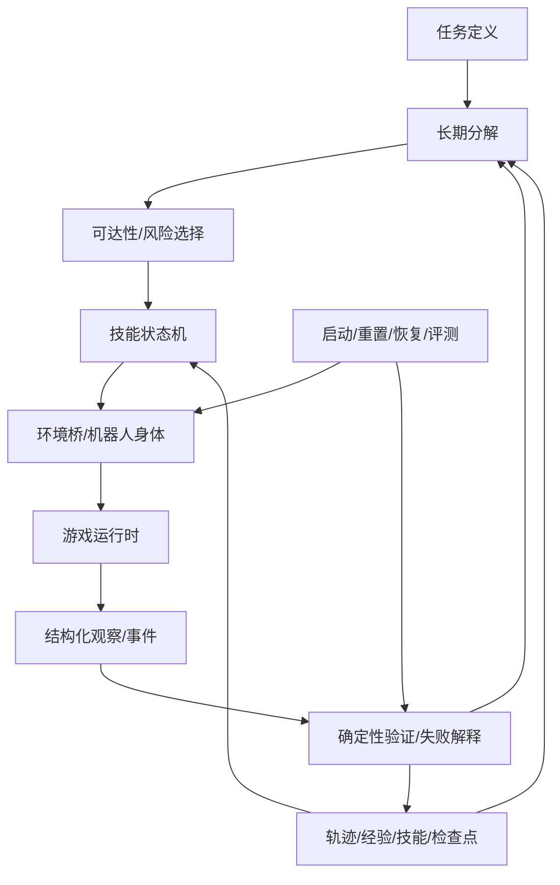
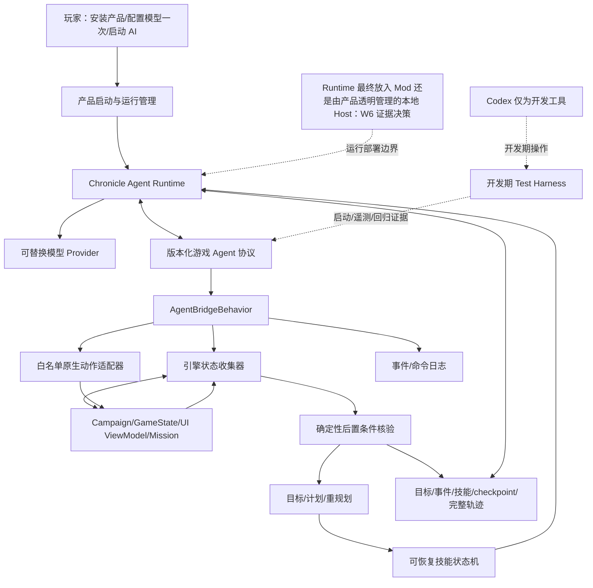
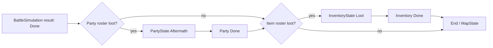

# 当前主线：Autonomous Campaign Agent Mod

绝对目标：AI 不能只是观察者、建议器、辅助工具或需要玩家确认的 Copilot。AI 必须能够独立感知战役状态、制定目标、执行行动、处理失败并持续推进战役。

只有两种正式部署形态：

1. **单机自主客户端**：AI 控制当前 Bannerlord 单机客户端中的玩家角色/玩家战役，拥有完整自主权；不需要第二 Steam 账号。
2. **多人独立客户端**：AI 以独立 Hero/Party/Clan 身份加入共享多人战役，拥有独立客户端身份；这通常需要第二个游戏客户端、第二个 Steam 账号和第二份游戏授权。

同一进程中的同伴/队伍代理可以作为单机架构实验，但只有当它拥有独立目标、独立行动循环和独立战役身份时，才算自主代理，不是辅助功能。

### 术语边界：单机多代理不等于离线联机

- **单机自主玩家**：AI 控制当前单机客户端中的玩家角色；没有第二玩家实体。
- **单机 NPC 代理**：AI 在同一个单机进程中控制独立 Hero、MobileParty、Clan 或其他游戏实体；它拥有自主目标，但仍由同一个战役进程统一模拟，不是网络客户端。
- **多人独立玩家**：AI 作为第二客户端加入共享战役；需要网络同步、独立客户端身份和多人战役服务器/Mod。

“离线联机”不作为工程术语。单机 NPC 代理可以实现玩家与 AI 共同生活在同一战役，但不能据此声称实现了联机。

### 单机多代理的底层限制

单机 NPC 代理在数据层面可行，但存在不能由普通 Agent 逻辑消除的引擎边界：

- 玩家进入单机战斗、聚落或其他 Mission 时，战役时间通常停止；小时/日事件、Party 移动、工资、食物、围城和其他时间系统不会像多人服务器那样继续推进；
- AI NPC 即使在玩家视野外，也不会获得一个独立的并行世界。它通常只是 Campaign 层的 Hero/MobileParty，接受全局抽象模拟；只有进入相应 Mission/Scene 时才有 3D 实体；
- 战略层 AI 可以在 Campaign Tick 上运行；要求真实 3D 场景、实时移动或独立交战的行为，必须等待场景实例化；
- 因此单机 NPC 代理适合验证 AI 作为世界实体的数据模型，不等价于玩家与 AI 同时推进的共同游玩。

真正的并发共玩需要多人服务器拥有全局时钟，并定义玩家进入战斗、暂停、遭遇、战斗结果和断线时的仲裁。现有 Bannerlord 联机项目正是通过服务器权威和时间控制补丁处理这些问题，而不是复用单机暂停语义。

Mineflayer/MineDojo 等 Agent 以独立玩家为动作和观察主体；这不排除 Bannerlord 单机 NPC 代理，它是利用原生 Hero/Party AI 的另一条研究路线，验收不可与多人客户端路线混称。

### Research readiness and current technical focus

Research Gate: **READY**
Implementation Gate: **READY**
行为总分母：**182**（核心Campaign ACT族；OBS分母：**73**，23个N/A不计入）　游戏版本：**1.4.8.119303**

玩家行为目录以本机1.4.8.119303官方Native/SandBox/SandBoxCore/StoryMode为基线；`SYSTEM_INVENTORY.md`的126项是系统研究入口，不是动作数量。当前目录含183条ACT、73条OBS和23条N/A，其中`ACT-A06-06`仅为打开Cheat菜单的特权入口，另有控制台/作弊命令；它们留在条件特权扩展，不计入标准Campaign行动分母或普通Agent白名单。故标准行动族分母为182，观察面分母为73。本轮根据用户玩家观察补入两个此前未拆开的成员加入入口：`ACT-F05-04`未交战的地图行军Army成员加入，以及`ACT-G01-06`在已有SiegeEvent中加入攻城方；两者和Army管理页Roster事务、Army战斗援助均区分。W2覆盖审计此前补入`ACT-G10-01`战后Loot提交和`ACT-H04-03`聚落志愿兵招募。前者不代表自然掉落全覆盖；招募不代表Town、Backstreet、Village三种入口及真实Gauntlet界面都已视觉验收。其他全游戏系统不因这些局部工作而宣称已实现。第三方Gameplay模块、模型覆写和动态新增入口属于条件扩展，不能静默算进基线或宣称已兼容。多人核心是通过多人战役Mod加入共享Campaign，不包含原生PvP赛事、ForfeitSpawn或通用MP语音；未来支持语音时作为独立通信接口评估。盘点与产品工作次序由GitHub Project维护；本文不保存活动Issue/完成状态。Research Gate通过后仍需按任务板实现、逐项验证；Tier 1仅作为未来成熟度夹具。首个AI战斗接入优先使用Campaign地图坐镇/BattleSimulation；Mission部署、实时Orders和士兵控制仍属完整产品目录，但不属初始战斗切片。Minecraft Agent研究作为架构参考，不构成绕过全景研究的理由。

Implementation Gate READY仅表示允许推进当前单一、边界清楚且已有当前版本机制契约/重复验收路径的W2工作项；不表示182个核心动作已实现或任意功能都可开工。任何变更仍须先有对应玩家入口、前置/副作用/时间与后置条件，限定在GitHub唯一In Progress事项内，运行最窄的原生结果测试；无法复现的分支必须留下明确未知，不能据API调用成功宣称完成。

Minecraft Agent 的环境、规划、技能、记忆和评测研究已沉淀到本文后续架构段落；本文不再把项目目标定义为“测试工具”。

## 玩家交付原则与待定运行边界

玩家必须只感知一个产品：安装 Chronicle Agent、完成一次模型配置、在游戏中启动自主 AI。玩家不安装 Codex/Claude Code，不配置 MCP/CLI/IPC，也不手工启动 Python 或 Node。

内部实现目前不预设为“全部内嵌 Mod”或“必须外置 Agent Host”。两种方案都保留，最终边界由原型证据决定：

| 候选 | 优势 | 主要风险 |
| --- | --- | --- |
| Mod 内编排 | 单包安装、配置直接、状态访问简单 | 游戏线程污染、请求超时、崩溃耦合、重型记忆与多代理扩展困难 |
| Mod + 隐藏 Host | 故障隔离、模型/记忆独立升级、批量测试和多代理更自然 | 安装与生命周期复杂、IPC 和进程管理成本 |
| 混合式 | Mod 保留身体与轻量循环，Host 承担可选重型能力 | 边界设计和兼容测试要求更高 |

冻结部署边界前必须完成同一 Agent 循环的对照原型，至少测量：游戏线程占用、模型超时行为、断网恢复、游戏/模型进程崩溃隔离、存档大小、长期记忆规模、多代理并发、版本升级和安装步骤。玩家体验要求始终是单入口；即使内部存在 Host，也必须由安装器和启动器透明管理。

## 现实参考：AI 效应 + Player2

现有《AI 效应》的安装说明要求玩家先安装 Mod，再单独下载安装 Player2；进入 Mod 设置后选择 `Player2` 作为 AI Backend，使用预设 URL。[AI 效应安装说明](https://www.mountblade.com.cn/news/Bannerlord/2026-01-17/3059.html)

这说明它采用的是：

```text
Bannerlord Mod（游戏内适配器）
        ↓ HTTP/本地或平台接口
Player2（外部 AI Host/平台）
        ↓
模型、账号、额度和 AI 服务
```

Player2 官方定位也是面向游戏和 Mod 的 AI 接口平台，并同时提供模型和玩家入口。[Player2](https://player2.game/)

它不是完整 Agent 架构的必要组成，而是为游戏 Mod 提供统一模型服务的外部后端。这个案例只能证明“可替换后端 + Mod 内提示词/世界逻辑”可行，不能直接证明 Chronicle 的长期自主 Agent 应全部内嵌或全部外置。

Steam 创意工坊或 CurseForge 可以分发 Mod 文件、依赖和配置，但不能可靠地替玩家执行任意外部程序安装。如果最终需要 Host，应由明确的统一安装器或启动器透明管理，不能由 Mod 隐式下载并执行未知程序。

### AI 效应案例带来的架构修正

AI 效应的现有资料显示，Player2 不是它的唯一 Agent Host，而是可选 AI Backend：公开配置同时列出 Player2、OpenRouter、DeepSeek、Ollama、KoboldCpp 等后端；Mod 自己负责生成结构化提示词、读取游戏上下文、保存世界/提示词数据，并通过后端 URL 请求模型。[AI Influence 后端说明](https://www.nexusmods.com/mountandblade2bannerlord/mods/9711) [AI Influence Prompt Control](https://github.com/PiTatva/AI_Influence_Prompt_Control)

当前只冻结两个技术结论：后端必须可替换，游戏动作与结果验证必须留在 Mod 的安全边界内。规划、提示词、长期记忆和技能库运行在 Mod 内还是 Host 内，须通过同一 Agent 循环的可重复对照原型决定，不能由现有代码库存或安装偏好反推。

## Minecraft Agent 全景结论

已核对论文、官方仓库和 Voyager/Mindcraft 关键代码，覆盖与本项目有关的主要架构家族：

| 层 | 代表项目 | 已解决问题 |
| --- | --- | --- |
| 实验环境 | Malmo、MineRL、MineDojo、MineStudio | reset/step、观察/动作、任务、终止、轨迹、批量评测和崩溃恢复 |
| 原生机器人身体 | Mineflayer | 游戏协议、实体、寻路、背包、合成、容器和战斗高层 API |
| 代码技能与课程 | Voyager、Odyssey | 自动课程、成功技能沉淀、检索、Critic、checkpoint |
| 交互式规划 | DEPS、GITM | 描述、解释、重规划、可达性选择和分层动作 |
| 多模态控制 | VPT、STEVE-1、JARVIS-1 | raw pixels 到键鼠、短时控制器和多模态经验记忆 |
| 工程化 LLM Bot | Mindcraft | 命令白名单、中断、超时、循环检测、记忆压缩、技能检索和代码沙箱 |
| 任务评测 | MCU、MineStudio Benchmark | 原子/组合任务、Simple/Hard 条件和批量证据 |

成熟 Agent 不是一个大模型直接“玩游戏”，而是以下闭环：



缺少环境契约、动作原语、执行后验证、中断、checkpoint 或 benchmark，都会把额外成本转嫁给 LLM 推理。

## 代码级认识

Voyager 实际由 Python 协调器、HTTP 环境桥和 Node/Mineflayer 组成。每轮向环境发送程序与已检索技能，环境执行后返回事件和最终观察；Critic 判断成功，失败状态与 critique 回流，只有成功程序进入向量检索技能库。课程进度、失败任务、技能代码和数据库可 checkpoint 恢复。

Mindcraft 将命令路由、ActionManager、SelfPrompter、History、SkillLibrary 和 Coder 分离。ActionManager 会中断旧动作、设置超时、检测快速/无限循环；History 同时保存短上下文、压缩记忆和完整轨迹；技能按相关性选择；生成代码先检查引用和 lint，再进入受限 compartment。

这些工程保护比“让模型多思考”更重要。

## 迁移与拒绝

采用：

- Malmo/MineRL 的环境动作契约；
- Mineflayer 的原生身体分层；
- Voyager 的动作后观察、Critic 反馈和成功技能沉淀；
- DEPS 的失败解释、重规划与可达性选择；
- JARVIS-1 的规划器/控制器分离；
- Mindcraft 的白名单、中断、超时、循环检测、上下文压缩和完整轨迹；
- MCU 的 Standard/Hard 任务评测；
- MineStudio 的批量运行和崩溃恢复。

暂不采用：

- VPT/STEVE-1 的逐帧视觉控制；战役层低频决策不值得承担其成本；
- 在游戏进程执行 LLM 任意生成代码；
- 第一阶段开放式自动课程；
- LLM Critic 作为成功真值；
- 为测试直接写入资源、位置或战斗结果；
- 把全世界状态和全部技能塞入上下文。

## Bannerlord 目标架构



- 游戏内 Mod 是深入 Bannerlord 引擎的身体：从当前 Campaign、GameState、原生菜单/ViewModel、Mission 与事件生命周期收集信息，并把 Agent 意图映射到有前置/后置条件的原生动作；不能用外部脚本伪造游戏结果。
- Agent Runtime 是交付给玩家的自主决策系统，包含模型 Provider、目标规划、技能状态机、记忆、验证和重规划。部署到游戏进程内还是由产品透明管理的本地 Host，仍由 W6 的原型证据决定；无论边界如何，玩家都只安装/启动一个产品并配置模型一次。
- Codex、MCP、开发用 CLI、Computer Use 与 Test Harness 只属于开发工具，不是交付依赖、产品界面或 Agent Runtime。若 Agent Runtime 位于进程外，它必须随产品被透明部署/启动/更新/停止，玩家不能被要求自行准备 Python/Node 等开发运行环境。
- 游戏进程只执行协议允许的结构化读取与白名单动作；不得执行模型任意生成代码。模型调用不能阻塞 Campaign/UI 主线程。

## 状态、记忆与动作

状态分层：

1. 即时状态：界面、时间、玩家队伍、资源、位置、附近实体和当前遭遇；
2. 增量事件：资源变化、移动、战斗、任务、错误和存档；
3. 工作记忆：目标、子目标、当前技能步骤、预算和风险；
4. 情节记忆：状态—动作—结果—失败原因；
5. 语义记忆：已验证技能、版本、前置和失败模式；
6. 完整轨迹：不可压缩命令、状态、日志和 checkpoint。

每个动作必须声明协议版本、稳定实体 ID、参数、前置条件、成功条件、可恢复/不可恢复失败、超时、中断、清理、重试和幂等边界。自然语言摘要不能替代结构化状态与完整轨迹。

## 当前本机接口风险

历史探针确认过 `MBSubModuleBase.OnGameStart`、`CampaignGameStarter.AddBehavior`、`CampaignBehaviorBase.RegisterEvents/SyncData` 和多个 `CampaignEvents`，但这些证据来自先前本体状态。当前客户端为 `v1.4.8.119303`，进入实现前必须针对当前 DLL 重探针。

当前代码中已有只读 `ChronicleCampaignBehavior` 与 `DailyTickEvent` 计数实验；旧模块加载、行为注册和旧存档日志不能作为当前版本证据。

## Observation knowledge and open contract

原版实体分别暴露 `IsVisible` 与 `IsInspected` 两种地图状态；属性本身不足以证明它们如何对应地图图标、悬浮提示、ALT 部队详情或百科信息。任何 Agent 情报策略都应先核对玩家实际入口与运行时可见结果，不从字段命名推导遮蔽规则。静态面板按需读取，不应默认将玩家物品、队伍、家族、王国和日志全部塞入每次决策上下文。

## Action contracts and coverage definitions

#### 覆盖口径与验收证据 / Coverage and Evidence Contract

本表定义长期有效的分母和判定方式，不维护当前完成数。任务完成状态由GitHub Project Issue表示；单次通过/失败、运行号和原始文件由 `TestResults/<run-id>` 表示。

| 范围 | 分母或判定规则 | 证据规则 |
| --- | --- | --- |
| 玩家行为与观察面 | A-L全域审完并跨域去重后，按核心Campaign ACT族ID计行动分母、按OBS族ID计观察分母；明确排除的特权作弊接口另列，不并入核心分母 | 每条目录记录在来源列引用有效系统编号，且所有126个A-L编号至少被引用一次；Docs同时验证ID唯一、引用已定义和逐系统有目录映射。当前含183条ACT（含1条权限隔离入口），基线182核心ACT/73 OBS；`ACT-A06-06`与其可选作弊命令属单独权限扩展；详细事实见对应Research/源码/运行证据 |
| GameState接口 | 反编译枚举的状态类型只是接口分母，不等于玩家行为或 Agent 覆盖率 | 按当前安装DLL重新盘点；API Probe和运行时结果分别标记 |
| 自主 Agent 闭环 | 必须有非测试模型/规划器选择目标、调用白名单动作、验证结果，并在世界变化或失败后重规划 | 确定性Provider、单动作成功或累计动作数量均不能算自主闭环 |
| 长程成长夹具 | Tier 1用于评测长期规划、资源、风险和恢复，不是产品目标，也不要求通过刷固定奖励达成 | 结果必须来自 disposable campaign、保留状态/动作证据并清理夹具；失败如实保留 |
| 视觉证据 | 仅用于结构化遥测不能判明的真实界面迁移；采集窗口、帧覆盖、索引和源视频清理均需验证 | 关键帧与事件时间线可追溯至同一run；不将截图替代游戏状态真值 |

新增动作族先更新完整行为分母和验收定义；命令数、Issue数量和测试运行次数都不代表 Agent 能力进度。

#### 原版机制契约 / Mechanic Contract

| 动作/观察 | 玩家入口与原生后果 | 时间行为 | Agent界面/API边界 | 证据与未知 |
| --- | --- | --- | --- | --- |
| W2-BB `ACT-D08-01` Campaign Map `town→manage_alley`玩家Alley菜单入口 | 玩家在含有效玩家Alley的Town菜单选择显示为“进入巷子”的`manage_alley`；`AlleyCampaignBehavior.go_to_alley_on_consequence`以`GameMenu.SwitchToMenu("manage_alley")`转入Alley管理GameMenu，初始化另向当前`GameMenuManager.MenuLocations`加入Settlement的`alley` Location；返回走当前Alley菜单Native `back`/`leave_alley_menu_consequence` | 1.4.8运行在Stop基线中，进入/返回前CampaignDay/raw mode/`isWaiting`稳定；菜单选择不暗藏`advance/pause` | 只从当前Town `menu`观察中选择Native enabled `manage_alley` option；返回只选当前`manage_alley`实际`back`选项。产品调用通用`menuSelect`的当前option handler；直接`SwitchToMenu`仅作为Harness夹具预置。MenuLocations注册不能解释为3D场景/mission已启动 | 本机1.4.8源码`go_to_alley_on_condition/consequence/manage_alley_menu_on_init/leave_alley_menu_consequence`确认菜单与Location registration链；运行`20261004-052453`：Town原版option enabled，真实`menuSelect`进入后仍是`MapState`且`mission=null`，UI是在Campaign地图上显示Alley背景板的管理菜单，不是3D Mission；Native `back`返回`town`。Alley业务Roster/Owner/Leader/Gold/Influence不变，Day=91077.400065/raw Stop/`isWaiting=true`稳定，源hash相同、进程退出。证据`TestResults/20261004-052453/Temp/AlleyEntryMenuResult.json`和三张Native帧。该入口本身不启动可对话的3D角色场景；如何从玩家入口进入Assigned Alley Leader实际对话仍未知 |
| W2-BA `ACT-D08-04` Campaign Map Native abandon-Alley confirmation | 玩家在当前Town的玩家Alley `manage_alley`选择`abandon_alley`，原版切至`manage_alley_abandon_are_you_sure`；No调用`go_to_alley_on_consequence`回`manage_alley`；Yes由`AlleyCampaignBehavior.abandon_alley_consequence`移除`PlayerAlleyData`、调用`PlayerAlleyData.AbandonTheAlley()`并请求`town_outside`。非ClanScreen且不在袭击中时，普通Alley守军回MainParty、Alley roster清空、Owner置null；underAttack会把owner交给攻击方，本项排除该分支 | 普通GameMenu转换，不是等待菜单。两个disposable分支的CampaignDay都保持91077.400/raw `Stop`；`isWaiting=true`保持稳定。未调用`advance/pause` | 只选择当前`manage_alley`/`manage_alley_abandon_are_you_sure`真实显示且enabled的Native menu option；No是可恢复取消，Yes属于不可逆游戏动作并须Agent有明确放弃目标。不得直接调用`AbandonTheAlley`、移除PlayerAlleyData、写Owner或转移Roster。首版只限Town菜单No/Yes；攻击状态、对话/Clan面板入口排除 | 本机1.4.8源码：`abandon_alley_are_you_sure_consequence`只切确认Menu；`abandon_alley_yes_no_on_init`校验PlayerAlleyData；Yes先从Native行为list移除，再`AbandonTheAlley()`并调用`town_outside`。`PlayerAlleyData.AbandonTheAlley(false)`把普通兵加入MainParty并由`DestroyAlley`清空Roster/Owner。运行`20261004-050635`以两个隔离进程验证：Town确认页中文选项为“是/否”；No回`manage_alley`且Owner/负责人/双方Roster/Gold/Influence不变；Yes实际回到Town菜单（观察menuId=`town`，引擎帧显示“你已经失去了巷子帮派的所有权”），Owner为null、PlayerAlleyData消失、vlandian_recruit从MainParty 7→13、Gold/Influence无变化。源Campaign hash相同、两分支CampaignDay/raw档/waiting稳定、两个进程清理；证据`TestResults/20261004-050635/Temp/AlleyAbandonmentResult.json`及六张Native帧。源码目标Menu ID与运行后观察到的`town`不一致，按实际Native运行事实记录。此为内存内原生Alley夹具，不代表正式存档/真实鼠标输入 |
| W2-AZ `ACT-D08-03` Campaign Map `manage_alley_troops` Alley roster事务 | Town的玩家Alley `manage_alley`菜单选项触发`AlleyCampaignBehavior.manage_troops_of_alley`，经`AlleyHelper.OpenScreenForManagingAlley(false, playerAlleyData.TroopRoster, ...)`构造Left=Alley、Right=MainParty的`PartyState/PartyScreenLogic`；原版只允许普通兵转移，禁止Hero与Prisoner。Native Done按`AlleyModel`最小/最大Roster数校验，成功由`OnPartyScreenClosed`提交Left roster至`PlayerAlleyData.TroopRoster`，若已有Alley Mission则刷新Scene Agents | `GameStateManager.PushState(PartyState)`暂停Map操作；本原版夹具在raw `Stop`下观察到打开/Cancel/Done前后CampaignDay=91077.401、raw mode与`isWaiting`保持不变。不写`Campaign.TimeControlMode`或调用测试`advance/pause`；非Stop档位下的恢复规则未由本轮覆盖 | `state.partyScreen`暴露当前活动VM双方可见成员、transferability、Done状态，并在该原版上下文附上Alley min/max/current troops。`alleyRosterTransfer(troopId,sourceSide)`只针对当前VM中可转移普通兵调用Native `PartyCharacterVM.ExecuteTransferSingle`，每次一名；`partyScreenDone`在此上下文走Native `PartyVM.ExecuteDone`，`alleyRosterCancel`走Native `PartyVM.ExecuteCancelWithoutInquiry`。限定Campaign Map Town `manage_alley`菜单入口，不含Alley leader 3D对话同一入口；不允许Hero/Prisoner/隐藏或失效项，不直接写Party/Alley Roster | 本机1.4.8反编译`AlleyCampaignBehavior.manage_troops_of_alley/OnPartyScreenClosed`、`Helpers.AlleyHelper.OpenScreenForManagingAlley/IsTroopTransferable/DoneButtonCondition`、`Helpers.PartyScreenHelper.OpenScreenForManagingAlley`和`PartyVM/PartyCharacterVM`。运行`20261004-044859`经Sargot `manage_alley→manage_alley_troops`进入真实`PartyState/TroopsManage`，原生帧显示左巷道、右主队、不可转移的负责人、普通兵转移行与取消/完成；Cancel前暂存一人后完全无Owner/Leader/Roster/Gold/Influence/日期/时钟/waiting变化。Roster min=5/max=10：在5 Done可用、4不可用且调用被拒、11不可用且调用被拒、恢复10再Native Done提交；最终Alley普通兵6→10、MainParty该兵7→3，Owner/Leader与资源不变，源Campaign hash一致、Bannerlord进程族退出。证据：`TestResults/20261004-044859/Temp/AlleyRosterManagementResult.json`和四张Native帧(`alley-roster-town-menu.bmp`, `alley-roster-party-screen.bmp`, `alley-roster-after-cancel.bmp`, `alley-roster-after-done.bmp`)。测试仅通过内存内原版Alley/Clan Hero/普通兵夹具验证菜单入口和VM handler，不是正式存档或物理鼠标拖拽；Alley leader对话入口、非Stop时间档和已有Alley Mission时的Scene Agent刷新未运行覆盖 |
| W2-AX `context.inquiry` / `respondInquiry`（只支持当前Native Campaign Map Yes/No弹窗，不另计世界行动） | 玩家通过已支持原版动作触发当前显示的`InquiryData`确认框，例如`RecruitmentVM.ExecuteDone`容量超限确认；询问排队不代表对AI当前可见。按钮文案及当前enabled来自原生SingleQueryPopUpVM | `GauntletQueryManager.CreateQuery`可能显示为当前VM或排队；只有Native `_activeQueryData/_activeDataSource`及`InformationManager.IsAnyInquiryActive()`一致时才开放响应。VM `ExecuteAffirmativeAction/ExecuteNegativeAction`先走Inquiry自己的原回调再关框并切下一项。按钮业务副作用按原版回调各异 | `pauseGameActiveState`可注册ActiveState disable request并暂停引擎；不是调用Campaign `SetTimeSpeed`。观测与回答都不自动advance/pause；必须同时记录CampaignDay/raw mode/`isWaiting`和该pause标志，`TestResults/20261003-140443/Temp/MapInquiryResult.json`经Native RecruitmentVM样本验证：`pauseGameActiveState=false`且CampaignDay=91077.402/raw Stop，回调前后无时钟变化；其他Inquiry的pause=true与活动档行为仍未知 | `state.context.inquiryOpen`说明地图当前被Native modal阻挡；`inquiry`只给Yes/No可视文案/显示启用和运行期一次性token；`respondInquiry(token, affirmative|negative)`只调用当前Native `SingleQueryPopUpVM` handler，禁止过期token、排队项、隐藏按钮/禁用按钮、TextInquiry/MultiSelection或非MapState。普通地图写动作在有模态时先拒绝 | 本机1.4.8 `InformationManager/InquiryData/GauntletQueryManager/SingleQueryPopUpVM`已反编译核实：active对象是私有静态`_activeQueryData/_activeDataSource`，OnShow事件可入队，不能把最近事件误当屏幕当前项；Native两个按钮回调顺序是动作先、Hide/Close后。运行`TestResults/20261003-140443/Temp/MapInquiryResult.json`通过：先以`InformationManager.ShowInquiry`确认真实Native VM桥接与过期token保护，再在萨哥特`recruit_volunteers`菜单将主队填至20/20，由Native `RecruitmentVM.ExecuteDone`产生真实`Over Limit/超过上限` Inquiry。引擎帧显示原生双按钮文案。按否后Roster/Gold不变；新token再按是，Native回调招入1人并扣20第纳尔。地图追近只按玩家导航自然走且另行Stop；弹窗处理前后Day/raw mode/`isWaiting`相同，其他不相关状态不变，源档Hash一致/进程清理。此为Native ViewModel handler及业务回调验收，不是物理鼠标点击；不代表所有Inquiry业务类型已支持 |
| W2-AY `context.multiSelectionInquiry` / `respondMultiSelectionInquiry`，以玩家Owned Alley更换负责人`ACT-D08-02`为首个Native实例（复用UI协议，不新建行为分母） | Town Settlement菜单`manage_alley`中的`change_leader_of_alley`；只限此GameMenu入口。原生`AlleyHelper.CreateMultiSelectionInquiryForSelectingClanMemberToAlley`按`AlleyModel.GetClanMembersAndAvailabilityDetailsForLeadingAnAlley`给出Clan Hero候选、启用与不可用提示；Alley受攻击时原菜单禁用 | `MultiSelectionQueryPopUpVM`处理当前`InquiryElements`/Min/Max；选定项设为`InquiryElementVM.IsSelected`会回调原生计数/单选逻辑。确认收集当前VM选中的InquiryElements并执行Alley回调，Native consequence更换`PlayerAlleyData.AssignedClanMember`、替换驻守Roster Hero并延迟传送新负责人；原负责人若在当前定居点，原版还会把其`LocationCharacter`移到酒馆。Exit/X调用否定回调，不应提交 | Native Inquiry以`pauseGameActiveState=true`显示并disable active GameState；不操作Campaign `TimeControlMode`。专项夹具开弹窗前原始档位已为Stop；取消/确认后`CampaignDay`和raw档位仍稳定为91077.400/Stop，测试没有advance/pause动作。此证据验证本夹具在停止档位下不改时钟，不推导其他档位下暂停/恢复时序 | 首次限定当前活动`MultiSelectionInquiryData`和`MultiSelectionQueryPopUpVM`；仅暴露当前VM实际显示的元素、可选状态、提示、选择范围、Done文案/启用和右上角X退出可见性/token；只选一名本体enabled Clan Hero或取消。禁止任意选身份、直接写AssignedClanMember/Roster、选择队列/过期项目；名称/技能之外不补查不可见Clan候选 | 本机1.4.8.119303静态源码链及截图核验：`AlleyHelper.CreateMultiSelectionInquiryForSelectingClanMemberToAlley`生成`MultiSelectionInquiryData` (min=max=1, ShowExit, GameState pause=true)；`GauntletQueryManager`active VM、`MultiSelectionQueryPopUpVM`及Alley Behavior handler。运行`20261004-034423`在Sargot的Native `town→manage_alley→change_leader_of_alley`完成：引擎帧显示“选择同伴”、描述、禁用当前负责人及提示、一个可选Clan Hero、底部“完成”与右上角X；非法ID拒绝且弹窗保留，负向退出不改负责人/Roster/Owner/Gold/Influence，重新打开后Native正向handler更换AssignedClanMember与驻守Roster，并保留Owner/Gold/Influence/CampaignDay/raw档位；旧负责人的LocationCharacter由Native AddPlayerAlleyCharacters夹具生命周期建立后可被原版回调移动。时钟基线Stop；源Campaign hash相同、Bannerlord进程族清理完成。证据：`TestResults/20261004-034423/Temp/AlleyLeaderInquiryResult.json`与四张Native引擎帧(`alley-leader-town-menu.bmp`, `alley-leader-multiselection.bmp`, `alley-leader-after-cancel.bmp`, `alley-leader-after-accept.bmp`)。这是通过内存内原版Alley/Clan-Hero数据夹具并真实调用菜单与VM callback的集成验证，不是自然存档/实际鼠标操作；不同城镇、真实存档自然Alley及非Stop档位未覆盖 |
| W2-AW `context.escapeMenuOpen` / `closeEscapeMenu`（仅Campaign Map UI恢复，不另计世界动作） | 地图窗口失焦或玩家打开MapScreen原生Escape overlay；此时活动GameState仍可为`MapState`且GameMenu为空。原版“Return to the Game/继续游戏”会关闭该overlay；不含Options、Save/Load、Quit、Mission菜单或Campaign GameMenu | Overlay阻止地图输入，但不等于显式Campaign时间档位。关闭动作不可调用`SetTimeSpeed`、`advance`、`pause`或`resume`；只比较CampaignDay/raw mode/`isWaiting`自然读数 | 只读`MapScreen.IsEscapeMenuOpened`作为MapState上下文；关闭动作要求MapState且当前确有Escape菜单，然后调用Native `MapScreen.CloseEscapeMenu()`（与原生返回游戏回调同一`OnEscapeMenuToggled(false)`后果）。不发OS键鼠，不点击任意Escape菜单项，不强制切GameState；`pursue`等地图写动作仍须在AtMenu/overlay打开时先拒绝 | 安装版1.4.8来源：`MapScreen.OnGameWindowFocusChange`、`OnEscapeMenuToggled`、`CloseEscapeMenu`、`IsEscapeMenuOpened`、`MapViewsContainer.IsOpeningEscapeMenuOnFocusChangeAllowedForAll`及`EscapeMenuVM`回调。`TestResults/20261003-111556/Temp/harness-failure-frame.bmp`曾记录Harness失焦触发真实overlay；Harness专用guard于`37c0dfe`修复。运行`TestResults/20261003-124654/Temp/MapEscapeMenuResult.json`通过：暂停后在MapState打开真实Native overlay，Observer在普通`state`中报告true，overlay截图显示原生菜单；关闭后标记false且地图恢复。`pursue`在overlay打开时返回rejected，关闭前后CampaignDay=91077.378、raw mode=Stop、waiting=false、金币/影响力/目标/任务数不变；三张原生引擎帧、源存档SHA一致、进程退出均通过。测试首次发现的协议重复命令ID和`rejected`状态断言误写已修复并保留失败run。未验证失焦触发菜单的完整真实玩家窗口焦点时序；本测试以Native Open/Close API复现overlay与回调，不将其伪称鼠标或键盘操作 |

W2-AA实现修订（优先于下方较早的ACT-A02-01实现记录）：CLI `pause`/`resume`/`fastForward`统一调用原生 `Campaign.SetTimeSpeed(0/1/2)`，只允许Campaign Map且时间未锁定、活动菜单为空或可用Wait菜单；回执同时给出raw/effective模式、waiting和调用瞬间CampaignDay。`AgentLoop`仅验证只读 `state → mapPartyTargets` 闭环；`TimeControlLoop`用确定性Provider在真实Agent循环中分别运行Play→FastForward→Pause和Hold→Play。证据：`TestResults/20260930-020009/Temp/AgentTimeControlLoopResult.json`全部断言通过：Play档在下一次档位选择前CampaignDay由91077.378增至91077.413；FastForward档设置后日期继续增长；Pause后日期保持91077.444；第二个隔离进程先Hold使`IsMainPartyWaiting=true`，再显式Play令有效模式为UnstoppablePlay，等待状态持续且日期从91077.378自然增至91077.387。Harness `advance`越权被拒；源fixture hash一致，两进程均正常停止。通用只读循环`TestResults/20260930-013829/AgentLoop.json`通过。仍未人工视觉核对热键绑定/全部菜单锁定状态，API动作不模拟按钮焦点与动画；产品事项验收仍需确认UI与各原生限制边界。

| 动作 | 玩家入口 | 原版自然副作用 | Campaign 时间行为 | UI/API 差异及当前实现 | 证据 / 未知 |
| --- | --- | --- | --- | --- | --- |
| `mapPartyTargets` issue/quest markers（OBS-J01-01扩展；W2-AU） | Campaign Map中与Native地图Party Nameplate对应的可见独立Party markers；用户确认贵族领主名字旁蓝色感叹号表示存在委托 | Native `PartyNameplatesVM`只为`IsSpotted()`且不在Settlement的Party建立Nameplate；`PartyNameplateVM.RefreshDynamicProperties`由LeaderHero当前Issue、与Party相关Quest及Army leader可聚合的附属Party marker形成`IssueQuestFlags`，再呈现`QuestMarkerVM`。AvailableIssue/ActiveIssue/ActiveStoryQuest/TrackedIssue/TrackedStoryQuest互不等价；AvailableIssue才表示待接Issue | 观察无世界状态/时间副作用；marker随Campaign/Quest/native nameplate刷新更新 | `mapPartyTargets`候选按`Party.IsVisible`，不同于`IsSpotted()`/屏幕相机范围。输出`questMarkers:null`表示非Native Nameplate候选，`[]`表示候选当前无marker，非空数组给Native类别及`hasAvailableIssueMarker`；不返回标题/描述/期限/IssueManager全集/隐藏Party | 用户于2026-10-01确认地图贵族蓝色任务标记；本机1.4.8 `PartyNameplatesVM.UpdateMobilePartyVisibility/PartyNameplateVM.DetermineIsVisibleOnMap/RefreshDynamicProperties`、`CampaignUIHelper.GetIssueType/GetQuestsRelatedToParty`、`QuestMarkerVM`源码核。运行`TestResults/20261003-101114/Temp/MapPartyQuestMarkersResult.json`：Native IssueManager合法候选在lord_4_13上创建TheSpyPartyIssue，原生Hero flag和party观察均为AvailableIssue；lord_4_14无marker仍空，重复查询稳定，无Quest文本，截图显示名字牌蓝色“!”标记；源档hash不变、进程退出。未覆盖Army marker聚合、摄像机投影视锥与多类/Story marker动态更新
| Map Lord Party Issue Quest offer / Native `encounter_meeting`（W2-AV；沿用对话输入与既有Issue Quest行为族） | `mapPartyTargets`本轮列出的Lord Party含AvailableIssue后，玩家普通点击/追近该地图队伍，进入原版地图会面并与领主对话；不同于Settlement Character Overlay或Visit Mission | `PlayerEncounter.DoMeetingInternal`/`CampaignMapConversation`创建地图会面Conversation；`IssuesCampaignBehavior`仅对Hero当前Issue动态开放`hero_give_issue`与方案分支。Quest正向接受要求`IssueBase.CheckPreconditions`及当前Conversation实际出现可点击`issue_offer_player_accept_quest`；其回调经`IssueManager.StartIssueQuest`生成Issue Quest并转入解决中，不可直调启动API | 地图接近按原版点击时钟自然推进；会面/对话期间Stop。运行Day 91077.378→91077.397只发生于地图接近；对话选项和Quest接受不附加快进 | 只用当前party目标`pursue`与当前可点击Conversation选项`dialogueSelect`；拒绝/Alternative/Lord/barter分支不当成Quest接受。Native可提供多个Issue解决方式，测试经过Alternative说明桥接但只提交Quest option | `TestResults/20261003-110250/Temp/MapPartyQuestAcceptanceResult.json`通过：Native候选`TheSpyPartyIssue`先经原版地图接近进入`encounter_meeting`，动态选问候→`hero_give_issue`→Issue explanation→Alternative说明桥接→当前Enabled `issue_offer_player_accept_quest`；Quest `issue_153_quest`归属该Hero且从0→1、期限16日；接受后复读Map Party标记由AvailableIssue转为ActiveIssue、hasAvailableIssueMarker=false。Gold 1000不变、对话后Campaign Stop、源档hash相同、三张Native引擎帧和进程清理通过。Harness首轮(105312)回执字段断言位置错误、次轮(110002)监听错读对话层级；均保留失败证据，修复后本次Runtime通过 |
| ACT-F05-04 join a marching friendly Army / Native `army_join`（W2-AS） | 用户确认的入口边界：Army未交战且在地图行军时可加入；Army正在战斗时显示JoinBattle/Leave或中立Leave，不显示Join Army；围城加入另属攻城分支。W2-AS原版引擎帧显示“与军团领袖交谈 / 加入军团 / 离开” | 1.4.8 `army_join`要求MainParty与Army为同一MapFaction、MainParty未在该Army，且未被敌方SafePassage期限禁用。Native callback设置Army membership，`AddPartyToMergedParties`建立AttachedTo，结束PlayerEncounter；与ArmyManagementVM编辑名单不同 | 地图接近时Campaign自然推进。选Join的即时Native回执仍为Stop且未显式快进；后续原版`army_wait`等待菜单自动进入UnstoppableFastForward，Day自然前进。Harness没有把该等待推进附加到Join命令 | 仅提交当前可见且Enabled的`army_join_army`；不直接改`Party.Army`。测试用Native `ChangeKingdomAction`设定一次性同Faction前置、`Kingdom.CreateArmy`准备行军Army，玩家从当前可见marker经原版`pursue`接近；政治转换/Army构造不是玩家交互已验收 | 本机1.4.8 `DoMeetingInternal`、`army_join_on_condition/consequence`、`Army.AddPartyToMergedParties`、`PlayerEncounter.Finish`、`PlayerArmyWaitBehavior`。`TestResults/20261002-165845/Temp/MovingArmyJoinResult.json`通过：Army处于GoToPoint、移动中、非MapEvent/非Siege；页面option `army_join_army` enabled，Native提交后MainParty进入Army.Parties/AttachedTo Leader，army_wait菜单出现并FastForward；Gold/两侧Influence不变。前后两张原生Engine帧，源档hash与进程清理正常。未测玩家实际加入王国的政治UI、Army Management流程、围城加入及各SafePassage禁用条件 |
| ACT-G01-06 join a continuing besieger SiegeEvent / Native `join_siege_event`（W2-AT） | 用户确认围城加入是不同于未交战行军Army成员加入及战斗援助的入口；本项聚焦地图Settlement已存在SiegeEvent、双方未进入MapEvent battle时的“Join the continuing siege” | Native `DefaultEncounterGameMenuModel`将符合上下文路由到`join_siege_event`；`game_menu_join_siege_event_on_condition`要求`SiegeEvent.CanPartyJoinSide(MainParty,Attacker)`并检查SafePassage。无MapEvent时callback→PlayerEncounter.Finish→MainParty.BesiegerCamp设置→`PlayerSiege.StartPlayerSiege(Attacker,false,settlement)`→StartSiegePreparation；Settlement已有MapEvent则走另一个battle-join结果，本项不混用 | 普通地图接近目标时Campaign按当前档自然流动；Native菜单callback源码显式设置`UnstoppablePlay`进入围城准备。运行证据显示地图导航档Stop→StoppablePlay，Native选Join后StartSiegePreparation置UnstoppablePlay，Camp等待自然将CampaignDay 91077.400375→91077.431638 | 只从当前可见SiegeEvent/Settlement入口和当前Enabled选项提交；不直调StartPlayerSiege或手改BesiegerCamp，避免绕过join side、安全通行及原版菜单迁移 | 用户2026-10-02确认Army围城可以加入且与战斗援助、行军Army入军不同。本机1.4.8 `GetEncounterMenu`、`game_menu_join_siege_event_on_condition/consequence`、`SiegeEvent.CanPartyJoinSide`、`PlayerSiege.StartPlayerSiege/StartSiegePreparation`源码核；`TestResults/20261003-091025/Temp/JoinSiegeEventResult.json`及`join-siege-event-before.bmp`/`after.bmp`验证真实地图入口、Native选项、Attacker PlayerSiege/BesiegerCamp与时钟；源档hash相同、进程退出。Gold 1000不变，政治夹具后Influence -1不变。首轮被Chronicle hostility guard误拦的失败收据为`20261003-090333`，已修正为严格Side eligibility例外。第二轮`20261003-091720`在地图接近中进入Native `join_encounter`，截图显示“帮助作战军团/不参与”；未选择、且无MapEvent字段收据，完整成因未判定，作为动态遭遇分流而非围城菜单成功。围城营袭击、突围援守、Blockade/海战、active MapEvent战斗加入及之后围城战斗/Mission均未覆盖 |
| OBS MapScreen settlement markers / on-demand `mapSettlementTargets` | Campaign Map显示本体`Settlement.IsVisible`的聚落marker；玩家可平移/缩放地图浏览，再用当前MapScreen鼠标ray选中visual | 只读观察不改变Settlement/Party状态或时钟；选中并点击才执行ACT-K02-01的原版导航/点击时间处理。列表只包含原版地图可见标记，不含未发现全局Settlement | 观察无时间副作用；有效地图点击按当前Campaign点击时钟配置改变时间档，之后自然推进 | 普通`state`保留schema21和局部`nearbySettlements`摘要；Agent需要规划地图目标时显式调用只读`mapSettlementTargets`，回传独立schema 1紧凑名单，避免每轮状态重复携带约393项/52KB清单。集合仅取active + `IsVisible`并附`isInspected`；协议`move`拒绝IsVisible=false target并复核`GetInteractionDataForMainParty` | 本机1.4.8 `SettlementVisualManager.OnInitialize`枚举Settlement.All，`SettlementVisual`按MapEntity.IsVisible显隐，`PartyBase.UpdateVisibilityAndInspected`区分IsVisible/IsInspected，`MapScreen`用ray-hit测试；`village_V1_1`Calioc运行`20260927-080856`与主队相距20.5，出现在地图目标查询但不在周边8项摘要；同一运行确认IsVisible=false的藏身处未列出，协议move拒绝且位置/目标/时钟不变。未知：未发现`ISpottable`和各类mod覆盖的完整映射、地图镜头/鼠标焦点与屏幕投影的视觉精确对应 |
| OBS MainHero skill levels / `mainHeroSkills` | 玩家在C→Character Developer选择MainHero查看各Skill当前等级；不是XP/Focus/Perk页面草稿数据 | 被动读取MainHero的原版SkillObject等级，不改HeroDeveloper、不推进Campaign时间；角色成长仍只能由其他行为族产生 | schema21固定体量字段随一般state提供所有当前`Campaign.Current.AllSkills`，每项含skill id/name/level；Hero.GetSkillValue是本体同一数值。技能集合动态适配活动模块新增的SkillObject | 本机1.4.8 `CharacterDeveloperVM`给MainHero构造SkillVM并用`HeroDeveloper.Hero.GetSkillValue(Skill)`设Level；observer对当前AllSkills按id排序。`MainHeroSkills` harness以独立visual-capture QA读数逐项比对、确认重复state无变且时间/存档不变；未知主要是第三方Mod对技能value/对象注册和CharacterDeveloper适用Hero规则的覆盖 |
| ACT-A05-01/02 + ACT-A01-03 save/load Campaign session（W2-Y） | 玩家从地图ESC/F5打开原生存档UI执行QuickSave或Save As；从初始菜单Continue latest/Load slot恢复Campaign。F5/ESC属于保存UI别名；Save As新建/覆盖slot、Load是新GameState/进程生命周期，不应混成Agent世界动作 | Native SaveHandler异步排队序列化Campaign与所有CampaignBehavior `SyncData`；只有匹配存档名的`OnSaveOver(success)`表示保存最终成功。读取存档会重建Campaign/行为并调用`SyncData`，载入后SandBox原生流程恢复MapState并将Campaign时钟置Stop。存档本身不主动推进Campaign时间；保存失败不能报告成功 | 当前CLI `save`用Native `SaveHandler.SaveAs(name)`并以OnSaveOver回执完成；Harness `load`通过停止本进程再启动指定存档的新Bannerlord进程恢复，不是游戏内SaveLoadScreen视觉点击。SAVE/LOAD调用都不在现有Agent自主决策白名单，属于会话持久化接口 | 本机1.4.8 SaveLoadVM/SandBoxSaveHelper与CampaignBehaviorManager/SyncData源码见`Research/A/CampaignRuntimeWorldState.md`。Protocol `TestResults/20260929-122409/Protocol.log`：SaveAs后结束首进程，再由独立进程读档；Hero/Clan、Tier、金钱/影响力/声望、主队健康/伤病/俘虏/物品摘要、粮食、坐标/地点目标/点目标、Quest摘要与MapState指纹完全一致；目标点(206.646,395.888,陆地)恢复一致，Campaign日91077.400、Chronicle daily tick 2恢复一致，读档时钟Stop，源fixture hash不变、临时SaveAs槽清理、两进程均退出。该证据验证Native Campaign保存API/跨进程恢复，不是ESC/F5/SaveLoadScreen视觉点击。未知：视觉焦点/取消/失败恢复、StoryMode新档与Ironman覆盖、完整Troop/Item明细逐项往返和第三方Mod数据兼容 |
| OBS MainHero Character Developer details / `characterDevelopment` | Agent在Campaign Map按需请求C→Character Developer对应主角成长信息；不把界面所有数据常驻给模型 | 只读MainHero属性、角色等级经验、未分配属性/Focus点、Skill等级/经验进度/Focus/学习率与上限、当前技能等级已解锁Perk状态；不写HeroDeveloper、不推进Campaign | 独立schema1工具，仅Agent显式调用；默认state维持schema21体量。只返回当前可见成长选项，不列完整Perk百科、不读取其他Hero/Trait | `TestResults/20260927-095403/Temp/CharacterDevelopmentResult.json`对照本机1.4.8 `CharacterDeveloperHeroItemVM`：6 Attributes、18 Skills所有比较字段一致，重复查询稳定、Campaign状态/时间/存档hash不变、进程停止。当前夹具没有已解锁Perk，非空解锁分支、其它Hero和第三方Mod覆盖未知；不代表Perk可选动作或视觉页面已验 |
| Map party markers / on-demand `mapPartyTargets`（W2-L候选） | Campaign Map里可被原版`MobilePartyVisual`选中/悬浮的移动Party marker；用户确认地图显示人数，悬停+ALT可查看政治Party兵种组成。摄像机当前屏幕范围与Campaign全局`IsVisible`不是同一概念 | `MobilePartyVisualManager.OnInitialize`为非Garrison/Militia Party创建visual；`MobilePartyVisual.OnHover`只对MapEntity.IsMobile且IsVisible显示tooltip。附着Party的visual有`AttachedTo`并被MapScreen命中后映射到leader marker，所以目标清单不重复列附着子Party。官方`IsInfoHidden`字段虽有NameplateVM读取方，但原版无对应信息隐藏玩法（用户确认），且所查官方CampaignSystem/SandBox/StoryMode源码未见赋值；仅按兼容/Mod扩展字段处理，Agent观察不据此隐藏人数 | 只读`PartyBase.IsVisible`、isInspected、MainParty可见基础摘要；不包含ALT详细Roster，不作视觉相机视锥假设；Agent显式查询而不扩大nearby摘要 | 本机1.4.8 `SandBox.View.MobilePartyVisualManager`/`MobilePartyVisual`反编译核marker创建、Garrison/Militia排除、可见显示及附着点击合并。`TestResults/20260927-121425/Temp/MapPartyTargetsResult.json`返回6个目标，与当前存档原生可见marker候选集合一致；名称/类型/检查状态/健康人数/伤员/俘虏/距离逐项匹配原生Nameplate读取，重复稳定、战役/存档未变、进程退出。测试模块含Harmony等前置，不称纯净原版运行；诊断中六项IsInfoHidden均为false。用户已确认ALT逐兵种详情入口，但本接口不覆盖。未知：attached Army tooltip的精确Roster汇总、各类型Party在自然Campaign中的分布、屏幕摄像机可见范围与全局marker清单的视觉映射 |
| Map party behavior summary / on-demand `mapPartyBehavior(partyId)`（W2-O） | Campaign Map悬停当前可见Party marker显示Native Tooltip；不是ALT专属动作，也不对NPC发命令 | 普通Party `MobilePartyVisual.OnHover`→`RefreshMobilePartyTooltip`只在`IsInspected`时加入`CampaignUIHelper.GetMobilePartyBehaviorText(party)`；Army leader通过`RefreshArmyTooltip`对LeaderParty取同一摘要。helper原样返回`MobileParty.GetBehaviorText().ToString()`，由Army长程行为或Default/ShortTerm行为/目标条件产生；不是完整计划、候选分数或AI推理 | Tooltip/查询不写Party目标/Faction、不改变时钟；Campaign按当前时钟模式自然流动。接口直接调用Native helper，跳过Map hover/Tooltip绘制，不推导或改写摘要 | 仅允许当前`mapPartyTargets`可见、独立且`IsInspected`的Party ID；非候选/过期ID rejected，未inspection时不读底层DefaultBehavior/ShortTermTarget。Army摘要用LeaderParty | `TestResults/20260927-143749/Temp/MapArmyBehaviorResult.json`：普通Lord party输出“正在萨哥特周围巡逻。”与Native tooltip属性值逐字一致；原生`Kingdom.CreateArmy`单成员Army tooltip输出“正在塔利维尔堡附近集结。”亦逐字一致。重复查询稳定、无效ID rejected，主队/资源/位置/Quest/时间与存档不变、进程停止。模块有Harmony等前置，不是纯净原版；不同AI状态文字变化及人工视觉呈现未穷举；摘要不构成完整意图 |
| Map party composition / on-demand `mapPartyComposition(partyId)`（W2-M普通Party；W2-N Army Tooltip含附属Party） | 玩家悬停当前可见独立MobileParty marker并按ALT展开Tooltip（按键/所见由用户确认）；`mapPartyTargets`提供名牌摘要，Agent按需查询单个已inspected目标。Army leader对应原版Army Tooltip，按不同类型进入同一查询 | 普通Party：`MobilePartyVisual.OnHover`→`ShowTooltip(typeof(MobileParty))`→`RefreshMobilePartyTooltip`；Army leader：`ShowTooltip(typeof(Army))`→`RefreshArmyTooltip`。Native扩展VM在`IsExtended && IsInspected`列MemberRoster/PrisonRoster行；Army leader按原版逻辑合并leader及AttachedParties roster。`IsInfoHidden`不是原版信息隐藏玩法，仅当活动Mod置位且Tooltip不显示时作为兼容条件 | Agent查询只读，不改Party/roster或时钟；Campaign按当前档自然流动。它跳过鼠标hover/ALT与Tooltip渲染，但查询按对象类别复现对应Native Tooltip所用roster。Harness一次性Campaign经`Kingdom.CreateArmy`与Native Army合并入口建立单附属Party样本，不保存存档 | 只接受活动Map中当前`mapPartyTargets`可见的独立Party；`IsInspected=false`或兼容字段抑制详情时不返回Roster；无效ID回`rejected` | 普通Party：`TestResults/20260927-131611/Temp/MapPartyCompositionResult.json`的13类成员行与Native Tooltip VM匹配。Army leader：`TestResults/20260927-140439/Temp/MapArmyCompositionResult.json`调用Native `Kingdom.CreateArmy`并接入一支同Faction Party；两支Party合并后查询输出14类Roster行，与Native `RefreshArmyTooltip` VM一致，Army AttachedPartyCount=1。两类查询均拒绝无效ID、重复稳定、主队状态/时间/源档hash不变，进程退出；模块有前置框架，非纯净原版。无非空伤兵/俘虏样本；没有模拟ALT键或人工视觉录屏 |
| Active Quest Journal details / `questDetails(QuestId)`（W2-J；源码与运行验收通过） | 玩家从Quests/任务日志页选择一个当前进行中任务，查看当前阶段、记录文本/子目标进度、任务发起人及期限显示 | `QuestsVM`从`QuestManager.Quests`选进行中Quest；`QuestItemVM`按`QuestBase.JournalEntries`构建阶段，日志类型决定显示普通文本或TaskName/CurrentProgress/Range；过期与失败仍由QuestBase/QuestManager规则驱动 | 查询只回读本次`state.quests`已列出的进行中Quest，不读历史完成任务/隐藏内部TaskList，不改变Journal已读标记、Quest或Campaign时间。期限按`Quest.IsRemainingTimeHidden`尊重原版隐藏规则；schema21摘要只给原版可见的整日剩余时间，隐藏时为null | 本机1.4.8 `QuestsVM`/`QuestItemVM`/`QuestStageVM`/`JournalLog`链已核；`TestResults/20260927-111022/Temp/SettlementOverlayQuest-QuestDetails-Result.json`：原版接受VillageNeedsToolsIssue后QuestItemVM阶段、文本/Task进度、任务人、期限天数逐项对照；重复查询稳定，未观察ID被拒，Quest集合/Campaign/存档不变。此Sandbox样本期限可见；隐藏期限返回null的序列化分支经Harness回归验证，但没有加载真实StoryMode隐藏期限Quest作运行样本；替代方案/已完成历史仍不覆盖，不将其包装成通用Quest执行器 |
| MainParty member/prisoner roster / on-demand `partyRoster`（W2-K） | Campaign Map打开MainParty管理/Party Screen以查看本队成员、伤员与俘虏编制；不记录未确认的热键/特定面板输入 | 只读`MobileParty.MainParty.MemberRoster`与`PrisonRoster`的TroopRoster元素、人数/健康伤员与Hero标志；不写Roster、不读取其他Party、不推进Campaign | 普通state保持汇总；仅Agent显式调用无参数`partyRoster`且在MapState可用。Stable character ID排序；数据为语义Roster，不冒充PartyVM视觉排序/按钮可用性 | `TestResults/20260927-112940/Temp/PartyRosterResult.json`逐行比对本机1.4.8 MemberRoster/PrisonRoster及state摘要，重复查询稳定、Campaign Stop下无变化、存档hash与进程清理通过；样本有1类MainParty成员、没有俘虏，因此非空俘虏项与真实PartyScreen视觉仍待验证 |
| MainParty troop upgrade / `partyUpgradeOptions` + `upgradeTroop`（ACT-H04-01；W2-P） | 地图底栏Party入口：`MapNavigationVM.ExecuteOpenParty`→Native `OpenParty`→`PartyScreenHelper.OpenScreenAsNormal`进入MainParty Normal PartyState。玩家选右侧普通士兵的升级目标再Done；不记录未确认快捷键 | `PartyCharacterVM.Upgrade`→`PartyVM.ExecuteUpgrade`→`PartyScreenLogic.AddCommand(UpgradeTroop)`暂存Roster草稿；原生校验成员数量/XP/Gold/升级目标/需求物品。Done→`PartyScreenHelper.CloseScreen`→`PartyScreenLogic.DoneLogic`提交Roster、扣XP/Gold与需求物品并发升级历史/事件；Cancel/Reset撤销草稿。直接改TroopRoster会绕过这些条件。单人升级不使用堆叠modifier | 适配器仅在本次请求内创建Normal PartyState/PartyVM，查询后原生Cancel关闭，升级则走原生ExecuteUpgrade+Done；动作本身不调用Campaign时间API或显式推进/改档。源码显示`PartyState.IsMenuState=true`；Campaign `RealTick/Tick`由MapState在自身为ActiveState时驱动，所以PartyState压在地图上期间地图Campaign tick不执行。PartyScreenHelper关闭时PopState恢复父MapState；PartyState与MapState激活/关闭路径没有改写时间档。Harness在Stop和UnstoppablePlay下均测到档位保留，Stop下查询日值不变；本次即时开关没有长驻视觉屏幕测试 | 当前仅MainParty普通成员及当前选项中的一个UpgradeTarget；单次提交1人。Loot/Shared/Ransom/Prisoner模式、Hero、批量modifier和过期/不可用目标拒绝。`partyUpgradeOptions`按需从原生PartyVM生成条件；查询关闭时不留下PartyState | 本机1.4.8入口、`PartyVM.ExecuteUpgrade`、`PartyScreenLogic.ValidateCommand/UpgradeTroop/DoneLogic/ResetLogic`、`PartyState.IsMenuState`、`MapState.OnMapModeTick`、`PartyScreenHelper.ClosePartyPresentation`源码链核验；`TestResults/20260927-164831/Temp/PartyUpgradeResult.json`通过：临时阿塞莱农民→阿塞莱新兵，XP 100→0、Gold 1000→995、成员1→0/目标0→1；过期ID与XP不足目标均被拒且队伍/金币/日值不变；Stop下查询日值不变、UnstoppablePlay档位保留；测试存档SHA-256未变、游戏进程已停止；重复运行还确认Detached PartyVM调用原生`OnFinalize`安全清理。测试验证原生VM事务/清理及开关路径，不是人工PartyScreen视觉点击；无物品需求或金币不足有效目标负向样本 |
| `spendSkillFocus`（W2-I；仅主角技能Focus点） | 玩家按C打开Character Developer，选MainHero/技能并点击Focus加点，再按Done；Cancel会丢弃本次草稿 | `SkillVM.ExecuteAddFocus`先在VM草稿中减未花Focus点、加目标技能Focus并触发`FocusAddedByPlayerEvent`；Done→`ApplyAllChanges`→`CharacterDeveloperHeroItemVM.ApplyChanges`→`SkillVM.ApplyChanges`逐点调用`HeroDeveloper.AddFocus`。Cancel→`ResetChanges(isCancel:true)`后关闭、不提交。直接调用`HeroDeveloper.AddFocus`会跳过点数草稿/取消回滚；Agent在单个请求内用原生VM起草、完整校验并提交，拒绝时不写入、不跨回合保留未提交草稿 | 适配器只接受Campaign Map状态，提交动作不调用时间API、不改变时间档；Campaign仍按请求前的时钟模式自然推进。Harness用显式Stop隔离自然时间推进并核验命令未改时钟。打开面板的`CharacterDeveloperState.IsMenuState=true`；实际UI open/close时钟恢复分支未视觉验证 | `TestResults/20260927-102057/Temp/SpendSkillFocusResult.json`：真实fixture MainHero Crafting Focus 0→1、未花点3→2，学习率/余额/Focus与本机1.4.8 `CharacterDeveloperHeroItemVM`/HeroDeveloper回读一致；余额不足与超过Focus上限均整体拒绝、没有部分副作用，主队/资源/位置/Quest/时钟稳定、源存档hash不变、进程停止。未覆盖主角真实屏幕点击、自然未暂停时钟、其它Hero/第三方Model覆写；不代表属性/Perk分配、Cancel UI或完整Character Developer工作流 |
| moveToPoint（自由地点移动，陆地） | Campaign地图左键点击有效陆地NavMesh点（非Settlement/Party视觉实体）；MapScreen从鼠标射线得到带Face与`IsOnLand`语义的`CampaignVec2` | `MapScreen.HandleLeftMouseButtonClick`通过地图相机/Encounter及`MapScene.DoesPathExistBetweenFaces`门禁后调用`MapState.ProcessTravel`；后者先清`ForceAiNoPathMode`，再由`NavigationHelper.CanPlayerNavigateToPosition`验证并`SetMoveGoToPoint` | 有效地图输入进入`HandleClickTimeChange`；之后Campaign按当前档自然推进，不附加`advance/pause`。API调用`ProcessTravel`本身不切时钟 | W2-B实现`moveToPoint(X,Y,Surface=land)`白名单；先验证坐标Face/NavigationModel，再调用`MapState.ProcessTravel`并复现成功点击时间档；只接受陆上主队与陆地目标。schema 9向Agent观察主队自己的GoToPoint目标坐标。直接API不做UI屏幕射线/相机路径门禁 | 本机1.4.8.119303 SandBox.View.MapScreen/`MapState.ProcessTravel`/`DefaultPartyNavigationModel`源码已核；`CampaignVec2.Face`延迟由MapSceneWrapper计算。`MoveToPoint`运行`20260926-211402`在disposable fixture从(207.018,389.419)移动到(208.518,389.419)，有效目标1步到达，GoToPoint/targetPosition/自然移动一致；超界目标拒绝且位置/目标/时间未变，fixture和进程清理通过。NavSea/港口死区/转场不在W2-B支持范围，交由单独边界研究 |
| Settlement overlay QuickConversation/Conversation（W2-D；交涉族ACT-J02-01，双路径） | 用户确认：本地Settlement overlay人物旁的蓝色感叹号表示委托；地图贵族Party Leader名字旁也有蓝标。点击本地Hero可“交谈”或“造访” | SettlementMenuOverlayVM生成QuickConversation/Conversation两种选项。QuickConversation→权限事件→`CampaignMapConversation.OpenConversation`；Conversation→Visit权限事件→`OnPlayerStartTalkFromMenu`→`LocationEncounter.CreateAndOpenMissionController`进入Location Mission | `TestResults/20261001-101331` QuickTalk返回同一Village菜单/MapState，Day=91077.564、Stop不变；`20261001-095934` Visit停在Location Mission，Campaign时间Stop。返回地图由Native Leave Area另行负责；不把长按TAB暗塞入Conversation | `talkToSettlementHero`是交谈/QuickConversation并校验当前overlay QuickTalkPermission；`visitSettlementHero`是造访/Mission并校验Visit permission。overlay只含玩家当前Settlement列表Hero，不能用全场景/全局Notable表补漏。地图贵族marker由W2-AU扩展到`mapPartyTargets`，不等于地图Party接Quest动作 | 用户确认入口和返回差异；`TestResults/20261001-101331/Temp/SettlementOverlayQuickTalk-Result.json`验证QuickTalk回同一聚落菜单、Quest/Gold/Day不变；`TestResults/20261001-095934/Temp/SettlementOverlayVisit-Result.json`验证Visit进入目标Location Mission。两条路径均保留Native帧、源存档hash和进程清理回执 |
| missionViewAim（W2-D视线/Focusing研究） | Mission中鼠标移动相机；屏幕准星/原版Focus界面表明当前瞄准物 | `MissionScreen.UpdateCamera`改变相机bearing/elevation；`MissionMainAgentController.LookTick`根据相机姿态设置MainAgent视向；`MissionMainAgentInteractionComponent.FocusTick`用场景射线更新`CurrentFocusedObject`，Action时再检查可交互与范围 | Location Mission内CameraView调整不快进Campaign；当前Campaign `TimeControlMode=Stop`。 | API确认`MissionScreen.CameraBearing`有公开setter，`CameraElevation`只有getter；Observer读取相机姿态和原生Focus。有限Target Agent只能来自本地12单位观察并由agentIndex临时标识。 | `TestResults/20260927-005534/Temp/TownCenterMissionResult.json`：一回合确定性Provider按当前观察的Agent 32（Soldier，非Notable）请求原生相机yaw调整，bearing 2.221→2.748，但等待后`CurrentFocusedObject`仍为null；`TestResults/20260927-031458/Temp/TownCenterMissionResult.json`对一名普通Townswoman做局部导航后重观察，原生Focus仍为空。相机视向写入不等价于目标通过Focus、无遮挡和可交互检查。`TestResults/20260927-014511/Temp/TownCenterMissionResult.json`证明32步后附近只观察到Soldiers。未知：原生相机朝向计算、Focus更新时序或目标可交互性何者导致未命中；不能把cameraAim回执或视角变化作为瞄准成功，也不得直接指定Focus对象
| follow / escort | Campaign地图上按住`MapFollowModifier`点击一个可导航的移动Party | `MobilePartyVisual.OnMapClick(true)`→`MobileParty.MainParty.SetMoveEscortParty(target)`；记录目标与导航模式，`DefaultBehavior=EscortParty`，不同于敌对接近 | 有效点击调用与普通地图点击相同的`MapScreen.HandleClickTimeChange`；后续只按当前时间模式自然推进，不附加`advance/pause` | W2-A已在AgentProtocol/CLI实现`follow`白名单；直接setter仍跳过地图目标选择/焦点检查及点击时钟副作用 | 本机1.4.8.119303安装版`TaleWorlds.CampaignSystem.dll`：`MobilePartyAi.TickInternal`仅对主队`EngageParty && !TargetParty.IsVisible`调用`SetMoveModeHold`；`GetFollowBehavior`对Escort只在目标null/非active时Hold，目标在聚落时改走聚落、否则跟随位置。`MobileParty.IsVisible`属性读写的是`_isVisible`标记，属性本身不能证明它等同于玩家视野/画面内可见。`EscortVisibility`运行`20260926-203358`自然观察45秒（Campaign Day +0.055）：目标从距离7.037靠近至0.056，始终在附近观察内，`DefaultBehavior=EscortParty`且时钟保持`StoppablePlay`；没有触发目标不可见分支，不能外推其结果。用户此前提到目标视野变化后队伍停止，但没有确认是哪种地图输入；此项仍是语义/运行未知，不移植Engage规则 |
| move | Campaign Map选择本体`IsVisible`的Settlement marker；通过on-demand `mapSettlementTargets`读取可选目标，玩家可平移/缩放后点击 | `SettlementVisual.OnMapClick`检查`IsVisible`、`GetInteractionDataForMainParty`并调用`SetMoveGoToSettlement`；协议也检查active/IsVisible及同一导航model。普通敌对Settlement仍被安全策略拒绝；唯一例外是当前可见、非Blockade、无Settlement MapEvent的活动SiegeEvent，且Native `CanPartyJoinSide(MainParty, Attacker)`为真时，允许原生地图导航进入“加入继续围城”入口；不等于直接加入或启动战斗 | 真实MapScreen有效点击按`HandleClickTimeChange`改时钟；协议按相同点击策略设档，之后Campaign自然推进，不附加快进/暂停。Native提交Join Siege后调用`StartSiegePreparation`并把Campaign档置为`UnstoppablePlay`，等待菜单下时间自然推进；若Settlement已有MapEvent则转JoinBattle分支，非本例 | `move`按SettlementId调用原生导航目标，跳过真实鼠标ray/焦点与相机平移；仍只接受本体IsVisible目标并复核Native导航。围城例外要求Side eligibility与无战斗事件，不能访问隐藏Settlement、普通敌对城镇、围城守方破围或Blockade | 本机1.4.8 `SettlementVisual.OnMapClick`/`MapScreen`/`NavigationHelper`源码。`TestResults/20260930-023203/Temp/MapSettlementTargetsResult.json`：493个活动聚落中393个Native可见marker与Observer集合完全一致；100个不可见目标均未出现在AI观察中，选取隐藏藏身处执行move被拒，CampaignDay/位置/目标均不变。`TestResults/20260930-022948/Movement.log`：AI从可见marker列表选择非敌对Sargot (`town_V1`, 距离6.467)，调用move后使用独立Harness显式步进，CampaignDay自然模式推进0.024日到达town菜单；存档hash不变、进程停止。W2-AT失败证据`TestResults/20261003-090333/Temp/JoinSiegeEventFailure.json`定位通用hostility guard在Native导航前拒绝可加入围城的Sargot；`TestResults/20261003-091025/Temp/JoinSiegeEventResult.json`及before/after Native帧证实受限例外能抵达原版围城选项并完成Attacker preparation。普通敌对Settlement仍拒绝，隐藏目标验证仍有效 |
| pursue | 普通左键点击地图上可见/有效移动Party下达Engage/Pursue；用户确认通常快速双击触发通用三倍速，不按隐藏修饰项 | `MapScreen.HandleLeftMouseButtonClick`→`MobilePartyVisual.OnMapClick(false)`设置`SetMoveEngageParty`，并由地图点击规则设时钟档。`MobilePartyAi.TickInternal`在主队Engage目标`IsVisible=false`时转Hold并清目标。`Campaign.IsMainPartyWaiting`随后由`MainParty.ComputeIsWaiting()`重算；即使原始`TimeControlMode`仍是StoppablePlay/FastForward，`Campaign.Tick`也会因waiting不给Campaign时间dt，`GetSimplifiedTimeControlMode()`返回Stop，`MapTimeControlVM`显示暂停 | 用户观测的“双击时速度”与普通目标点击分开：Native配置决定原始点击档。目标丢失后的“停表”不一定把底层枚举写成Stop；Agent观察必须同时记录raw time mode与`context.isWaiting`/CampaignDay，不可只检查`timeControlMode == Stop` | CLI `pursue`先要求Campaign Map未处于`MapState.AtMenu`且Native MapScreen Escape menu关闭，否则在写入Engage目标前明确拒绝；有效调用再经NativeEngage并按普通单击档运行。`EngageVisibility`一次性fixture(主队普通招募兵+100、Native弱Bandit 5人、初始合法点距6)只设初始场景；暂停后确认Native `mapPartyTargets`确有目标才下达Pursue，之后不改Party位置/AI/IsVisible、不注入时间。运行`20260929-141523`真实触发TargetMarker消失→主队target清空、MoveMode/DefaultBehavior Hold；`context.isWaiting=true`，原始模式仍StoppablePlay；Hold稳定13.9秒内CampaignDay为91077.540→91077.540，UI引擎关键帧显示“暂停”。这验证了用户描述的有效时间停止语义；不是自然沙盒随机目标统计或真实鼠标双击录制 | 来源：用户确认普通地图点击追近与双击速度效果；安装版`MobilePartyAi.TickInternal`、`Campaign.GetSimplifiedTimeControlMode`与`Campaign.Tick`、`MapScreen.HandleClickTimeChange`、`MapTimeControlVM.Tick`。运行与关键帧：`TestResults/20260929-141523/Temp/AgentEngageVisibilityResult.json`、`engage-target-initial-map.bmp`、`engage-target-lost-map.bmp`、`engage-target-lost-stable-hold.bmp`；源存档hash未变、进程已退出。Harness先前把“底层TimeControlMode是否等于Stop”误当成时钟停止；现已区分IsMainPartyWaiting带来的有效停表与原始枚举。未覆盖自然生成目标比例/阵营、同一双击输入的视觉命中/速度选择和其他AI目标丢失原因；`mapPartyTargets`只证明Native `IsVisible`标记，不是屏幕摄像机视锥测试 |
| hold | Campaign Map左键点击自己的MainParty地图visual（不是底部Pause按钮） | `SetMoveModeHold`清除目标并停止当前导航；之后Campaign是否有效推进仍由raw mode与`Campaign.IsMainPartyWaiting`共同决定 | 原版点击时间策略照常设置raw mode；在Stoppable模式且waiting时Campaign自然dt为0，`GetSimplifiedTimeControlMode`将状态显示为Stop；Unstoppable模式则可等待中继续运行 | CLI `hold`复现SetMoveModeHold与单击时间策略，不模拟鼠标ray/焦点；不附加`pause`或`advance`。应同时读raw mode、waiting、日期变化，不能把raw `StoppablePlay`误报为有效推进 | 本机1.4.8 `MapScreen`主队点击→`SetMoveModeHold`→`HandleClickTimeChange`。`TestResults/20260930-025002/Temp/AgentHoldResult.json`：先对可见Town下达move再hold，目标清除；raw仍为`StoppablePlay`但`IsMainPartyWaiting=true`，无Pause/advance命令的4秒自然窗口中Party稳定为`isMoving=false`，CampaignDay 91077.387→91077.387不变，源fixture hash不变且进程退出。`20260930-022948/Movement.log`同时证明普通move与hold都沿单击时钟策略 |
| rest | `town_wait` 菜单 | `StartWait` 快进；`EndWait` Stop | `rest(days)` 只观察时长 | 保留原生 Wait menu 时钟，离开后 Stop | 运行断言 Wait menu、持续时间及离开效果；`IsMainPartyWaiting` 生命周期语义需单独理解 |
| ACT-H04-02 ordinary prisoner recruitment（W2-Q） | Campaign Map底栏Party→Normal PartyScreen→MainParty右侧俘虏；原版Recruit Prisoners弹窗对单个可招普通俘虏点Recruit，再Done；本接口每次仅招1个，不用Recruit All/五人快捷键 | `PartyCharacterVM.ExecuteRecruitTroop`→`PartyVM.ExecuteRecruit(character)`构造单人`PartyCommand.RecruitTroop`；`ValidateCommand`复核右侧MainParty Prisoner和原生RightRecruitableData。Done提交时从PrisonRoster扣1及其Conformity XP、MemberRoster加1、记录history并由Campaign事件写RecentEventsMorale；无金币/物品费用。已达PartySizeLimit而会超额时，原版VM仍显示可招，提示“将超过上限”且Done打开Over Limit确认，确认后Native Done提交；查询还返回原版Done的完整超限确认文案；动作必须显式携带`confirmPartySizeWarning=true`，未确认时重置草稿并拒绝。直接写TroopRoster绕过模型资格/XP/history/morale/确认 | 招募/查询不调用Campaign时间API或显式改档；Conformity由MapState活动时的原生Hourly tick积累。PartyState压在MapState上时Campaign RealTick/Tick不执行，Pop回地图恢复此前时间档 | 本机1.4.8 `PartyVM.ExecuteRecruit`/`ExecuteDone`、`PartyCharacterVM.ExecuteRecruitTroop`、`PartyScreenLogic.IsPrisonerRecruitable/ValidateCommand/RecruitPrisoner/DoneLogic/FireCampaignRelatedEvents`、`PartyScreenData.CopyFromPartyAndRoster`、`DefaultPrisonerRecruitmentCalculationModel`、`RecruitPrisonersCampaignBehavior`。`TestResults/20260927-174107/Temp/PartyPrisonerRecruitmentResult.json`确认：Tier2阿塞莱马穆鲁克在MemberCount20/Limit20时可招数量1；无确认参数被拒且无Roster变化；显式确认原生Over Limit弹窗后人数20→21、俘虏2→1/XP557→278、Morale preview/RecentEventsMorale -1、Gold不变；剩余278XP不足279门槛时被拒无改动；两档时钟均保留、源档hash不变、进程停止。原生确认文案在本接口观察内暴露，只有Agent明确携带确认参数才调用原生affirmative callback |
| OBS-E10-01 BarterVM / on-demand `barterOptions`（W2-W） | 当前由MainHero发起的任一官方玩家Barter会面；观察当前活动谈判，不搜索无关NPC | `BarterManager.StartBarterOffer`创建`BarterData`并触发`BarterBegin`；Map/Mission宿主创建实际`BarterVM`。读取双方、全部VM原生Barterable分类/上下文/Offer状态及双方进度条百分比 | 读取不显式写CampaignTime；Map普通Barter的Stop时钟已核；Safe Passage测试在Offer后显式使用Harness `advance`观察32小时期限，不是Barter观察/Offer本身推进时间；Mission和其他特殊Context单独待验 | Harmony只捕获实际构造的活动VM，关闭/finalize清空；AI-only `ExecuteAiBarter`无玩家VM、不纳入接口 | 官方玩家UI调用点按普通议价、Safe Passage/过路费、和平议和、领主归附、婚姻入口分类盘点见`Research/E/EconomyAndTrade.md`；普通Lord路径见`TestResults/20260928-120336`；Safe Passage观测见`TestResults/20260928-181704/Temp/SafePassageBarterContextResult.json`。Peace/Defection/Marriage、Mission宿主和人工视觉仍未核 |
| ACT-E10-01 edit/balance/submit/cancel current barter / `barterEdit`、`barterReset`、`barterAutoBalance`、`barterOffer`、`barterCancel`（W2-W） | 活跃原生BarterVM当前proposal；可编辑条款使用Native BarterItemVM handler/selector，自动平衡直接调用VM按钮方法 | 编辑草稿不转移World资源。Native `ExecuteAutoBalance`依据当前各项/阵营估值增删提案、更新双方进度条，不代表必然接受；Offer须先核`IsOfferDisabled=false`，按上下文Barterable Apply；Cancel不提交 | Stop下普通Map路线AutoBalance/Reset/Cancel/Offer前后档位和日值稳定；Safe Passage接受后通过显式Harness time action越过32小时期限，动作实现本身不暗藏推进/暂停；Mission及其余特殊context未知 | 通用接口保留ContextInitializer与fixed Barterable类型；不可转/上下文固定条款仅观察。候选仅最新观察代有效；Offer复核Native `IsOfferDisabled`，不直调Barterable.Apply | 本机v1.4.8 `BarterVM`/`BarterItemVM`原生handler。普通Lord：`TestResults/20260928-121703/Temp/BarterTransactionResult.json`验证普通商品、Auto Balance、Cancel及单Denar Offer结算。Safe Passage：`TestResults/20260928-161518/Temp/SafePassageBarterContextResult.json`验证144 Denar接受、遭遇结束和即时32小时字段；`TestResults/20260928-170916/Temp/SafePassageBarterCancelResult.json`验证Cancel返回Encounter；`TestResults/20260928-181704/Temp/SafePassageBarterContextResult.json`通过Harness显式快进32.4小时，原生冷却归零，劫匪转`PatrolAroundPoint`/`Party`。Fight入口可用见`TestResults/20260928-175833/Temp/SafePassageFightResult.json`。普通Offer的Native拒绝、Lord Safe Passage与Peace/Defection/Marriage结果仍未运行 |
| ACT-A02-01 + OBS-A02-01 显式地图时间控制 | Campaign Map底部Pause/Play/FastForward三个控件；Native `MapTimeControlVM.ExecuteTimeControlChange(0/1/2)`；`MapScreen`的相关热键走同一 `Campaign.SetTimeSpeed` | `Campaign.SetTimeSpeed(0)`选Stop；若从快进暂停则保留`FastForwardStop`。Play/FastForward在主队Hold、`IsMainPartyWaiting`或非军团领袖成员条件下选Unstoppable模式，否则选Stoppable模式。该设置本身不推进日期；`Campaign.TickMapTime`随后根据mode与waiting计算自然`dt` | Stop/FastForwardStop为0；StoppablePlay/FastForward仅在非waiting时推进，Unstoppable对应模式即使主队等待仍推进。Raw `TimeControlMode=StoppablePlay`并不保证时钟有效推进：`GetSimplifiedTimeControlMode()`会在waiting时返回Stop，地图时间栏显示暂停 | 现有CLI `pause`直接写raw Stop，`resume`直接写UnstoppablePlay，未走原生VM/`SetTimeSpeed`条件，也没有显式FastForward选择；Harness `advance`为测试专用固定步进，决策器不允许。Observer返回raw mode及`context.isWaiting`，尚未暴露Native简化/有效显示mode | 本机1.4.8 `MapBar.xml`、`MapTimeControlVM.ExecuteTimeControlChange/Tick`、`MapScreen.HandleClickTimeChange`、`Campaign.SetTimeSpeed/GetSimplifiedTimeControlMode/TickMapTime`。`TestResults/20260929-141523/Temp/AgentEngageVisibilityResult.json`证实Hold后raw mode仍StoppablePlay但`IsMainPartyWaiting=true`且CampaignDay稳定；该现象由Native简化时间模式解释。未知：当前安装玩家profile中三个控件确切图标/热键绑定及全部GameMenu锁定条件的视觉状态；此次只验证了暂停/等待/Play选择的部分运行后果 |
| advance | Harness 专用，不是地图输入 | 按请求推进 Campaign | 固定步长；遭遇可提前结束 | CLI/Harness 显式工具；决策 provider 拒绝调用 | 独立时钟测试；不得塞进普通地图动作 |
| missionInteract(AgentIndex)（W2-R已通过；ACT-G03-07普通NPC对话分支，不新增ACT族） | 本项仅实现ACT-G03-07的普通友善NPC对话分支；Tavern/Town Location Mission中走到一个可交谈人类NPC附近，满足原版交互距离/条件后通过当前目标的Use/Interact入口触发；键名不硬编码，受绑定影响 | Native `Agent.OnUse(userAgent,-1)`→`Mission.OnAgentInteraction`向MissionBehaviors分派→`MissionConversationLogic.OnAgentInteraction`要求Campaign模式、无活跃对话和`IsThereAgentAction`允许，再调用原生`StartConversation`/ConversationManager并切MissionMode。执行API不直接调用ConversationManager启动，也不改NPC关系/任务/雇佣结果 | Location Mission内Campaign Map时间停止；交互本身不附加`advance`或改时钟 | 只允许当前`state.mission`观察中的有效人类Agent及当前玩家MainAgent；现有`missionNavigateToAgent`用于走近，交互再按当前Agent索引调用Native `OnUse`。现有使命观察不等于整个Scene全局列表；不能点名远方/敌对/不可用NPC | 本机1.4.8 `Agent.OnUse`公开路径调用`Mission.OnAgentInteraction`；`MissionConversationLogic.OnAgentInteraction`核Campaign GameMode/已有对话/目标Action并调用`StartConversation`，`IsThereAgentAction`限制目标为活动、非敌对、人类Agent及约2单位对话距离；`Agent.CanInteractWithAgent`再核原生行为Action/可达/use条件。`TestResults/20260927-184946/Temp/MissionInteractionResult.json`：Tavern当前局部观察到RansomBroker `ransom_broker_vlandia`，1个有界Movement输入靠近至1.082米；Native `Agent.OnUse`启动其原生对话并返回经纪人问候/选项，非法AgentIndex在无对话时被拒。Campaign日/Stop时钟不变、源存档hash不变、进程停止；同次引擎截图`MissionInteraction-frame.bmp`。API跳过真实鼠标射线/屏幕焦点，但仅能使用当前nearbySceneAgents并复核CanInteract/ConversationLogic资格；Town-center场景运行验证、FocusRay遮挡差异仍未覆盖；ACT-G03-07通用UsableMissionObject/UsableMachine分支仍未适配 |
| Location Mission长按离开/返回Campaign Map（W2-AJ；ACT-G03-24；依附OBS-G03-01，不新增行为族） | 玩家在Town/Village等友善Location Mission内长按原版“Leave Area”游戏键；用户已确认本机键鼠是长按Tab约2秒后直接回Campaign Map。适配使用本版Native Mission game-key id，不将物理Tab键码作为产品协议 | 1.4.8 `Mission.Tick`在`CurrentState=Continuing && IsFriendlyMission && !IsInPhotoMode`时逐帧检查`Mission.InputManager.IsGameKeyDown(4)`；按下逐帧调`Mission.OnEndMissionRequest()`，松开重置`_leaveMissionTimer`。handler依序调用MissionLogic的`OnEndMissionRequest`，可拒绝或打开Native Inquiry；通过时累积`BasicMissionTimer`，超过`GetMissionEndTimeInSeconds()`返回的0.6秒后由游戏调用`Mission.EndMission`。`MissionLeaveVM`显示原生hold进度。本协议只为当前Mission.InputContext短时报告game-key 4处于down，`Mission.Tick`仍执行完整原生路径；不是直接EndMission/PopState，也不调用OS全局输入 | Location Mission内Campaign时钟Stop；Leave timer在Mission时间下工作；动作不执行advance/pause。运行前后都比较CampaignDay/TimeControlMode；回Map后依本体先前模式自然运行 | `missionLeave`只在Campaign Map支持的友善Town/Tavern/Village Location Mission且MainAgent有效、时钟Stop时可用；将原`Mission.InputManager`包在限时2.5秒Mission局部input wrapper内，只对game-key id 4回报down，其余input透明转发。Native MissionLogic veto/Inquiry仍保留；Mission结束/改变、timeout或异常都恢复原input context。Mission状态按需观察leave lease状态/Native timer；不添加新的OBS族 | 本机1.4.8源码`Mission.Tick/OnEndMissionRequest/GetMissionEndTimeInSeconds/EndMission`、`MissionLeaveVM/MissionGauntletLeaveView`、SandBox `str_game_tip.campaign0`；用户确认物理Tab→Leave Area映射。本轮`TestResults/20260930-105254/Temp/MissionLeaveResult.json`通过：Sargot `vlandia_town_e`经此原生输入路线回`MapState`, Settlement `town_V1`, menu `town`; CampaignDay前后均91077.401、TimeControlMode均Stop、fixture SHA一致、进程正常退出。前后游戏引擎帧在同目录`mission-leave-before.bmp`/`mission-leave-after.bmp`。采样第一次观察已处于MapState，`MissionSamplesDuringHold=0`，故未看见中间进度bar；虽然转换结果验证通过，Native veto/Inquiry分支与Village/Tavern其他场景仍未运行覆盖 |
| ACT-H05-01 Wanderer companion hiring / Tavern conversation | campaign进入Settlement后选`town_backstreet`→`town_tavern`，在Tavern Mission内观察本地Wanderer Hero，走近后原版Use开始目标Conversation；按当前原生句链继续到加入MainParty报价并接受，不固定ConversationOptionId/报价 | 原版`LordConversationsCampaignBehavior`对未雇用、无Party的Wanderer注册“I can use someone like you in my company”；接受需Clan未达`CompanionLimit`且MainHero Gold严格大于动态`CompanionHiringPriceCalculationModel`报价，处理依次扣款/加入Clan/加入MainParty。拒绝/离开不扣款、不改变Clan/Party | Tavern Location Mission和对话期间Campaign地图时钟停；本身无额外时间推进。退出Mission后地图时间依原生模式自然恢复，不在hire动作加`advance/pause` | 对话与Hire只通过Agent可见Option `dialogueSelect`，结果需复读Party roster/Gold/Campaign身份；不调用`AddCompanionAction/AddHeroToPartyAction/GiveGoldAction`直接写状态。目标必须来自当前局部Mission观察；当前AI移动必须自然接近，不传送 | 本机1.4.8 `Research/H/PlayerPartyAndProgression.md`源码链已核；`TestResults/20260927-201154/Temp/CompanionHiringResult.json`：Tavern当前观察到Wanderer `CharacterObject_1604`，原生20s AgentNavigator从5.81米到1.438米，不传送；使用Agent.OnUse和当前对话option链，报价660与Native模型一致。Gold 661接受后精确扣660，Clan companions 0→1、Hero进入PlayerClan和MainParty、主队+1；Gold恰好660时Native对话没有Accept option，选择拒绝后Gold/Clan/Party均不变。Campaign stop/time与正式存档hash保持、两轮游戏进程分别停止；本任务只覆盖当前这一个Wanderer/Tavern，未做全世界Wanderer检索/等待刷新或其他模板/设备兼容 |
| OBS-H06-01 MainParty role holders / on-demand `partyRoles`（W2-T） | 玩家打开Clan管理→Parties，展开MainParty卡片的成员/职责区；四个职责显示当前任职者、技能和角色效果 | 只读当前MainParty动态模型职责的指定Hero、原生有效Hero、Relevant Skill与角色VM效果；不改Hero/Party/角色/时钟。职责列表来自当前`ClanMemberPartyRoleModel.GetAssignablePartyRoles()`，默认模型返回Quartermaster/Scout/Surgeon/Engineer | 查询不设置时钟；接口仅在Campaign Map可读。`PartyRoles`测试在Stop时读数不变；Active的`UnstoppablePlay`查询过程中Campaign自然经过约0.073日，TimeControlMode不变。原版ClanState可视页面打开时的时间表现仍未实测 | 原生`ClanPartyItemVM`把符合条件的主队Hero建成成员VM，并为每个模型职责构造`ClanRoleItemVM`；有效持有人和效果取该VM。Chronicle提供按需`partyRoles`，不把角色列表常驻state | `TestResults/20260927-213318/Temp/PartyRolesResult.json`：四职位/动态候选ID与`MobileParty.GetRoleHolder/Effective*`独立诊断一致，技能及效果文本从Native Role VM返回，重复查询只读；源档hash一致、进程停止。代码源：`ClanPartyItemVM.RefreshMembers/Refresh`、`ClanRoleItemVM.Refresh/GetMemberAssignedToRole`、`MobileParty`角色持有者。未做ClanState页面实机视觉/时钟核验；接口刻意在MapState下读，不伪称可视页面自动化 |
| ACT-H06-01 assign/remove MainParty role（W2-T） | 玩家在Clan管理→Parties展开MainParty职责行，选择该Party当前合资格家族Hero，或选“Remove assignee” | 原生候选由当前角色Model资格、技能与`CanBeGovernorOrHavePartyRole`过滤；`CampaignUIHelper.GetMapScreenActionIsEnabledWithReason`决定玩家是否可执行。默认模型仅四职位、单Hero最多承担两个PartyRole。`ClanRoleMemberItemVM.ExecuteAssignHeroToRole`调用对应MobileParty setter并触发原生任命事件，`ClanPartyItemVM.OnRoleAssigned`刷新角色VM；Remove仅清空目标职责。赋第三职会先`RemoveOnePartyRoleOfHero`按原生次序清掉该Hero一个旧职位，再设置新职位；执行回执前后返回全部职位/效果，明确暴露替换项 | Action不写CampaignTime/TimeControl；Campaign Map下Stop时事务日值/时间档不变；active测试中TimeControlMode保持不变且日值自然推进，不能把自然推进塞入动作。ClanState可视页面时钟行为未测试；本工具不打开该GameState | 工具基于当前MainParty roster构造原生`ClanRoleItemVM`/`ClanRoleMemberItemVM`，候选、MapScreen行动禁用条件均复核后调用Native `ExecuteAssignHeroToRole`并按`OnRoleAssigned`语义刷新；不直接调用MobileParty setter，不绘制/模拟Clan页面点击。当前CLI分为`setPartyRole(RoleId, HeroId)`与`unassignPartyRole(RoleId)`；超出当前动态候选、FirstMate/Navigator、禁用Campaign行动状态均拒绝 | `TestResults/20260927-213318/Temp/PartyRolesResult.json`：真实Campaign中的当前Wanderer同伴被角色VM列入四个候选；连续任命Quartermaster+Scout后任第三职Surgeon，原生结果自动移除Quartermaster、保留Scout/Surgeon；再移除Surgeon只清目标位；数据与独立MobileParty读数一致。非法FirstMate、未观察Hero及空位Remove均拒绝无变化；Stop下Gold/roster无成本、time/存档hash不变、进程停。Harness为当前边界提供相同的原生Role Member提交handler回归，未验证完整ClanManagement页面点击/键盘焦点、ClanState时钟或第三方Model覆写 |
| OBS-H08-01 MainHero equipment / on-demand `heroEquipmentOptions`（W2-U） | Campaign Map导航栏Inventory图标；同一元素提示其当前原生GameKey绑定。`InventoryNavigationElement.GetPermission/OpenView`经`MapNavigationHelper`检查导航、俘虏、Raft/Mission限制后调用`InventoryScreenHelper.OpenScreenAsInventory` | `InventoryScreenHelper`建立`InventoryState`/`InventoryLogic`，以MainParty物品、成员Roster及`CharacterObject.PlayerCharacter`初始化；`GauntletInventoryScreen.OnReady`从该State的逻辑构造`SPInventoryVM`。设备模式、装备槽索引和每件装备modifier均来自该VM当前EquipmentElement；槽位索引经本机`SPInventoryVM.GetItemFromIndex(EquipmentIndex)`反查，不能从当前槽内物品推导，因为空槽没有物品索引 | Observer查询只读装备/背包状态；打开InventoryState本身不写时间API。`InventoryNavigation`确认Stop档不改变、活动`UnstoppablePlay`不改档且Campaign自然经过；`EquipmentTransactions`中的Stop装备/卸装/Done/Cancel档位未变。活动Inventory准确时间增量不概括成显式时间动作 | 只返回当前MainHero与当前VM模式装备槽、原生索引、modifier、对应ItemElement和可装备库存候选；空槽仍保留索引；不读取未知Hero或全世界库存。不扩展常驻state，按需独立查询 | 本机1.4.8原生导航/`SPInventoryVM`源码链已核；`TestResults/20260927-232822`验证InventoryState/时钟；最终`TestResults/20260928-071313/Temp/EquipmentTransactionResult.json`完整读取12个原生槽及非空modifier，并验证普通剑与同基础Item的masterwork候选在当前VM中具有不同viewModelItemId；modifier EquipmentElement穿戴/卸下往返可读，空槽索引稳定。活动模式计时语义仍由`InventoryNavigation`独立覆盖；源fixture哈希不变、进程清理。 |
| ACT-H08-01 equip/unequip one MainHero item / `equipHeroItem` 与 `unequipHeroItem`（W2-U） | InventoryState当前MainHero装备页：将有效Inventory `SPItemVM`拖到指定`Equipment_{slot}`，或将当前装备槽Item拖回PlayerInventory；按Done确认整个原生事务或按Cancel撤回 | `SPInventoryVM.ExecuteTransferWithParameters`设目标槽并调用装备/卸装handler；`EquipEquipment`校验`CanCharacterUseItem`、物品/EquipmentIndex匹配、mode/civilian使用资格、Horse/Harness搭配，使用原生`TransferCommand`→`InventoryLogic.AddTransferCommand(s)`建草稿。Native `GetItemFromIndex(EquipmentIndex)`映射空/占用槽位。`GauntletInventoryScreen.ExecuteConfirm`调`ExecuteCompleteTransactions`才提交；Cancel调`ExecuteResetAndCompleteTransactions(true)`撤销草稿。直接写Equipment/ItemRoster绕过双方Roster、stack、mode、槽位检查和Done/Cancel | equip/unequip与Commit/Cancel不附加`advance/pause`；`InventoryNavigation`确认Stop打开/Cancel返回及活动档自然时间不隐式改档；`EquipmentTransactions`的Stop档装备/卸装/Done/取消过程均保持Stop。其他模式或活动档事务时钟仍待核验，不把自然推进混入动作 | CLI实现`inventoryOpen`原生Map导航、`heroEquipmentOptions`读取Gauntlet SPInventoryVM、`equipHeroItem/unequipHeroItem`用VM建立单件transfer草稿、`inventoryConfirm`调用Native Done并校验Equipment/Party ItemRoster，`inventoryCancel`取消无草稿页面、`inventoryCancelChanges`须Agent明确选择丢弃后才接受Native Inquiry。仅当前MainHero/Default InventoryMode/一件一槽；观察包含EquipmentElement modifier | `TestResults/20260928-071313/Temp/EquipmentTransactionResult.json`全部验收断言通过：盾牌Native unequip→Done→equip→Done；另一把原版剑与占用武器槽交换、确认旧装备Native归还库存、恢复两个原槽；有效旧候选、随机无效ID和剑→躯干不兼容目标全部拒绝且装备/库存不变；Cancel Changes经原版Inquiry撤回；Harness-only非空`masterwork_sword` modifier随SPItemVM/EquipmentElement穿戴、Done、卸下、Done往返并被精确清除。同基础普通剑与masterwork剑同时在库存时，Native VM的viewModelItemId不同，测试确认用各自当前候选操作；12个槽、主队itemCount/载重/兵力、Gold/Influence/Renown、位置、Campaign日及Stop时钟、源fixture hash前后不变，游戏进程停止。未覆盖Civilian/Stealth、活动档完整事务、第三方SPInventoryVM替换。shader-cache自动确认回执：`TestResults/20260928-061907/Temp/startup-dialog-58948.json`。 |
| OBS-E02-01 Town Trade Inventory / on-demand `tradeOptions`（W2-V） | 玩家从Campaign Map的当前`town`菜单选择`trade`，`InventoryScreenHelper.OpenScreenAsTrade`建立原生Trade `InventoryState` | `SPInventoryVM`返回当前市场OtherInventory与玩家PlayerInventory两侧候选、ItemViewModelId/InventorySide/EquipmentElement modifier/数量及当前VM item cost；只读不提交交易或Gold/库存。相同ItemObject在两侧可能同时存在，因此候选引用同时包含side | 查询不写时间；Stop下InventoryState/报价读数保持。以`UnstoppablePlay`进入Trade时Native Trade Inventory及买卖动作维持该档，Campaign日可自然非递减；打开/关闭不由查询API写CampaignTime | `tradeOptions`只能在当前Native Trade InventoryState读取活动VM。`foodOptions`为当前OtherInventory食品筛选。若交易草稿挂起，输出Native VM草稿状态，不作为已提交 | `TestResults/20260928-095145/Temp/TradeTransactionResult.json`：Campaign Map起始`UnstoppablePlay`；Town原生Trade Inventory候选报价与InventoryLogic同state一致，Native Trade State/报价查询实际时钟档可读取。 |
| OBS-J06-01 native trade rumor hints / `tradeRumors(ItemViewModelId, InventorySide)`（W2-AE） | 玩家在Trade Inventory Goods悬停详情中查看异地低买/高卖传闻；Agent按需查询当前Native Trade VM最近观察到的一个候选，不扫描所有物品或城镇 | 本机1.4.8 `ItemMenuVM.SetItem`只对`InventoryItemType.Goods`进入`SetMerchandiseComponentTooltip`；使用`ITradeRumorCampaignBehavior.TradeRumors`过滤过期记录，按具体`ItemObject`匹配，排除当前Settlement，再比较记录价与当前`InventoryLogic.MarketData`价，仅显示原版0.9/1.1阈值通过的本地化提示。两个阈值同过时沿Native优先显示低买文本。Horse虽有传闻生成来源，但Horse/Weapon均不走Goods提示入口。传闻不是现价或利润保证 | 查询不交易、不刷新/采集传闻、不改资源或时钟。Trade Rumor的剩余有效日数决定原生tooltip淡化；本查询只返回原生匹配项 | `tradeRumors`以最新`ItemViewModelId + InventorySide`为键并拒绝过期/歧义项；只返回当前商品原版tooltip已有文本、地点、方向/报价与原生新旧度，不暴露全局rumor库。产品查询不调用`ItemMenuVM.SetItem`，避免把读取误当玩家悬停/触发检查事件；本地化提示以独立`TextObject`局部变量生成，Harness-only Native `ItemMenuVM`实例用于对照 | 本机1.4.8 `ItemMenuVM`/`TradeRumorsCampaignBehavior`源码链已核。`TestResults/20260930-054645/Temp/TradeTransactionResult.json`：同一商品在市场侧与买入后的PlayerInventory侧，方向、地点、本地化文本及顺序都与Native `ItemMenuVM.TargetItemProperties`一致；正常买/卖提示出现，Expired rumor被原生集合滤掉，当前Town rumor不显示；Horse类型无提示、无效ItemVM候选被拒。Gold、物品、时钟及日值不变、源档hash相同、进程退出。未视觉模拟鼠标悬停/焦点和第三方修改tooltip的情况 |
| OBS-J07-01 Campaign Map Notice tray / on-demand `mapNotifications`（W2-AF） | Campaign地图通知栏显示通知卡；Agent可查看原版通知ViewModel实际呈现的类型、标题、描述和检查提示。它不同于短暂QuickInformation、Mission/Scene弹窗、Quest JournalLog和N百科事件日志 | `CampaignInformationManager`持久保存`InformationData`，移除通知会从其列表删除；读取只对`InformationData.IsValid=true`项调用Native `MapNotificationVM.AddMapNotification`，由版本内注册表生成原版具体ItemVM。产品只读，不调用焦点/导航、Remove或Proceed回调 | 查询仅MapState且不调Campaign time；Notice创建/失效由原版Campaign事件驱动、地图时间按当前档自然推进。关闭/移除是单独UI副作用，本接口不执行 | `mapNotifications`通过反射读取本版本无公共枚举器的Manager私有`_mapNotices`，只返回原版ItemVM基础字段（类型、标题、描述、NotificationIdentifier、ForceInspection）；不暴露未显示数据/底层对象。Detached Native VM不能证明活动UI焦点，因此不返回`IsFocused`，也不拆解各类型隐藏目标ID；不模拟相机跳转、dismiss或点击 | 本机v1.4.8 `CampaignInformationManager._mapNotices/OnGameLoaded/NewMapNoticeAdded/MapNoticeRemoved`、`MapNotificationVM`注册表/factory与`MapNotificationItemBaseVM`核验。`TestResults/20260930-061737/Temp/MapNotificationsResult.json`：注册的Native `TraitChangedMapNotification`返回原版`TraitChangedNotificationItemVM`标题/描述/标识；Invalid notice和未注册的Harness InformationData均不泄漏，重复读取保序、Campaign数据/时钟不变。仅disposable内存夹具、源存档哈希相同、进程退出。未实测真实自然Notice频率、活动UI焦点/目标点击、其他具体Notice数据分支和第三方扩展 |
| OBS-J07-02 active QuickInformation / on-demand `quickInformation`（W2-AG） | Campaign Map上原版GameNotification浮层当前显示的短提示。不同于Notice栏、`InformationManager.DisplayMessage`与Dialogue Speech；Agent只看当前展示项，不读取延迟队列/历史 | Native `MBInformationManager.AddQuickInformation`→`FiringQuickInformation`→`GauntletGameNotification.RegisterEvents`→`GameNotificationVM.AddGameNotification`；VM队列含一个`CurrentNotification`及私有待显示`_items`，当前项由重复抑制/队列序决定。叠层会被SceneNotification/Loading暂停，VM有`IsPaused`；UI把Dialog语音也放同一VM，以`IsDialog`区分 | QuickInfo由原版UI帧时间倒数；`ExtraTimeInMs`与字数影响显示周期，非CampaignDay。查询不发消息、不clear queue、不附加时间控制；Suspended或Current为Dialog时不输出QuickInfo文本 | 用反射读取当前Native `GauntletGameNotification.Current`和其`_dataSource`，限定`GotNotification && !IsPaused && !CurrentNotification.IsDialog`；只返回当前VM的文字/说话者/Native ExtraTime和原始duration，绝不枚举私有`_items`或保存消息历史 | 本机v1.4.8 `MBInformationManager.AddQuickInformation/FiringQuickInformation`、`GauntletGameNotification.Current/_dataSource/OnTick/GetShouldBeSuspended`、`GameNotificationVM.AddGameNotification/CurrentNotification`、`GameNotificationItemVM`源码已核。`TestResults/20260930-064259/Temp/QuickInformationResult.json`：Native UI层当前提示按原文返回，30s额外时间与Native显示时长回执一致；尚未显示的queued提示未泄漏，反复即时查询维持同一current；状态/时钟不变、测试进程退出。未视觉自动化鼠标/屏幕和Dialog/Suspended边缘运行验证 |
| OBS-J07-03 active SceneNotification modal / on-demand `sceneNotification`（W2-AH） | 玩家当前看见的SceneNotification场景式对话/决策确认；当前活动项不等于已确认结果 | `MBInformationManager.ShowSceneNotification`→`GauntletSceneNotification.OnShowSceneNotification`排队2帧；通过`RelevantContext`才会dequeue/Create，随后设置`SceneNotificationVM.ActiveData/IsShown`并独立加载渲染场景。标题、正/负文本、按钮可见状态/键提示由Native VM提供；正/负/Close各自回调可能有世界后果，部分后果延迟到Close才提交 | 基类`SceneNotificationData.PauseActiveState`默认true；一次性Map样本查询前后raw mode为Stop、CampaignDay不变，但这不足以区分原有Stop和弹窗暂停。不同Map/Mission host时钟仍未知；Observer不主动控时 | 从公开`GauntletSceneNotification.Current/IsActive`及其当前`_dataSource`读取；只在Active/Shown返回Native `SceneNotificationVM`可见标题、说明、按钮标签/显示条件、Ready与Continue文本。不读等待队列、不调用affirmative/negative/close/Proceed callback、不返回Scene对象或具体回调委托；观察API本身不选按钮 | 本机v1.4.8源码已核。`TestResults/20260930-071127/Temp/SceneNotificationResult.json`通过Native informational `HeroExecutionSceneNotificationData`：当前modal进入Active/Shown/Ready，标题“法尔塞沃处决卢孔”、Proceed按钮显示/取消按钮隐藏与Native data一致；游戏引擎实际modal帧`TestResults/20260930-071127/Temp/scene-notification-active.bmp`捕获。读取前后Gold/Roster/Quest/时钟/日期不变，源档哈希相同且进程退出；affirmative/negative/close回调未执行。仅覆盖该一种scene UI，不是处决行为验收或其他SceneNotification完整覆盖 |
| ACT-E02-01 buy market item / `trade(direction=buy)`（W2-V） | Town原生`trade`菜单→当前Trade InventoryState；玩家选择市场OtherInventory中的当前SPItemVM并买到PlayerInventory，再按Native Done提交 | `SPItemVM.ExecuteBuy(amount)`→当前VM绑定的`SPInventoryVM.ProcessBuyItem`→Native BuyItem/TransferCommand草稿；Gauntlet Done/`ExecuteConfirm`走原生`ExecuteCompleteTranstactions/HandleDone`与Trade listener，提交双方ItemRoster和Player/Merchant Gold。候选identity由当前`ItemViewModelId+InventorySide`锚定 | Buy/Done不额外写`advance/pause`；Stop/`UnstoppablePlay`两档下Native调用前后时钟档不变。`UnstoppablePlay`期间Campaign日可在动作间自然前进，不能把自然推进算作动作副作用 | `tradeOptions`只返回当前VM候选VM ID、side、modifier、stock及VM item cost；命令必须包含最新`ItemViewModelId+InventorySide+direction`。`tradeConfirm`仅在Native VM允许时调用Done；`tradeCancelChanges`明确接受原版丢弃Inquiry。食品选项是同一OtherInventory候选的过滤，`provision`只执行观察中的Native food candidate。原版VM存在高于玩家金币的候选，适配器以Native交易草稿总额校验并在不足时通过原版Cancel丢弃草稿后拒绝。**负重是软行为而非普遍硬门槛：Native仍允许容量30时买入重量40的羊；Chronicle不额外禁止原版允许的交易** | `TestResults/20260928-095145/Temp/TradeTransactionResult.json`：Map的`UnstoppablePlay`下实际Trade VM和买卖Draft/Native Done均维持`UnstoppablePlay`；买入`clay`一件成交9、卖回成交7，Gold和双方roster后置检查通过，动作自身的CampaignDay前后值一致，而Map自然可在两事务之间由91077.424→91077.465→91077.525增长。另在Stop下通过碎裂箭买60/卖21；超库存、方向/InventorySide不匹配、超预算`balanced_bow` 1258>Gold 1000均无持久变更，超重羊草稿被Native允许后按原生Cancel清理。源存档hash相同、进程退出。 |
| ACT-E02-02 sell player item / `trade(direction=sell)`（W2-V） | 同一Town Trade InventoryState；玩家选择当前PlayerInventory VM候选卖至OtherInventory并按Native Done提交，区分队伍卖货与商人卖货 | `SPItemVM.ExecuteSell(amount)`→VM绑定`SPInventoryVM.ProcessSellItem`→Native SellItem/TransferCommand；卖价按Sell方向重新计算并受Town库存/商人Gold约束，Done更新双方ItemRoster/Gold与Native交易事件；Cancel不提交。不能重用买价或伪造roster | Sell/Done不显式推进Campaign时间；Stop/`UnstoppablePlay`两档下Native调用前后时钟档不变；Active时Campaign日可在动作间自然增长，须与动作前后日期差分区分 | 动作接受来自最新tradeOptions的`ItemViewModelId+PlayerInventory+sell+amount`；Market/Player若同时有同一VM名字，side与方向复核防止跨边选择。Native ItemModifier/EquipmentElement准确匹配，商人Gold不足、过期VM、库存不足等重新拒绝 | `TestResults/20260928-095145/Temp/TradeTransactionResult.json`：在Map起始UnstoppablePlay档下按当前Native PlayerInventory侧卖回刚买的同一clay；实际卖出7，双方postcondition通过，卖交易时钟档/单步日值无变化，地图日在前后动作间自然增长。Stop及modifier往返另见同run基本事务证明。交易XP尚未测 |
| ACT-G01-02 send troops / native BattleSimulation（W2-X） | 玩家在Campaign地图有效hostile encounter菜单中选择当前可用的“Send Troops/坐镇指挥”，不是实时Mission Attack | Native `menuSelect`重验当前Encounter menu、option存在/启用及原生条件，再调用`RunMenuOptionConsequence`→`EncounterOrderAttack`/`BeHostileAction.ApplyEncounterHostileAction`，建立MapEvent/BattleSimulation；`battleSkip`只调用当前Native Simulation.Skip，`battleFinish`调用原生OnFinished并进入战后流程。直接设置模拟胜负会绕过遭遇宣战/参战过滤/贡献与奖励 | 遭遇、Simulation及PostBattle各状态的CampaignDay/TimeControl变化未有完整运行读数；W2-X须保留初始/Simulation前后/最终模式与日期，不把Skip迭代当作Campaign advance | 只接受当前观察Encounter菜单的可用`str_order_attack`，执行后复观察BattleSimulation结果；不允许任意注入胜负/伤亡。Native UI还可能带预览/动画，本协议走相同当前菜单后果但不复现Gauntlet按钮视觉 | 本机1.4.8 Native `EncounterGameMenuBehavior/Helpers.MenuHelper.EncounterOrderAttack/BeHostileAction`源码链；`TestResults/20260924-154639/PostBattle.log`通过原生遭遇菜单Send Troops→BattleSimulation.Skip/OnFinished到战后流程，测试敌Party为Harness建立并在Loot前注入临时战利品。随机野战与W1系统入口全覆盖未声称 |
| ACT-G01-04 surrender / `encounter.surrender`→MainHero captive（W2-AN） | 当前Native Campaign `encounter`菜单的`surrender`仅在原版条件满足后可用；本次真实Bandit路径先从当前可见会面选项选择Fight进入Encounter，再在活动Encounter内因MainHero受伤且Morale为0出现“投降”选项 | `menuSelect`执行当前option→`game_menu_encounter_surrender_on_consequence`→`PlayerEncounter.PlayerSurrender=true/Update`→`PlayerSurrenderInternal`/`MapEvent.DoSurrender`→`DoPlayerDefeat`/Captor结果；实测MainHero进入Captor PrisonRoster、MainParty失活。源码请求先激活`taken_prisoner`，但首个观察已在`prisoner_wait`，中间Menu是否渲染未知 | 选项与结算时`TimeControlMode=Stop`；进入`prisoner_wait`后自然恢复`UnstoppableFastForward`，测试首个后验CampaignDay 91077.379→91077.406；该时间发生在Captivity等待阶段，不是投降菜单选择暗含`advance` | Agent必须从当前Native `availableMenuOptions`选择当前`surrender`，通用`menuSelect`调用原版callback；不可直调PlayerSurrender flag、DoSurrender或Captivity API。测试性伤病/士气只在已活动的disposable Encounter内由visual-capture Harness准备，不加入产品Action/观察，不送入决策循环 | 本机v1.4.8 `EncounterGameMenuBehavior.game_menu_encounter_surrender_on_condition/consequence`、`PlayerEncounter.PlayerSurrenderInternal/DoPlayerDefeat`、`MapEvent.DoSurrender`。`TestResults/20261002-064814/Temp/EncounterSurrenderResult.json`：地图Bandit Fight对话→原生Encounter菜单显示Fight/逃跑/投降；设伤病/低士气条件并重读菜单后，投降真实启用。通过菜单投降产生Captor captive，MainHero俘虏数1/MainParty inactive/Gold不变，当前`prisoner_wait`不显示Continue，等待时钟自然快进；前后原生引擎帧、存档hash不变、进程退出。未覆盖raft/围城防守投降条件、其他Encounter类型或玩家决策策略 |
| ACT-G01-03 try to get away / `leave_soldiers_behind`（W2-AO） | Native Campaign `encounter`菜单且MainParty作为Defender Leader、MapEvent无胜者、非raft时可出现“Try to get away”；选择后进入原生风险说明页，再选“Go ahead with that.”或“Think of something else.” | 原生TroopSacrificeModel检查健康非Hero队伍数与可牺牲数；Accept移除模型计算的士兵、按商品roster数量取floor(15%)并触发PlayerDesertedBattle事件，然后进`try_to_get_away_debrief`；Native Continue把MapEvent标记DiplomaticallyFinished并`PlayerEncounter.Finish()`。Sea分支另丢舰船/损伤，当前不覆盖 | 该原版回调不调用Campaign时钟；Reject/Accept/debrief/Continue实测的CampaignDay全程91077.378787、TimeControlMode保持Stop。其他初始档位/事件host未知；动作不得暗藏advance/pause | Agent须从当前Encounter选项观察选择`leave_soldiers_behind`，再从当次Native warning menu选Accept或Reject；直接API调用确认后果会绕过损失数/战术说明和取消机会。Harness只在disposable memory里加入Roster/商品以满足Native人数门槛，不预设成功/损失结果 | 本机1.4.8 `EncounterGameMenuBehavior`/`DefaultTroopSacrificeModel`源码确认入口、人数门槛、模型损失、15% Merchandise、Debrief和Finish。`TestResults/20261002-071124/Temp/EncounterEscapeResult.json`：两个独立进程均从Native Bandit Fight对话进入Defender Encounter和Try-to-get-away警告，符合当前12健康非Hero/Model可牺牲7。Reject回Encounter，成员13/Grain20/Gold1000/Time不变；Accept按Native模型失去7名新兵与20 grain中的3份，进入原版debrief，再Current Continue完成退出。警告/脱离文案与两option引擎帧一致，Gold保持、Campaign日期/档位不变、源档哈希一致、进程清理。未覆盖raft/舰船、围城/其他host和动态mod |
| ACT-G01-05 join/help/leave/abandon army（W2-AP、W2-AQ、W2-AR） | 玩家追近Native NPC MapEvent进入`join_encounter`；普通玩家按关系只见一个Help与“不参与”，双方中立不能帮。Army非Leader成员页面显示“抛弃军团”并过滤普通Leave | `CanPartyJoinBattle`只允许所帮侧不与玩家交战、对侧与玩家交战。Help加入当前MapEvent并回普通`encounter`菜单、不自动开战。弃军仅限Army非Leader；callback执行MapEvent.BeginWait、主队Hold、移除Army成员并清AttachedTo、结束PlayerEncounter | #72弃军前后CampaignDay=91077.402299/TimeControlMode=Stop；Gold、玩家及Army Leader Influence、Faction战争关系不变。同一Event仍未决；PlayerEncounter结束回MapState waiting，主队Hold。遭遇前世界时间由原版地图追近自然推进 | Agent只提交当轮实际可用菜单选项。#72先自然进入原生JoinEncounter，再以disposable Native Harness `Kingdom.CreateArmy`准备MainParty非Leader成员并刷新同一注册菜单；这验证Native菜单和callback，不是Army Management视觉入军流程，也不证明已入Army时的自然追近路线。直接清Army引用不算功能验证 | 本机1.4.8 `EncounterGameMenuBehavior`、`CanPartyJoinBattle`、`JoinBattleInternal`、`game_menu_encounter_abandon_on_consequence`、`Army.OnRemovePartyInternal`；Help分支证据见#70/#71。`TestResults/20261002-090646/Temp/JoinEncounterAbandonArmyResult.json`及两张Native引擎帧：Army成员页仅显示Help Defender/Abandon Army、无普通Leave；选择后MainParty退出Army.Parties、AttachedTo为空、PlayerEncounter关闭、Event0继续等待且无胜者、主队Hold；时钟/资源/战争关系不变。源档Hash不变、进程清理。未覆盖Army UI入军、Army成员自然追近到JoinEncounter、Raid/ArmyEncounter/Siege/海战/战斗撤退 |
| dialogueSelect / dialogueContinue | Campaign地图追近可交谈Lord并进入`encounter_meeting`后，选择当前活跃Sentence选项；无选项时按Continue；Bandit Defender遭遇也在`encounter_meeting`提供原生威胁选项 | `ConversationManager.DoOption(id)`执行当前Sentence的Native consequence并生成下一阶段Option；`ContinueConversation()`只推进当前无选项Sentence。Lord问候可显示`hero_give_issue`后续Option；Bandit威胁选“动手”转Encounter菜单（Attack/Send Troops），选“谈谈”进入Safe Passage BarterVM，两条均复用当前可见Option而不是固定复做后果 | 地图追近按原配置转为StoppablePlay；NPC会面/遭遇启动后本次运行TimeControlMode为Stop。Fight选项及Continue没有额外推进Campaign日/改变时钟档；Barter的Offer/Cancel结果另记E10 | Protocol `dialogueSelect`重验Conversation活跃/option在CurOptions中/IsClickable；Continue只在CurOptions为空时调用。直接API使用ConversationManager原生条件/后果，跳过ConversationVM按钮动画/焦点；不得在已进入BarterVM后复用失效的威胁选项 | `TestResults/20260926-214832/Temp/AgentConversationResult.json`验证Lord选项与Continue；`TestResults/20260928-175833/Temp/SafePassageFightResult.json`验证Bandit威胁“动手”进入仍活动Encounter菜单，Attack与Send Troops均可用，Gold/时间/源存档不变。未知：更多ConversationFlow、Quest/Barter/Persuasion后果、对话中断/退出与不同host时钟 |
| MainHero PlayerCaptivity / `OBS-H12-01` + ransom choices `ACT-H12-01/02` | 战斗失败后Native Captivity菜单可出现阶段提示、野外/Prison赎金要约及Accept/Reject；另有捕获后的单按钮`mno_continue`阶段，不等于最终赎金选择。当前实机帧确认两类offer界面文案/背景不同，两个选项均由当前菜单决定 | `PlayerCaptivity.IsCaptive/CurrentRansomAmount`描述主角囚禁与当前报价。Accept按报价扣MainHero Gold并调`EndCaptivityAction.ApplyByRansom`；该Action重新激活MainHero/放回MainParty、处理Captor prisoner roster、清理Captivity并把主队设Hold。Reject callback只`GameMenu.ExitToLast()`，不付钱也不直接解囚；返回Native Captivity wait菜单后继续等待。与其他Hero ransom Inquiry分开 | 两种报价菜单中原版都不允许显式快进输入；Accept后后验仍为Stop且CampaignDay未变。野外Reject回`prisoner_wait`、模式Stop→UnstoppableFastForward并自然+0.102737日；Settlement Prison Reject回`settlement_wait`、模式Stop→UnstoppableFastForward并自然+0.106295日。时间变化发生在回到等待阶段后，不是`menuSelect`夹带快进。Captor再检查与其他模式仍按原版条件；本测试未过长等待周期 | Observer的`context.captivity`仅当`PlayerCaptivity.IsCaptive`时非null，含`isCaptive/currentMenuId/ransomOfferVisible`，两种当前offer都暴露可见金额而不泄漏Captor roster。Option来自当前`availableMenuOptions`，通用`menuSelect`调用Native菜单callback，不直接代调赎金/解囚API，也不模拟Gauntlet焦点/按钮动画。测试不制定付赎策略 | 本机1.4.8 `PlayerCaptivity/PlayerCaptivityCampaignBehavior/RansomOfferCampaignBehavior/EndCaptivityAction`源码链。Observation `TestResults/20261002-051747`覆盖Wilderness报价/选项。野外结果`TestResults/20261002-062355/Temp/CaptivityOutcomeResult.json`回归通过：Accept报价331、Gold 1000→669解囚；Reject报价305、无费用并自然返回`prisoner_wait`。Settlement结果`TestResults/20261002-061905/Temp/PrisonCaptivityOutcomeResult.json`：Town Prison报价2689，Gold 10000→7311释放/解囚；Reject独立报价2236、Gold不变并回`settlement_wait`。无效选项均无状态变化；两个阶段各保存4张前后Native帧、源存档hash不变、进程清理。首次Prison Reject夹具因Captor与玩家和平触发原版no-more-enemies释放；加入仅限disposable Campaign的Native宣战准备后通过。该夹具不复现战败/押送/自然定时触发，临时宣战与10K金币不属于产品。后续定时检查/逃脱及AI付赎决策未覆盖 |
| incidentSelect | Town leave→modal→choose/Done | VM Confirm→effects/close | Modal pauses/locks time; close restores | Direct API skips cleanup; unsupported | 目前源码链；模态窗口生命周期与时钟仍待运行核实 |
| talkToIssueOwner (research) | 蓝标→聚落场景→交互 notable | Issue→give→precheck→brief或拒绝 | probe Stop→Stop；运行未知 | 现有本地探针跳过3D接近，仅研究性 | 不同Issue种子/前置会产生不同对话；不可泛化成通用接委托能力 |
| dialogueContinue (research) | 地图对话无选项时 Continue/继续 | Gauntlet `ExecuteContinue`→`ConversationManager.ContinueConversation` | 对话/遭遇时间待核实 | 仅 `CurOptions` 为空时调用 | 运行后要确认对话阶段和遭遇迁移；时钟语义未知 |
| retreat (research) | Mission TAB→Quit；模拟结果→Quit确认 | `TryExit`→RetreatMission；Simulation→XP/encounter | Mission暂停；Simulation未知 | Adapter绕过HUD确认 | 分开验证UI确认副作用与API结果结算，不相互替代 |
| ACT-G10-01 battle loot items / take all and commit（新目录项；W2-X） | Campaign BattleSimulation/MapEvent正常结算后，进入`InventoryMode.Loot`，Native UI从Loot侧选择/Take All物品，再Done提交到MainParty ItemRoster。PartyAftermath中普通俘虏转移是独立`ACT-F12-11` | `InventoryScreenHelper.OpenScreenAsLoot`以战斗分配的ItemRoster建Loot `InventoryState`；Gauntlet Take All→`SPInventoryVM.ExecuteBuyAllItems/TransferAll(true)`草稿；Native Done→`ExecuteCompleteTranstactions`，剩余物品时弹`str_leaving_loot_behind`确认，最后`InventoryLogic.DoneLogic`提交。Chronicle `inventoryDone`仍以`CloseScreen(false)`退出，但现在在OtherInventory有Loot条目时先拒绝，不再跳过原生确认 | BattleSimulation开始/Finish与Battle Loot/Done过程中，W2-X运行验证CampaignDay均为91077.379、TimeControlMode维持Stop；测试不加`advance/pause`。其他Party/host/活动档时钟仍未知 | 当前适配只提供原生Take All、不支持Loot部分选择/主动放弃。Done仅当OtherInventory Loot条目清空才调用Native `CloseScreen(false)`/`InventoryLogic.DoneLogic`; 尚有Loot时拒绝且保持InventoryState、两侧Roster不变，避免静默丢失；玩家原生Warning的按钮交互不模拟 | 本机v1.4.8 native Loot/Done链见H07；`TestResults/20260928-194555/PostBattle.log`通过：Send Troops→Simulation Skip/Finish→Native战后Party/Inventory；未取Loot时Done被拒，Loot和Player sides及页面保持；Take All转移6个Roster条目，Done回Map。Battle/Finish/Map Return前后CampaignDay/TimeControlMode数值不变，存档hash与游戏进程清理通过。视觉战利品使用`seedVisualLoot`注入测试wool，`naturalDrop=false`；自然掉落统计、Inventory剩余Loot警告的真实鼠标确认、部分选择未覆盖 |
| ACT-H04-03 settlement volunteer recruitment / `recruitOptions` + `recruit` | 当前Settlement GameMenu (`town`/`town_backstreet`/`village`)存在且启用`recruit_volunteers`时，玩家可从本地Notable volunteer slots选择新兵并Done | `PlayerTownVisit.game_menu_recruit_volunteers_on_consequence`→`MenuContext.OpenRecruitVolunteers`→Gauntlet RecruitmentVM；Native Done清volunteer slot、MainParty成员+1、派发`OnUnitRecruited`并扣当前troop cost；超容量触发Native Inquiry，Yes回调允许临时超额 | 适配器不打开Gauntlet overlay、不写Campaign时钟。1.4.8 Handler自身无显式时钟操作；Settlement菜单当前Campaign tick行为仍未独立确认，测试须记录日期/raw mode但不能据此推广至真实可视overlay | `recruitOptions/recruit`仅在Campaign Map的Town/Backstreet/Village当前Native `recruit_volunteers` option存在、conditions成立且enabled时运行，使用Native `RecruitmentVM`/`ExecuteDone`；每次查询/事务后调用Native `OnFinalize`清理事件订阅；不是通过Focus/鼠标打开UI。容量警告需Agent明确设置`ConfirmPartySizeWarning=true`才调用捕获的Native Inquiry affirmative callback；未确认先Native VM回滚并拒绝。正常Garrison/俘虏/强征/Alley路径不同 | 当前1.4.8源链见`Research/H/PlayerPartyAndProgression.md`、`Research/D/SettlementsAndTerritory.md`。`TestResults/20260930-045312/Recruitment.log`：Sargot `town`选项有效，瓦兰迪亚新兵正常招募金币1000→980、MainParty+1；满员后未确认超限选择被拒且未改槽/Gold/人数，明示确认后按Native Inquiry callback招入至21/20并扣20 Gold；离开Settlement后查询被拒且无改动。两次RecruitmentVM都正确初始化热键并OnFinalize，无事件订阅泄漏；流程raw时钟Stop/日值91077.402，源fixture哈希不变、游戏退出。capacity filler是visual Harness临时内存注入。未做Recruitment Gauntlet实际焦点/画面核对、Town/Village三类菜单逐一实跑及真实overlay自然时钟测试 |



| W2-AI：自主交付一件自然出现的VillageNeedsToolsIssue委托（复用ACT-J02-01、ACT-E02-01/02及既有地图/对话/Quest观察） | 用户确认：进村后看右上本地要人及蓝色任务标记，选择“交谈”进入QuickConversation，结束后回同一聚落菜单。AI只从当前可见人物/对话选项接取并交付；Visit/造访是分开的Location Mission路径。 | 本机1.4.8 `VillageNeedsToolsIssue`按本体条件开放Quest/Alternative；接受后`PlayerInventoryExchangeEvent`更新Journal进度；物品数量达标才出现可交付选项，选择后`FinishQuestSuccess1`按原版消费工具、发放Gold/交换物并结束Quest。适配不调完成helper、不改私有Quest字段或直接写Roster/Gold。交付后以`inventoryOpen`→原生MainHero Inventory VM `heroEquipmentOptions`读`rightItems`验证工具和奖励ID/数量；TradeVM提供购入前现货报价。 | 真实运行`TestResults/20261002-035659`：CampaignDay 91077.378→91078.875，地图移动按原版目标移动，移动后另发显式`fastForward`，不会藏在`move`里；Trade/Conversation不固定advance，结束回MapState聚落菜单且时钟Stop。30日任务期限自然流逝。 | 仅本轮`mapSettlementTargets`与当前Settlement overlay可见Notable/Issue marker、Quest对话/Journal、当前市场及玩家Native Inventory；不搜索未发现聚落或隐藏Quest字段。一次性测试Provider在委托村原生招募入口雇用2名志愿兵，余下金币用于路线物品；成功运行未触发战斗。其他运行曾自然触发劫匪俘虏赎金/逃脱面板，玩家策略仍待确认，不把该分支宣称已完成。 | 本机1.4.8源码链：`VillageNeedsToolsIssueBehavior/Quest.SetDialogs/OnInventoryExchange/FinishQuestSuccess1`。`TestResults/20261002-035659`通过：自然蓝标`village_V1_1`/`issue_64_quest`；公开文本要求1×`tools`、奖励73×`flax`；Native Trade在`town_V6`买入1件，花283第纳尔；交付前工具1，Native MainHero Inventory交付后工具0、Flax 73；总物品1→73的净增72与“73奖励−1交付”一致；Quest退出活动列表；继续QuickConversation后返回`village_V1_1`的`village`菜单。62轮、61动作、Campaign仅过1.497日、源存档SHA一致、进程已停。验收Provider为当前观察驱动的确定性Harness，不是模型能力/通用Quest Agent已完成；只完成此Quest成功切片，Alternative、任务刷新发现率、Captivity策略和全局战术仍不覆盖。 |

### 当前原版界面核对记录

| 界面 | 已核实入口/行为 | 本地验证层级 | 尚未声称 |
| --- | --- | --- | --- |
| 城镇中心 `town` | 抵达后打开；菜单包含招募、交易、主楼、竞技场、酒馆区、等待、离开等动态选项；离开后回到地图 | 原版代码 + 战役状态/命令回执 | 未做人工逐项截图核对所有选项状态 |
| 招募 | 原版入口是 `town` 菜单的 `recruit_volunteers`；该 VM 按 notable 列出可招募兵种、费用、工资与队伍容量 | 招募 VM 实际执行、roster/金币结果验证 | 当前 Harness 直接调用本体 `RecruitmentVM`，未导航并展示可视招募弹窗；不能称为 UI 路径已验证 |
| 城镇交易 | 原版入口是 `town` 菜单的 `trade`；本体用 `InventoryLogic` 处理市场交易 | 食品报价、交易结算、玩家库存/市场/金币状态验证 | 当前测试不打开可视交易屏幕；不能称为视觉交互已验证 |
| Join Encounter / 弃置军团 | 用户确认普通玩家看到一个按关系决定的Help和“不参与”，不提供攻击方/防守方二选一；双方中立时不能加入。Native运行的Army非Leader成员页面显示Help Defender与“抛弃军团”，普通“不参与”被过滤；选择弃军后回到Campaign地图并出现离开Army提示 | `TestResults/20261002-074242`、`20261002-081603`、`20261002-085526`：Help防守/进攻、中立仅Leave及Army成员弃军菜单与后果都有Native Engine帧和结构化前后态 | 弃军用Harness在真实JoinEncounter页面中以Native `Kingdom.CreateArmy`准备Army成员，并刷新同一Native菜单；未视觉点选Army Management入军，也没有证明已入Army的玩家从地图追近能自然到达JoinEncounter；不可声称完整Army游戏流程已验证 |

证据等级统一标为：源码/资源核实、运行时状态核实、自动动作/结果核实、人工视觉核实。高等级不自动替代低等级；尤其“VM 调用成功”不等于“已验证玩家从界面入口走通”。

## Tier 1 long-horizon evaluation fixture

本阶段定位：Tier 1 是衡量新档 Agent 成长/资源/风险闭环的验证场景，不是产品目标或必须“过关”的交付承诺。不得为凑足 50 Renown 临时堆一次性功能；若通用能力不足，记录证据与缺口，按产品主线判断是否值得补齐。

1.4.8新档与成长证据

- 角色创建反编译显示：成年背景选择在新档起始给予 Clan Renown +20；Tier 1 门槛为50，因此示例背景下缺30。StoryMode 的+25奖励要在Tier 1 后才可能取得，不能作为前置成长路径。
- 在确定性、非模型Provider下，测试招募入口通过VM产生过以下原生副作用：招入一名瓦兰迪亚新兵花费20第纳尔、工资2/日、队伍人数+1；此类单动作结果不代表Agent具备自主成长能力。
- 新档的本地Issue种子和条件有变化：有的没有Issue，有的仅有金币报酬，也有到不了Brief的情况；单个fixture不能推成通用可用的任务路线。

声望来源静态研究记录

对 1.4.8 CampaignSystem、SandBox、StoryMode 的反编译源码检索 `GainRenownAction.Apply` 和 `Clan.AddRenown`，可定位大量声望赋值调用点。它们不等于玩家行为全集：同一Issue可有多种奖励分支，一个行为也可能共用奖励helper。必须逐项还原入口、条件、成本、失败与奖励，才能判断玩家是否真的有该路径。

- 战斗：`MapEventSide` 先根据敌我强度与双方强度比计算战斗声望值；`MapEvent` 再按胜方各队贡献份额和敌方战力被消灭的比例分配，`DefaultBattleRewardModel` 还可能叠加 perk/文化修正。它不是每胜一场给定常数。
- 受控战斗夹具证明原版结算会依据双方强度、胜方贡献和敌方消灭比例计算声望；单个受控样本不代表野外自然遭遇的典型收益，不能线性外推成达标战斗场数。
- 锦标赛：`DefaultTournamentModel` 默认胜者给3点，但赛事生成受城镇状态、时间及当地参赛者等条件影响；玩家须进入赛事 Mission。Chronicle 当前没有锦标赛/3D比赛控制能力，因此奖励数值并不等于可用路线。
- Issue：源码中存在多个+1至+10左右的奖励分支，但每种 Issue 的触发对象、前置资源、交付方式和成败结果不同；聚合调用点不足以判断哪一种适合作为通用的 Tier 1 前置循环。

当前判断：地图战斗与已有 battle bridge 的复用度最高，只能列为一个可检验候选；不能把P5偷换为“反复打劫匪直到50”。在确定验证场景前，还需从玩家实际可用路径、出现率、损失/收益及尚未适配的入口完成比较，并继续保持 Tier 1 是Agent成熟度夹具而非产品目标。

## 维护规则

- 本文维护技术目标、机制契约、领域架构、长期验收定义和未解事实；不保存项目工作项状态、域完成计数或测试通过快照。
- GitHub Project 是唯一工作项/依赖/状态入口；本地 `TestResults/latest.json` 只代表最近一次本机Harness运行，不代表任务完成或当前项目状态。
- 主线改变时更新本文并运行 `Set-ContextFocus.ps1 -Review` 刷新hash/复核期；ContextState只作为本文件和按需研究的路由器。
- 缺少前置时按GitHub原生依赖表示阻塞；领域事实和验收约束留在本文/Research，不复制进任务状态字段。

## 主要来源

- Voyager: https://github.com/MineDojo/Voyager
- Mineflayer: https://github.com/PrismarineJS/mineflayer
- Malmo: https://github.com/microsoft/malmo
- MineRL: https://github.com/minerllabs/minerl
- MineDojo: https://github.com/MineDojo/MineDojo
- MineStudio: https://github.com/CraftJarvis/MineStudio
- DEPS: https://github.com/CraftJarvis/MC-Planner
- GITM: https://github.com/OpenGVLab/GITM
- VPT: https://github.com/openai/Video-Pre-Training
- STEVE-1: https://github.com/Shalev-Lifshitz/STEVE-1
- JARVIS-1: https://github.com/CraftJarvis/JARVIS-1
- Mindcraft: https://github.com/mindcraft-bots/mindcraft
- MCU: https://github.com/CraftJarvis/MCU
