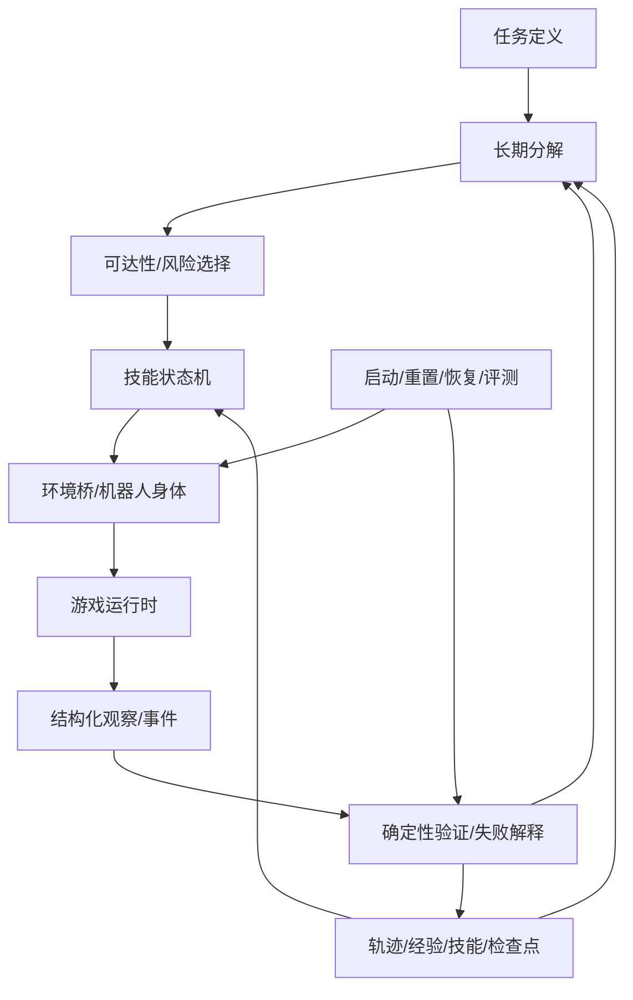
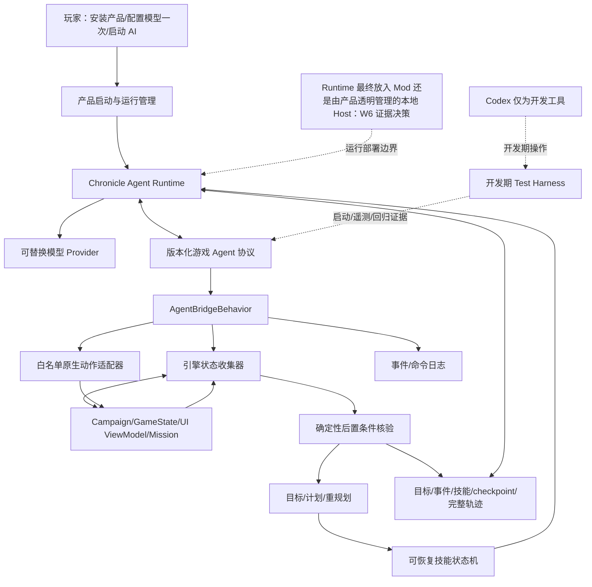
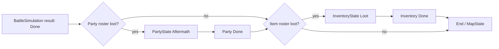

# 当前主线：Autonomous Campaign Agent Mod

绝对目标：AI 不能只是观察者、建议器、辅助工具或需要玩家确认的 Copilot。AI 必须能够独立感知战役状态、制定目标、执行行动、处理失败并持续推进战役。

只有两种正式部署形态：

1. **单机自主客户端**：AI 控制当前 Bannerlord 单机客户端中的玩家角色/玩家战役，拥有完整自主权；不需要第二 Steam 账号。
2. **多人独立客户端**：AI 以独立 Hero/Party/Clan 身份加入共享多人战役，拥有独立客户端身份；这通常需要第二个游戏客户端、第二个 Steam 账号和第二份游戏授权。

同一进程中的同伴/队伍代理可以作为单机架构实验，但只有当它拥有独立目标、独立行动循环和独立战役身份时，才算自主代理，不是辅助功能。

### 术语边界：单机多代理不等于离线联机

- **单机自主玩家**：AI 控制当前单机客户端中的玩家角色；没有第二玩家实体。
- **单机 NPC 代理**：AI 在同一个单机进程中控制独立 Hero、MobileParty、Clan 或其他游戏实体；它拥有自主目标，但仍由同一个战役进程统一模拟，不是网络客户端。
- **多人独立玩家**：AI 作为第二客户端加入共享战役；需要网络同步、独立客户端身份和多人战役服务器/Mod。

“离线联机”不作为工程术语。单机 NPC 代理可以实现玩家与 AI 共同生活在同一战役，但不能据此声称实现了联机。

### 单机多代理的底层限制

单机 NPC 代理在数据层面可行，但存在不能由普通 Agent 逻辑消除的引擎边界：

- 玩家进入单机战斗、聚落或其他 Mission 时，战役时间通常停止；小时/日事件、Party 移动、工资、食物、围城和其他时间系统不会像多人服务器那样继续推进；
- AI NPC 即使在玩家视野外，也不会获得一个独立的并行世界。它通常只是 Campaign 层的 Hero/MobileParty，接受全局抽象模拟；只有进入相应 Mission/Scene 时才有 3D 实体；
- 战略层 AI 可以在 Campaign Tick 上运行；要求真实 3D 场景、实时移动或独立交战的行为，必须等待场景实例化；
- 因此单机 NPC 代理适合验证 AI 作为世界实体的数据模型，不等价于玩家与 AI 同时推进的共同游玩。

真正的并发共玩需要多人服务器拥有全局时钟，并定义玩家进入战斗、暂停、遭遇、战斗结果和断线时的仲裁。现有 Bannerlord 联机项目正是通过服务器权威和时间控制补丁处理这些问题，而不是复用单机暂停语义。

Mineflayer/MineDojo 等 Agent 以独立玩家为动作和观察主体；这不排除 Bannerlord 单机 NPC 代理，它是利用原生 Hero/Party AI 的另一条研究路线，验收不可与多人客户端路线混称。

### Research readiness and current technical focus

Research Gate: **READY**
Implementation Gate: **READY**
行为总分母：**178**（核心Campaign ACT族；OBS分母：**73**，23个N/A不计入）　游戏版本：**1.4.8.119303**

玩家行为目录已完成A-L跨域去重，核心分母基线为本机1.4.8.119303官方Native/SandBox/SandBoxCore/StoryMode模块；`SYSTEM_INVENTORY.md`的126项是系统研究入口，不是动作数量。目录含179条ACT、73条OBS和23条有依据的N/A，其中`ACT-A06-06`仅为打开Cheat菜单的特权入口，另有控制台/作弊命令；全部归入条件特权扩展，不计入标准Campaign行动分母或普通Agent白名单。需要修改游戏状态的作弊能力必须由独立权限层显式授予、与正常规划器隔离并留下审计记录；未获授权时默认不可调用。故标准行动族分母为178，观察面分母为73。第三方Gameplay模块、模型覆写和动态新增入口属于条件扩展，不能静默算进基线或宣称已兼容。多人核心是通过多人战役Mod加入共享Campaign，不包含原生PvP赛事、ForfeitSpawn或通用MP语音；未来支持语音时作为独立通信接口评估。盘点与产品工作次序由GitHub Project维护；本文不保存活动卡片或完成状态。Research Gate通过后仍需按任务板实现、逐项验证；Tier 1仅作为未来成熟度夹具。首个AI战斗接入优先使用Campaign地图坐镇/BattleSimulation；Mission部署、实时Orders和士兵控制仍属完整产品目录，但不属初始战斗切片。Minecraft Agent研究作为架构参考，不构成绕过全景研究的理由。

Implementation Gate READY仅表示允许推进当前单一、边界清楚且已有当前版本机制契约/重复验收路径的W2工作项；不表示178个核心动作已实现或任意功能都可开工。任何变更仍须先有对应玩家入口、前置/副作用/时间与后置条件，限定在GitHub唯一In Progress事项内，运行最窄的原生结果测试；无法复现的分支必须留下明确未知，不能据API调用成功宣称完成。

Minecraft Agent 的环境、规划、技能、记忆和评测研究已沉淀到本文后续架构段落；本文不再把项目目标定义为“测试工具”。

## 玩家交付原则与待定运行边界

玩家必须只感知一个产品：安装 Chronicle Agent、完成一次模型配置、在游戏中启动自主 AI。玩家不安装 Codex/Claude Code，不配置 MCP/CLI/IPC，也不手工启动 Python 或 Node。

内部实现目前不预设为“全部内嵌 Mod”或“必须外置 Agent Host”。两种方案都保留，最终边界由原型证据决定：

| 候选 | 优势 | 主要风险 |
| --- | --- | --- |
| Mod 内编排 | 单包安装、配置直接、状态访问简单 | 游戏线程污染、请求超时、崩溃耦合、重型记忆与多代理扩展困难 |
| Mod + 隐藏 Host | 故障隔离、模型/记忆独立升级、批量测试和多代理更自然 | 安装与生命周期复杂、IPC 和进程管理成本 |
| 混合式 | Mod 保留身体与轻量循环，Host 承担可选重型能力 | 边界设计和兼容测试要求更高 |

冻结部署边界前必须完成同一 Agent 循环的对照原型，至少测量：游戏线程占用、模型超时行为、断网恢复、游戏/模型进程崩溃隔离、存档大小、长期记忆规模、多代理并发、版本升级和安装步骤。玩家体验要求始终是单入口；即使内部存在 Host，也必须由安装器和启动器透明管理。

## 现实参考：AI 效应 + Player2

现有《AI 效应》的安装说明要求玩家先安装 Mod，再单独下载安装 Player2；进入 Mod 设置后选择 `Player2` 作为 AI Backend，使用预设 URL。[AI 效应安装说明](https://www.mountblade.com.cn/news/Bannerlord/2026-01-17/3059.html)

这说明它采用的是：

```text
Bannerlord Mod（游戏内适配器）
        ↓ HTTP/本地或平台接口
Player2（外部 AI Host/平台）
        ↓
模型、账号、额度和 AI 服务
```

Player2 官方定位也是面向游戏和 Mod 的 AI 接口平台，并同时提供模型和玩家入口。[Player2](https://player2.game/)

它不是完整 Agent 架构的必要组成，而是为游戏 Mod 提供统一模型服务的外部后端。这个案例只能证明“可替换后端 + Mod 内提示词/世界逻辑”可行，不能直接证明 Chronicle 的长期自主 Agent 应全部内嵌或全部外置。

Steam 创意工坊或 CurseForge 可以分发 Mod 文件、依赖和配置，但不能可靠地替玩家执行任意外部程序安装。如果最终需要 Host，应由明确的统一安装器或启动器透明管理，不能由 Mod 隐式下载并执行未知程序。

### AI 效应案例带来的架构修正

AI 效应的现有资料显示，Player2 不是它的唯一 Agent Host，而是可选 AI Backend：公开配置同时列出 Player2、OpenRouter、DeepSeek、Ollama、KoboldCpp 等后端；Mod 自己负责生成结构化提示词、读取游戏上下文、保存世界/提示词数据，并通过后端 URL 请求模型。[AI Influence 后端说明](https://www.nexusmods.com/mountandblade2bannerlord/mods/9711) [AI Influence Prompt Control](https://github.com/PiTatva/AI_Influence_Prompt_Control)

当前只冻结两个技术结论：后端必须可替换，游戏动作与结果验证必须留在 Mod 的安全边界内。规划、提示词、长期记忆和技能库运行在 Mod 内还是 Host 内，须通过同一 Agent 循环的可重复对照原型决定，不能由现有代码库存或安装偏好反推。

## Minecraft Agent 全景结论

已核对论文、官方仓库和 Voyager/Mindcraft 关键代码，覆盖与本项目有关的主要架构家族：

| 层 | 代表项目 | 已解决问题 |
| --- | --- | --- |
| 实验环境 | Malmo、MineRL、MineDojo、MineStudio | reset/step、观察/动作、任务、终止、轨迹、批量评测和崩溃恢复 |
| 原生机器人身体 | Mineflayer | 游戏协议、实体、寻路、背包、合成、容器和战斗高层 API |
| 代码技能与课程 | Voyager、Odyssey | 自动课程、成功技能沉淀、检索、Critic、checkpoint |
| 交互式规划 | DEPS、GITM | 描述、解释、重规划、可达性选择和分层动作 |
| 多模态控制 | VPT、STEVE-1、JARVIS-1 | raw pixels 到键鼠、短时控制器和多模态经验记忆 |
| 工程化 LLM Bot | Mindcraft | 命令白名单、中断、超时、循环检测、记忆压缩、技能检索和代码沙箱 |
| 任务评测 | MCU、MineStudio Benchmark | 原子/组合任务、Simple/Hard 条件和批量证据 |

成熟 Agent 不是一个大模型直接“玩游戏”，而是以下闭环：



缺少环境契约、动作原语、执行后验证、中断、checkpoint 或 benchmark，都会把额外成本转嫁给 LLM 推理。

## 代码级认识

Voyager 实际由 Python 协调器、HTTP 环境桥和 Node/Mineflayer 组成。每轮向环境发送程序与已检索技能，环境执行后返回事件和最终观察；Critic 判断成功，失败状态与 critique 回流，只有成功程序进入向量检索技能库。课程进度、失败任务、技能代码和数据库可 checkpoint 恢复。

Mindcraft 将命令路由、ActionManager、SelfPrompter、History、SkillLibrary 和 Coder 分离。ActionManager 会中断旧动作、设置超时、检测快速/无限循环；History 同时保存短上下文、压缩记忆和完整轨迹；技能按相关性选择；生成代码先检查引用和 lint，再进入受限 compartment。

这些工程保护比“让模型多思考”更重要。

## 迁移与拒绝

采用：

- Malmo/MineRL 的环境动作契约；
- Mineflayer 的原生身体分层；
- Voyager 的动作后观察、Critic 反馈和成功技能沉淀；
- DEPS 的失败解释、重规划与可达性选择；
- JARVIS-1 的规划器/控制器分离；
- Mindcraft 的白名单、中断、超时、循环检测、上下文压缩和完整轨迹；
- MCU 的 Standard/Hard 任务评测；
- MineStudio 的批量运行和崩溃恢复。

暂不采用：

- VPT/STEVE-1 的逐帧视觉控制；战役层低频决策不值得承担其成本；
- 在游戏进程执行 LLM 任意生成代码；
- 第一阶段开放式自动课程；
- LLM Critic 作为成功真值；
- 为测试直接写入资源、位置或战斗结果；
- 把全世界状态和全部技能塞入上下文。

## Bannerlord 目标架构



- 游戏内 Mod 是深入 Bannerlord 引擎的身体：从当前 Campaign、GameState、原生菜单/ViewModel、Mission 与事件生命周期收集信息，并把 Agent 意图映射到有前置/后置条件的原生动作；不能用外部脚本伪造游戏结果。
- Agent Runtime 是交付给玩家的自主决策系统，包含模型 Provider、目标规划、技能状态机、记忆、验证和重规划。部署到游戏进程内还是由产品透明管理的本地 Host，仍由 W6 的原型证据决定；无论边界如何，玩家都只安装/启动一个产品并配置模型一次。
- Codex、MCP、开发用 CLI、Computer Use 与 Test Harness 只属于开发工具，不是交付依赖、产品界面或 Agent Runtime。若 Agent Runtime 位于进程外，它必须随产品被透明部署/启动/更新/停止，玩家不能被要求自行准备 Python/Node 等开发运行环境。
- 游戏进程只执行协议允许的结构化读取与白名单动作；不得执行模型任意生成代码。模型调用不能阻塞 Campaign/UI 主线程。

## 状态、记忆与动作

状态分层：

1. 即时状态：界面、时间、玩家队伍、资源、位置、附近实体和当前遭遇；
2. 增量事件：资源变化、移动、战斗、任务、错误和存档；
3. 工作记忆：目标、子目标、当前技能步骤、预算和风险；
4. 情节记忆：状态—动作—结果—失败原因；
5. 语义记忆：已验证技能、版本、前置和失败模式；
6. 完整轨迹：不可压缩命令、状态、日志和 checkpoint。

每个动作必须声明协议版本、稳定实体 ID、参数、前置条件、成功条件、可恢复/不可恢复失败、超时、中断、清理、重试和幂等边界。自然语言摘要不能替代结构化状态与完整轨迹。

## 当前本机接口风险

历史探针确认过 `MBSubModuleBase.OnGameStart`、`CampaignGameStarter.AddBehavior`、`CampaignBehaviorBase.RegisterEvents/SyncData` 和多个 `CampaignEvents`，但这些证据来自先前本体状态。当前客户端为 `v1.4.8.119303`，进入实现前必须针对当前 DLL 重探针。

当前代码中已有只读 `ChronicleCampaignBehavior` 与 `DailyTickEvent` 计数实验；旧模块加载、行为注册和旧存档日志不能作为当前版本证据。

## Observation knowledge and open contract

原版实体分别暴露 `IsVisible` 与 `IsInspected` 两种地图状态；属性本身不足以证明它们如何对应地图图标、悬浮提示、ALT 部队详情或百科信息。任何 Agent 情报策略都应先核对玩家实际入口与运行时可见结果，不从字段命名推导遮蔽规则。静态面板按需读取，不应默认将玩家物品、队伍、家族、王国和日志全部塞入每次决策上下文。

## Action contracts and coverage definitions

#### 覆盖口径与验收证据 / Coverage and Evidence Contract

本表定义长期有效的分母和判定方式，不维护当前完成数。任务完成状态由GitHub Project Issue表示；单次通过/失败、运行号和原始文件由 `TestResults/<run-id>` 表示。

| 范围 | 分母或判定规则 | 证据规则 |
| --- | --- | --- |
| 玩家行为与观察面 | A-L全域审完并跨域去重后，按核心Campaign ACT族ID计行动分母、按OBS族ID计观察分母；明确排除的特权作弊接口另列，不并入核心分母 | 每条目录记录在来源列引用有效系统编号，且所有126个A-L编号至少被引用一次；Docs同时验证ID唯一、引用已定义和逐系统有目录映射。现行基线178核心ACT/73 OBS；`ACT-A06-06`与其可选作弊命令属单独权限扩展；详细事实见对应Research/源码/运行证据 |
| GameState接口 | 反编译枚举的状态类型只是接口分母，不等于玩家行为或 Agent 覆盖率 | 按当前安装DLL重新盘点；API Probe和运行时结果分别标记 |
| 自主 Agent 闭环 | 必须有非测试模型/规划器选择目标、调用白名单动作、验证结果，并在世界变化或失败后重规划 | 确定性Provider、单动作成功或累计动作数量均不能算自主闭环 |
| 长程成长夹具 | Tier 1用于评测长期规划、资源、风险和恢复，不是产品目标，也不要求通过刷固定奖励达成 | 结果必须来自 disposable campaign、保留状态/动作证据并清理夹具；失败如实保留 |
| 视觉证据 | 仅用于结构化遥测不能判明的真实界面迁移；采集窗口、帧覆盖、索引和源视频清理均需验证 | 关键帧与事件时间线可追溯至同一run；不将截图替代游戏状态真值 |

新增动作族先更新完整行为分母和验收定义；命令数、Issue数量和测试运行次数都不代表 Agent 能力进度。

#### 原版机制契约 / Mechanic Contract

| 动作 | 玩家入口 | 原版自然副作用 | Campaign 时间行为 | UI/API 差异及当前实现 | 证据 / 未知 |
| --- | --- | --- | --- | --- | --- |
| OBS MapScreen settlement markers / on-demand `mapSettlementTargets` | Campaign Map显示本体`Settlement.IsVisible`的聚落marker；玩家可平移/缩放地图浏览，再用当前MapScreen鼠标ray选中visual | 只读观察不改变Settlement/Party状态或时钟；选中并点击才执行ACT-K02-01的原版导航/点击时间处理。列表只包含原版地图可见标记，不含未发现全局Settlement | 观察无时间副作用；有效地图点击按当前Campaign点击时钟配置改变时间档，之后自然推进 | 普通`state`保留schema21和局部`nearbySettlements`摘要；Agent需要规划地图目标时显式调用只读`mapSettlementTargets`，回传独立schema 1紧凑名单，避免每轮状态重复携带约393项/52KB清单。集合仅取active + `IsVisible`并附`isInspected`；协议`move`拒绝IsVisible=false target并复核`GetInteractionDataForMainParty` | 本机1.4.8 `SettlementVisualManager.OnInitialize`枚举Settlement.All，`SettlementVisual`按MapEntity.IsVisible显隐，`PartyBase.UpdateVisibilityAndInspected`区分IsVisible/IsInspected，`MapScreen`用ray-hit测试；`village_V1_1`Calioc运行`20260927-080856`与主队相距20.5，出现在地图目标查询但不在周边8项摘要；同一运行确认IsVisible=false的藏身处未列出，协议move拒绝且位置/目标/时钟不变。未知：未发现`ISpottable`和各类mod覆盖的完整映射、地图镜头/鼠标焦点与屏幕投影的视觉精确对应 |
| OBS MainHero skill levels / `mainHeroSkills` | 玩家在C→Character Developer选择MainHero查看各Skill当前等级；不是XP/Focus/Perk页面草稿数据 | 被动读取MainHero的原版SkillObject等级，不改HeroDeveloper、不推进Campaign时间；角色成长仍只能由其他行为族产生 | schema21固定体量字段随一般state提供所有当前`Campaign.Current.AllSkills`，每项含skill id/name/level；Hero.GetSkillValue是本体同一数值。技能集合动态适配活动模块新增的SkillObject | 本机1.4.8 `CharacterDeveloperVM`给MainHero构造SkillVM并用`HeroDeveloper.Hero.GetSkillValue(Skill)`设Level；observer对当前AllSkills按id排序。`MainHeroSkills` harness以独立visual-capture QA读数逐项比对、确认重复state无变且时间/存档不变；未知主要是第三方Mod对技能value/对象注册和CharacterDeveloper适用Hero规则的覆盖 |
| OBS MainHero Character Developer details / `characterDevelopment` | Agent在Campaign Map按需请求C→Character Developer对应主角成长信息；不把界面所有数据常驻给模型 | 只读MainHero属性、角色等级经验、未分配属性/Focus点、Skill等级/经验进度/Focus/学习率与上限、当前技能等级已解锁Perk状态；不写HeroDeveloper、不推进Campaign | 独立schema1工具，仅Agent显式调用；默认state维持schema21体量。只返回当前可见成长选项，不列完整Perk百科、不读取其他Hero/Trait | `TestResults/20260927-095403/Temp/CharacterDevelopmentResult.json`对照本机1.4.8 `CharacterDeveloperHeroItemVM`：6 Attributes、18 Skills所有比较字段一致，重复查询稳定、Campaign状态/时间/存档hash不变、进程停止。当前夹具没有已解锁Perk，非空解锁分支、其它Hero和第三方Mod覆盖未知；不代表Perk可选动作或视觉页面已验 |
| Map party markers / on-demand `mapPartyTargets`（W2-L候选） | Campaign Map里可被原版`MobilePartyVisual`选中/悬浮的移动Party marker；用户确认地图显示人数，悬停+ALT可查看政治Party兵种组成。摄像机当前屏幕范围与Campaign全局`IsVisible`不是同一概念 | `MobilePartyVisualManager.OnInitialize`为非Garrison/Militia Party创建visual；`MobilePartyVisual.OnHover`只对MapEntity.IsMobile且IsVisible显示tooltip。附着Party的visual有`AttachedTo`并被MapScreen命中后映射到leader marker，所以目标清单不重复列附着子Party。官方`IsInfoHidden`字段虽有NameplateVM读取方，但原版无对应信息隐藏玩法（用户确认），且所查官方CampaignSystem/SandBox/StoryMode源码未见赋值；仅按兼容/Mod扩展字段处理，Agent观察不据此隐藏人数 | 只读`PartyBase.IsVisible`、isInspected、MainParty可见基础摘要；不包含ALT详细Roster，不作视觉相机视锥假设；Agent显式查询而不扩大nearby摘要 | 本机1.4.8 `SandBox.View.MobilePartyVisualManager`/`MobilePartyVisual`反编译核marker创建、Garrison/Militia排除、可见显示及附着点击合并。`TestResults/20260927-121425/Temp/MapPartyTargetsResult.json`返回6个目标，与当前存档原生可见marker候选集合一致；名称/类型/检查状态/健康人数/伤员/俘虏/距离逐项匹配原生Nameplate读取，重复稳定、战役/存档未变、进程退出。测试模块含Harmony等前置，不称纯净原版运行；诊断中六项IsInfoHidden均为false。用户已确认ALT逐兵种详情入口，但本接口不覆盖。未知：attached Army tooltip的精确Roster汇总、各类型Party在自然Campaign中的分布、屏幕摄像机可见范围与全局marker清单的视觉映射 |
| Map party composition / on-demand `mapPartyComposition(partyId)`（W2-M；单个普通MobileParty路径） | 玩家悬停当前可见的独立MobileParty marker并按ALT展开Tooltip（按键/玩家所见由用户确认）；`mapPartyTargets`提供名牌摘要，此工具按需查看单个普通Party当前可显示的兵种/英雄组成 | 本机1.4.8 `MobilePartyVisual.OnHover`→`InformationManager.ShowTooltip(typeof(MobileParty), ...)`→`TooltipRefresherCollection.RefreshMobilePartyTooltip`。`AddPartyTroopProperties`在`TooltipBaseVM.IsExtended && IsInspected`时列MemberRoster逐兵种/英雄行，条件满足时另列PrisonRoster。Army leader走不同的`RefreshArmyTooltip`聚合路径，本项明确拒绝Army leader详情，留待独立验证。`IsInfoHidden`有官方Tooltip读取方，但用户确认它不是原版战役信息隐藏玩法；仅当活动Mod实际置位时匹配当前UI不返回详情，不当作vanilla规则 | 查询不写Party/roster、不操作时钟；Campaign自然按当前档运行。原版hover/扩展Tooltip不切时钟；Agent查询跳过物理hover/ALT键与绘制，只复现当前active/visible/inspected普通MobileParty能看到的Roster字段 | 只接受活动Campaign Map中当前符合`mapPartyTargets`条件的独立非Army-leader Party ID；Army leader、`IsInspected=false`或活动兼容钩子压制详情时不给阵容。无效ID回`rejected`。本工具不是物理键鼠ALT复现，也不是摄像机截图 | `TestResults/20260927-125259/Temp/MapPartyCompositionResult.json`：六个可见/inspected目标均为普通Lord Party；其中一支13种成员类型的名称、ID、总数/健康/伤兵/Hero字段对照Campaign roster诊断一致，并在本机官方 `PropertyBasedTooltipVM(IsExtended=true)`字段列表找到相同兵种名；重复读取稳定，无效ID rejected，战役状态/时间/存档hash不变、进程退出。模块集含Harmony/ButterLib/UIExtenderEx/MBOptionScreen，不是纯净原版。该6项无Army leader、伤兵、俘虏，故对应非空分支未运行验证；也未手工操控ALT/截屏。Army Tooltip聚合属真实待办，不宣称已完成 |
| Active Quest Journal details / `questDetails(QuestId)`（W2-J；源码与运行验收通过） | 玩家从Quests/任务日志页选择一个当前进行中任务，查看当前阶段、记录文本/子目标进度、任务发起人及期限显示 | `QuestsVM`从`QuestManager.Quests`选进行中Quest；`QuestItemVM`按`QuestBase.JournalEntries`构建阶段，日志类型决定显示普通文本或TaskName/CurrentProgress/Range；过期与失败仍由QuestBase/QuestManager规则驱动 | 查询只回读本次`state.quests`已列出的进行中Quest，不读历史完成任务/隐藏内部TaskList，不改变Journal已读标记、Quest或Campaign时间。期限按`Quest.IsRemainingTimeHidden`尊重原版隐藏规则；schema21摘要只给原版可见的整日剩余时间，隐藏时为null | 本机1.4.8 `QuestsVM`/`QuestItemVM`/`QuestStageVM`/`JournalLog`链已核；`TestResults/20260927-111022/Temp/SettlementOverlayQuest-QuestDetails-Result.json`：原版接受VillageNeedsToolsIssue后QuestItemVM阶段、文本/Task进度、任务人、期限天数逐项对照；重复查询稳定，未观察ID被拒，Quest集合/Campaign/存档不变。此Sandbox样本期限可见；隐藏期限返回null的序列化分支经Harness回归验证，但没有加载真实StoryMode隐藏期限Quest作运行样本；替代方案/已完成历史仍不覆盖，不将其包装成通用Quest执行器 |
| MainParty member/prisoner roster / on-demand `partyRoster`（W2-K） | Campaign Map打开MainParty管理/Party Screen以查看本队成员、伤员与俘虏编制；不记录未确认的热键/特定面板输入 | 只读`MobileParty.MainParty.MemberRoster`与`PrisonRoster`的TroopRoster元素、人数/健康伤员与Hero标志；不写Roster、不读取其他Party、不推进Campaign | 普通state保持汇总；仅Agent显式调用无参数`partyRoster`且在MapState可用。Stable character ID排序；数据为语义Roster，不冒充PartyVM视觉排序/按钮可用性 | `TestResults/20260927-112940/Temp/PartyRosterResult.json`逐行比对本机1.4.8 MemberRoster/PrisonRoster及state摘要，重复查询稳定、Campaign Stop下无变化、存档hash与进程清理通过；样本有1类MainParty成员、没有俘虏，因此非空俘虏项与真实PartyScreen视觉仍待验证 |
| `spendSkillFocus`（W2-I；仅主角技能Focus点） | 玩家按C打开Character Developer，选MainHero/技能并点击Focus加点，再按Done；Cancel会丢弃本次草稿 | `SkillVM.ExecuteAddFocus`先在VM草稿中减未花Focus点、加目标技能Focus并触发`FocusAddedByPlayerEvent`；Done→`ApplyAllChanges`→`CharacterDeveloperHeroItemVM.ApplyChanges`→`SkillVM.ApplyChanges`逐点调用`HeroDeveloper.AddFocus`。Cancel→`ResetChanges(isCancel:true)`后关闭、不提交。直接调用`HeroDeveloper.AddFocus`会跳过点数草稿/取消回滚；Agent在单个请求内用原生VM起草、完整校验并提交，拒绝时不写入、不跨回合保留未提交草稿 | 适配器只接受Campaign Map状态，提交动作不调用时间API、不改变时间档；Campaign仍按请求前的时钟模式自然推进。Harness用显式Stop隔离自然时间推进并核验命令未改时钟。打开面板的`CharacterDeveloperState.IsMenuState=true`；实际UI open/close时钟恢复分支未视觉验证 | `TestResults/20260927-102057/Temp/SpendSkillFocusResult.json`：真实fixture MainHero Crafting Focus 0→1、未花点3→2，学习率/余额/Focus与本机1.4.8 `CharacterDeveloperHeroItemVM`/HeroDeveloper回读一致；余额不足与超过Focus上限均整体拒绝、没有部分副作用，主队/资源/位置/Quest/时钟稳定、源存档hash不变、进程停止。未覆盖主角真实屏幕点击、自然未暂停时钟、其它Hero/第三方Model覆写；不代表属性/Perk分配、Cancel UI或完整Character Developer工作流 |
| moveToPoint（自由地点移动，陆地） | Campaign地图左键点击有效陆地NavMesh点（非Settlement/Party视觉实体）；MapScreen从鼠标射线得到带Face与`IsOnLand`语义的`CampaignVec2` | `MapScreen.HandleLeftMouseButtonClick`通过地图相机/Encounter及`MapScene.DoesPathExistBetweenFaces`门禁后调用`MapState.ProcessTravel`；后者先清`ForceAiNoPathMode`，再由`NavigationHelper.CanPlayerNavigateToPosition`验证并`SetMoveGoToPoint` | 有效地图输入进入`HandleClickTimeChange`；之后Campaign按当前档自然推进，不附加`advance/pause`。API调用`ProcessTravel`本身不切时钟 | W2-B实现`moveToPoint(X,Y,Surface=land)`白名单；先验证坐标Face/NavigationModel，再调用`MapState.ProcessTravel`并复现成功点击时间档；只接受陆上主队与陆地目标。schema 9向Agent观察主队自己的GoToPoint目标坐标。直接API不做UI屏幕射线/相机路径门禁 | 本机1.4.8.119303 SandBox.View.MapScreen/`MapState.ProcessTravel`/`DefaultPartyNavigationModel`源码已核；`CampaignVec2.Face`延迟由MapSceneWrapper计算。`MoveToPoint`运行`20260926-211402`在disposable fixture从(207.018,389.419)移动到(208.518,389.419)，有效目标1步到达，GoToPoint/targetPosition/自然移动一致；超界目标拒绝且位置/目标/时间未变，fixture和进程清理通过。NavSea/港口死区/转场不在W2-B支持范围，交由单独边界研究 |
| Settlement Notable `Visit`/“造访”/`talkToSettlementHero`（W2-D，ACT-J02-01） | Settlement菜单人物列表或地图顶栏重要NPC头像 → 选择目标人物的原生`Conversation`上下文项；其Native中文Localization显示“造访”。这是同一目标式入口，不拆成两个行为。 | `SettlementMenuOverlayVM`构造`Conversation`动作标签`str_menu_overlay_context_list.Conversation`；Native字串将其映射到`toK51MD4`“造访”。`GameMenuOverlay.ExecuteTroopAction(Conversation)`检查TalkPermission，解析目标Location，触发`OnPlayerStartTalkFromMenu`并创建带目标Hero的Location Mission；SandBox `MissionConversationLogic`加载场景/目标后启动该Hero Conversation。协议`talkToSettlementHero(HeroId)`以当前overlay可见Hero为限，复现该目标式原生路径；与点击顶栏头像后选“造访”语义相同，差异是协议不执行鼠标焦点/按钮动画。 | 进入Location Mission后Campaign时钟按本体规则停止；退出后的恢复/返回菜单仍待核实。动作没有额外推进地图时间。 | Observer schema21暴露当前Characters overlay名单/Quest markers；Mission `dialogue`返回目标Hero与原生选项；测试专用全场景Notable诊断不进入AI观察。 | 本机1.4.8 `SettlementMenuOverlayVM`/`GameMenuOverlay.ExecuteTroopAction`反编译与Native中文Localization (`str_menu_overlay_context_list.Conversation`→`toK51MD4`“造访”)；StoryMode教程`VzE9aVBh`确认顶栏NPC头像→造访。`TestResults/20260927-052705/Temp/SettlementOverlayConversationResult.json`验证目标Hero、Greeting和原生选项，Campaign Stop、Quest 0→0、源档hash不变、进程清理。此前盲走坐标测试发现目标Notable距入口121.4；targeted Visit路径免去该无效搜索。未知：顶栏入口具体VM/按钮触发是否与overlay handler完全共用，TalkPermission拒绝分支和离场/时间恢复。
| missionViewAim（W2-D视线/Focusing研究） | Mission中鼠标移动相机；屏幕准星/原版Focus界面表明当前瞄准物 | `MissionScreen.UpdateCamera`改变相机bearing/elevation；`MissionMainAgentController.LookTick`根据相机姿态设置MainAgent视向；`MissionMainAgentInteractionComponent.FocusTick`用场景射线更新`CurrentFocusedObject`，Action时再检查可交互与范围 | Location Mission内CameraView调整不快进Campaign；当前Campaign `TimeControlMode=Stop`。 | API确认`MissionScreen.CameraBearing`有公开setter，`CameraElevation`只有getter；Observer读取相机姿态和原生Focus。有限Target Agent只能来自本地12单位观察并由agentIndex临时标识。 | `TestResults/20260927-005534/Temp/TownCenterMissionResult.json`：一回合确定性Provider按当前观察的Agent 32（Soldier，非Notable）请求原生相机yaw调整，bearing 2.221→2.748，但等待后`CurrentFocusedObject`仍为null；`TestResults/20260927-031458/Temp/TownCenterMissionResult.json`对一名普通Townswoman做局部导航后重观察，原生Focus仍为空。相机视向写入不等价于目标通过Focus、无遮挡和可交互检查。`TestResults/20260927-014511/Temp/TownCenterMissionResult.json`证明32步后附近只观察到Soldiers。未知：原生相机朝向计算、Focus更新时序或目标可交互性何者导致未命中；不能把cameraAim回执或视角变化作为瞄准成功，也不得直接指定Focus对象
| follow / escort | Campaign地图上按住`MapFollowModifier`点击一个可导航的移动Party | `MobilePartyVisual.OnMapClick(true)`→`MobileParty.MainParty.SetMoveEscortParty(target)`；记录目标与导航模式，`DefaultBehavior=EscortParty`，不同于敌对接近 | 有效点击调用与普通地图点击相同的`MapScreen.HandleClickTimeChange`；后续只按当前时间模式自然推进，不附加`advance/pause` | W2-A已在AgentProtocol/CLI实现`follow`白名单；直接setter仍跳过地图目标选择/焦点检查及点击时钟副作用 | 本机1.4.8.119303安装版`TaleWorlds.CampaignSystem.dll`：`MobilePartyAi.TickInternal`仅对主队`EngageParty && !TargetParty.IsVisible`调用`SetMoveModeHold`；`GetFollowBehavior`对Escort只在目标null/非active时Hold，目标在聚落时改走聚落、否则跟随位置。`MobileParty.IsVisible`属性读写的是`_isVisible`标记，属性本身不能证明它等同于玩家视野/画面内可见。`EscortVisibility`运行`20260926-203358`自然观察45秒（Campaign Day +0.055）：目标从距离7.037靠近至0.056，始终在附近观察内，`DefaultBehavior=EscortParty`且时钟保持`StoppablePlay`；没有触发目标不可见分支，不能外推其结果。用户此前提到目标视野变化后队伍停止，但没有确认是哪种地图输入；此项仍是语义/运行未知，不移植Engage规则 |
| move | Campaign Map选择本体`IsVisible`的Settlement marker；通过on-demand `mapSettlementTargets`读取可选目标，玩家可平移/缩放后点击 | `SettlementVisual.OnMapClick`检查`IsVisible`、`GetInteractionDataForMainParty`并调用`SetMoveGoToSettlement`；协议也检查active/IsVisible/hostility及同一导航model，不可达则拒绝 | 真实MapScreen点击按`HandleClickTimeChange`改时钟；协议按相同点击策略设档，之后Campaign自然推进，不附加快进/暂停 | `move`按SettlementId调用原生导航目标，跳过真实鼠标ray/焦点与相机平移，但只接受本体IsVisible目标，不能访问隐藏Settlement | 本机1.4.8 `SettlementVisual.OnMapClick`/`MapScreen`/`NavigationHelper`源码；`MapSettlementTargets`测试证明Calioc从visible targets选入并自然抵达Village菜单，隐藏hideout被拒且无位置/目标/时间/存档变化；显示端到端证据仍不等同于人工逐像素hit-test |
| pursue | 普通左键点击移动部队令主队追近；用户确认通常快速双击以触发通用三倍速，不按隐藏修饰项 | 原版地图实体点击走`EngageParty`；目标离开玩家可见范围后，用户观察主队丢失目标并停下、时间暂停；此触发与Agent观测范围/内部`IsVisible`标记的对应关系仍待验证 | 用户观察：快速双击带来通用三倍速；丢失目标时Campaign时间暂停。适配需与原版点击时钟设置分开核实 | CLI 已复现 Engage 与点击时间政策，但未复现目标离开玩家可见范围的停步/暂停 | 来源：普通点击是用户在本机1.4.8游玩中的实际操作说明；Harness对可见目标自然接敌已测；源码`MobilePartyAi.TickInternal`仅能证明`TargetParty.IsVisible=false`时设置Hold，不能单独证明该标记等于玩家感知的“视野消失”。未知：三倍速双击如何在当前配置状态下形成时间模式、停步与暂停是否为同一原版更新链；后续通过源码/一次性自然运行厘清，不再追问用户是否按专用Follow键 |
| hold | 点击玩家队伍 | `SetMoveModeHold` 清目标 | 地图单击时间策略 | CLI Hold+点击时钟 | 运行断言目标清除并检查原版点击时钟 |
| rest | `town_wait` 菜单 | `StartWait` 快进；`EndWait` Stop | `rest(days)` 只观察时长 | 保留原生 Wait menu 时钟，离开后 Stop | 运行断言 Wait menu、持续时间及离开效果；`IsMainPartyWaiting` 生命周期语义需单独理解 |
| advance | Harness 专用，不是地图输入 | 按请求推进 Campaign | 固定步长；遭遇可提前结束 | CLI/Harness 显式工具；决策 provider 拒绝调用 | 独立时钟测试；不得塞进普通地图动作 |
| autoresolve (research) | 遭遇“坐镇指挥”→Done | Init→StartSimulation→Skip→OnFinished→PartyState | 追近自然推进；模拟Stop | 原生Pause/Skip/Done；测试夹具注入敌方 | 奖励与双方状态可结构化核验；自然随机战斗结果需另验 |
| dialogueSelect / dialogueContinue | Campaign地图追近可交谈Lord并进入`encounter_meeting`后，选择当前活跃Sentence选项；无选项时按Continue | `ConversationManager.DoOption(id)`执行当前Sentence的Native consequence并生成下一阶段Option；`ContinueConversation()`只推进当前无选项Sentence。问候选择后的“我会记住你的”显示`hero_give_issue`后续Option，但本测试不接Quest | pursuit地图点击按原配置转为StoppablePlay；NPC会面启动后当前运行的TimeControlMode为Stop，对话选项/Continue本身不额外改时钟 | Protocol `dialogueSelect`重验Conversation活跃/option在CurOptions中/IsClickable；Continue只在CurOptions为空时调用。直接API使用ConversationManager原生条件/后果，跳过ConversationVM按钮动画/焦点；W2-C已通过一次性fixture验证地图会面输入和重观察 | `TestResults/20260926-214832/Temp/AgentConversationResult.json`：无效option与有选项时Continue均Rejected且无Conversation变更；选择`lord_meet_player_response1`和无选项Continue后流程推进至下一选项；fixture hash不变/进程清理。未知：其它ConversationFlow、Quest/Barter/Persuasion后果、对话中断/退出与不同host时钟 |
| incidentSelect | Town leave→modal→choose/Done | VM Confirm→effects/close | Modal pauses/locks time; close restores | Direct API skips cleanup; unsupported | 目前源码链；模态窗口生命周期与时钟仍待运行核实 |
| talkToIssueOwner (research) | 蓝标→聚落场景→交互 notable | Issue→give→precheck→brief或拒绝 | probe Stop→Stop；运行未知 | 现有本地探针跳过3D接近，仅研究性 | 不同Issue种子/前置会产生不同对话；不可泛化成通用接委托能力 |
| dialogueContinue (research) | 地图对话无选项时 Continue/继续 | Gauntlet `ExecuteContinue`→`ConversationManager.ContinueConversation` | 对话/遭遇时间待核实 | 仅 `CurOptions` 为空时调用 | 运行后要确认对话阶段和遭遇迁移；时钟语义未知 |
| retreat (research) | Mission TAB→Quit；模拟结果→Quit确认 | `TryExit`→RetreatMission；Simulation→XP/encounter | Mission暂停；Simulation未知 | Adapter绕过HUD确认 | 分开验证UI确认副作用与API结果结算，不相互替代 |
| partyLoot (research) | Battle Done→Party/Inventory Loot→Map | 原生Loot screens/Done | 战后Stop | 测试夹具注入战利品；直接离开会跳过Loot | 通过Roster/Inventory前后差异核验；自然掉落和视觉交互分别标明 |



### 当前原版界面核对记录

| 界面 | 已核实入口/行为 | 本地验证层级 | 尚未声称 |
| --- | --- | --- | --- |
| 城镇中心 `town` | 抵达后打开；菜单包含招募、交易、主楼、竞技场、酒馆区、等待、离开等动态选项；离开后回到地图 | 原版代码 + 战役状态/命令回执 | 未做人工逐项截图核对所有选项状态 |
| 招募 | 原版入口是 `town` 菜单的 `recruit_volunteers`；该 VM 按 notable 列出可招募兵种、费用、工资与队伍容量 | 招募 VM 实际执行、roster/金币结果验证 | 当前 Harness 直接调用本体 `RecruitmentVM`，未导航并展示可视招募弹窗；不能称为 UI 路径已验证 |
| 城镇交易 | 原版入口是 `town` 菜单的 `trade`；本体用 `InventoryLogic` 处理市场交易 | 食品报价、交易结算、玩家库存/市场/金币状态验证 | 当前测试不打开可视交易屏幕；不能称为视觉交互已验证 |

证据等级统一标为：源码/资源核实、运行时状态核实、自动动作/结果核实、人工视觉核实。高等级不自动替代低等级；尤其“VM 调用成功”不等于“已验证玩家从界面入口走通”。

## Tier 1 long-horizon evaluation fixture

本阶段定位：Tier 1 是衡量新档 Agent 成长/资源/风险闭环的验证场景，不是产品目标或必须“过关”的交付承诺。不得为凑足 50 Renown 临时堆一次性功能；若通用能力不足，记录证据与缺口，按产品主线判断是否值得补齐。

1.4.8新档与成长证据

- 角色创建反编译显示：成年背景选择在新档起始给予 Clan Renown +20；Tier 1 门槛为50，因此示例背景下缺30。StoryMode 的+25奖励要在Tier 1 后才可能取得，不能作为前置成长路径。
- 在确定性、非模型Provider下，测试招募入口通过VM产生过以下原生副作用：招入一名瓦兰迪亚新兵花费20第纳尔、工资2/日、队伍人数+1；此类单动作结果不代表Agent具备自主成长能力。
- 新档的本地Issue种子和条件有变化：有的没有Issue，有的仅有金币报酬，也有到不了Brief的情况；单个fixture不能推成通用可用的任务路线。

声望来源静态研究记录

对 1.4.8 CampaignSystem、SandBox、StoryMode 的反编译源码检索 `GainRenownAction.Apply` 和 `Clan.AddRenown`，可定位大量声望赋值调用点。它们不等于玩家行为全集：同一Issue可有多种奖励分支，一个行为也可能共用奖励helper。必须逐项还原入口、条件、成本、失败与奖励，才能判断玩家是否真的有该路径。

- 战斗：`MapEventSide` 先根据敌我强度与双方强度比计算战斗声望值；`MapEvent` 再按胜方各队贡献份额和敌方战力被消灭的比例分配，`DefaultBattleRewardModel` 还可能叠加 perk/文化修正。它不是每胜一场给定常数。
- 受控战斗夹具证明原版结算会依据双方强度、胜方贡献和敌方消灭比例计算声望；单个受控样本不代表野外自然遭遇的典型收益，不能线性外推成达标战斗场数。
- 锦标赛：`DefaultTournamentModel` 默认胜者给3点，但赛事生成受城镇状态、时间及当地参赛者等条件影响；玩家须进入赛事 Mission。Chronicle 当前没有锦标赛/3D比赛控制能力，因此奖励数值并不等于可用路线。
- Issue：源码中存在多个+1至+10左右的奖励分支，但每种 Issue 的触发对象、前置资源、交付方式和成败结果不同；聚合调用点不足以判断哪一种适合作为通用的 Tier 1 前置循环。

当前判断：地图战斗与已有 battle bridge 的复用度最高，只能列为一个可检验候选；不能把P5偷换为“反复打劫匪直到50”。在确定验证场景前，还需从玩家实际可用路径、出现率、损失/收益及尚未适配的入口完成比较，并继续保持 Tier 1 是Agent成熟度夹具而非产品目标。

## 维护规则

- 本文维护技术目标、机制契约、领域架构、长期验收定义和未解事实；不保存项目工作项状态、域完成计数或测试通过快照。
- GitHub Project 是唯一工作项/依赖/状态入口；本地 `TestResults/latest.json` 只代表最近一次本机Harness运行，不代表任务完成或当前项目状态。
- 主线改变时更新本文并运行 `Set-ContextFocus.ps1 -Review` 刷新hash/复核期；ContextState只作为本文件和按需研究的路由器。
- 缺少前置时按GitHub原生依赖表示阻塞；领域事实和验收约束留在本文/Research，不复制进任务状态字段。

## 主要来源

- Voyager: https://github.com/MineDojo/Voyager
- Mineflayer: https://github.com/PrismarineJS/mineflayer
- Malmo: https://github.com/microsoft/malmo
- MineRL: https://github.com/minerllabs/minerl
- MineDojo: https://github.com/MineDojo/MineDojo
- MineStudio: https://github.com/CraftJarvis/MineStudio
- DEPS: https://github.com/CraftJarvis/MC-Planner
- GITM: https://github.com/OpenGVLab/GITM
- VPT: https://github.com/openai/Video-Pre-Training
- STEVE-1: https://github.com/Shalev-Lifshitz/STEVE-1
- JARVIS-1: https://github.com/CraftJarvis/JARVIS-1
- Mindcraft: https://github.com/mindcraft-bots/mindcraft
- MCU: https://github.com/CraftJarvis/MCU
