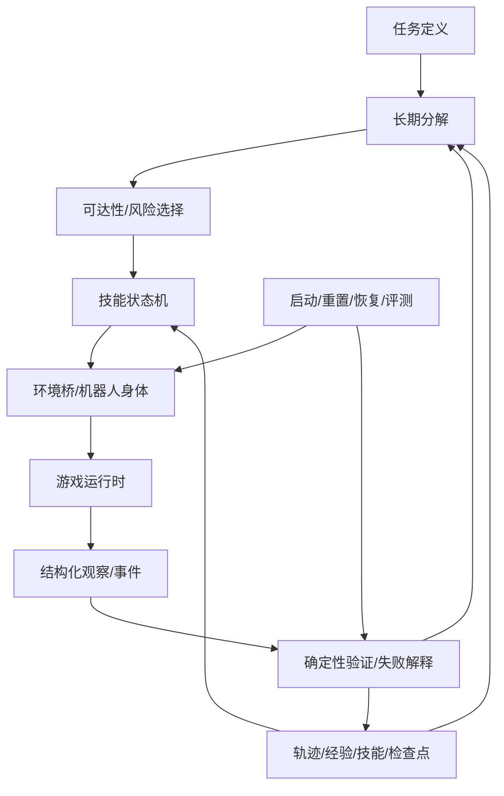
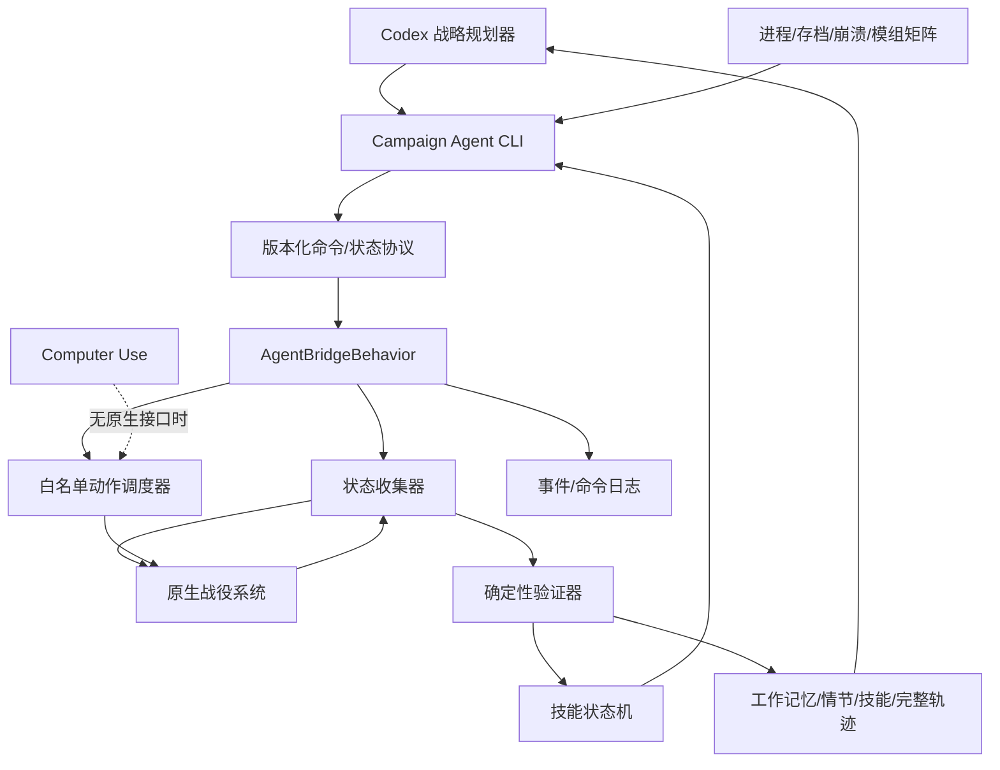
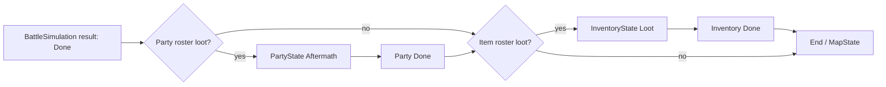

# 当前主线：Autonomous Campaign Agent Mod

状态：P0-P4 环境桥与抽样切片已验，非完整行为覆盖；当前P5只作验证样本。

绝对目标：AI 不能只是观察者、建议器、辅助工具或需要玩家确认的 Copilot。AI 必须能够独立感知战役状态、制定目标、执行行动、处理失败并持续推进战役。

只有两种正式部署形态：

1. **单机自主客户端**：AI 控制当前 Bannerlord 单机客户端中的玩家角色/玩家战役，拥有完整自主权；不需要第二 Steam 账号。
2. **多人独立客户端**：AI 以独立 Hero/Party/Clan 身份加入共享多人战役，拥有独立客户端身份；这通常需要第二个游戏客户端、第二个 Steam 账号和第二份游戏授权。

同一进程中的同伴/队伍代理可以作为单机架构实验，但只有当它拥有独立目标、独立行动循环和独立战役身份时，才算自主代理，不是辅助功能。

### 术语边界：单机多代理不等于离线联机

- **单机自主玩家**：AI 控制当前单机客户端中的玩家角色；没有第二玩家实体。
- **单机 NPC 代理**：AI 在同一个单机进程中控制独立 Hero、MobileParty、Clan 或其他游戏实体；它拥有自主目标，但仍由同一个战役进程统一模拟，不是网络客户端。
- **多人独立玩家**：AI 作为第二客户端加入共享战役；需要网络同步、独立客户端身份和多人战役服务器/Mod。

“离线联机”不作为工程术语。单机 NPC 代理可以实现玩家与 AI 共同生活在同一战役，但不能据此声称实现了联机。

### 单机多代理的底层限制

单机 NPC 代理在数据层面可行，但存在不能由普通 Agent 逻辑消除的引擎边界：

- 玩家进入单机战斗、聚落或其他 Mission 时，战役时间通常停止；小时/日事件、Party 移动、工资、食物、围城和其他时间系统不会像多人服务器那样继续推进；
- AI NPC 即使在玩家视野外，也不会获得一个独立的并行世界。它通常只是 Campaign 层的 Hero/MobileParty，接受全局抽象模拟；只有进入相应 Mission/Scene 时才有 3D 实体；
- 战略层 AI 可以在 Campaign Tick 上运行；要求真实 3D 场景、实时移动或独立交战的行为，必须等待场景实例化；
- 因此单机 NPC 代理适合验证 AI 作为世界实体的数据模型，不等价于玩家与 AI 同时推进的共同游玩。

真正的并发共玩需要多人服务器拥有全局时钟，并定义玩家进入战斗、暂停、遭遇、战斗结果和断线时的仲裁。现有 Bannerlord 联机项目正是通过服务器权威和时间控制补丁处理这些问题，而不是复用单机暂停语义。

Mineflayer/MineDojo 等 Agent 以独立玩家为动作和观察主体；这不排除 Bannerlord 单机 NPC 代理，它是利用原生 Hero/Party AI 的另一条研究路线，验收不可与多人客户端路线混称。

### Research readiness and current technical focus

Research Gate: **BLOCKED**
Implementation Gate: **BLOCKED**
行为总分母：**UNKNOWN**　完整系统域：**0/12**　游戏版本：**1.4.8.119303**

当前工程焦点是 **W1 行为与观察全景盘点**，本轮从A01战役生命周期开始；先逐系统核对玩家实际入口/输入修饰、被动及按需信息、原版后果和Campaign时间、UI handler/API差异、当前适配、证据及未知，再去重形成行为分母。`SYSTEM_INVENTORY.md`的127项是盘点入口，不是玩家动作数。W1按A-L逐域完成；在它达到12/12前不新增游戏能力。P5声望路线暂停；Tier 1仍只是未来成熟度夹具。

任务状态、依赖和唯一WIP由[GitHub Project](https://github.com/users/c3115644151/projects/5)维护，当前研究卡为[W1-A（Issue #1）](https://github.com/c3115644151/chronicle-framework-agent/issues/1)；本文不复制卡片状态。既有基线（非全景覆盖）：环境/协议通过；P3-P4已有Map/Party/Inventory 3类观察、9类抽样动作及战斗夹具；GameStates 3/15已细查，Agent vertical slice 0/1；P5前置4/4，Tier1 E2E 0/1。GameState数和CampaignEvent数都不等于玩家行为数。Minecraft Agent研究作为后续架构参考，不构成绕过W1的理由。

Minecraft Agent 的环境、规划、技能、记忆和评测研究已沉淀到本文后续架构段落；本文不再把项目目标定义为“测试工具”。

## 玩家交付原则与待定运行边界

玩家必须只感知一个产品：安装 Chronicle Agent、完成一次模型配置、在游戏中启动自主 AI。玩家不安装 Codex/Claude Code，不配置 MCP/CLI/IPC，也不手工启动 Python 或 Node。

内部实现目前不预设为“全部内嵌 Mod”或“必须外置 Agent Host”。两种方案都保留，最终边界由原型证据决定：

| 候选 | 优势 | 主要风险 |
| --- | --- | --- |
| Mod 内编排 | 单包安装、配置直接、状态访问简单 | 游戏线程污染、请求超时、崩溃耦合、重型记忆与多代理扩展困难 |
| Mod + 隐藏 Host | 故障隔离、模型/记忆独立升级、批量测试和多代理更自然 | 安装与生命周期复杂、IPC 和进程管理成本 |
| 混合式 | Mod 保留身体与轻量循环，Host 承担可选重型能力 | 边界设计和兼容测试要求更高 |

冻结部署边界前必须完成同一 Agent 循环的对照原型，至少测量：游戏线程占用、模型超时行为、断网恢复、游戏/模型进程崩溃隔离、存档大小、长期记忆规模、多代理并发、版本升级和安装步骤。玩家体验要求始终是单入口；即使内部存在 Host，也必须由安装器和启动器透明管理。

## 现实参考：AI 效应 + Player2

现有《AI 效应》的安装说明要求玩家先安装 Mod，再单独下载安装 Player2；进入 Mod 设置后选择 `Player2` 作为 AI Backend，使用预设 URL。[AI 效应安装说明](https://www.mountblade.com.cn/news/Bannerlord/2026-01-17/3059.html)

这说明它采用的是：

```text
Bannerlord Mod（游戏内适配器）
        ↓ HTTP/本地或平台接口
Player2（外部 AI Host/平台）
        ↓
模型、账号、额度和 AI 服务
```

Player2 官方定位也是面向游戏和 Mod 的 AI 接口平台，并同时提供模型和玩家入口。[Player2](https://player2.game/)

它不是完整 Agent 架构的必要组成，而是为游戏 Mod 提供统一模型服务的外部后端。这个案例只能证明“可替换后端 + Mod 内提示词/世界逻辑”可行，不能直接证明 Chronicle 的长期自主 Agent 应全部内嵌或全部外置。

Steam 创意工坊或 CurseForge 可以分发 Mod 文件、依赖和配置，但不能可靠地替玩家执行任意外部程序安装。如果最终需要 Host，应由明确的统一安装器或启动器透明管理，不能由 Mod 隐式下载并执行未知程序。

### AI 效应案例带来的架构修正

AI 效应的现有资料显示，Player2 不是它的唯一 Agent Host，而是可选 AI Backend：公开配置同时列出 Player2、OpenRouter、DeepSeek、Ollama、KoboldCpp 等后端；Mod 自己负责生成结构化提示词、读取游戏上下文、保存世界/提示词数据，并通过后端 URL 请求模型。[AI Influence 后端说明](https://www.nexusmods.com/mountandblade2bannerlord/mods/9711) [AI Influence Prompt Control](https://github.com/PiTatva/AI_Influence_Prompt_Control)

当前只冻结两个技术结论：后端必须可替换，游戏动作与结果验证必须留在 Mod 的安全边界内。规划、提示词、长期记忆和技能库运行在 Mod 内还是 Host 内，等待 P0-P2 原型基准后决定。

## Minecraft Agent 全景结论

已核对论文、官方仓库和 Voyager/Mindcraft 关键代码，覆盖与本项目有关的主要架构家族：

| 层 | 代表项目 | 已解决问题 |
| --- | --- | --- |
| 实验环境 | Malmo、MineRL、MineDojo、MineStudio | reset/step、观察/动作、任务、终止、轨迹、批量评测和崩溃恢复 |
| 原生机器人身体 | Mineflayer | 游戏协议、实体、寻路、背包、合成、容器和战斗高层 API |
| 代码技能与课程 | Voyager、Odyssey | 自动课程、成功技能沉淀、检索、Critic、checkpoint |
| 交互式规划 | DEPS、GITM | 描述、解释、重规划、可达性选择和分层动作 |
| 多模态控制 | VPT、STEVE-1、JARVIS-1 | raw pixels 到键鼠、短时控制器和多模态经验记忆 |
| 工程化 LLM Bot | Mindcraft | 命令白名单、中断、超时、循环检测、记忆压缩、技能检索和代码沙箱 |
| 任务评测 | MCU、MineStudio Benchmark | 原子/组合任务、Simple/Hard 条件和批量证据 |

成熟 Agent 不是一个大模型直接“玩游戏”，而是以下闭环：



缺少环境契约、动作原语、执行后验证、中断、checkpoint 或 benchmark，都会把额外成本转嫁给 LLM 推理。

## 代码级认识

Voyager 实际由 Python 协调器、HTTP 环境桥和 Node/Mineflayer 组成。每轮向环境发送程序与已检索技能，环境执行后返回事件和最终观察；Critic 判断成功，失败状态与 critique 回流，只有成功程序进入向量检索技能库。课程进度、失败任务、技能代码和数据库可 checkpoint 恢复。

Mindcraft 将命令路由、ActionManager、SelfPrompter、History、SkillLibrary 和 Coder 分离。ActionManager 会中断旧动作、设置超时、检测快速/无限循环；History 同时保存短上下文、压缩记忆和完整轨迹；技能按相关性选择；生成代码先检查引用和 lint，再进入受限 compartment。

这些工程保护比“让模型多思考”更重要。

## 迁移与拒绝

采用：

- Malmo/MineRL 的环境动作契约；
- Mineflayer 的原生身体分层；
- Voyager 的动作后观察、Critic 反馈和成功技能沉淀；
- DEPS 的失败解释、重规划与可达性选择；
- JARVIS-1 的规划器/控制器分离；
- Mindcraft 的白名单、中断、超时、循环检测、上下文压缩和完整轨迹；
- MCU 的 Standard/Hard 任务评测；
- MineStudio 的批量运行和崩溃恢复。

暂不采用：

- VPT/STEVE-1 的逐帧视觉控制；战役层低频决策不值得承担其成本；
- 在游戏进程执行 LLM 任意生成代码；
- 第一阶段开放式自动课程；
- LLM Critic 作为成功真值；
- 为测试直接写入资源、位置或战斗结果；
- 把全世界状态和全部技能塞入上下文。

## Bannerlord 目标架构



- Mod 内只做安全读取、白名单动作、事件记录和存档状态，不运行 LLM；
- CLI 提供一次性命令、JSON、超时、会话和可重放轨迹；
- 技能状态机承担重复多步流程和局部恢复；
- Codex 只在目标选择、权衡、异常解释和重规划时介入；
- Computer Use 是回退适配，不是真值来源。

## 状态、记忆与动作

状态分层：

1. 即时状态：界面、时间、玩家队伍、资源、位置、附近实体和当前遭遇；
2. 增量事件：资源变化、移动、战斗、任务、错误和存档；
3. 工作记忆：目标、子目标、当前技能步骤、预算和风险；
4. 情节记忆：状态—动作—结果—失败原因；
5. 语义记忆：已验证技能、版本、前置和失败模式；
6. 完整轨迹：不可压缩命令、状态、日志和 checkpoint。

每个动作必须声明协议版本、稳定实体 ID、参数、前置条件、成功条件、可恢复/不可恢复失败、超时、中断、清理、重试和幂等边界。自然语言摘要不能替代结构化状态与完整轨迹。

## 当前本机接口风险

历史探针确认过 `MBSubModuleBase.OnGameStart`、`CampaignGameStarter.AddBehavior`、`CampaignBehaviorBase.RegisterEvents/SyncData` 和多个 `CampaignEvents`，但这些证据来自先前本体状态。当前客户端为 `v1.4.8.119303`，进入实现前必须针对当前 DLL 重探针。

当前代码中已有只读 `ChronicleCampaignBehavior` 与 `DailyTickEvent` 计数实验；旧模块加载、行为注册和旧存档日志不能作为当前版本证据。

## 阶段计划

### P0 版本事实重建

- 锁定实际版本、官方模块、四前置、Chronicle 最小集和整合包集；
- 当前 DLL 重新运行 API Probe；
- 清除 `1.5.3` 与 `1.4.8` 冲突；
- Docs、Api、Build、Smoke 在同一基线上通过。

退出：所有证据包含版本、模块集、PID 和时间，不引用旧日志作为当前通过。

### P1 战役生命周期

- 创建新的 `AgentBridgeFixture` disposable 战役；
- 验证行为注册、`DailyTickEvent` 次数和战役时间；
- 用 `SyncData` 保存协议版本与计数；
- 自动推进、保存、退出、重载和比对。

退出：无人值守推进至少一个战役日，重载后状态一致，正式存档无变化。

### P2 环境协议与 CLI

状态：已完成。Protocol v1 已通过 CLI 启动/重载、状态、暂停/恢复、时间推进、保存、进程停止、持久状态回读与 fixture 哈希保护。

- 定义状态、命令、回执、错误和事件 schema；
- 第一版用原子文件与 JSONL，优先可检查、回放和崩溃保留；
- 实现 `start/load/state/advance/pause/resume/save/stop`；
- 支持唯一命令 ID、超时、幂等和 `--json`。

退出：除一次性启动 UI 外，可通过 CLI 完成推进、保存和重载。

### P3 结构化观察

状态：基础快照已实现。原版实体存在 `IsVisible` 与 `IsInspected` 两种地图状态，当前观察器保留可见实体并读取人数/战力。二者如何对应地图标记、悬浮提示、ALT 部队详情仍需沿原版界面链验证。是否要求 AI 与玩家同等信息、是否允许 AI 使用额外推断，属于产品情报策略，当前未定；不得仅凭 API 名称推导为“未侦察必须遮蔽”。

- 玩家队伍、资源、兵力、伤员、俘虏和负重；
- 位置、目标、附近聚落/队伍、菜单、遭遇、任务和危险；
- 增量事件、稳定 ID、相关范围裁剪和状态版本；
- 字段来源、最后观察时间、可见/已侦察级别和未知值语义；
- 玩家物品、队伍、家族、王国、日志等静态面板按需查询，不把所有面板常驻塞入模型上下文；
- 单独记录 AI 可用情报策略；它可以选择玩家视野、扩展情报或其他经过产品确认的模式。

退出：不读截图也能解释当前提供给 Agent 的局势并判断下一个合法原子动作；每个字段来源与情报策略可追溯，未知和过期信息表达清楚。

### P4 白名单动作原语

#### 量化进度 / Quantified Progress（2026-09-24）

| Metric | 当前值 | 口径/证据 |
| --- | ---: | --- |
| P4 sampled action families | **9** | Total unknown; samples only |
| Behavior-interface census | **0/12 domains** | A-L各域完成玩家入口/被动观察、副作用/时间、Agent覆盖和证据未知项映射；行为总数待盘点 |
| Campaign GameState surfaces | **3/15 detailed** | 1.4.8 CampaignSystem.dll；Map/Party/Inventory typed data；state数非动作数 |
| P3 Structured observation | **1/1** | Schema8身份/队伍/loot；Obs `20260924-131118` |
| Map-click/time parity | **3/3** | `move`/`pursue`/`hold` 均验证普通地图单击时间档位：Movement `20260924-061109`、Pursuit `20260924-055319` |
| Agent loop contract | **1/1** | `200757/201522` receipt/offer forwarding；deterministic Provider |
| Battle fixture | **1/1** | BattleFixture `20260924-083440`：looter→pursue→原版对话/continue→encounter；fixture 未改、进程退出 |
| BattleSimulation bridge | **1/1** | `PostBattle 20260924-222714`：全链/奖励遥测通过、Renown+2.562、夹具哈希不变 |
| Agent vertical slice | **0/1** | 尚无模型调用、目标选择或跨动作重规划；当前为身体/环境桥 |
| P5 precursor checks | **4/4；E2E0/1** | Fresh 215022, Recruit 201522, Battle 222714, Progression 045339 pass; deterministic provider, save/reload/move/recruit 1, fixture cleanup verified. |
| Visual capture transport | **1/1** | HWND-only `gfxcapture`; VisualCapture `20260924-152546`: 233/233@30fps；视频卸载、关键图保留 |
| Visual UI evidence | **2/2** | `154639`: 838帧/30fps；10事件→30关键帧；MP4删除 |
| Latest Docs gate | **1/1** | `latest.json` Docs pass + contract match |

新增/拆分动作族先改分母与验收；命令数不代表 Agent 进度。

#### 原版机制契约 / Mechanic Contract

| 动作 | 玩家入口 | 原版自然副作用 | Campaign 时间行为 | UI/API 差异及当前实现 | 证据 / 未知 |
| --- | --- | --- | --- | --- | --- |
| move | 地图点聚落 | `GetInteractionDataForMainParty`+`SetMoveGoToSettlement` | 单击按配置切速；运行模式自然推进 | CLI 复现 setter/点击时钟；Harness 独立步进抵达 | Movement `20260924-061109` 通过 |
| pursue | 普通点击移动队伍（非 Follow Modifier） | `EngageParty`；失明时原版 Hold | 单击按配置切速；自然接敌 | CLI 复现 Engage 与点击时钟，立即回执 | Pursuit `20260924-055319`：无 advance 接敌；失明未测 |
| hold | 点击玩家队伍 | `SetMoveModeHold` 清目标 | 地图单击时间策略 | CLI Hold+点击时钟 | Movement `20260924-061109` 通过 |
| rest | `town_wait` 菜单 | `StartWait` 快进；`EndWait` Stop | `rest(days)` 只观察时长 | Rest `20260924-055458`：保留原生时钟，离开后 Stop |
| advance | Harness 专用，不是地图输入 | 按请求推进 Campaign | 固定步长；遭遇可提前结束 | CLI/Harness 显式工具；决策 provider 拒绝调用 | AgentLoop `20260924-100325` 拒绝回归通过；Pursuit `20260924-042347` 遭遇提前返回 |
| autoresolve (research) | 遭遇“坐镇指挥”→Done | Init→StartSimulation→Skip→OnFinished→PartyState | 追近自然推进；模拟Stop | 原生Pause/Skip/Done；wool测试注入 | `PostBattle 222714`奖励断言/全链通过 |
| dialogueSelect (research) | Party click→Map conversation | `DoMeeting`→native conversation; `CurOptions`→`DoOption(id)` | clock unverified | protocol only selects active options | `20260924-083440` ultimatum test |
| incidentSelect | Town leave→modal→choose/Done | VM Confirm→effects/close | Modal pauses/locks time; close restores | Direct API skips cleanup; unsupported | Source; runtime unknown |
| talkToIssueOwner (research) | 蓝标→聚落场景→交互 notable | Issue→give→precheck→brief或拒绝 | probe Stop→Stop；运行未知 | native map跳过3D接近；本地限域 | `194812`到brief；`194018`未到brief，原因未定 |
| dialogueContinue (research) | 地图对话无选项时 Continue/继续 | Gauntlet `ExecuteContinue`→`ConversationManager.ContinueConversation` | 对话/遭遇时间待核实 | 仅 CurOptions 为空时调用 | `20260924-083440`：NPC 回答后继续至 encounter |
| retreat (research) | Mission TAB→Quit；模拟结果→Quit确认 | `TryExit`→RetreatMission；Simulation→XP/encounter | Mission暂停；Simulation未知 | Adapter绕过HUD确认 | `085658`返回成功；结算未知 |
| partyLoot (research) | Battle Done→Party/Inventory Loot→Map | 原生Loot screens/Done | 战后Stop | 测试wool注入；直接离开会跳过Loot | `154639`收俘10/物品10；自然掉落未知 |



### 当前原版界面核对记录

| 界面 | 已核实入口/行为 | 本地验证层级 | 尚未声称 |
| --- | --- | --- | --- |
| 城镇中心 `town` | 抵达后打开；菜单包含招募、交易、主楼、竞技场、酒馆区、等待、离开等动态选项；离开后回到地图 | 原版代码 + 战役状态/命令回执 | 未做人工逐项截图核对所有选项状态 |
| 招募 | 原版入口是 `town` 菜单的 `recruit_volunteers`；该 VM 按 notable 列出可招募兵种、费用、工资与队伍容量 | 招募 VM 实际执行、roster/金币结果验证 | 当前 Harness 直接调用本体 `RecruitmentVM`，未导航并展示可视招募弹窗；不能称为 UI 路径已验证 |
| 城镇交易 | 原版入口是 `town` 菜单的 `trade`；本体用 `InventoryLogic` 处理市场交易 | 食品报价、交易结算、玩家库存/市场/金币状态验证 | 当前测试不打开可视交易屏幕；不能称为视觉交互已验证 |

证据等级统一标为：源码/资源核实、运行时状态核实、自动动作/结果核实、人工视觉核实。高等级不自动替代低等级；尤其“VM 调用成功”不等于“已验证玩家从界面入口走通”。

退出：每个原语在 Standard 和失败条件下都有独立夹具与结构化结果。

### P5 一级家族纵向闭环

本阶段定位：Tier 1 是衡量新档 Agent 成长/资源/风险闭环的验证场景，不是产品目标或必须“过关”的交付承诺。不得为凑足 50 Renown 临时堆一次性功能；若通用能力不足，记录证据与缺口，按产品主线判断是否值得补齐。

1.4.8新档与成长证据

- 角色创建反编译显示：成年背景选择在新档起始给予 Clan Renown +20；Tier 1 门槛为50，因此示例背景下缺30。StoryMode 的+25奖励要在Tier 1 后才可能取得，不能作为前置成长路径。
- `Progression 20260925-045339` 通过了确定性测试 Provider 下的保存、重载、移动和招募链：起始声望20；招入1名瓦兰迪亚新兵花费20第纳尔，工资2/日；队伍人数1→2、金币1000→980，声望不变。它没有声望成长决策，也不是自主 Tier 1 闭环，E2E仍为0/1。测试启动时遇到的 CampaignMusic 初始化 NRE 已由 Harness 等待原版初始化解决。
- 早先 `Fresh 20260924-212453` 观察到新档创建选择Vlandia+20、停在MapState且未存档。不同 fresh fixture 的 Issue 种子和条件变化：有的没有本地 Issue，有的仅有金币报酬，也有到不了 Brief 的情况；这些只是变异样本，不能推成统一规则。

声望来源的当前静态盘点

对已有的 1.4.8 CampaignSystem、SandBox、StoryMode 反编译快照，检索 `GainRenownAction.Apply` 和 `Clan.AddRenown`，得到68处命中、涉及39个源码文件；其中52处位于26个 Issue 相关文件。它们是赋值调用点，不是玩家行为全集：同一 Issue 可有多种奖励分支，一个行为也可能共用奖励 helper。证据源位于 `TestResults/20260924-102913/Temp/{CampaignSystem, SandBox, StoryMode}Decompiled/`。

- 战斗：`MapEventSide` 先根据敌我强度与双方强度比计算战斗声望值；`MapEvent` 再按胜方各队贡献份额和敌方战力被消灭的比例分配，`DefaultBattleRewardModel` 还可能叠加 perk/文化修正。它不是每胜一场给定常数。
- 已有 `PostBattle 20260924-222714` 是受控夹具：19名劫匪、敌方起始强度12.540；玩家贡献1764/1764，模拟胜利后声望+2.562，其中模型基础值为2.440。这个单样本验证结算链有效，不证明野外自然遭遇的典型收益，也不能直接线性外推胜场数。
- 锦标赛：`DefaultTournamentModel` 默认胜者给3点，但赛事生成受城镇状态、时间及当地参赛者等条件影响；玩家须进入赛事 Mission。Chronicle 当前没有锦标赛/3D比赛控制能力，因此奖励数值并不等于可用路线。
- Issue：源码中存在多个+1至+10左右的奖励分支，但每种 Issue 的触发对象、前置资源、交付方式和成败结果不同；聚合调用点不足以判断哪一种适合作为通用的 Tier 1 前置循环。

当前判断：地图战斗与已有 battle bridge 的复用度最高，只能列为一个可检验候选；不能把P5偷换为“反复打劫匪直到50”。在确定验证场景前，还需从玩家实际可用路径、出现率、损失/收益及尚未适配的入口完成比较，并继续保持 Tier 1 是Agent成熟度夹具而非产品目标。

### P6 规划与记忆

长期目标 → 候选子目标 → 可达性/风险选择 → 技能执行；失败产生描述和原因，再选择替代路线。根据目标检索相关技能，并从结构化 checkpoint 跨进程恢复。

退出：资源变化、目标消失或动作失败后可自主改线。

### P7 崩溃自治与模组诊断

关联最后命令、状态、模块集、RGL/Watchdog/Mod 日志和 checkpoint；分类弹窗、卡死和崩溃；只自动恢复一次，重复故障转入模块二分和隔离。

退出：强制崩溃可自动保存证据、恢复并给出机器可读归因。

### P8 任务评测与整合包

建立原子、组合、一级家族和 10/30/100 日 soak；每项有 Standard/Hard 和基线/Candidate A/B。

退出：形成可重复的兼容性矩阵、已知问题和证据包。

### P9 服务原版增强

关系、俘虏、身份转换和长期目标优化接入同一 A/B Harness，但仍需先完成对应系统研究并进入 `DESIGN.md`。

## 维护规则

- 本文维护领域架构、迁移决策和阶段计划；新项目归入现有层，仅架构决策改变时修订；不另建路线图/竞品文档。
- 阶段状态以 `TestResults` 为准，本文记录退出条件和当前入口；缺少前置则回退补地基，不删退出条件。

## 主要来源

- Voyager: https://github.com/MineDojo/Voyager
- Mineflayer: https://github.com/PrismarineJS/mineflayer
- Malmo: https://github.com/microsoft/malmo
- MineRL: https://github.com/minerllabs/minerl
- MineDojo: https://github.com/MineDojo/MineDojo
- MineStudio: https://github.com/CraftJarvis/MineStudio
- DEPS: https://github.com/CraftJarvis/MC-Planner
- GITM: https://github.com/OpenGVLab/GITM
- VPT: https://github.com/openai/Video-Pre-Training
- STEVE-1: https://github.com/Shalev-Lifshitz/STEVE-1
- JARVIS-1: https://github.com/CraftJarvis/JARVIS-1
- Mindcraft: https://github.com/mindcraft-bots/mindcraft
- MCU: https://github.com/CraftJarvis/MCU
