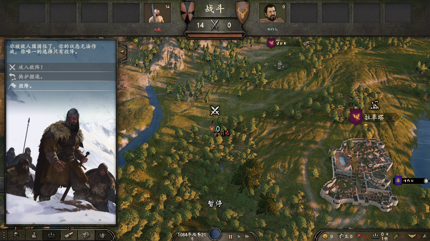
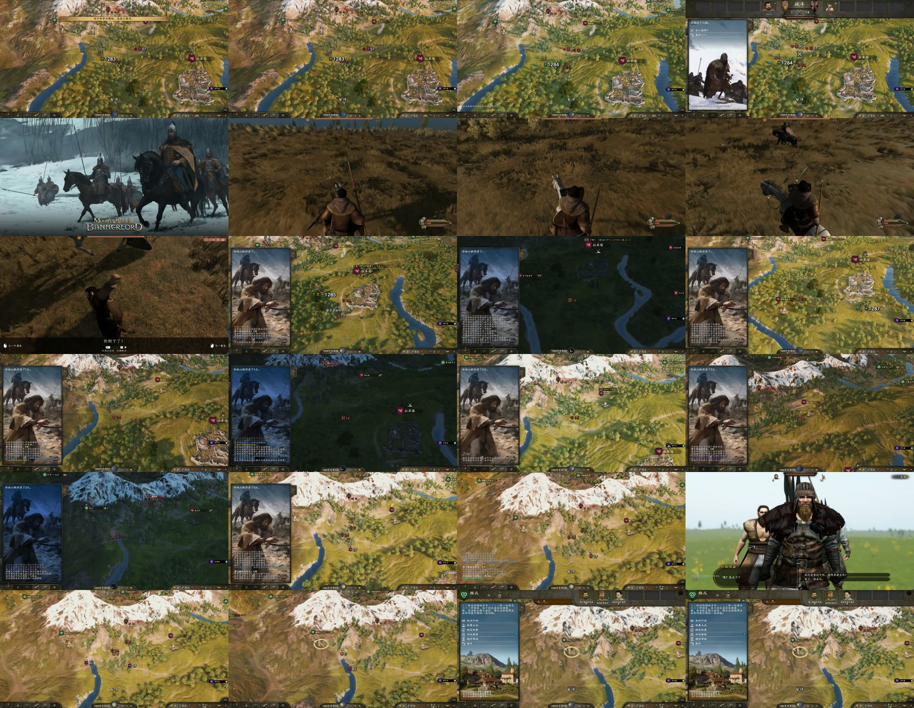

# Chronicle Framework 设计文档

本文件写**玩家体验层面**的设计取舍：一个观看者坐在屏幕前看 AI 玩《骑马与砍杀2：霸主》，他到底在看什么，什么东西让这一局值得看下去。

工程契约与验收阶梯在 [DEVELOPMENT.md](DEVELOPMENT.md)，持久技术事实与机制契约在 [MAINLINE.md](MAINLINE.md)，每次真实运行的记录在 [RUNLOG.md](RUNLOG.md)。本文件不复制这些内容，也不登记动态任务状态。

## 1. 一局是什么

一个模型，从零开始，建立自己的家族。屏幕上只有原版界面：菜单、对话、交易、队伍、任务、地图、战斗结算。没有人替它点按钮，也没有为它准备好的世界。

AI 不是"被脚本带着走完流程的执行器"，而是一个必须自己判断的玩家。判断错了，世界会记住。

这个 Mod 的核心玩法就是这一条：让 AI 作为玩家控制主角去行动。其余一切——多角色、多人感、国王的宏观决策——都建立在这一层真的成立之上，因此当前不投入任何为上层做的结构改造。

## 2. 分三层：现在是基底，不是全部

这个 Mod 最终要支持的不是「一个 AI 玩主角」，而是三层依次解锁的东西。写在这里，是为了让当前这层的技术选择不挡住上面两层。

**L0 基底（当前）**：一个模型控制原版 `Hero.MainHero` 与 `MobileParty.MainParty`，只走原版菜单、对话、交易、队伍、任务、地图与战斗结算。这一层必须先做稳——AI 连主角都控制不干净时，谈别的都是空中楼阁。

**L1 NPC 控制与联机感**：同一个战役里出现多个 AI 扮演的角色，各自有独立的观察、意图与动作面，像一局多人游戏。Bannerlord 没有原版联机战役，所以这里要的不是网络同步，而是同一台机器上多个 AI 玩家共享一个世界：谁是行动者、他能看到什么、什么时候轮到他说、他慢半拍时世界已经变了怎么办。真正的看点不是技术难度，而是信息不对称与互相记仇——它们正是这一层的玩法。

**L2 国王与宏观决策**：AI 控制各国国王，专注国家层面的决策——宣战、议和、政策、封地、征召、外交姿态。这一层的动作面、节奏和推理都不同：L0/L1 是每次决策选下一个动作，L2 是按天或按周做战略判断，代价以年为单位结算。它不是把动作白名单撑大，而是另一个剧本与另一条决策管线。

顺序是有理由的：L0 的信息面与动作面错了，L1 会继承错误；L1 的会话与仲裁机制不做，L2 的国王之间没法共享一个世界。

写作目的是留个准确的坐标，不是立项：现在的投入只有 L0，L1 与 L2 都没有排期，也没有为此预建任何东西。

## 3. 现在要保住的四条中立性

下面四条都是低成本、不预建抽象的取舍，目的是让 L1/L2 到来时不必重写。每条都对应一处实测到的事实。

1. **施动者身份要能解析，不能长死成单例调用**。`mod` 下 69 个源文件里现有 130 处 `Hero.MainHero`、158 处 `MobileParty.MainParty`——这是 L1 的账单。规则不是现在建角色抽象层，而是：改到某一族动作时，把该动作的「谁在做」收到一处解析，新代码不再新增裸单例读取。
2. **邮箱按 agent 会话分区**。当前 `mod/AgentProtocol.cs` 把根目录写死为 `Documents/Mount and Blade II Bannerlord/AgentRuns/ChronicleAgent`，一个进程一个 `command.json`；回执已经按 `commandId` 应答。L1 只需要把根目录变成「每个 agent 一个会话目录」，协议本身不用改。
3. **观察面按「这个 agent 知道什么」分片，而不是「世界数据有什么」**。L1 的难点不是并发，是不该知道的事不能知道；一条给主角写的观察把我们所有的信息都给出去，多 AI 就退化成共享内存。
4. **动作面继续按场景裁剪**，不合并成大而全的通用接口。P5 已验证 32 个按场景裁剪的 Native 接口不是冗余传输，而是「场景只能发自己切片内动作」的验证边界；L1/L2 只会新增面，不会把面撑大。

agent 侧已经中立：`agenthost` 全部 33 个源文件对 `Hero.MainHero` / `MobileParty.MainParty` 的引用为 0——它吃的是 JSON 观察、吐的是动作，不含对主角的知识。这意味着 L1 的工作量集中在 `mod` 的观察与动作面，不在 AgentHost。

这四条是**记录下来的将来约束**，不是当前的工程任务。当前不改造 `mod` 的施动者定位方式、不分区邮箱、不预分观察——等真的有第二个 agent 要进场时再动，届时按这四条改，不按别的原则改。

### 现在不做的

- 多 agent 调度器、轮次仲裁、网络同步：没有第二个消费者之前不建。
- 国王 AI 的动作面与决策管线：等 L0 的 EYC 闭环稳定、L1 的会话机制定型再开。
- 为 L1 预留的开关、配置项与空实现：宁可届时改结构，也不留两套路径。

## 4. 判据：吸引力取决于"答案有没有被预先给出"

分界不在"有没有脚本"。脚本本身没有错——整理观察、把动作目录摆整齐都是必要的。问题是**脚本里有没有装着答案**：如果允许的动作只剩一条正确路径，如果目标被写成外部完成条件，如果进度用"完成了几项行动"衡量，那么被观看的其实是程序，AI 只是它的嘴。

据此，设计层面用四条可观察的判据衡量一局是否值得看（这是设计验收，不是工程门禁）：

1. **有没有没教过的选择**：这一局里出现过训练数据之外、也没有被动作目录暗示的取舍。
2. **会不会被世界说服**：它因为观察到的事实改变过主意，而不是执行完自己开局的计划。
3. **有无代价感**：它为了某个目标放弃过什么——时间、钱、关系、兵力，甚至自己的自由。
4. **同一起点是否分化**：同一个检查点、同一套动作目录，两次运行走出不同的路。

四条都靠实际运行的分母说话，不靠宣言。判据为负的时候，加功能不解决问题，先减"答案"。

## 5. 目标层：自声明意图

每次决策，AI 先说自己此刻要做什么、为什么，再执行；下一轮允许推翻自己，并且要说清为什么改口。目的是让观看者读出一个"脾气"，而不是一串合法的动作调用。

意图是叙事的一等公民，不是日志装饰：一局结束时能读出"它想干什么、怎么变的"，比"它完成了哪些动作"重要得多。

## 6. 世界必须会出事

剧力来自不可逆的因果：会死，会被俘，会记仇，每天结算工资和粮食。Bannerlord 的这些机制比一个纯建造世界更强，因为它们不等 AI 准备好才发生。

设计上因此要求：世界配置要允许压力真实发生，不为"让这一局跑完"把危险关掉。一局因为被俘、破产或死亡而结束，是有效的一局，只要证据链完整。

## 7. 剧本，不是产品目标

第一个剧本是 **Establish Your Clan**：Gold 2000、队伍规模 25、Renown 50、伙伴 1。它的作用是给第一次长跑一个可以结束的形状，不是产品定义。

后续剧本沿用同一结构：一个可验证的终局条件，加一组会持续施压的世界事实（战争、饥荒、劫掠、被俘）。剧本之间共享世界与机制，不共享"答案"。

## 8. 可观看性：叙事日志

决策原因、动作回执、目标核验已经全部落盘。把它们渲染成人类可读的一局叙事，是产品的一部分，不是调试附属品——观众看的是故事，不是 JSON。

## 9. 场景：AI 在游戏里会遇到什么

剧本给 AI 一个可以结束的形状；场景给 AI 一个必须应对的处境。这一节写场景怎么设计，以及它与 Minecraft 那类 agent 项目的差别。

**一个场景由五件事构成**：起点（哪个存档或检查点）、世界配置（谁在打谁、经济松紧、危险密度）、压力源（每天结算的工资与粮食、会追你的人、会反悔的领主）、可观察结局（成功与失败都要能判定，且失败也是有效数据）、预算（决策数、真实时间）。

这些旋钮今天已经存在，不需要新框架：`harness/Agent-DecisionLoop.ps1` 接收 `-Goal`、`-AllowedActionNames`、`-MaxDecisions`（限定 1 到 400），`PersistentEycCampaign` 按 checkpoint key 续跑，决策账本记下 decisions、token 与 trace。所以一个场景 = 一个检查点 + 一个动作面 + 一个预算 + 一个可判定的结局。`harness/stages` 现有 134 个阶段，其中 `FreshCampaignProgression`、`FreshCampaignLiveModelEvaluation`、`LiveModelRuntimeResume`、`PersistentEycCampaign` 已经是在跑带预算的真模型长局。

**场景族**（前六项用现有动作面就能跑，第七项需要更多动作面）：

| 场景 | 压力源 | 常见的翻车 | 观察什么 |
| --- | --- | --- | --- |
| 开局求生 | 雇人的机会成本、战役日的现金燃烧、无处落脚的住宿与补粮 | 队伍缩水、欠薪拖垮士气、饿到掉好感 | 它会不会先算清每天要花多少再决定雇不雇 |
| 以战养战 | 劫匪团伙、商队护卫、追捕 | 被俘、被通缉、队伍打空 | 面对打得过但不该打的局面，它选什么 |
| 城镇经济 | 竞技场、买卖差价、工坊租金 | 被套牢、欠租、城里惹事被抓 | 它会不会用信息差，还是只会重复同一次交易 |
| 人际 | 伙伴要价、说服失败、任务链断 | 关系破裂、任务连锁失败 | 它会不会为了一个人放弃一笔钱 |
| 被俘与重建 | 失去队伍、装备、钱 | 反复被俘、信用崩塌 | 代价感最纯的考场：它怎么从零再起 |
| 建立家族（EYC） | Gold 2000、队伍 25、Renown 50、伙伴 1 | 卡在某一项直到预算耗尽 | 它有没有自己的路线，而不是被目标牵着走 |
| 战争与封臣 | 领主征召、封地、背叛 | 站错队、被封、被围 | 需要新增动作面，暂不设计 |

**一条红线：场景给处境，不给路径。** `-AllowedActionNames` 是验证用的收窄工具——自测里把动作面砍到 `mapSettlementTargets,move` 是为了断言某条链路，不是为了说明这个场景的正确解法。一次真跑必须给全动作面；一旦某个场景只在收窄后的动作集里成立，那它验证的是脚本，不是 AI。

**与 Minecraft 那类 agent 项目的差别**：

- 借用它们的**长期自主循环与自验证**：做完一步要能自己确认做成了（我们的对应物是 Native 回执加目标核验，而不是让模型自己写代码攒技能库）。
- 不借它们的**自动课程**：自动生成下一步该干什么，正是判据里说的答案被预先给出。我们生成的是处境——把世界调得会出事，让世界来提要求。
- 不借它们的**建造式目标**：Minecraft 里造出东西是开放式创造；Bannerlord 的强项是不可逆因果与时间成本——会死、会被俘、会记仇、每天结算工资和粮食。看点在代价，不在作品。

**怎么比较两局**：同一个检查点、同一套动作面、同一个预算，换模型或换起点随机性跑两次，比的是路径而不是分数——这就是判据里的同一起点是否分化。

### 9.1 压力曲线：钱什么时候开始烧

一个场景的压力必须先能算出来，否则「破产」只是形容词。本机实测（标定过程见 `docs/Research/E/EconomyAndTrade.md`）给出每日现金支出：工资 2 ×（非主角人数），粮食 0.05 × 人数（单位），粮价 9–30 第纳尔/单位。

| 队伍人数 | 日工资 | 日粮（单位） | 日现金支出 | 1000 第纳尔能撑 |
| --- | --- | --- | --- | --- |
| 1（StoryMode 开局） | 0 | 0.05 | 0.5–1.5 | 看不到头 |
| 6 | 10 | 0.30 | 12.7–19 | 53–79 天 |
| 8 | 14 | 0.40 | 17.6–26 | 38–57 天 |
| 11 | 20 | 0.55 | 25–36.5 | 27–40 天 |
| 25（EYC 的队伍规模目标） | 48（估）/ **78（实测，混合兵种）** | 1.3 | 78 + 1.3×粮价 = 90–117 | 8.5–11 天 |

这张表改变了两件事。**第一，成本在账面上不咬人**：1 人队伍每天只烧掉不到 1.5 金，所以按表算「破产」在开局谈不上——但这只是账，现场要看存档里的实际金库：本机唯一可用的 StoryMode 开局检查点（下面实测的 `freshB`）是 **0 金、0 粮、一开局就在挨饿**，与表里假设的 1000 金不是一回事。由成本真正咬人的时刻是**决定雇人的那一刻**——雇一个一阶兵 20 金，而他每天要吃 2 金工资 + 0.05 单位粮，回本需要十天以上，兵本身不产钱。**于是第一个有成本、且成本在选之前就能算出来的选择是「雇不雇」**——前提是先活到那一天。

**第二，EYC 自带一个硬期限**：24 个招募名额先花掉 480 金，队伍到 25 人后每天 60–85 金，剩下的 520 金只够 6–9 个战役日。也就是说 EYC 的难点不是四条目标各自怎么达成，而是「八九天之内让队伍开始赚钱」。

这条期限不是决策预算问题。战役日很便宜：`MultiDaySupplyBaseline` 里在城镇 Wait 一次 `rest`，原版自然走过三个每日边界，墙钟 60–61 秒，没有任何时钟命令。所以「凑够八九个战役日」只要几次等待，`-MaxDecisions` 的 1..400 不是这里的瓶颈。瓶颈是**等待本身有价**：25 人队伍闲等三天要花 177–255 金，等于五分之一的启动资金。于是时间不是要争的资源，而是要花的东西——这正是场景要测的那种取舍。

由此把开局求生的压力源改写为：**雇人的机会成本 + 战役日的现金燃烧 + 无处落脚时的住宿与补粮**；失败条件改为「队伍规模缩水或欠薪导致士气归零」，而不是「金币归零」。金币归零在 25 人之前几乎不会发生，用它判定会得到一个永远通过的场景。

**实测：真实开局检查点长什么样，以及世界的第一招是什么。** 上表的 1000 金来自 EYC 任务日志的 gold 基线（`Objective("gold", 1000, 2000)`），不是存档里的现金。可用的 StoryMode 开局检查点是 `ChronicleEycDev-freshB-20261123092350-d1a1805e`：战役日 91117.285、金 0、1 人、粮 0、`foodChange=-0.05`、`moraleContext.isStarving=true`、`recentEventsMorale=-90`、`effectiveMorale=-64.5`，「建立你的家族」由 quest-manager 挂着。用 `IdlePressure` 直接量它（1 天/块、12 块预算、零模型请求，两次独立跑：`TestResults/20261125-idle-freshB/IdlePressureResult.json` 与 `TestResults/20261125-idle-freshB-2/IdlePressureResult.json`）：

| | 第一跑 | 第二跑 |
| --- | --- | --- |
| 停因 | `menu-opened` | `menu-opened` |
| 遭遇发生在 | 91118.158（起跑后 0.873 天） | 91118.102（0.817 天） |
| 谁来了 | `mountain_bandits_2145` 山贼、8 人、强度 8.74、距离 0.43 | `looters_2541` 劫匪 |
| 队伍状态 | 健康 1 → 0、伤兵 0 → 1、`menuId=encounter_meeting` | 同 |
| 对话 | 拦路强盗「今儿个不走运啊，伙计。把钱交出来吧，要是把小命搭在这就可惜了。」 | 劫匪「这一带是要交过路费的，旅行者，要么交钱要么放血。」 |
| 可选项 | `bandit_start_defender_3`「我们已无力再战，全凭你的处置。」、`bandit_start_defender_2`「也许我们可以找个两全其美的办法。」 | 同两个 option id |

两跑复现的是形状而不是细节：来的是不同的劫匪（山贼 / 劫匪），但都不到一个战役日就撞上来，结局都一样。三个后果：

- **这台仪器在这个检查点上量不了「闲等」**：它在第 1 天就被一次遭遇打断，停因 `menu-opened` 是正确行为，不是故障。所以「1 人队伍能撑多久」这个问题在这个起点上不存在——答案是撑不到一天。
- **模型第一次真正要做选择的地方是一段已经输掉的遭遇**：对话里只有投降与讨价还价两条（两支劫匪给的是同一组 option id，说明这组选项由「玩家已被打败」这个状态决定，而不是由对话文本决定）。战场上「打不打」这个选项不在对话里。
- **金 0 让「交钱」这条路等于没有**：这句台词指向的筹码不在手里，于是这个场景的第一个决策连「花多少钱买平安」都问不出来。

**StoryMode 原生开局检查点现在有了，那 1000 金是真的现金。** 用 `harness/Test-AgentFreshCampaign.ps1 -StoryModeEycSetup -StoryModeEycPersistentSeed -PersistentStoryModeSaveName ChronicleEycDev-opening-20261126` 从原生开局跳过教程并把检查点留在存档目录：`ChronicleEycDev-opening-20261126.sav`，SHA256 `6E04DD0ADE983732FC42CD9739F2AA8C2873BBB1AC3E7F9CA88FBF142B0CD0D7`。加载后实测 gold **1000**、1 人、粮 2.00 单位、士气 49、HP 100/100、Renown 20、战役日 91077.375（收据 `TestResults/20261126-opening-baseline/Temp/IdlePressureResult.json` 与 `TestResults/20261126-opening-seed/Temp/scratch.json/FreshStoryMode.post-skip-map-state.json`）。上表按 EYC 任务日志假设的 1000 金从此有存档背书；`freshB` 那个 0 金检查点代表的是「已经从挨饿里截出来的一份残局」，不是开局。

两条仪器事实跟着定下来。**一是原生开局不是空菜单**：检查点停在 `training_field_menu`，`training_field_enter`「回去训练。」与 `training_field_leave`「离开」两项都可点；`IdlePressure` 现在开局先按原版走一次 `training_field_leave`（零耗时，`leftAtCampaignDay` 与起点相同），并在回执里记下 `Opening`。**二是 1000 金在开局构不成压力**：1 人队伍工资 0、粮 0.05 单位/天，账面上「看不到头」；开局第一件真事还是遭遇——放任不管，两次跑分别在 0.34 与 0.435 个战役日被劫匪拦住（`looters_390` / `looters_394`，`menuId=encounter_meeting`），粮 2.00 → 1.95、金不动。所以「开局求生」的压力源不在这份现金上，而在那次已经输掉的遭遇里。

**伤兵是怎么回事，现在量出来了，而且和遭遇无关。** 观察面新加了 `party.heroHitPoints`/`heroMaxHitPoints`（`mod/AgentObserver.cs` 的 party 块），于是「挨饿」不再只能从伤兵人数反推。给 `IdlePressure` 补一个 `-ShelterInTown` 与 HP 采样后，同一 25 人夹具跑两遍（1 天/块，零模型请求）：断粮那条 `TestResults/20261125-idle-hp-starved/IdlePressureResult.json`，补粮那条 `TestResults/20261125-idle-hp-fed/IdlePressureResult.json`。

| 天 | 断粮：主角 HP / 伤兵 / 粮 | 补粮：主角 HP / 伤兵 / 粮 |
| --- | --- | --- |
| 起点 | 100/100 · 0 · 12.5 | 100/100 · 0 · 24.5 |
| 第 1–9 天 | 100/100 · 0 · 12.5→0.8 | 100/100 · 0 · 24.5→12.8 |
| 第 10 天 | **87/100 · 3 · −1.3** | 100/100 · 0 · 11.5 |
| 第 11 天 | **68/100 · 9 · −1.3** | 100/100 · 0 · 10.2 |
| 第 12 天 | **49/100 · 14 · −1.3** | 100/100 · 0 · 8.9 |

粮还在正数的那 9 天，主角 HP 一动不动；粮变负的那一天起，每天掉 13–19 点，伤兵同步涨 3 → 9 → 14。补粮那条 12 天里 HP 一直是 100，一个伤兵都没有。于是这条因果链可以写成：**粮见底 → 主角与队伍开始掉 HP → HP 掉到上限的 20% 以下，名单把这个人计为伤兵**。伤兵不是「谁在战斗里挨了一刀」的计数，而是「当前 HP 低于门槛的人数」，所以它能在一场零遭遇的等待里凭空长出来。

同一套解释把 freshB 开局的谜也解了。那个检查点加载时主角 **23/100 HP**（存档本身就是从挨饿里截出来的），站着不动、零遭遇、零移动（`TestResults/_probe-hp2.ps1` 原地 `advance -Days 0.01` × 40）：HP 每天掉 10–18 点，第 0.16 个战役日掉到 20/100 那一刻 `healthy` 1→0、`wounded` 0→1，而劫匪到第 0.75–0.87 天才出现。所以上一版文档写的「伤兵与这次遭遇同时出现」是错的：伤兵出现得比遭遇早半天，遭遇只是后面那件事。开局真正的形状是「一半血、正在掉血、一天之内会遇到劫匪」，而不是「满血等危险」。

两个观察面的坑值得写死在这里。**一是 `encounterActive` 不等于有战斗**：走进城镇会让 `PlayerEncounter.IsActive` 为真、`encounteredPartyId` 就是那座城的 id（第一次 `-ShelterInTown` 跑就因此报了一次假异常）。判「有没有敌意遭遇」要看 `encounteredPartyId` 是不是那座城，而不是看这个布尔。**二是围城会在等待期间开始**：第一跑在 `town_EW1` 里等到日中时菜单被 `encounter_interrupted_siege_preparations` 顶掉，所以「选一个 `underSiege=false` 的城」不足以保证安全，仪器现在把这个停因记为 `shelter-besieged` 并单独断言。

仍未归因的只剩 `cargoCapacity` 30 → 10 与 `speed` 5.189 → 4.988（`itemCount` 始终是 1，出现在 freshB 那次遭遇前后，本轮没有单独量）。

这个判断现在有重放证据。`OpeningScenario` 阶段（`harness/Test-AgentOpeningScenario.ps1 -Repeats 3 -ScenarioDays 2.0`，零模型请求：每次重放都把存档重新加载一遍，只走路、不做任何动作，走到第一个「要你回答」的东西就停）在同一检查点上跑了两轮共六次，六次全部被拦：0.747 / 0.747 / 0.933 / 0.864 / 0.974 / 1.194 个战役日，遇到的永远是同一位拦路强盗（`mountain_bandits_chief`，`mountain_bandits_2145` 两次、`mountain_bandits_2289` 一次）、三句不同台词、同一组两个可点选项。撞上时主角 HP 分别是 9/9/6/7/5/1（起点 23/100，一路走一路掉），队伍在相遇之前就已经是「0 健康 + 1 伤兵」。收据 `TestResults/20261125-opening-scenario/OpeningScenarioResult.json` 与 `TestResults/20261125-opening-scenario-2/Temp/OpeningScenarioResult.json`。把两条 `IdlePressure` 收据（0.873 / 0.817 天）与一次 1.2 天静默的探针一起算，同一个存档九次重放全部在 1.2 个战役日内分叉、没有一次走到第二天——遭遇是约半天尺度上的分布，不是定值，也不是「全天安全」，所以仪器记录每次的分叉，而不是断言一定会有遭遇。
这改变开局求生的形状：它的第一个决策点不是「雇不雇」，也不是「破产前怎么省」，而是**一次已经输掉的遭遇里的两句话**。要让它成为能测东西的场景，仪器必须先说得清「一开始就被打败」这条路上模型有什么可选的（现在只有投降与讨价还价），而不是把它当成一道理财题。真正的成本决策要等它能活下来、有钱、有兵之后才出现；在那之前拿「它会不会算日工资」当判据，是在问一个它还没走到的岔路口。

**实测：放任不管，世界在 12 天里做了什么。** 这是本场景第一个真正跑起来的仪器（`IdlePressure` 阶段，零模型请求，1 天/块；夹具 `ChronicleW7P-manual-20261101-eyc-complete`，25 人 / 2277 金 / 12.5 单位粮；收据 `TestResults/20261125-idle-pressure-daily/IdlePressureResult.json`，采样 13 点）：

- 前 9 天：每天金 −78，**恰好等于当日 `dailyWage`**，一分不差的整额扣款；粮每天 −1.3；士气从 42 缓升到 46。不做事并不掉士气——掉的是钱和粮。
- 第 10 天：粮 0.8 → −1.3、库存归零，士气同一天从 46 掉到 13（−33），队伍同时出现 3 名伤兵（健康 25 → 22，人数仍是 25）。
- 第 11–12 天：伤兵 3 → 9 → 14，士气 13 → 10 → 6；第 12 天掉 1 名成员（25 → 24）、`dailyWage` 78 → 76，仪器按 `party-shrunk` 停下。
- 12 天总账：936 金、全部 12.5 单位粮、36 点士气、1 名成员。

三个机制事实由这条曲线固定下来。**一是 `Food` 不封底**：粮尽之后每日消耗继续计入 `Food`（0.8 → −1.3 → −1.3），所以「粮 0」不是拐点，「粮开始变负」才是，观察面上要读符号不能只读零。**二是惩罚集中在粮尽那一天**（士气 −33），此后每日只掉 3–4 点，随后才表现为伤兵累积与掉人——失败条件的顺序是「粮 → 士气 → 伤兵 → 掉人」，不是「欠薪 → 士气」。**三是工资不能按人数线性外推**：这支 25 人队伍实测 78（3.12 金/人），远高于 2 × 25 = 50 的估算，说明 `TotalWage` 由兵种构成决定；做预算时按实测值留余量，不要拿表里的估算列当公式。

这条曲线现在有两条独立收据：逐日细粒度那条在 `TestResults/20261125-idle-pressure-daily/IdlePressureResult.json`，另一条是注册成阶段后由 `Run-Harness.ps1 -Phase IdlePressure`（4 天/块）跑出的 `TestResults/20261125-210118/IdlePressureResult.json`——后者在第 3 块到达 24 人、13 名伤兵、士气 6，停因同为 `party-shrunk`。两次在同一人数上分别得到 14 和 13 名伤兵，说明伤兵数是分布不是定值；可以当作场景判据的只有顺序（断粮后伤兵累积、随后掉人），不能当作精确数值。
这条曲线上原本还剩一个未归因项：12 天里 `encounterActive` 在每个采样点都是 false，mod 事件流里也没有任何 battle/encounter 命令，但伤兵仍然从 0 涨到 14——要么是饥饿本身把士兵变成伤兵，要么是快进期间有一次没留下回执的地图遭遇，观察面分不出。**这个未知项现在有答案：给同一个夹具补粮，12 天里一个伤兵都没有。**

对照跑的做法是给 `IdlePressure` 阶段加 `-TopUpFoodUnits`：进城（`town_ES3`）、`menuSelect town/trade`、`tradeOptions` 读当前市场报价、按单价从低到高 `trade` 买入、一次 `tradeConfirm` 提交、`town_leave` 回地图，然后再跑同一 12 天的 1 天/块。买粮这一步零模型请求、零时间消耗（回执 `campaignDayBefore` 与 `campaignDayAfter` 相同、`timeControlMode` 前后都是 Stop），只付了路上 0.13 个战役日。收据 `TestResults/20261125-idle-pressure-fed-2/IdlePressureResult.json`（Passed=true、`TopUpBoughtFood=true`、停因 `chunk-budget-exhausted`）：

| | 断粮跑（两条收据） | 补粮跑 |
| --- | --- | --- |
| 起点粮 / 金币 | 12.5 单位 / 2277 | 24.5 单位 / 2133（买 12 单位粮花 144） |
| 12 天后的粮 | −1.3（第 9 天见底） | 8.9 |
| 12 天后的伤兵 | 14 | **0** |
| 12 天后的士气 | 6 | 47 |
| 12 天后的人数 | 24（`party-shrunk` 停） | **25**（预算跑完才停） |
| 12 天的金币变化 | −936 | −936 |

两跑的金币曲线逐日相同（每天 −78），差别只在粮仓。于是「伤兵」在这套仪器里可以当饥饿证据用，不必再怀疑是随机遭遇；能当判据的是顺序（断粮后伤兵累积、随后掉人），不是精确的伤兵数值。

**城墙里也问了一遍，结论一样。** 补粮对照说明的是「有粮不挨饿」；把变量换成「在城里还是在地图上挨饿」才能把地图上的随机遭遇彻底排除。同一夹具、同样 4 天一块共 12 天、零模型请求，三跑对照（都不给模型请求、都从战役日 91179.34 起跑）：

| 跑法 | 停因 | 12 天后粮 | 伤兵 | 人数 | 士气 | 收据 |
| --- | --- | --- | --- | --- | --- | --- |
| 地图上闲等、不补粮 | `party-shrunk` | −1.3 | 0 → 14 | 25 → 24 | 42 → 6 | `TestResults/20261125-210118/IdlePressureResult.json` |
| **城里闲等、不补粮** | `party-shrunk` | −1.3 | 0 → **15** | 25 → 24 | 42 → 6 | `TestResults/20261126-idle-sheltered-2/Temp/IdlePressureResult.json` |
| 地图上闲等、先补到 30 单位粮 | `chunk-budget-exhausted` | +14.9 | **0** | 25 | 42 → 47 | `TestResults/20261126-idle-stocked/Temp/IdlePressureResult.json` |

城里那一跑每个采样点都是 `menuId=town`、`encounterActive=true` 且 `encounteredPartyId=town_ES3`（那座城自己），`ShelteredPartyNotEncountered`、`ShelteredPartyNotBesieged`、`ShelteredPartyStayedInTown` 全为 true——城墙内不可能被谁截住，伤兵照样从 0 涨到 15，与地图上的 14 同量级。所以断粮是把人变成伤兵的那一件事，地图遭遇不是；补粮那一跑 12 天后还剩 14.9 单位粮、一个伤兵没有，把「闲等本身伤人」这条也排除了。三跑的金币曲线逐日相同（每天 −78，12 天 −936），差别只在粮仓和城墙。

这一轮同时修掉仪器里的两处自相矛盾。**一是断言没有按「那座城自己」豁免**：`ShelteredPartyNotEncountered` 原来数「任何 `encounterActive` 为真的采样」，而进城的第一个采样必然为真，于是这次跑在第一块就红了一次假警报；现在采样多记一个 `encounteredPartyId`，断言只把「与城里不同的队伍」算作被截住（与 `Invoke-SeekTownShelter` 的到达判定同口径）。**二是断粮时的 `rest` 会超时**：饥饿状态下的 4 天 Wait 有时比 `max(60, 天数×70)` 秒的墙钟预算晚几秒收尾，仪器原来直接记 `wait-timed-out`；现在超时后再读一次战役日，追上目标日就记 `reachedTargetDay=true`。

由此还得到一个对场景设计更有用的数字：**补粮便宜得不成比例**。24 单位粮（够 18.5 天）只花 144 金，摊到每天 9.2 金，只有日工资 78 的 12%。所以空闲场景里真正咬人的是**工资**，饿只是「忘了买粮」时的惩罚；压力源该写成「每天 78 金不停止地烧」，判据则是「它会不会在闲等的第二天就进城补一次粮」——这也是一个在选之前就能算清代价的选择。

同一趟的市场报价（战役日 91179.3、`town_ES3`、单价/库存）：`grain` 12/268、`fish` 14/237、`butter` 22/33、`meat` 24/99、`cheese` 26/43、`grape` 30/13、`olives` 41/16、`beer` 64/35、`date_fruit` 85/6。粮价随城镇与库存浮动，`docs/Research/E/EconomyAndTrade.md` 里另一处的谷物 19–30 是别处行情，预算要读当前市场而不是背价格表。

### 9.2 收益面：钱只能从已经拿到手的东西里来

压力曲线算的是支出，收益侧同样由动作面决定，而不是由模型有多聪明决定。主机侧按 slice 收窄动作白名单（`agenthost/NativeMailboxClient.cs` 的 `SupplySliceActions` 7 个动词、`VillageToolsQuestActions` 19 个、`BattleSimulationActions` 12 个），落在白名单以外的动词模型即使知道名字也执行不了。

EYC 这条产品路线的金币动词最窄：`agenthost/AgentHostEstablishClanGoldSaleLoop.cs` 只接受 `trade` 且 `direction=sell`、`inventorySide=PlayerInventory`、`amount=1`，外加 `sellPrisonerOne`。不能买入。于是这个项目里金币只有一条增长链：**先有可卖的东西，再一件一件卖掉**——战利品（`partyLootTransferOne`/`partyTakeAll`）、战俘、任务奖励。卖家一侧的原版回执以 Quest Journal 的 gold 进度为准，交易被原版证明之后才继续下一件。

| 赚钱方式 | 原版里有 | 这套动作面里 |
| --- | --- | --- |
| 卖战利品 | 战后 Loot 界面取物再卖 | 有：`partyLootTransferOne`/`partyTakeAll` + `trade`（sell，一次 1 件） |
| 卖战俘 | 城镇酒馆/监狱卖出 | 有：`sellPrisonerOne` 逐人暂存 + 一次 `partyScreenDone` 提交（两条真机收据见下） |
| 任务奖励 | 完成任务由 Issue 结算给金 | 有：任务接受与交付走 `questDetails`/对话分支 |
| 低价买入高价卖出 | 城镇市场价差 | EYC 路线里没有买入动词；只有 VillageToolsQuest slice 允许买 |
| 竞技场奖金/赌注 | 报名锦标赛、跳过轮次、看结算 | **没有**：`mod/AgentTournamentAdapter.cs` 已适配 `tournamentJoin`/`tournamentSkipAllRounds` 等五个原版 handler，`agenthost` 全仓零引用，任何白名单都不含它 |

这一行的空缺值得单独说：竞技场是原版开局最容易的赚钱路子，而它在 Chronicle 里是「机制已经接上、动词没有暴露」。所以「模型没去赚奖金」这句话在当前状态下没有信息量——路不在动作面里。评价模型之前先问一句它看得到哪些能换钱的动词，否则会把「路不存在」记成「它没去找」。

把锦标赛接进动作面属于扩展玩家动作面，不是文档任务：它要真机进竞技场 Mission 验证报名、跳过轮次的真实结算与胜者判定，因此在产品看板上单列，不在本轮自行接上。

另一件要交代清楚的事：已记录的邮箱流（`events.jsonl`，921 条事件、38 个 nativeSession）里没有出现过一次 `trade` 或锦标赛动作。这不能当成模型偏好证据——那些 session 未必经过允许交易的 slice——只能说明这条路上没有留下尝试记录。要判断模型在有交易动词时会不会去用，必须有对应的运行收据。

卖战俘这一行现在有运行收据，而且收据把「谁在定价」讲清楚了。`TestResults/20261030-012146/RansomCancelRuntime.json`（零模型请求）在 `town_backstreet → sell_some_prisoners` 的 Ransom 界面里只暂存一名骑马掠夺者：草稿报价 +50，原版 Done 后金币 1823→1873、俘虏 7→6。`TestResults/20261125-202821/PrisonerRansomSaleResult.json`（零模型请求，现已注册为 `PrisonerRansomSale` 阶段可复跑）把同一动作拉到多人：夹具战役日 91179.34、金币 2277、俘虏 2 名 `looter`，右侧接收上限 22、开屏草稿 0，两次 `sellPrisonerOne looter` 把草稿从 5 累到 10，一次 `partyScreenDone` 使金币 2277→2287、俘虏 2→0，战役日与时钟档位前后完全不变，页面关闭回到地图。

同一批对比里最有用的是一个数字：**一名 `looter` 只值 5 第纳尔，而一名骑马掠夺者值 50**。按 §9.1 的日烧曲线，25 人队伍每天要付 59–85，靠卖劫匪凑钱等于一天要抓十几个人。所以「卖战俘」不是金库，而是一条薄利、看俘获兵种等级的路线；把它写进场景时，压力源应该是「有没有值得卖的东西」，而不是「肯不肯卖」。这条链也天然适合做判据：每一步只是草稿，模型看得到 `ransomGoldChangeAmount`，必须自己决定卖谁、卖几个、什么时候收手。

**实测：价差是真的，但它是体积生意。** `harness/Test-AgentMarketProbe.ps1`（零模型请求，零存档改动，现已注册为 `MarketProbe` 阶段）在夹具 `ChronicleW7P-manual-20261101-eyc-complete` 上取最近的两座非敌对城镇 `town_ES3` 与 `town_EW2`，同一件 `flax`：A 城买入价 9（库存 71，非食物候选 183 种，`buyOffers` 257 行 / `sellOffers` 30 行），B 城卖出价 15（同城买入价 18）——隔一座城就是 67% 的价差。买 2 件付 18（金币 2277→2259，商人金 53,636→53,654，`campaignDay` 与时钟档位前后不动），背 0.807 战役日到 B 城（期间日工资扣掉 78），卖 1 件得原版回执 `nativeTransactionAmount=-15`（金币 2181→2196，商人金 69,253→69,238）。收据 `TestResults/20261126-market-probe-3/Temp/MarketProbeResult.json`，七条断言全真，`arbitrage.breakEvenUnitsPerTravelDay` 由收据自己算。

把数字放进 §9.1 的日烧曲线，结论就翻过来了：每件毛利 6，25 人队伍每天工资 78，**一个单程日要背 17 件才够本**。所以「买低卖高」在这里不是单价生意，是体积生意；城镇经济的判据不该写成「会不会捡便宜」，而该写成「会不会算清一趟能背多少、市场上有多少货」。这是纯算术，模型算得出来——前提是它手上有买入动词，而战役循环没有（§9.3）：真正缺的不是算术，是那张货单。

第二次运行把体积这一侧也量了（`TestResults/20261126-market-probe-4/Temp/MarketProbeResult.json`，九条断言全真）。一件 `flax` 重 10：买 2 件让 `cargoWeight` 223.53→243.53，行囊 `cargoCapacity` 1210，剩余 986 → **按负重能背 98 件**；A 城该货库存只有 **71** 件，所以一个单程的实际上限是库存而不是负重；起点金币 2277 按 9 一件能买 **253** 件，资金也不是约束。三个上限排下来是「库存 71 < 负重 98 < 资金 253」，于是单程毛利上限 71×6 = 426，扣掉 78 工资净剩 348——利润真实，但由库存决定大小。这条链也解释了为什么「一天背 17 件」不是一个可以硬凑的目标：货就在那儿，一趟能搬走多少由原版市场给。

村庄是同一张表里另一个方向：它收你的货，但只卖给你养。`TestResults/20261126-village-market-2/VillageMarketProbeResult.json`（零模型请求，现注册为 `VillageMarketProbe` 阶段）在村庄卖出一件 `meat`，原版回执按报价结算 20 第纳尔，商人金 1000→980；买盘 4 行全是食物。所以「卖战利品」这一格的落点是村庄与城镇都在，而「买低卖高」只发生在城镇之间——村庄的价值是把手里已经背着的货换成现金，不是再造一条价差。

这一侧的证据还顺带钉住一个读数细节：同一件 `flax` 在 B 城的 `sellOffers` 里会出现多行、单价不同（本轮亲眼看到 `unitPrice` 7 与 15 并存，按堆叠与修正分开），而原版成交按被选中那一行报价——探针因此用「成交前后的金币差 = 该行报价」来判定，而不是拿库存行里的第一个价格当答案。

### 9.3 决策面：模型做决定的那一刻手里有哪些动词

场景能不能成立，不只取决于世界会出什么事，还取决于**在那一刻模型被允许做什么**。这一层可以直接读代码确认，不需要猜。

通用战役循环（`agenthost/AgentHostCampaignLoop.cs`）给模型的清单只有一个来源：`BuildActionCatalog`（`:1036`）。它产出三种东西——`mapSettlementTargets`、`move`、以及地图对话里的 `dialogueSelect`/`dialogueContinue`；一旦 `moving` 或 `goalVerified` 为真就返回空清单。控件走 `BuildControlCatalog`（`:1083`），到达聚落后只给一个 `done`。

所以有一件事说得很直白：**模型站在城镇菜单里，即使金库 900、粮仓 0，它手里也没有 `tradeOptions`，更没有 `sellPrisonerOne`**。市场与收钱动词只存在于被目标调起的 slice 内部——EYC 的 gold objective（`:723` 的 objective 路由 → `AgentHostEstablishClanGoldSaleLoop`）、VillageToolsQuest 里买工具的那一次 `trade`、Supply slice 允许的那一次买粮。

这条边界现在被自测钉住了：`campaign-loop-offers-no-market-verb-outside-objective-slices`（同一个文件的自测清单，当前 430 个场景）。断言就两句——城镇菜单 + `goalVerified=false` 只给 `move`；到达后 `goalVerified=true` 只给 `done`。它防的是以后有人顺手往战役循环里塞市场动词却不改这段叙述。

对场景设计，这个事实有三个后果：

- 「开局求生」在金钱维度上决策面是空的：模型能决定去哪、打不打，不能决定买不买粮。拿它当「会不会理财」的判据会冤枉模型。
- 任何「让模型自己管钱」的场景，前提是先把买卖动词放进战役循环，那属于玩家动作面扩展，要走真机验证与产品判断，不是脚本任务。
- EYC 的 gold 目标给了模型「要赚钱」的选择权，但只给「卖一件」的执行权：它能选要不要赚，选不了怎么赚。这也是 §4 判据的一个可指认实例——不是它没去想，是它那一刻没有这个选项。

**实测：开局那一刻，模型手里只有一个动作。** 三次重放抓到的现场对话里，可点的选项始终是同两个：`bandit_start_defender_3`（TextObject `LLEffOga`「我们已无力再战，全凭你的处置。」）与 `bandit_start_defender_2`（`aQYMefHU`「也许我们可以找个两全其美的办法。」）。而战斗 slice 的动作面（`agenthost/AgentHostBattleSimulationLoop.cs:1104-1131`）只收 `bandit_start_defender_1`、`common_encounter_ultimatum`、`common_bandit_surrender_declined`，外加 `recoverPlayerCaptivity` 为真、且这次对话里没有迎战选项时的 `_3`。这次对话里没有 `_1`，`_2` 从来不在名单上，于是 EYC/Autonomy 路线走到开局这一刻，模型被列出的动作恰好一个：认输。

这不是能力缺口，是 slice 选择的缺口：`bandit_start_defender_2` 在别处已经能用——VillageToolsQuest slice 把它当「找折中办法」（`agenthost/AgentHostVillageToolsQuestLoop.cs:1148`、`agenthost/AgentHostVillageToolsQuestPolicy.cs:729`），safe-passage 那条 harness 也走通过（`harness/Test-AgentSafePassageBarterContext.ps1:228` 选中它之后进 barter）。战斗 slice 里没有 barter 动词，所以它把这条路过滤掉了。

**实测：围困那一刻，原版只给一个可点的动作。** 用 `-Answer bandit_start_defender_3` 走到对话末尾，`menuId` 变成 `encounter`，此刻菜单的完整选项面（`TestResults/20261126-opening-surrender/Temp/OpeningScenarioResult.json`，零模型请求）是 12 项：`continue_preparations`「继续围攻准备。」、`village_raid_action`「洗劫这座村庄，然后将它夷为平地。」、`village_force_volunteer_action`「强迫要人为你募兵。」、`village_force_supplies_action`「向平民强征给养。」、`attack`「攻入敌阵！」（available=true、enabled=false）、`capture_the_enemy`「俘虏敌人。」、`str_order_attack`（text 为空）、`leave_soldiers_behind`「掩护撤退。」（available=true、enabled=false）、`surrender`「投降。」（available=true、enabled=true）、`leave`「离开……」、`abandon_army`「抛弃军团」、`go_back_to_settlement`「返回。」。可点的只有 `surrender`。

截图里的三行菜单是「进入战斗！」「掩护撤退。」「撤退。」，后两行是灰的；左侧文字是「你被敌人围困住了。你的状态无法作战，你唯一的选择只有投降。」。

点下去之后不是死路：原版自己走完被俘与回血，`menu prisoner_wait`（`captivity.isCaptive=true`，heroHitPoints 6→11）→ 第 4 秒起 `menu menu_captivity_end_wilderness_escape`（hit points 16，`ransomOfferVisible=false`），此后停住，唯一可点项是 `mno_continue`「继续……」，恢复路径已实现在 `agenthost/AgentHostBattleSimulationLoop.cs:1357-1362`（只允许提交当前启用的 `mno_continue`）。代价是被俘一段流程，不是终局。

EYC/Autonomy 的 BattleSimulation 调用点都带 `recoverPlayerCaptivity: true`（`agenthost/AgentHostCampaignLoop.cs:689`、`:777`、`:814`，`agenthost/AgentHostEstablishYourClanAutonomyLoop.cs:1287`、`:1441`，`agenthost/AgentHostEstablishClanTrainingIssueLoop.cs:860`），所以这条投降在这些路线里在册。普通 Renown 战斗 slice（`agenthost/AgentHostCampaignLoop.cs:678`）不带 recovery，遇到同样的「只剩投降」会得到空目录并以 `no-safe-action` 停下；旧消息说「没有受限动作」，等于把「原版也只有投降」写成「什么都没有」。现在 `ExplainNoAction` 单独认这一种局面：`The Native encounter menu currently offers only its original surrender option; outside captivity-recovery mode the Host leaves that choice unmade instead of surrendering on the player's behalf.`，并由 `battle-loop-surrenders-only-as-last-resort-in-explicit-captivity-recovery-mode` 这个自测场景断言，防止措辞退回含糊。
对场景设计，后果有两个：

- 「开局求生」现在不能拿「它会怎么谈」当判据，因为它拿不到谈判动词；能判的只有「它认不认这个已经输掉的结局，以及认输之后怎么爬起来」。
- 想让开局出现真正的分叉，得先把谈判/交钱这条路暴露进战斗 slice（先真机核对 barter 之后原版走向，再补动词），那是产品级动作面扩展，不是脚本任务。
### 9.4 第一批真实模型收据：它真的会打，也不会自己变富

场景要能判，先得有一个模型真的坐进驾驶位。2026-11-26 这条路线打通了：本机 Ollama（loopback `http://127.0.0.1:11434/v1`）经 C# Host 发起推理，不触碰任何上游凭据，也不修改游戏或存档里的任何进度。

**为什么只有这条路通。** 仓库里三道门禁对本地推理的态度不一样：`harness/Agent-OpenAICompatibleProvider.ps1` 只放行 loopback:31415 的 FreeLLMAPI 网关（拒绝语逐字是 `Live PowerShell model calls are FreeLLMAPI-only; local inference and other endpoints are refused.`），`harness/Test-AgentHostProvider.ps1` 只放行 31415/8326/8328；`harness/Test-AgentLiveModelLoop.ps1` 只要求 openai-compatible + http loopback + `/models` 预检。Host 侧 `agenthost/OllamaNativeProvider.cs` 对 loopback 非 FreeLLMAPI 端点不要求 API key。所以「旧 PowerShell 决策循环」和「provider smoke」都打不到本机模型，只有 `-AgentHostRuntime` 这条路可以。

**结构化输出是能否决策的分水岭。** `json_object` 模式下 llama3.2:3b 自己发明了 `classification` 键，Host 要的是 `control`，于是得到 `provider-decision-ambiguous`（进度日志写着 `providerDecisionFieldShape="classification:String_reason:String"`）；qwen3.5:4b、qwen3:8b、qwen3.5:9b 三档思考模型把 token 预算烧在 reasoning 上，回来的是空 `content` 加 `finish_reason=length`。换成 `json_schema` 之后，llama3.2:3b 用 890ms 给出合法的 `{"control":"supportedEstablishYourClanGoal"}`，真机首轮也把目标分类成 `supported-establish-your-clan`。结论是**不是模型不行，是没给约束**。

**Host 只接受一组精确动作集。** `AgentHostCampaignLoop.SupportedActionProfiles` 现在是单一事实来源：approved 20、battle 12、captivity 2、gold-sale 11、all-supported 42；`--campaign-action-catalog` 同时发布 `actions` 与 `profiles`。`harness/Test-AgentLiveModelLoop.ps1` 在载入游戏前把 slice 请求集和这张表逐项比对，匹配不上就报 `match none of [...]`，不再让 Host 用 `campaign-loop-request-invalid` 在跑完一整轮之后才拒绝。实测声明支持 Host 的切片里，只有 `-EstablishYourClanAutonomyLoop`（all-supported）与 `-CaptivityRecoveryLoop`（captivity = resume,menuSelect）能过这道门；arrival、recruitment、supply、battle、battle-and-captivity、village-tools、gold-sale 的旧子集都不在表里。这不是能力被砍，是这些子集本来就只属于已退休的 FreeLLMAPI 路线。

**这一轮它做了什么。** 夹具 `ChronicleEycDev-freshB-20261123092350-d1a1805e.sav`（1 人、0 金、Renown 20），llama3.2:3b，24 次决策预算、1800 秒墙钟预算，收据 `TestResults/20261126-live-host-autonomy5`：24 次决策、28 个 Native 动作、61,121 输入 token、658 输出 token、走了 3.3 个战役日。

行为链逐条可查：先分类成 `establish-your-clan` → 查 `mapSettlementTargets` → 向 `castle_village_EW6_2` 移动 → 匪徒打断后要求 `stop`（被拒，只能 `observeAgain` 等 10 秒）→ 匪徒显形，查 `mapPartyTargets` → `pursue` `mountain_bandits_2289` → 对话选最后通牒 → `encounter/attack` 开打 → 一个人打输了，被俘 → `menu_captivity_end_wilderness_escape/mno_continue` 逃出来 → 改选 `gold` 目标 → 移向 `town_B1` → 又被同一伙匪徒拦住 → `pursue` → 这次对话后选 `leave`，不接战 → 改选 `partySize` → 移向村庄 → 连着两次要求 `stop`（一次被 `observeAgain` 顶回，一次触发 `recruitment-model-stopped-with-safe-actions`）→ 再选 `gold` → `gold-sale-budget-exhausted`。

结果：终局 Gold 0、队伍 1 人、站在村庄菜单里，四个 EYC 目标一个没动；金币没长也没少，因为 1 人队伍不付工资，3.3 天的粮食消耗也没换出任何收益。

**这张收据说明什么。** 它同时证明了两件事。一是管路通了：一个 3B 的本地模型能在原版 Bannerlord 里自己走地图、追匪徒、打输、被俘、逃出来、拒绝第二次接战、再三要求停手——没有一条动作是脚本写好的顺序。二是它没有脾气之外的本事：24 次决策里没赚到一枚第纳尔、没招到一个人，还反复在 `gold` 与 `partySize` 之间改主意。

对 §4 的判据这是一个干净的正例：**这次没有任何答案被预先给出**（没有为剧本收窄的动作白名单，没有打卡式课程，目标由模型自己分类、自己挑子目标），于是能看见模型的偏好——它第一次遇袭就开打，被俘之后两次拒绝接战，并且四次要求「停下来」。这类偏好正是要量化「这个 AI 有什么脾气」时必须先能看见的东西。

对场景设计，后果有四条：

- **起点选存档就是选剧本**：`freshB` 是「一兵零金」的求生开局，`opening`（1000 金、1 人）压力不足，`eyc-complete`（46 人 2277 金）已经通关。同一套动作面在这三个存档里是三个不同的游戏。
- **预算按决策记，不按秒记**：这一轮 24 次决策里，等待（`observeAgain`）和被拒的 `stop` 各吃掉一次；想看它完整处理一场遭遇，得留 20 次以上。
- **本地模型可以做场景仪器**：零成本、零凭据、可重复，适合先把「它会怎么选」看清楚，再决定要不要花上游配额去验语义能力。
- **不要拿 3B 的语义判断当产品结论**：它在 0 金的队伍上选 `gold`，说明它读不懂「没有货就没有钱」；这类结论要用更大的模型复验，不能写进验收。

### 9.5 判决器与第二次跑：它自己开完了局，也真的卖出了一件东西

场景要能判，第二个前提是「同一份 run 能读成结论」。`harness/Get-ScenarioVerdict.ps1 -RunPath <run>` 把一次真实模型运行的 `Temp/AgentHostProgress.jsonl` 与 `Temp/LiveModelLoopResult.json` 读成 `Temp/ScenarioVerdict.json`：五项检查（观测是否带战役状态、战役时间是否单调、队伍是否还在、每条决策是否落成动作/控制/分类、是否走到终局记录）加上场景要量的数量（决策数、动作数、要求停手与被拒次数、等待次数、走过多少战役日、金币、队伍、粮食、最低士气）。

判定口径有两条容易踩的坑，都已经写进脚本注释。第一是**决策形状不止一种**：Campaign loop 回 `control` 或 `action`，目标子流程回 `{stop:true}`、`{observeAgain:true}` 或 `{goalClassification}`；只认 `control` 的读者会把一次要求停手四次的运行读成 0 次。第二是**战役时间要按序列分别判**：子流程记录里的 `nativeStateBefore` 是子流程开始时的快照，但记录写在子流程结束时，把它和决策序列混在一张表里比较，会在时间从未倒退的运行上报出三次「倒退」。

判决器的 `passed` 只表示「这场运行能被判定」，不表示目标达成；目标达成看 `goalVerified` 与 `hostTermination`。把这两件事分开，是因为场景要能记录失败的回执，否则只剩成功案例可留。

第二次真实模型运行用开局存档 `ChronicleEycDev-opening-20261126`（1000 金、1 人），同样的 `llama3.2:3b` + `json_schema`，零外部凭据（收据 `TestResults/20261126-live-host-opening1`）：34 次决策、70 个 Native 动作、0.633 个战役日、61,213 输入与 770 输出 token，终局 `gold-sale-no-safe-native-action`。

这一轮比第一轮多出三件事：

- **开局是它自己走完的**：`submitStoryModeClanName` 与 `bannerEditorDone` 两个原版开局界面都由模型提交，中间没有任何脚本替它选名字或旗。存档仍报 `FixtureUnchanged`，说明这些选择没有写回夹具。
- **它真的卖出了一件东西**：进城 → `tradeOptions` → `trade` → `tradeConfirm`，Host 用任务日志核对金币 `1000 → 1022`，回执 `one-native-sale-and-journal-gold-increase-verified`（23 个动作）。这是 §9.2 那张表里「卖战利品/库存」一格的第一条自然收据。
- **它两次被同一条训练任务路线弹回**：`goldTrainingIssueIncome` 三次 `observeAgain` 之后报 `native-stalled-move-returned-by-training-issue`，外层 `gold` 用同一个码收尾——地图上「已下令移动、被暂停、却还没到目标」这个状态由主机判定并交回父级，不是模型自己选的路。

**这一轮暴露的真正缺口在村庄，现在补上了。** 最后一段金币路线里，队伍站在 `castle_village_EW3_2`（村庄），原版 `availableMenuOptions` 明确给出 `trade` 且 `available && enabled`，但主机在问模型之前就报了 `gold-sale-no-safe-native-action`：`AgentHostEstablishClanGoldSaleLoop` 的市场白名单只收 `type == town`。同一个原生动作在玩家手里可用、在收入路线上不存在，这正是 §9.2 那句判据的反例。

两次零模型真机探针（现注册为 `VillageMarketProbe` 阶段）先证明村庄是不是真市场，再改路由。`TestResults/20261126-village-market-1/VillageMarketProbeResult.json`：`menuSelect village/trade` 真的打开 `InventoryState`/`mode=Trade`，`settlementType=village`，商人金 1000、玩家金 2199；买盘只有 4 行且全是食物（`grain` 7/13、`grape` 15/37、`butter` 35/1、`cheese` 46/1），卖盘 30 行。`TestResults/20261126-village-market-2/VillageMarketProbeResult.json` 卖出 1 件 `meat`：报价 `inventoryLogicUnitPrice=20`，原版回执 `nativeTransactionAmount=-20`，玩家金 2199→2219、商人金 1000→980、库存 3→2，`campaignDay` 与时间控制模式不变，八条断言全真。

于是主机把「市场」从 `town` 扩到「任何打开 Trade 的聚落」：`IsMarketMenu(menuId)` 与 `IsMarketTargetType(type)` 接受 `town` 与 `village`，`FilterSafeTowns` 改名 `FilterSafeMarkets`，村庄菜单目录发出 `menuSelect village/trade`，空市场后退回该聚落自己的 `leave`。自测同时覆盖村庄菜单被发出、外来 `menuId` 被拒、空市场后的村庄 `leave`。

对场景本身，这次量化出一个新判断：**村庄不是第二个套利点，而是出口**。它的商店只卖给养，商人只有 1000 金（城镇 53,636 / 69,253），所以能卖给它的量有限；城镇经济场景的压力源因此应该是「货能不能搬走、卖给谁」，而不是「价格差有多大」。
 Chronicle Framework 设计文档

本文件写**玩家体验层面**的设计取舍：一个观看者坐在屏幕前看 AI 玩《骑马与砍杀2：霸主》，他到底在看什么，什么东西让这一局值得看下去。

工程契约与验收阶梯在 [DEVELOPMENT.md](DEVELOPMENT.md)，持久技术事实与机制契约在 [MAINLINE.md](MAINLINE.md)，每次真实运行的记录在 [RUNLOG.md](RUNLOG.md)。本文件不复制这些内容，也不登记动态任务状态。

## 1. 一局是什么

一个模型，从零开始，建立自己的家族。屏幕上只有原版界面：菜单、对话、交易、队伍、任务、地图、战斗结算。没有人替它点按钮，也没有为它准备好的世界。

AI 不是"被脚本带着走完流程的执行器"，而是一个必须自己判断的玩家。判断错了，世界会记住。

这个 Mod 的核心玩法就是这一条：让 AI 作为玩家控制主角去行动。其余一切——多角色、多人感、国王的宏观决策——都建立在这一层真的成立之上，因此当前不投入任何为上层做的结构改造。

## 2. 分三层：现在是基底，不是全部

这个 Mod 最终要支持的不是「一个 AI 玩主角」，而是三层依次解锁的东西。写在这里，是为了让当前这层的技术选择不挡住上面两层。

**L0 基底（当前）**：一个模型控制原版 `Hero.MainHero` 与 `MobileParty.MainParty`，只走原版菜单、对话、交易、队伍、任务、地图与战斗结算。这一层必须先做稳——AI 连主角都控制不干净时，谈别的都是空中楼阁。

**L1 NPC 控制与联机感**：同一个战役里出现多个 AI 扮演的角色，各自有独立的观察、意图与动作面，像一局多人游戏。Bannerlord 没有原版联机战役，所以这里要的不是网络同步，而是同一台机器上多个 AI 玩家共享一个世界：谁是行动者、他能看到什么、什么时候轮到他说、他慢半拍时世界已经变了怎么办。真正的看点不是技术难度，而是信息不对称与互相记仇——它们正是这一层的玩法。

**L2 国王与宏观决策**：AI 控制各国国王，专注国家层面的决策——宣战、议和、政策、封地、征召、外交姿态。这一层的动作面、节奏和推理都不同：L0/L1 是每次决策选下一个动作，L2 是按天或按周做战略判断，代价以年为单位结算。它不是把动作白名单撑大，而是另一个剧本与另一条决策管线。

顺序是有理由的：L0 的信息面与动作面错了，L1 会继承错误；L1 的会话与仲裁机制不做，L2 的国王之间没法共享一个世界。

写作目的是留个准确的坐标，不是立项：现在的投入只有 L0，L1 与 L2 都没有排期，也没有为此预建任何东西。

## 3. 现在要保住的四条中立性

下面四条都是低成本、不预建抽象的取舍，目的是让 L1/L2 到来时不必重写。每条都对应一处实测到的事实。

1. **施动者身份要能解析，不能长死成单例调用**。`mod` 下 69 个源文件里现有 130 处 `Hero.MainHero`、158 处 `MobileParty.MainParty`——这是 L1 的账单。规则不是现在建角色抽象层，而是：改到某一族动作时，把该动作的「谁在做」收到一处解析，新代码不再新增裸单例读取。
2. **邮箱按 agent 会话分区**。当前 `mod/AgentProtocol.cs` 把根目录写死为 `Documents/Mount and Blade II Bannerlord/AgentRuns/ChronicleAgent`，一个进程一个 `command.json`；回执已经按 `commandId` 应答。L1 只需要把根目录变成「每个 agent 一个会话目录」，协议本身不用改。
3. **观察面按「这个 agent 知道什么」分片，而不是「世界数据有什么」**。L1 的难点不是并发，是不该知道的事不能知道；一条给主角写的观察把我们所有的信息都给出去，多 AI 就退化成共享内存。
4. **动作面继续按场景裁剪**，不合并成大而全的通用接口。P5 已验证 32 个按场景裁剪的 Native 接口不是冗余传输，而是「场景只能发自己切片内动作」的验证边界；L1/L2 只会新增面，不会把面撑大。

agent 侧已经中立：`agenthost` 全部 33 个源文件对 `Hero.MainHero` / `MobileParty.MainParty` 的引用为 0——它吃的是 JSON 观察、吐的是动作，不含对主角的知识。这意味着 L1 的工作量集中在 `mod` 的观察与动作面，不在 AgentHost。

这四条是**记录下来的将来约束**，不是当前的工程任务。当前不改造 `mod` 的施动者定位方式、不分区邮箱、不预分观察——等真的有第二个 agent 要进场时再动，届时按这四条改，不按别的原则改。

### 现在不做的

- 多 agent 调度器、轮次仲裁、网络同步：没有第二个消费者之前不建。
- 国王 AI 的动作面与决策管线：等 L0 的 EYC 闭环稳定、L1 的会话机制定型再开。
- 为 L1 预留的开关、配置项与空实现：宁可届时改结构，也不留两套路径。

## 4. 判据：吸引力取决于"答案有没有被预先给出"

分界不在"有没有脚本"。脚本本身没有错——整理观察、把动作目录摆整齐都是必要的。问题是**脚本里有没有装着答案**：如果允许的动作只剩一条正确路径，如果目标被写成外部完成条件，如果进度用"完成了几项行动"衡量，那么被观看的其实是程序，AI 只是它的嘴。

据此，设计层面用四条可观察的判据衡量一局是否值得看（这是设计验收，不是工程门禁）：

1. **有没有没教过的选择**：这一局里出现过训练数据之外、也没有被动作目录暗示的取舍。
2. **会不会被世界说服**：它因为观察到的事实改变过主意，而不是执行完自己开局的计划。
3. **有无代价感**：它为了某个目标放弃过什么——时间、钱、关系、兵力，甚至自己的自由。
4. **同一起点是否分化**：同一个检查点、同一套动作目录，两次运行走出不同的路。

四条都靠实际运行的分母说话，不靠宣言。判据为负的时候，加功能不解决问题，先减"答案"。

## 5. 目标层：自声明意图

每次决策，AI 先说自己此刻要做什么、为什么，再执行；下一轮允许推翻自己，并且要说清为什么改口。目的是让观看者读出一个"脾气"，而不是一串合法的动作调用。

意图是叙事的一等公民，不是日志装饰：一局结束时能读出"它想干什么、怎么变的"，比"它完成了哪些动作"重要得多。

## 6. 世界必须会出事

剧力来自不可逆的因果：会死，会被俘，会记仇，每天结算工资和粮食。Bannerlord 的这些机制比一个纯建造世界更强，因为它们不等 AI 准备好才发生。

设计上因此要求：世界配置要允许压力真实发生，不为"让这一局跑完"把危险关掉。一局因为被俘、破产或死亡而结束，是有效的一局，只要证据链完整。

## 7. 剧本，不是产品目标

第一个剧本是 **Establish Your Clan**：Gold 2000、队伍规模 25、Renown 50、伙伴 1。它的作用是给第一次长跑一个可以结束的形状，不是产品定义。

后续剧本沿用同一结构：一个可验证的终局条件，加一组会持续施压的世界事实（战争、饥荒、劫掠、被俘）。剧本之间共享世界与机制，不共享"答案"。

## 8. 可观看性：叙事日志

决策原因、动作回执、目标核验已经全部落盘。把它们渲染成人类可读的一局叙事，是产品的一部分，不是调试附属品——观众看的是故事，不是 JSON。

## 9. 场景：AI 在游戏里会遇到什么

剧本给 AI 一个可以结束的形状；场景给 AI 一个必须应对的处境。这一节写场景怎么设计，以及它与 Minecraft 那类 agent 项目的差别。

**一个场景由五件事构成**：起点（哪个存档或检查点）、世界配置（谁在打谁、经济松紧、危险密度）、压力源（每天结算的工资与粮食、会追你的人、会反悔的领主）、可观察结局（成功与失败都要能判定，且失败也是有效数据）、预算（决策数、真实时间）。

这些旋钮今天已经存在，不需要新框架：`harness/Agent-DecisionLoop.ps1` 接收 `-Goal`、`-AllowedActionNames`、`-MaxDecisions`（限定 1 到 400），`PersistentEycCampaign` 按 checkpoint key 续跑，决策账本记下 decisions、token 与 trace。所以一个场景 = 一个检查点 + 一个动作面 + 一个预算 + 一个可判定的结局。`harness/stages` 现有 134 个阶段，其中 `FreshCampaignProgression`、`FreshCampaignLiveModelEvaluation`、`LiveModelRuntimeResume`、`PersistentEycCampaign` 已经是在跑带预算的真模型长局。

**场景族**（前六项用现有动作面就能跑，第七项需要更多动作面）：

| 场景 | 压力源 | 常见的翻车 | 观察什么 |
| --- | --- | --- | --- |
| 开局求生 | 雇人的机会成本、战役日的现金燃烧、无处落脚的住宿与补粮 | 队伍缩水、欠薪拖垮士气、饿到掉好感 | 它会不会先算清每天要花多少再决定雇不雇 |
| 以战养战 | 劫匪团伙、商队护卫、追捕 | 被俘、被通缉、队伍打空 | 面对打得过但不该打的局面，它选什么 |
| 城镇经济 | 竞技场、买卖差价、工坊租金 | 被套牢、欠租、城里惹事被抓 | 它会不会用信息差，还是只会重复同一次交易 |
| 人际 | 伙伴要价、说服失败、任务链断 | 关系破裂、任务连锁失败 | 它会不会为了一个人放弃一笔钱 |
| 被俘与重建 | 失去队伍、装备、钱 | 反复被俘、信用崩塌 | 代价感最纯的考场：它怎么从零再起 |
| 建立家族（EYC） | Gold 2000、队伍 25、Renown 50、伙伴 1 | 卡在某一项直到预算耗尽 | 它有没有自己的路线，而不是被目标牵着走 |
| 战争与封臣 | 领主征召、封地、背叛 | 站错队、被封、被围 | 需要新增动作面，暂不设计 |

**一条红线：场景给处境，不给路径。** `-AllowedActionNames` 是验证用的收窄工具——自测里把动作面砍到 `mapSettlementTargets,move` 是为了断言某条链路，不是为了说明这个场景的正确解法。一次真跑必须给全动作面；一旦某个场景只在收窄后的动作集里成立，那它验证的是脚本，不是 AI。

**与 Minecraft 那类 agent 项目的差别**：

- 借用它们的**长期自主循环与自验证**：做完一步要能自己确认做成了（我们的对应物是 Native 回执加目标核验，而不是让模型自己写代码攒技能库）。
- 不借它们的**自动课程**：自动生成下一步该干什么，正是判据里说的答案被预先给出。我们生成的是处境——把世界调得会出事，让世界来提要求。
- 不借它们的**建造式目标**：Minecraft 里造出东西是开放式创造；Bannerlord 的强项是不可逆因果与时间成本——会死、会被俘、会记仇、每天结算工资和粮食。看点在代价，不在作品。

**怎么比较两局**：同一个检查点、同一套动作面、同一个预算，换模型或换起点随机性跑两次，比的是路径而不是分数——这就是判据里的同一起点是否分化。

### 9.1 压力曲线：钱什么时候开始烧

一个场景的压力必须先能算出来，否则「破产」只是形容词。本机实测（标定过程见 `docs/Research/E/EconomyAndTrade.md`）给出每日现金支出：工资 2 ×（非主角人数），粮食 0.05 × 人数（单位），粮价 9–30 第纳尔/单位。

| 队伍人数 | 日工资 | 日粮（单位） | 日现金支出 | 1000 第纳尔能撑 |
| --- | --- | --- | --- | --- |
| 1（StoryMode 开局） | 0 | 0.05 | 0.5–1.5 | 看不到头 |
| 6 | 10 | 0.30 | 12.7–19 | 53–79 天 |
| 8 | 14 | 0.40 | 17.6–26 | 38–57 天 |
| 11 | 20 | 0.55 | 25–36.5 | 27–40 天 |
| 25（EYC 的队伍规模目标） | 48（估）/ **78（实测，混合兵种）** | 1.3 | 78 + 1.3×粮价 = 90–117 | 8.5–11 天 |

这张表改变了两件事。**第一，成本在账面上不咬人**：1 人队伍每天只烧掉不到 1.5 金，所以按表算「破产」在开局谈不上——但这只是账，现场要看存档里的实际金库：本机唯一可用的 StoryMode 开局检查点（下面实测的 `freshB`）是 **0 金、0 粮、一开局就在挨饿**，与表里假设的 1000 金不是一回事。由成本真正咬人的时刻是**决定雇人的那一刻**——雇一个一阶兵 20 金，而他每天要吃 2 金工资 + 0.05 单位粮，回本需要十天以上，兵本身不产钱。**于是第一个有成本、且成本在选之前就能算出来的选择是「雇不雇」**——前提是先活到那一天。

**第二，EYC 自带一个硬期限**：24 个招募名额先花掉 480 金，队伍到 25 人后每天 60–85 金，剩下的 520 金只够 6–9 个战役日。也就是说 EYC 的难点不是四条目标各自怎么达成，而是「八九天之内让队伍开始赚钱」。

这条期限不是决策预算问题。战役日很便宜：`MultiDaySupplyBaseline` 里在城镇 Wait 一次 `rest`，原版自然走过三个每日边界，墙钟 60–61 秒，没有任何时钟命令。所以「凑够八九个战役日」只要几次等待，`-MaxDecisions` 的 1..400 不是这里的瓶颈。瓶颈是**等待本身有价**：25 人队伍闲等三天要花 177–255 金，等于五分之一的启动资金。于是时间不是要争的资源，而是要花的东西——这正是场景要测的那种取舍。

由此把开局求生的压力源改写为：**雇人的机会成本 + 战役日的现金燃烧 + 无处落脚时的住宿与补粮**；失败条件改为「队伍规模缩水或欠薪导致士气归零」，而不是「金币归零」。金币归零在 25 人之前几乎不会发生，用它判定会得到一个永远通过的场景。

**实测：真实开局检查点长什么样，以及世界的第一招是什么。** 上表的 1000 金来自 EYC 任务日志的 gold 基线（`Objective("gold", 1000, 2000)`），不是存档里的现金。可用的 StoryMode 开局检查点是 `ChronicleEycDev-freshB-20261123092350-d1a1805e`：战役日 91117.285、金 0、1 人、粮 0、`foodChange=-0.05`、`moraleContext.isStarving=true`、`recentEventsMorale=-90`、`effectiveMorale=-64.5`，「建立你的家族」由 quest-manager 挂着。用 `IdlePressure` 直接量它（1 天/块、12 块预算、零模型请求，两次独立跑：`TestResults/20261125-idle-freshB/IdlePressureResult.json` 与 `TestResults/20261125-idle-freshB-2/IdlePressureResult.json`）：

| | 第一跑 | 第二跑 |
| --- | --- | --- |
| 停因 | `menu-opened` | `menu-opened` |
| 遭遇发生在 | 91118.158（起跑后 0.873 天） | 91118.102（0.817 天） |
| 谁来了 | `mountain_bandits_2145` 山贼、8 人、强度 8.74、距离 0.43 | `looters_2541` 劫匪 |
| 队伍状态 | 健康 1 → 0、伤兵 0 → 1、`menuId=encounter_meeting` | 同 |
| 对话 | 拦路强盗「今儿个不走运啊，伙计。把钱交出来吧，要是把小命搭在这就可惜了。」 | 劫匪「这一带是要交过路费的，旅行者，要么交钱要么放血。」 |
| 可选项 | `bandit_start_defender_3`「我们已无力再战，全凭你的处置。」、`bandit_start_defender_2`「也许我们可以找个两全其美的办法。」 | 同两个 option id |

两跑复现的是形状而不是细节：来的是不同的劫匪（山贼 / 劫匪），但都不到一个战役日就撞上来，结局都一样。三个后果：

- **这台仪器在这个检查点上量不了「闲等」**：它在第 1 天就被一次遭遇打断，停因 `menu-opened` 是正确行为，不是故障。所以「1 人队伍能撑多久」这个问题在这个起点上不存在——答案是撑不到一天。
- **模型第一次真正要做选择的地方是一段已经输掉的遭遇**：对话里只有投降与讨价还价两条（两支劫匪给的是同一组 option id，说明这组选项由「玩家已被打败」这个状态决定，而不是由对话文本决定）。战场上「打不打」这个选项不在对话里。
- **金 0 让「交钱」这条路等于没有**：这句台词指向的筹码不在手里，于是这个场景的第一个决策连「花多少钱买平安」都问不出来。

**StoryMode 原生开局检查点现在有了，那 1000 金是真的现金。** 用 `harness/Test-AgentFreshCampaign.ps1 -StoryModeEycSetup -StoryModeEycPersistentSeed -PersistentStoryModeSaveName ChronicleEycDev-opening-20261126` 从原生开局跳过教程并把检查点留在存档目录：`ChronicleEycDev-opening-20261126.sav`，SHA256 `6E04DD0ADE983732FC42CD9739F2AA8C2873BBB1AC3E7F9CA88FBF142B0CD0D7`。加载后实测 gold **1000**、1 人、粮 2.00 单位、士气 49、HP 100/100、Renown 20、战役日 91077.375（收据 `TestResults/20261126-opening-baseline/Temp/IdlePressureResult.json` 与 `TestResults/20261126-opening-seed/Temp/scratch.json/FreshStoryMode.post-skip-map-state.json`）。上表按 EYC 任务日志假设的 1000 金从此有存档背书；`freshB` 那个 0 金检查点代表的是「已经从挨饿里截出来的一份残局」，不是开局。

两条仪器事实跟着定下来。**一是原生开局不是空菜单**：检查点停在 `training_field_menu`，`training_field_enter`「回去训练。」与 `training_field_leave`「离开」两项都可点；`IdlePressure` 现在开局先按原版走一次 `training_field_leave`（零耗时，`leftAtCampaignDay` 与起点相同），并在回执里记下 `Opening`。**二是 1000 金在开局构不成压力**：1 人队伍工资 0、粮 0.05 单位/天，账面上「看不到头」；开局第一件真事还是遭遇——放任不管，两次跑分别在 0.34 与 0.435 个战役日被劫匪拦住（`looters_390` / `looters_394`，`menuId=encounter_meeting`），粮 2.00 → 1.95、金不动。所以「开局求生」的压力源不在这份现金上，而在那次已经输掉的遭遇里。

**伤兵是怎么回事，现在量出来了，而且和遭遇无关。** 观察面新加了 `party.heroHitPoints`/`heroMaxHitPoints`（`mod/AgentObserver.cs` 的 party 块），于是「挨饿」不再只能从伤兵人数反推。给 `IdlePressure` 补一个 `-ShelterInTown` 与 HP 采样后，同一 25 人夹具跑两遍（1 天/块，零模型请求）：断粮那条 `TestResults/20261125-idle-hp-starved/IdlePressureResult.json`，补粮那条 `TestResults/20261125-idle-hp-fed/IdlePressureResult.json`。

| 天 | 断粮：主角 HP / 伤兵 / 粮 | 补粮：主角 HP / 伤兵 / 粮 |
| --- | --- | --- |
| 起点 | 100/100 · 0 · 12.5 | 100/100 · 0 · 24.5 |
| 第 1–9 天 | 100/100 · 0 · 12.5→0.8 | 100/100 · 0 · 24.5→12.8 |
| 第 10 天 | **87/100 · 3 · −1.3** | 100/100 · 0 · 11.5 |
| 第 11 天 | **68/100 · 9 · −1.3** | 100/100 · 0 · 10.2 |
| 第 12 天 | **49/100 · 14 · −1.3** | 100/100 · 0 · 8.9 |

粮还在正数的那 9 天，主角 HP 一动不动；粮变负的那一天起，每天掉 13–19 点，伤兵同步涨 3 → 9 → 14。补粮那条 12 天里 HP 一直是 100，一个伤兵都没有。于是这条因果链可以写成：**粮见底 → 主角与队伍开始掉 HP → HP 掉到上限的 20% 以下，名单把这个人计为伤兵**。伤兵不是「谁在战斗里挨了一刀」的计数，而是「当前 HP 低于门槛的人数」，所以它能在一场零遭遇的等待里凭空长出来。

同一套解释把 freshB 开局的谜也解了。那个检查点加载时主角 **23/100 HP**（存档本身就是从挨饿里截出来的），站着不动、零遭遇、零移动（`TestResults/_probe-hp2.ps1` 原地 `advance -Days 0.01` × 40）：HP 每天掉 10–18 点，第 0.16 个战役日掉到 20/100 那一刻 `healthy` 1→0、`wounded` 0→1，而劫匪到第 0.75–0.87 天才出现。所以上一版文档写的「伤兵与这次遭遇同时出现」是错的：伤兵出现得比遭遇早半天，遭遇只是后面那件事。开局真正的形状是「一半血、正在掉血、一天之内会遇到劫匪」，而不是「满血等危险」。

两个观察面的坑值得写死在这里。**一是 `encounterActive` 不等于有战斗**：走进城镇会让 `PlayerEncounter.IsActive` 为真、`encounteredPartyId` 就是那座城的 id（第一次 `-ShelterInTown` 跑就因此报了一次假异常）。判「有没有敌意遭遇」要看 `encounteredPartyId` 是不是那座城，而不是看这个布尔。**二是围城会在等待期间开始**：第一跑在 `town_EW1` 里等到日中时菜单被 `encounter_interrupted_siege_preparations` 顶掉，所以「选一个 `underSiege=false` 的城」不足以保证安全，仪器现在把这个停因记为 `shelter-besieged` 并单独断言。

仍未归因的只剩 `cargoCapacity` 30 → 10 与 `speed` 5.189 → 4.988（`itemCount` 始终是 1，出现在 freshB 那次遭遇前后，本轮没有单独量）。

这个判断现在有重放证据。`OpeningScenario` 阶段（`harness/Test-AgentOpeningScenario.ps1 -Repeats 3 -ScenarioDays 2.0`，零模型请求：每次重放都把存档重新加载一遍，只走路、不做任何动作，走到第一个「要你回答」的东西就停）在同一检查点上跑了两轮共六次，六次全部被拦：0.747 / 0.747 / 0.933 / 0.864 / 0.974 / 1.194 个战役日，遇到的永远是同一位拦路强盗（`mountain_bandits_chief`，`mountain_bandits_2145` 两次、`mountain_bandits_2289` 一次）、三句不同台词、同一组两个可点选项。撞上时主角 HP 分别是 9/9/6/7/5/1（起点 23/100，一路走一路掉），队伍在相遇之前就已经是「0 健康 + 1 伤兵」。收据 `TestResults/20261125-opening-scenario/OpeningScenarioResult.json` 与 `TestResults/20261125-opening-scenario-2/Temp/OpeningScenarioResult.json`。把两条 `IdlePressure` 收据（0.873 / 0.817 天）与一次 1.2 天静默的探针一起算，同一个存档九次重放全部在 1.2 个战役日内分叉、没有一次走到第二天——遭遇是约半天尺度上的分布，不是定值，也不是「全天安全」，所以仪器记录每次的分叉，而不是断言一定会有遭遇。
这改变开局求生的形状：它的第一个决策点不是「雇不雇」，也不是「破产前怎么省」，而是**一次已经输掉的遭遇里的两句话**。要让它成为能测东西的场景，仪器必须先说得清「一开始就被打败」这条路上模型有什么可选的（现在只有投降与讨价还价），而不是把它当成一道理财题。真正的成本决策要等它能活下来、有钱、有兵之后才出现；在那之前拿「它会不会算日工资」当判据，是在问一个它还没走到的岔路口。

**实测：放任不管，世界在 12 天里做了什么。** 这是本场景第一个真正跑起来的仪器（`IdlePressure` 阶段，零模型请求，1 天/块；夹具 `ChronicleW7P-manual-20261101-eyc-complete`，25 人 / 2277 金 / 12.5 单位粮；收据 `TestResults/20261125-idle-pressure-daily/IdlePressureResult.json`，采样 13 点）：

- 前 9 天：每天金 −78，**恰好等于当日 `dailyWage`**，一分不差的整额扣款；粮每天 −1.3；士气从 42 缓升到 46。不做事并不掉士气——掉的是钱和粮。
- 第 10 天：粮 0.8 → −1.3、库存归零，士气同一天从 46 掉到 13（−33），队伍同时出现 3 名伤兵（健康 25 → 22，人数仍是 25）。
- 第 11–12 天：伤兵 3 → 9 → 14，士气 13 → 10 → 6；第 12 天掉 1 名成员（25 → 24）、`dailyWage` 78 → 76，仪器按 `party-shrunk` 停下。
- 12 天总账：936 金、全部 12.5 单位粮、36 点士气、1 名成员。

三个机制事实由这条曲线固定下来。**一是 `Food` 不封底**：粮尽之后每日消耗继续计入 `Food`（0.8 → −1.3 → −1.3），所以「粮 0」不是拐点，「粮开始变负」才是，观察面上要读符号不能只读零。**二是惩罚集中在粮尽那一天**（士气 −33），此后每日只掉 3–4 点，随后才表现为伤兵累积与掉人——失败条件的顺序是「粮 → 士气 → 伤兵 → 掉人」，不是「欠薪 → 士气」。**三是工资不能按人数线性外推**：这支 25 人队伍实测 78（3.12 金/人），远高于 2 × 25 = 50 的估算，说明 `TotalWage` 由兵种构成决定；做预算时按实测值留余量，不要拿表里的估算列当公式。

这条曲线现在有两条独立收据：逐日细粒度那条在 `TestResults/20261125-idle-pressure-daily/IdlePressureResult.json`，另一条是注册成阶段后由 `Run-Harness.ps1 -Phase IdlePressure`（4 天/块）跑出的 `TestResults/20261125-210118/IdlePressureResult.json`——后者在第 3 块到达 24 人、13 名伤兵、士气 6，停因同为 `party-shrunk`。两次在同一人数上分别得到 14 和 13 名伤兵，说明伤兵数是分布不是定值；可以当作场景判据的只有顺序（断粮后伤兵累积、随后掉人），不能当作精确数值。
这条曲线上原本还剩一个未归因项：12 天里 `encounterActive` 在每个采样点都是 false，mod 事件流里也没有任何 battle/encounter 命令，但伤兵仍然从 0 涨到 14——要么是饥饿本身把士兵变成伤兵，要么是快进期间有一次没留下回执的地图遭遇，观察面分不出。**这个未知项现在有答案：给同一个夹具补粮，12 天里一个伤兵都没有。**

对照跑的做法是给 `IdlePressure` 阶段加 `-TopUpFoodUnits`：进城（`town_ES3`）、`menuSelect town/trade`、`tradeOptions` 读当前市场报价、按单价从低到高 `trade` 买入、一次 `tradeConfirm` 提交、`town_leave` 回地图，然后再跑同一 12 天的 1 天/块。买粮这一步零模型请求、零时间消耗（回执 `campaignDayBefore` 与 `campaignDayAfter` 相同、`timeControlMode` 前后都是 Stop），只付了路上 0.13 个战役日。收据 `TestResults/20261125-idle-pressure-fed-2/IdlePressureResult.json`（Passed=true、`TopUpBoughtFood=true`、停因 `chunk-budget-exhausted`）：

| | 断粮跑（两条收据） | 补粮跑 |
| --- | --- | --- |
| 起点粮 / 金币 | 12.5 单位 / 2277 | 24.5 单位 / 2133（买 12 单位粮花 144） |
| 12 天后的粮 | −1.3（第 9 天见底） | 8.9 |
| 12 天后的伤兵 | 14 | **0** |
| 12 天后的士气 | 6 | 47 |
| 12 天后的人数 | 24（`party-shrunk` 停） | **25**（预算跑完才停） |
| 12 天的金币变化 | −936 | −936 |

两跑的金币曲线逐日相同（每天 −78），差别只在粮仓。于是「伤兵」在这套仪器里可以当饥饿证据用，不必再怀疑是随机遭遇；能当判据的是顺序（断粮后伤兵累积、随后掉人），不是精确的伤兵数值。

**城墙里也问了一遍，结论一样。** 补粮对照说明的是「有粮不挨饿」；把变量换成「在城里还是在地图上挨饿」才能把地图上的随机遭遇彻底排除。同一夹具、同样 4 天一块共 12 天、零模型请求，三跑对照（都不给模型请求、都从战役日 91179.34 起跑）：

| 跑法 | 停因 | 12 天后粮 | 伤兵 | 人数 | 士气 | 收据 |
| --- | --- | --- | --- | --- | --- | --- |
| 地图上闲等、不补粮 | `party-shrunk` | −1.3 | 0 → 14 | 25 → 24 | 42 → 6 | `TestResults/20261125-210118/IdlePressureResult.json` |
| **城里闲等、不补粮** | `party-shrunk` | −1.3 | 0 → **15** | 25 → 24 | 42 → 6 | `TestResults/20261126-idle-sheltered-2/Temp/IdlePressureResult.json` |
| 地图上闲等、先补到 30 单位粮 | `chunk-budget-exhausted` | +14.9 | **0** | 25 | 42 → 47 | `TestResults/20261126-idle-stocked/Temp/IdlePressureResult.json` |

城里那一跑每个采样点都是 `menuId=town`、`encounterActive=true` 且 `encounteredPartyId=town_ES3`（那座城自己），`ShelteredPartyNotEncountered`、`ShelteredPartyNotBesieged`、`ShelteredPartyStayedInTown` 全为 true——城墙内不可能被谁截住，伤兵照样从 0 涨到 15，与地图上的 14 同量级。所以断粮是把人变成伤兵的那一件事，地图遭遇不是；补粮那一跑 12 天后还剩 14.9 单位粮、一个伤兵没有，把「闲等本身伤人」这条也排除了。三跑的金币曲线逐日相同（每天 −78，12 天 −936），差别只在粮仓和城墙。

这一轮同时修掉仪器里的两处自相矛盾。**一是断言没有按「那座城自己」豁免**：`ShelteredPartyNotEncountered` 原来数「任何 `encounterActive` 为真的采样」，而进城的第一个采样必然为真，于是这次跑在第一块就红了一次假警报；现在采样多记一个 `encounteredPartyId`，断言只把「与城里不同的队伍」算作被截住（与 `Invoke-SeekTownShelter` 的到达判定同口径）。**二是断粮时的 `rest` 会超时**：饥饿状态下的 4 天 Wait 有时比 `max(60, 天数×70)` 秒的墙钟预算晚几秒收尾，仪器原来直接记 `wait-timed-out`；现在超时后再读一次战役日，追上目标日就记 `reachedTargetDay=true`。

由此还得到一个对场景设计更有用的数字：**补粮便宜得不成比例**。24 单位粮（够 18.5 天）只花 144 金，摊到每天 9.2 金，只有日工资 78 的 12%。所以空闲场景里真正咬人的是**工资**，饿只是「忘了买粮」时的惩罚；压力源该写成「每天 78 金不停止地烧」，判据则是「它会不会在闲等的第二天就进城补一次粮」——这也是一个在选之前就能算清代价的选择。

同一趟的市场报价（战役日 91179.3、`town_ES3`、单价/库存）：`grain` 12/268、`fish` 14/237、`butter` 22/33、`meat` 24/99、`cheese` 26/43、`grape` 30/13、`olives` 41/16、`beer` 64/35、`date_fruit` 85/6。粮价随城镇与库存浮动，`docs/Research/E/EconomyAndTrade.md` 里另一处的谷物 19–30 是别处行情，预算要读当前市场而不是背价格表。

### 9.2 收益面：钱只能从已经拿到手的东西里来

压力曲线算的是支出，收益侧同样由动作面决定，而不是由模型有多聪明决定。主机侧按 slice 收窄动作白名单（`agenthost/NativeMailboxClient.cs` 的 `SupplySliceActions` 7 个动词、`VillageToolsQuestActions` 19 个、`BattleSimulationActions` 12 个），落在白名单以外的动词模型即使知道名字也执行不了。

EYC 这条产品路线的金币动词最窄：`agenthost/AgentHostEstablishClanGoldSaleLoop.cs` 只接受 `trade` 且 `direction=sell`、`inventorySide=PlayerInventory`、`amount=1`，外加 `sellPrisonerOne`。不能买入。于是这个项目里金币只有一条增长链：**先有可卖的东西，再一件一件卖掉**——战利品（`partyLootTransferOne`/`partyTakeAll`）、战俘、任务奖励。卖家一侧的原版回执以 Quest Journal 的 gold 进度为准，交易被原版证明之后才继续下一件。

| 赚钱方式 | 原版里有 | 这套动作面里 |
| --- | --- | --- |
| 卖战利品 | 战后 Loot 界面取物再卖 | 有：`partyLootTransferOne`/`partyTakeAll` + `trade`（sell，一次 1 件） |
| 卖战俘 | 城镇酒馆/监狱卖出 | 有：`sellPrisonerOne` 逐人暂存 + 一次 `partyScreenDone` 提交（两条真机收据见下） |
| 任务奖励 | 完成任务由 Issue 结算给金 | 有：任务接受与交付走 `questDetails`/对话分支 |
| 低价买入高价卖出 | 城镇市场价差 | EYC 路线里没有买入动词；只有 VillageToolsQuest slice 允许买 |
| 竞技场奖金/赌注 | 报名锦标赛、跳过轮次、看结算 | **没有**：`mod/AgentTournamentAdapter.cs` 已适配 `tournamentJoin`/`tournamentSkipAllRounds` 等五个原版 handler，`agenthost` 全仓零引用，任何白名单都不含它 |

这一行的空缺值得单独说：竞技场是原版开局最容易的赚钱路子，而它在 Chronicle 里是「机制已经接上、动词没有暴露」。所以「模型没去赚奖金」这句话在当前状态下没有信息量——路不在动作面里。评价模型之前先问一句它看得到哪些能换钱的动词，否则会把「路不存在」记成「它没去找」。

把锦标赛接进动作面属于扩展玩家动作面，不是文档任务：它要真机进竞技场 Mission 验证报名、跳过轮次的真实结算与胜者判定，因此在产品看板上单列，不在本轮自行接上。

另一件要交代清楚的事：已记录的邮箱流（`events.jsonl`，921 条事件、38 个 nativeSession）里没有出现过一次 `trade` 或锦标赛动作。这不能当成模型偏好证据——那些 session 未必经过允许交易的 slice——只能说明这条路上没有留下尝试记录。要判断模型在有交易动词时会不会去用，必须有对应的运行收据。

卖战俘这一行现在有运行收据，而且收据把「谁在定价」讲清楚了。`TestResults/20261030-012146/RansomCancelRuntime.json`（零模型请求）在 `town_backstreet → sell_some_prisoners` 的 Ransom 界面里只暂存一名骑马掠夺者：草稿报价 +50，原版 Done 后金币 1823→1873、俘虏 7→6。`TestResults/20261125-202821/PrisonerRansomSaleResult.json`（零模型请求，现已注册为 `PrisonerRansomSale` 阶段可复跑）把同一动作拉到多人：夹具战役日 91179.34、金币 2277、俘虏 2 名 `looter`，右侧接收上限 22、开屏草稿 0，两次 `sellPrisonerOne looter` 把草稿从 5 累到 10，一次 `partyScreenDone` 使金币 2277→2287、俘虏 2→0，战役日与时钟档位前后完全不变，页面关闭回到地图。

同一批对比里最有用的是一个数字：**一名 `looter` 只值 5 第纳尔，而一名骑马掠夺者值 50**。按 §9.1 的日烧曲线，25 人队伍每天要付 59–85，靠卖劫匪凑钱等于一天要抓十几个人。所以「卖战俘」不是金库，而是一条薄利、看俘获兵种等级的路线；把它写进场景时，压力源应该是「有没有值得卖的东西」，而不是「肯不肯卖」。这条链也天然适合做判据：每一步只是草稿，模型看得到 `ransomGoldChangeAmount`，必须自己决定卖谁、卖几个、什么时候收手。

**实测：价差是真的，但它是体积生意。** `harness/Test-AgentMarketProbe.ps1`（零模型请求，零存档改动，现已注册为 `MarketProbe` 阶段）在夹具 `ChronicleW7P-manual-20261101-eyc-complete` 上取最近的两座非敌对城镇 `town_ES3` 与 `town_EW2`，同一件 `flax`：A 城买入价 9（库存 71，非食物候选 183 种，`buyOffers` 257 行 / `sellOffers` 30 行），B 城卖出价 15（同城买入价 18）——隔一座城就是 67% 的价差。买 2 件付 18（金币 2277→2259，商人金 53,636→53,654，`campaignDay` 与时钟档位前后不动），背 0.807 战役日到 B 城（期间日工资扣掉 78），卖 1 件得原版回执 `nativeTransactionAmount=-15`（金币 2181→2196，商人金 69,253→69,238）。收据 `TestResults/20261126-market-probe-3/Temp/MarketProbeResult.json`，七条断言全真，`arbitrage.breakEvenUnitsPerTravelDay` 由收据自己算。

把数字放进 §9.1 的日烧曲线，结论就翻过来了：每件毛利 6，25 人队伍每天工资 78，**一个单程日要背 17 件才够本**。所以「买低卖高」在这里不是单价生意，是体积生意；城镇经济的判据不该写成「会不会捡便宜」，而该写成「会不会算清一趟能背多少、市场上有多少货」。这是纯算术，模型算得出来——前提是它手上有买入动词，而战役循环没有（§9.3）：真正缺的不是算术，是那张货单。

第二次运行把体积这一侧也量了（`TestResults/20261126-market-probe-4/Temp/MarketProbeResult.json`，九条断言全真）。一件 `flax` 重 10：买 2 件让 `cargoWeight` 223.53→243.53，行囊 `cargoCapacity` 1210，剩余 986 → **按负重能背 98 件**；A 城该货库存只有 **71** 件，所以一个单程的实际上限是库存而不是负重；起点金币 2277 按 9 一件能买 **253** 件，资金也不是约束。三个上限排下来是「库存 71 < 负重 98 < 资金 253」，于是单程毛利上限 71×6 = 426，扣掉 78 工资净剩 348——利润真实，但由库存决定大小。这条链也解释了为什么「一天背 17 件」不是一个可以硬凑的目标：货就在那儿，一趟能搬走多少由原版市场给。

这一侧的证据还顺带钉住一个读数细节：同一件 `flax` 在 B 城的 `sellOffers` 里会出现多行、单价不同（本轮亲眼看到 `unitPrice` 7 与 15 并存，按堆叠与修正分开），而原版成交按被选中那一行报价——探针因此用「成交前后的金币差 = 该行报价」来判定，而不是拿库存行里的第一个价格当答案。

### 9.3 决策面：模型做决定的那一刻手里有哪些动词

场景能不能成立，不只取决于世界会出什么事，还取决于**在那一刻模型被允许做什么**。这一层可以直接读代码确认，不需要猜。

通用战役循环（`agenthost/AgentHostCampaignLoop.cs`）给模型的清单只有一个来源：`BuildActionCatalog`（`:1036`）。它产出三种东西——`mapSettlementTargets`、`move`、以及地图对话里的 `dialogueSelect`/`dialogueContinue`；一旦 `moving` 或 `goalVerified` 为真就返回空清单。控件走 `BuildControlCatalog`（`:1083`），到达聚落后只给一个 `done`。

所以有一件事说得很直白：**模型站在城镇菜单里，即使金库 900、粮仓 0，它手里也没有 `tradeOptions`，更没有 `sellPrisonerOne`**。市场与收钱动词只存在于被目标调起的 slice 内部——EYC 的 gold objective（`:723` 的 objective 路由 → `AgentHostEstablishClanGoldSaleLoop`）、VillageToolsQuest 里买工具的那一次 `trade`、Supply slice 允许的那一次买粮。

这条边界现在被自测钉住了：`campaign-loop-offers-no-market-verb-outside-objective-slices`（同一个文件的自测清单，当前 430 个场景）。断言就两句——城镇菜单 + `goalVerified=false` 只给 `move`；到达后 `goalVerified=true` 只给 `done`。它防的是以后有人顺手往战役循环里塞市场动词却不改这段叙述。

对场景设计，这个事实有三个后果：

- 「开局求生」在金钱维度上决策面是空的：模型能决定去哪、打不打，不能决定买不买粮。拿它当「会不会理财」的判据会冤枉模型。
- 任何「让模型自己管钱」的场景，前提是先把买卖动词放进战役循环，那属于玩家动作面扩展，要走真机验证与产品判断，不是脚本任务。
- EYC 的 gold 目标给了模型「要赚钱」的选择权，但只给「卖一件」的执行权：它能选要不要赚，选不了怎么赚。这也是 §4 判据的一个可指认实例——不是它没去想，是它那一刻没有这个选项。

**实测：开局那一刻，模型手里只有一个动作。** 三次重放抓到的现场对话里，可点的选项始终是同两个：`bandit_start_defender_3`（TextObject `LLEffOga`「我们已无力再战，全凭你的处置。」）与 `bandit_start_defender_2`（`aQYMefHU`「也许我们可以找个两全其美的办法。」）。而战斗 slice 的动作面（`agenthost/AgentHostBattleSimulationLoop.cs:1104-1131`）只收 `bandit_start_defender_1`、`common_encounter_ultimatum`、`common_bandit_surrender_declined`，外加 `recoverPlayerCaptivity` 为真、且这次对话里没有迎战选项时的 `_3`。这次对话里没有 `_1`，`_2` 从来不在名单上，于是 EYC/Autonomy 路线走到开局这一刻，模型被列出的动作恰好一个：认输。

这不是能力缺口，是 slice 选择的缺口：`bandit_start_defender_2` 在别处已经能用——VillageToolsQuest slice 把它当「找折中办法」（`agenthost/AgentHostVillageToolsQuestLoop.cs:1148`、`agenthost/AgentHostVillageToolsQuestPolicy.cs:729`），safe-passage 那条 harness 也走通过（`harness/Test-AgentSafePassageBarterContext.ps1:228` 选中它之后进 barter）。战斗 slice 里没有 barter 动词，所以它把这条路过滤掉了。

**实测：围困那一刻，原版只给一个可点的动作。** 用 `-Answer bandit_start_defender_3` 走到对话末尾，`menuId` 变成 `encounter`，此刻菜单的完整选项面（`TestResults/20261126-opening-surrender/Temp/OpeningScenarioResult.json`，零模型请求）是 12 项：`continue_preparations`「继续围攻准备。」、`village_raid_action`「洗劫这座村庄，然后将它夷为平地。」、`village_force_volunteer_action`「强迫要人为你募兵。」、`village_force_supplies_action`「向平民强征给养。」、`attack`「攻入敌阵！」（available=true、enabled=false）、`capture_the_enemy`「俘虏敌人。」、`str_order_attack`（text 为空）、`leave_soldiers_behind`「掩护撤退。」（available=true、enabled=false）、`surrender`「投降。」（available=true、enabled=true）、`leave`「离开……」、`abandon_army`「抛弃军团」、`go_back_to_settlement`「返回。」。可点的只有 `surrender`。

截图里的三行菜单是「进入战斗！」「掩护撤退。」「撤退。」，后两行是灰的；左侧文字是「你被敌人围困住了。你的状态无法作战，你唯一的选择只有投降。」。

点下去之后不是死路：原版自己走完被俘与回血，`menu prisoner_wait`（`captivity.isCaptive=true`，heroHitPoints 6→11）→ 第 4 秒起 `menu menu_captivity_end_wilderness_escape`（hit points 16，`ransomOfferVisible=false`），此后停住，唯一可点项是 `mno_continue`「继续……」，恢复路径已实现在 `agenthost/AgentHostBattleSimulationLoop.cs:1357-1362`（只允许提交当前启用的 `mno_continue`）。代价是被俘一段流程，不是终局。

EYC/Autonomy 的 BattleSimulation 调用点都带 `recoverPlayerCaptivity: true`（`agenthost/AgentHostCampaignLoop.cs:689`、`:777`、`:814`，`agenthost/AgentHostEstablishYourClanAutonomyLoop.cs:1287`、`:1441`，`agenthost/AgentHostEstablishClanTrainingIssueLoop.cs:860`），所以这条投降在这些路线里在册。普通 Renown 战斗 slice（`agenthost/AgentHostCampaignLoop.cs:678`）不带 recovery，遇到同样的「只剩投降」会得到空目录并以 `no-safe-action` 停下；旧消息说「没有受限动作」，等于把「原版也只有投降」写成「什么都没有」。现在 `ExplainNoAction` 单独认这一种局面：`The Native encounter menu currently offers only its original surrender option; outside captivity-recovery mode the Host leaves that choice unmade instead of surrendering on the player's behalf.`，并由 `battle-loop-surrenders-only-as-last-resort-in-explicit-captivity-recovery-mode` 这个自测场景断言，防止措辞退回含糊。
对场景设计，后果有两个：

- 「开局求生」现在不能拿「它会怎么谈」当判据，因为它拿不到谈判动词；能判的只有「它认不认这个已经输掉的结局，以及认输之后怎么爬起来」。
- 想让开局出现真正的分叉，得先把谈判/交钱这条路暴露进战斗 slice（先真机核对 barter 之后原版走向，再补动词），那是产品级动作面扩展，不是脚本任务。
### 9.4 第一批真实模型收据：它真的会打，也不会自己变富

场景要能判，先得有一个模型真的坐进驾驶位。2026-11-26 这条路线打通了：本机 Ollama（loopback `http://127.0.0.1:11434/v1`）经 C# Host 发起推理，不触碰任何上游凭据，也不修改游戏或存档里的任何进度。

**为什么只有这条路通。** 仓库里三道门禁对本地推理的态度不一样：`harness/Agent-OpenAICompatibleProvider.ps1` 只放行 loopback:31415 的 FreeLLMAPI 网关（拒绝语逐字是 `Live PowerShell model calls are FreeLLMAPI-only; local inference and other endpoints are refused.`），`harness/Test-AgentHostProvider.ps1` 只放行 31415/8326/8328；`harness/Test-AgentLiveModelLoop.ps1` 只要求 openai-compatible + http loopback + `/models` 预检。Host 侧 `agenthost/OllamaNativeProvider.cs` 对 loopback 非 FreeLLMAPI 端点不要求 API key。所以「旧 PowerShell 决策循环」和「provider smoke」都打不到本机模型，只有 `-AgentHostRuntime` 这条路可以。

**结构化输出是能否决策的分水岭。** `json_object` 模式下 llama3.2:3b 自己发明了 `classification` 键，Host 要的是 `control`，于是得到 `provider-decision-ambiguous`（进度日志写着 `providerDecisionFieldShape="classification:String_reason:String"`）；qwen3.5:4b、qwen3:8b、qwen3.5:9b 三档思考模型把 token 预算烧在 reasoning 上，回来的是空 `content` 加 `finish_reason=length`。换成 `json_schema` 之后，llama3.2:3b 用 890ms 给出合法的 `{"control":"supportedEstablishYourClanGoal"}`，真机首轮也把目标分类成 `supported-establish-your-clan`。结论是**不是模型不行，是没给约束**。

**Host 只接受一组精确动作集。** `AgentHostCampaignLoop.SupportedActionProfiles` 现在是单一事实来源：approved 20、battle 12、captivity 2、gold-sale 11、all-supported 42；`--campaign-action-catalog` 同时发布 `actions` 与 `profiles`。`harness/Test-AgentLiveModelLoop.ps1` 在载入游戏前把 slice 请求集和这张表逐项比对，匹配不上就报 `match none of [...]`，不再让 Host 用 `campaign-loop-request-invalid` 在跑完一整轮之后才拒绝。实测声明支持 Host 的切片里，只有 `-EstablishYourClanAutonomyLoop`（all-supported）与 `-CaptivityRecoveryLoop`（captivity = resume,menuSelect）能过这道门；arrival、recruitment、supply、battle、battle-and-captivity、village-tools、gold-sale 的旧子集都不在表里。这不是能力被砍，是这些子集本来就只属于已退休的 FreeLLMAPI 路线。

**这一轮它做了什么。** 夹具 `ChronicleEycDev-freshB-20261123092350-d1a1805e.sav`（1 人、0 金、Renown 20），llama3.2:3b，24 次决策预算、1800 秒墙钟预算，收据 `TestResults/20261126-live-host-autonomy5`：24 次决策、28 个 Native 动作、61,121 输入 token、658 输出 token、走了 3.3 个战役日。

行为链逐条可查：先分类成 `establish-your-clan` → 查 `mapSettlementTargets` → 向 `castle_village_EW6_2` 移动 → 匪徒打断后要求 `stop`（被拒，只能 `observeAgain` 等 10 秒）→ 匪徒显形，查 `mapPartyTargets` → `pursue` `mountain_bandits_2289` → 对话选最后通牒 → `encounter/attack` 开打 → 一个人打输了，被俘 → `menu_captivity_end_wilderness_escape/mno_continue` 逃出来 → 改选 `gold` 目标 → 移向 `town_B1` → 又被同一伙匪徒拦住 → `pursue` → 这次对话后选 `leave`，不接战 → 改选 `partySize` → 移向村庄 → 连着两次要求 `stop`（一次被 `observeAgain` 顶回，一次触发 `recruitment-model-stopped-with-safe-actions`）→ 再选 `gold` → `gold-sale-budget-exhausted`。

结果：终局 Gold 0、队伍 1 人、站在村庄菜单里，四个 EYC 目标一个没动；金币没长也没少，因为 1 人队伍不付工资，3.3 天的粮食消耗也没换出任何收益。

**这张收据说明什么。** 它同时证明了两件事。一是管路通了：一个 3B 的本地模型能在原版 Bannerlord 里自己走地图、追匪徒、打输、被俘、逃出来、拒绝第二次接战、再三要求停手——没有一条动作是脚本写好的顺序。二是它没有脾气之外的本事：24 次决策里没赚到一枚第纳尔、没招到一个人，还反复在 `gold` 与 `partySize` 之间改主意。

对 §4 的判据这是一个干净的正例：**这次没有任何答案被预先给出**（没有为剧本收窄的动作白名单，没有打卡式课程，目标由模型自己分类、自己挑子目标），于是能看见模型的偏好——它第一次遇袭就开打，被俘之后两次拒绝接战，并且四次要求「停下来」。这类偏好正是要量化「这个 AI 有什么脾气」时必须先能看见的东西。

对场景设计，后果有四条：

- **起点选存档就是选剧本**：`freshB` 是「一兵零金」的求生开局，`opening`（1000 金、1 人）压力不足，`eyc-complete`（46 人 2277 金）已经通关。同一套动作面在这三个存档里是三个不同的游戏。
- **预算按决策记，不按秒记**：这一轮 24 次决策里，等待（`observeAgain`）和被拒的 `stop` 各吃掉一次；想看它完整处理一场遭遇，得留 20 次以上。
- **本地模型可以做场景仪器**：零成本、零凭据、可重复，适合先把「它会怎么选」看清楚，再决定要不要花上游配额去验语义能力。
- **不要拿 3B 的语义判断当产品结论**：它在 0 金的队伍上选 `gold`，说明它读不懂「没有货就没有钱」；这类结论要用更大的模型复验，不能写进验收。

### 9.5 判决器与第二次跑：它自己开完了局，也真的卖出了一件东西

场景要能判，第二个前提是「同一份 run 能读成结论」。`harness/Get-ScenarioVerdict.ps1 -RunPath <run>` 把一次真实模型运行的 `Temp/AgentHostProgress.jsonl` 与 `Temp/LiveModelLoopResult.json` 读成 `Temp/ScenarioVerdict.json`：五项检查（观测是否带战役状态、战役时间是否单调、队伍是否还在、每条决策是否落成动作/控制/分类、是否走到终局记录）加上场景要量的数量（决策数、动作数、要求停手与被拒次数、等待次数、走过多少战役日、金币、队伍、粮食、最低士气）。

判定口径有两条容易踩的坑，都已经写进脚本注释。第一是**决策形状不止一种**：Campaign loop 回 `control` 或 `action`，目标子流程回 `{stop:true}`、`{observeAgain:true}` 或 `{goalClassification}`；只认 `control` 的读者会把一次要求停手四次的运行读成 0 次。第二是**战役时间要按序列分别判**：子流程记录里的 `nativeStateBefore` 是子流程开始时的快照，但记录写在子流程结束时，把它和决策序列混在一张表里比较，会在时间从未倒退的运行上报出三次「倒退」。

判决器的 `passed` 只表示「这场运行能被判定」，不表示目标达成；目标达成看 `goalVerified` 与 `hostTermination`。把这两件事分开，是因为场景要能记录失败的回执，否则只剩成功案例可留。

第二次真实模型运行用开局存档 `ChronicleEycDev-opening-20261126`（1000 金、1 人），同样的 `llama3.2:3b` + `json_schema`，零外部凭据（收据 `TestResults/20261126-live-host-opening1`）：34 次决策、70 个 Native 动作、0.633 个战役日、61,213 输入与 770 输出 token，终局 `gold-sale-no-safe-native-action`。

这一轮比第一轮多出三件事：

- **开局是它自己走完的**：`submitStoryModeClanName` 与 `bannerEditorDone` 两个原版开局界面都由模型提交，中间没有任何脚本替它选名字或旗。存档仍报 `FixtureUnchanged`，说明这些选择没有写回夹具。
- **它真的卖出了一件东西**：进城 → `tradeOptions` → `trade` → `tradeConfirm`，Host 用任务日志核对金币 `1000 → 1022`，回执 `one-native-sale-and-journal-gold-increase-verified`（23 个动作）。这是 §9.2 那张表里「卖战利品/库存」一格的第一条自然收据。
- **它两次被同一条训练任务路线弹回**：`goldTrainingIssueIncome` 三次 `observeAgain` 之后报 `native-stalled-move-returned-by-training-issue`，外层 `gold` 用同一个码收尾——地图上「已下令移动、被暂停、却还没到目标」这个状态由主机判定并交回父级，不是模型自己选的路。

**这一轮暴露的真正缺口在村庄。** 最后一段金币路线里，队伍站在 `castle_village_EW3_2`（村庄），原版 `availableMenuOptions` 明确给出 `trade` 且 `available && enabled`，但主机在问模型之前就报了 `gold-sale-no-safe-native-action`：`AgentHostEstablishClanGoldSaleLoop` 的市场白名单只收 `type == town`。也就是说**同一个原生动作在玩家手里可用、在收入路线上不存在**。这正是 §9.2 那句判据的反例——评价模型之前先看它手里有哪些能换钱的动词；这一次缺的不是模型的意图，是「路」本身。机制记在 MAINLINE，产品缺口开成 issue #144。

对场景设计，这一轮的后果有三条：

- **仪器先于剧本**：判决器必须先于场景表存在，否则每跑一次都要人工读日志，场景就没法批量比较。
- **失败的回执也是场景数据**：这轮 `goalVerified=false`，但它给出了「自己开完局」「卖出第一件」「被停滞移动弹回」「村庄市场不可见」四条可行动事实，比一个笼统的 `failed` 有用得多。
- **800 秒墙钟里 70 个动作，说明预算单位仍是决策**：0.633 个战役日只够走完开局加一次买卖；要看一个场景里「钱开始烧」的压力曲线（§9.1），决策预算得按场景给到几十次，而不是按秒。

## 10. 明确不做

- **不把动作广度当 KPI**：动作目录有多少条不是体验，四条判据才是。
- **不拿 Harness 通过代替游戏结果**：命令成功、脚本退出 0、自测全绿都不能证明游戏里发生了什么。
- **不为凑验收加玩家可见的功能**：验证夹具保持是夹具。
- **不预建当前没有消费者的抽象**：结构等需求出现再做。

## 11. 与内部验收的分界

动作目录分母、观察分母、N/A 口径属于内部验收语言，只出现在 [DEVELOPMENT.md](DEVELOPMENT.md) 与 [MAINLINE.md](MAINLINE.md)，不进入对外叙述。

## 已确认优化方案清单

Confirmed optimization list
No confirmed features

本节只登记双方确认、准备进入开发的**工程优化**方案：方案要有对应的研究文档与原版基线，要写清玩家体验变化、涉及系统、实现边界和验收方式。设计方向写在上面各节，不在此登记；候选想法与待验证问题留在对应研究文档。
