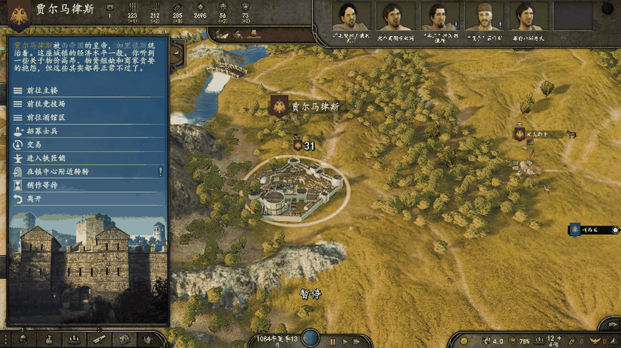

<div align="center">

# Chronicle Framework

**A language model plays the Mount & Blade II: Bannerlord campaign — through the game's own menus, dialogues, trades and battles.**

No scripted playbook. No injected commands. The model reads the same screens a player reads, and the Mod performs only the actions a player could perform.

[](https://github.com/c3115644151/chronicle-framework-agent/actions/workflows/docs-gate.yml)
[](https://github.com/c3115644151/chronicle-framework-agent/actions/workflows/agenthost-build.yml)



</div>

## What this is

Chronicle Framework is a Bannerlord Mod plus an external agent host. The Mod exposes a **bounded Native action surface** — every action is one the player could perform through the vanilla UI — and hands the current world observation to a model. The model chooses; the Mod executes inside the game process; the result of every executed action comes back as evidence.

The demonstration target is the original StoryMode quest **Establish Your Clan**: 2,000 denars, a party of 25, 50 renown, and one companion, starting from a fresh campaign, without the harness knowing the answer in advance.

## Status — read this before you install

This is a research project, not a finished mod. It is honest about where it stands.

| Area | State |
| --- | --- |
| Native action surface (menus, dialogues, trade, party, quests, map movement, battle hand-off) | Implemented, and tracked by the harness catalog that ARCHITECTURE.md describes |
| Model loop (OpenAI-compatible provider, structured output, bounded decision budget) | Working against real providers; single decisions and multi-decision slices verified in live campaigns |
| Establish Your Clan, end to end in one autonomous run | **Open milestone.** Increments are verified one at a time (tutorial skip, clan naming, banner, gold trading, recruitment, tournament); the uninterrupted closure is what is being worked on now |
| Cost control | Per-decision HTTP budget, token receipts, optional CNY ceiling for direct DeepSeek endpoints |

If you want a mod that simply plays the game for you today, this is not it yet. If you want to watch a model being held to the game's own rules, it is.

## How it works

Three pieces run at once:

1. **The game**, with the Mod loaded. It observes the vanilla state (for example MobileParty.MainParty and Hero.MainHero), and executes actions through the same handlers the UI uses.
2. **The agent host** — a standalone .NET 8 process that owns the model conversation, the action catalog, the decision budget and the receipts.
3. **The harness** — PowerShell 7 scripts that start a disposable campaign, drive the host, capture evidence and decide pass or fail. The harness never decides the campaign for the agent.

They talk over a file mailbox at %USERPROFILE%\Documents\Mount and Blade II Bannerlord\AgentRuns\ChronicleAgent:

- the Mod polls for command.json on the game's application tick and acts only when the live state still matches what the host saw;
- the host writes requests (world state, inquiry responses, checkpoint reads and writes, story-mode clan name, banner-editor completion) and reads the responses;
- every accepted decision and every executed action is appended to trace files, and the harness turns those traces into a verdict.

The full protocol, the action surface and the acceptance ladder are in [ARCHITECTURE.md](ARCHITECTURE.md).

## Requirements

- **Mount & Blade II: Bannerlord** 1.4.8, Steam build (the Mod targets the shipping client).
- **.NET SDK 8** or newer, including the netstandard2.0 targeting pack.
- **PowerShell 7** on PATH (pwsh). Windows PowerShell 5.1 is not supported.
- A model provider that speaks the OpenAI Chat Completions contract, and an API key in an environment variable.

## Build and install the Mod

```powershell
git clone https://github.com/c3115644151/chronicle-framework-agent.git
cd chronicle-framework-agent

# 1. Point the workspace at your game install (writes harness.local.json, gitignored)
./Dev/ChronicleFramework/harness/Initialize-ChronicleWorkspace.ps1 -GameRoot "D:\Program Files (x86)\Steam\steamapps\common\Mount & Blade II Bannerlord"

# 2. Build Mod and agent host
./Dev/ChronicleFramework/harness/Run-Harness.ps1 -Phase Build
```

The Mod project copies its output to the game's Modules\ChronicleFramework\bin\Win64_Shipping_Client\ChronicleFramework.dll together with SubModule.xml and ModuleData\global_strings.xml. Enable **Chronicle Framework** in the launcher's Mods list.

## Configure a model

Settings live in the Mod's in-game menu (MCM):

| Setting | Meaning |
| --- | --- |
| Base URL | OpenAI-compatible endpoint. https anywhere; plain http only for loopback |
| Model ID | Exact model identifier the endpoint serves |
| Structured output | auto, json_schema, json_object or required_tool_call — the host negotiates what the endpoint actually supports |
| Per-run CNY ceiling | Optional, direct DeepSeek endpoints only |

The API key is read from the environment of the process that starts the game; it is never written to the MCM settings, the command line or a log. It is passed only to the agent host child process the Mod owns.

## Run the harness

The harness is the only supported way to test. It creates a disposable campaign and never touches your saves.

```powershell
./Dev/ChronicleFramework/harness/Run-Harness.ps1 -Phase Docs        # documentation and contract gates, no game needed
./Dev/ChronicleFramework/harness/Run-Harness.ps1 -Phase Preflight   # environment, provider and workspace checks
./Dev/ChronicleFramework/harness/Run-Harness.ps1 -Phase Smoke       # start the game, load a campaign, verify the handshake
./Dev/ChronicleFramework/harness/Run-Harness.ps1 -Phase AgentLoop   # full host lifecycle against a disposable campaign
```

Every run writes a self-contained directory under Dev\ChronicleFramework\TestResults with a JSON receipt that says whether it passed and why. -Phase All exists, but it will happily spend hours and real tokens; start with Docs and Build.

## Repository layout

```
Dev/ChronicleFramework/
  mod/        the Bannerlord Mod (netstandard2.0) and its module/ manifest
  agenthost/  the .NET 8 agent host
  harness/    PowerShell 7 harness and gates
  docs/       contract documents, research notes, media
  tools/      API probe used to inspect Bannerlord assemblies
  openspec/   archived change specifications
  TestResults/ local evidence (gitignored)
```

docs\DEVELOPMENT.md is the contract: every observable behaviour the Mod may expose, and the acceptance rule for it. docs\MAINLINE.md holds mechanism facts and open unknowns. When code and document disagree, that is a bug, and -Phase Docs is what reports it.

## Design rules

- **The agent gets no script.** It sees observations, it picks from the declared action surface, and when it wants something the surface does not offer, the run stops.
- **Native only.** No direct state mutation for convenience: if a player cannot do it through a menu, a dialogue, a trade or a battle, the Mod does not do it either.
- **Every claim needs evidence.** A phase passes only if a receipt shows the game state changed as claimed; a command exiting zero is not evidence.
- **Bounded budgets.** Decisions per run, HTTP requests per decision and (optionally) money per run are capped before the first token is spent.

## License

Apache-2.0, see [LICENSE](LICENSE). Bannerlord, Mount & Blade and TaleWorlds are trademarks of TaleWorlds Entertainment; this repository contains no game binaries.
